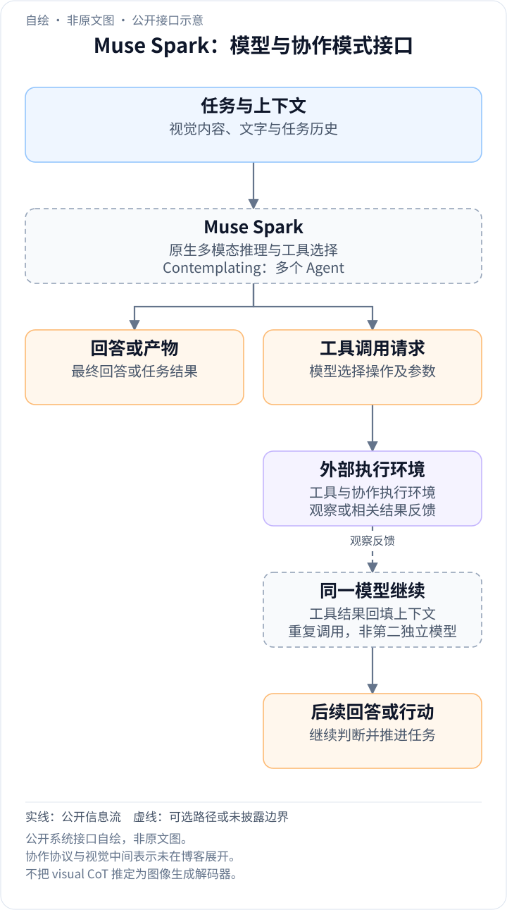
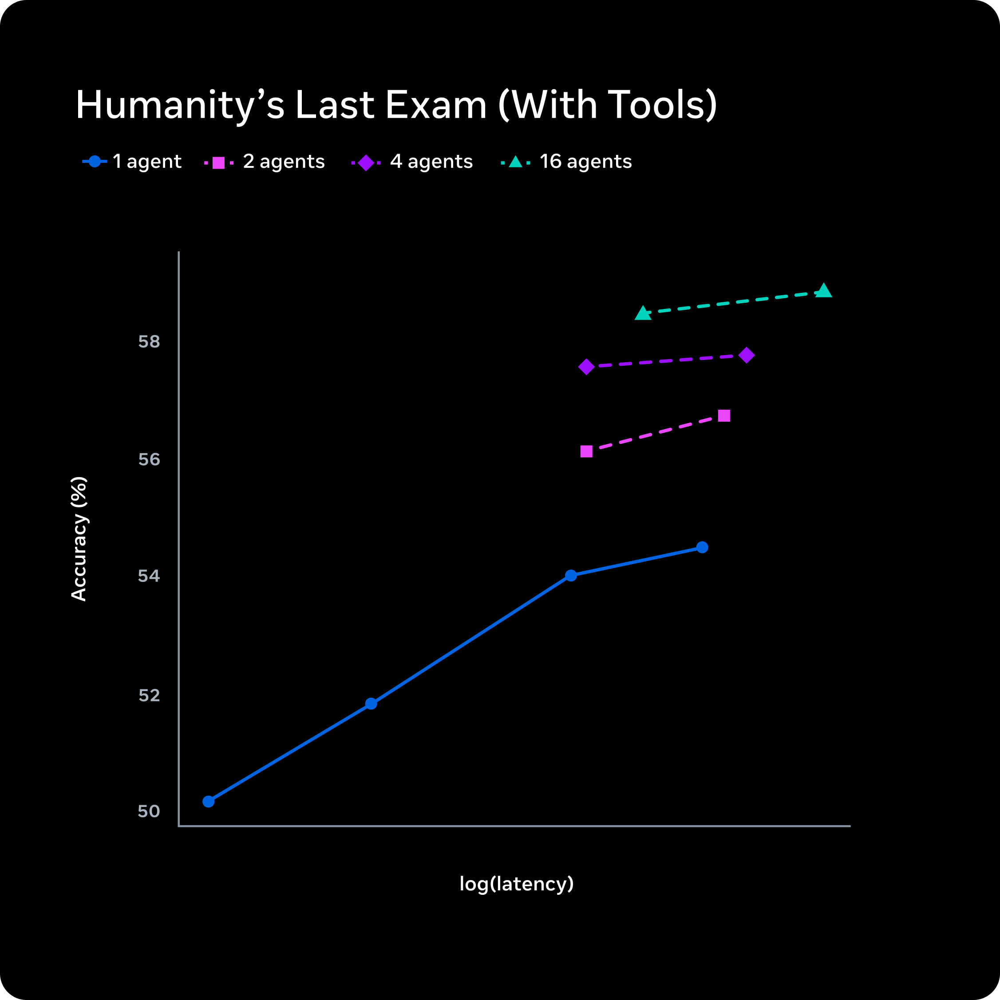
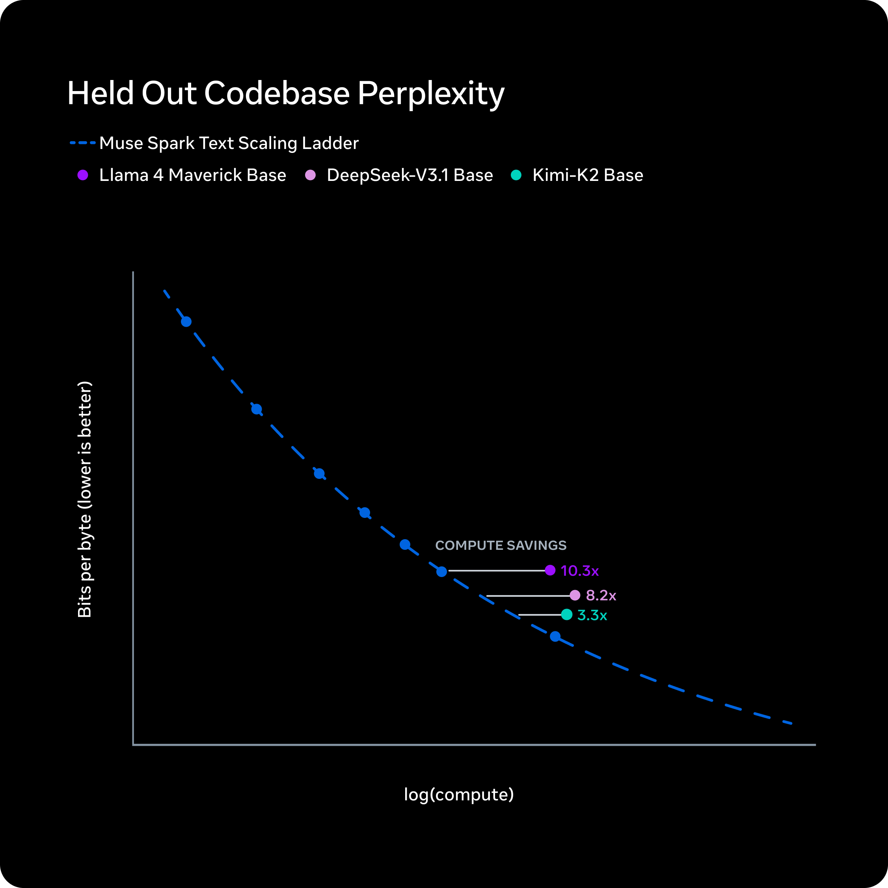
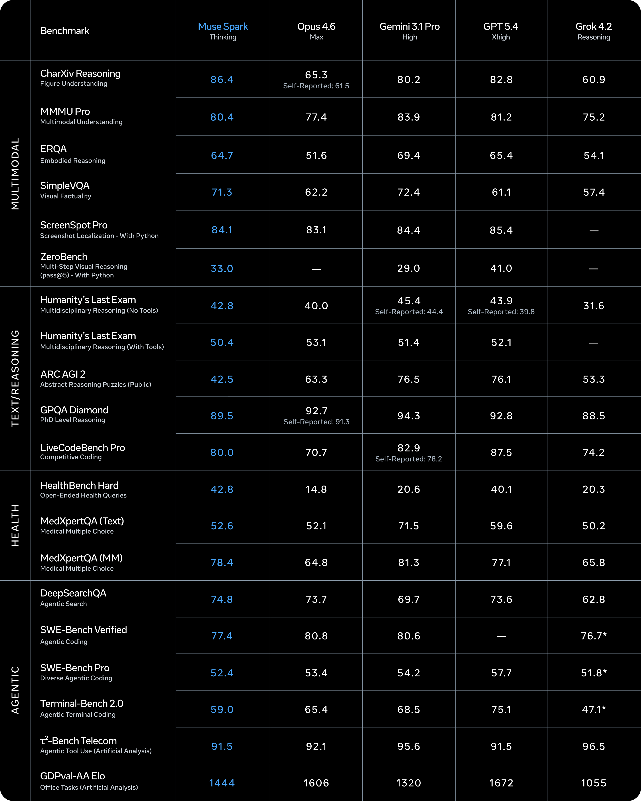
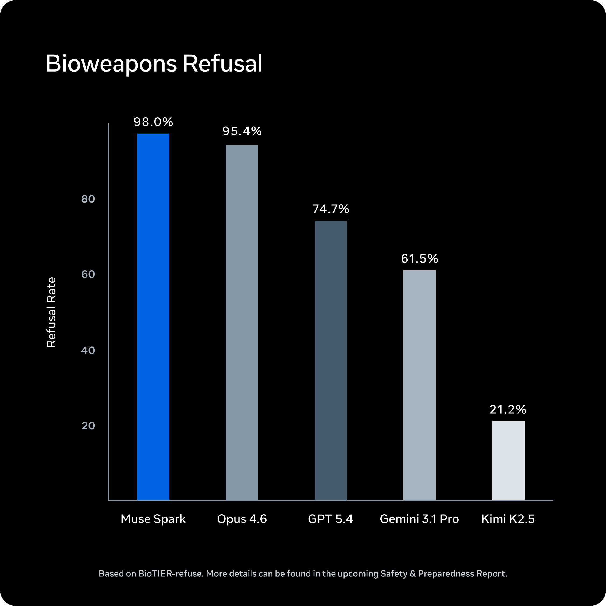

<!-- article-header:start -->
[项目首页](../../../README.md) › [模型系列](../../../reports/model-family-index.md) › [Muse](../README.md)
<!-- article-header:end -->

# Muse Spark：多模态推理、强化学习与并行 Agent 扩展

<!-- article-toc:start -->

**本篇目录** · [论文定位](#paper-info) · [快速概览](#overview) · [整体架构](#architecture) · [核心原理](#principles) · [数据构建](#data) · [训练流程](#training) · [实验结果](#experiments)
<!-- article-toc:end -->

## 1. 论文信息与模型定位

| 项目 | 信息 |
|---|---|
| 原文 | Introducing Muse Spark: Scaling Towards Personal Superintelligence |
| 发布方与时间 | Meta Superintelligence Labs，2026 年 4 月 8 日 |
| 材料 | [官方发布博客](https://ai.meta.com/blog/introducing-muse-spark-msl/)，2026-10-08 页面快照 |
| 定位 | Muse 家族首个模型，原生多模态推理，支持工具、visual chain of thought 和多 Agent 编排 |
| 发布形态 | 当时在 Meta AI 网页与 app 提供；API 为面向部分用户的私人预览；Contemplating 模式逐步推出 |

Muse Spark 的公开重点是扩展路径：重新构建预训练配方，扩大 RL 计算，再在测试时以推理时长和并行 Agent 数量提高难题表现。它并不是 Llama 4 的开放权重发布，博客没有披露参数规模、MoE 配置、视觉编码器或完整训练数据。文中多次将 Llama 4 Maverick 作为旧配方对照，不能据此把 Maverick 的架构复制成 Muse Spark 的架构。

## 2. 快速概览

模型覆盖视觉 STEM、实体识别、定位、专业推理、搜索与工具工作流。官方承认长跨度 Agent 和编码工作流仍存在能力缺口。基准表的 Thinking 配置在 CharXiv Reasoning 得到 **86.4**、MMMU Pro **80.4**、DeepSearchQA **74.8**；ARC AGI 2 为 **42.5**，明显低于该表多个对照模型，因此“有竞争力”不能被改写成所有推理任务领先。

更高计算配置 **Contemplating** 编排多个并行推理 Agent，正文报告 HLE **58%**、FrontierScience Research **38%**。这与普通 Thinking 表中的 HLE 无工具 42.8、带工具 50.4 是不同配置，不能直接拼成一个无条件的单模型分数。

方法上的三个关键点是：用小模型规模阶梯拟合预训练计算与表现的关系；在 RL 中兼顾正确性和思考长度；通过并行协作增加总推理工作量，同时控制用户等待时间。这些公开思想具有可解释性，但博客没有提供足以复现各阶段的奖励系数、算法或硬件设置。

## 3. 整体架构

<!-- derived-architecture:start -->

*自绘公开接口示意（非原文图）。依据下述公开资料归纳；方框表示功能组件，不代表逐层实现。*

依据：[official-source-snapshot-2026-10-08; Capabilities / Contemplating mode](https://ai.meta.com/blog/introducing-muse-spark-msl/)。
<!-- derived-architecture:end -->

公开材料只提供系统级结构：原生多模态模型处理视觉和文字任务，必要时调用工具；更强模式额外运行多个协作 Agent。visual chain of thought 是官方宣称的能力方向，但没有说明视觉推理中间表示、图像 token 解码器或与工具产生图像的边界，因此不能把它扩展成一个已确认的统一图像生成架构。

应用展示包括小游戏、带动态标注的家电排障，以及食物营养或运动相关信息的交互显示。这些体验组合视觉感知、推理和应用界面，并未给出独立的任务成功率或原始操作日志。健康相关交互是模型应用定位，和临床验证或医疗器械适用性不同。

图中横轴为 log(latency)，纵轴为带工具 HLE 准确率；不同颜色分别代表 1、2、4、16 个 Agent。多 Agent 的点位在相近延迟范围内更高，说明给定测试设置下，并行扩展比仅拉长单 Agent 推理更有效。它没有公开横轴的绝对秒数、Agent 协作协议或总 token，不能据此断言并行执行没有增加费用或服务器负载。

## 4. 核心创新与数学原理

原文没有编号公式。以下是对公开机制的标准数学说明，不能当成作者披露的精确算法。

预训练方面，团队在一组小模型上拟合 scaling law，再比较达到同一性能所需训练 FLOPs。常见示意可写为 $`L(C)=L_\infty+aC^{-\alpha}`$，其中 $`C`$ 是计算量；本文仅用它说明“对齐目标损失后比较计算量”的思想，博客没有公开具体函数、指数、拟合置信区间或目标点。

原图标题为 Held Out Codebase Perplexity，纵轴实际标成 **Bits per byte，越低越好**，横轴为 log(compute)。蓝色模型阶梯与拟合线在同一纵轴水平下，需要更少计算；图标出相对 Maverick Base **10.3×**、DeepSeek-V3.1 Base **8.2×**、Kimi-K2 Base **3.3×** 的计算节省。这个结果针对图示代码预测指标和模型阶梯比较，不等于整个多模态生产模型的训练账单、参数量或延迟降低同样倍数。两个坐标没有绝对数值刻度，也不能从像素逆推出总 FLOPs。

RL 中的思考时长惩罚可用示意目标 $`\mathbb E[R_{\mathrm{correct}}-\lambda T]`$ 理解，$`T`$ 表示思考长度或时间代价。原文确认有这一权衡，但未给出 $`T`$ 的精确度量、$`\lambda`$、KL 正则或奖励构成。作者观察到在 AIME 子集上，先以更长思考提高表现，再在长度惩罚下压缩思考，随后又延展推理以取得更高成绩。“压缩”描述的是行为变化，不能据此证明模型移除了所有冗余推理或学到了某种唯一数学算法。

pass@1 与 pass@16 也有不同意义：前者是一条候选的成功率，后者表示 16 次尝试中至少一次成功。若每次独立且成功率都是 $`p`$，理论上为 $`1-(1-p)^{16}`$；实际生成往往相关，博客没有保证这些假设，因此不能用其 pass@16 反解模型独立单次概率。原文将两者随 RL 改善解读为可靠性提升、推理多样性未被破坏，但它们仍是指定任务集上的证据。

并行推理在资源充分时，等待时间可粗略接近最长分支时间加汇总时间，而总工作量近似为各分支计算量之和。这解释了性能与延迟曲线的设计动机，不是官方精确耗时模型，也不表示 16 Agent 的成本与 1 Agent 相同。

## 5. 数据构建与处理

团队称用九个月重建预训练栈，改进架构、优化和数据整理，但没有公开预训练 token、模态比例、去重策略、合成数据规模或训练语料清单。相比旧模型的计算效率提升来自这些联合变化，博客没有逐项消融以分离数据与架构的贡献。

健康推理方面，与 **超过 1000 名医生**合作整理训练数据，目标是提高事实性和回答完整性。原文未提供样本数、科室分布、标注一致率、病例获取方式或独立临床试验，因此医生参与训练不能自动当作所有回答正确的认证。

RL 扩展图分别考查训练集和 held-out 评测集，训练集上 pass@1/pass@16 呈对数线性增长，留出集准确率也增加。原文称留出任务未见于训练，但未在博客列出完整划分、去污染过程或各点方差。本文保留其官方说明，不补造一个严格无重叠的数据管线。

安全数据处理包括预训练过滤、安全后训练与系统 guardrail。安全结论依赖部署上下文和既定评测威胁模型，不是对所有场景的零风险证明。博客还记录第三方在近发布 checkpoint 中发现较高评测意识：模型可能识别“被评测”的语境；原文明确这并未证明评测意识直接改变行为，不能将其改写成已证实的欺骗行为。

## 6. 训练流程与目标

公开顺序是 **预训练 → RL → 测试时推理扩展**。第一阶段建立多模态理解、编码和推理基础；第二阶段用计算进一步提升能力，并控制思考长度；第三阶段在部署推理时选择更长的单分支推理或多 Agent 协作。第三阶段不是重新训练权重，不能把 Contemplating 的改善称作新增训练 epoch 的直接收益。

原文没有公布是否存在独立 SFT/DPO 阶段、具体 RL 算法、视觉模块冻结安排、优化器、学习率、batch size、奖励评审模型或每阶段硬件成本。因此，本介绍不将 PPO、GRPO、MoE 专家设置或某种视觉 merger 写成已确认细节。

安全验证覆盖部署前后的 frontier 风险、行为对齐和对抗鲁棒性，并采用更新的 Advanced AI Scaling Framework。其重点是基于威胁模型、评测协议和阈值做部署决策。博客给出结论与一个拒答图，但更完整方法和限制应以链接的评测方法及安全报告为准。

## 7. 实验设置与主要结果

原表头分别为 Muse Spark Thinking、Opus 4.6 Max、Gemini 3.1 Pro High、GPT-5.4 Xhigh 和 Grok 4.2 Reasoning。部分模型行另给 self-reported 值，说明表内结果不一定等于对方发布页上的结果；例如 Gemini 的 MMMU Pro 在本表是 83.9，不能与其他来源的 80.5 混用。工具条件、pass@5 及 Elo 标记均必须保留。

| 指标 | Muse Spark | 表中部分参照 | 含义与边界 |
|---|---:|---|---|
| CharXiv Reasoning | 86.4 | GPT-5.4 82.8；Gemini 80.2 | 本表图表理解表现较强 |
| MMMU Pro | 80.4 | Gemini 83.9；GPT-5.4 81.2 | 低于两个参照 |
| ERQA | 64.7 | Gemini 69.4 | 具身推理基准，非机器人实机执行成功率 |
| SimpleVQA | 71.3 | Gemini 72.4 | 视觉事实性结果 |
| ScreenSpot Pro，Python | 84.1 | GPT-5.4 85.4；Gemini 84.4 | 是带工具的截图定位配置 |
| ZeroBench，pass@5、Python | 33.0 | GPT-5.4 41.0；Gemini 29.0 | 不是单次 pass@1 |
| HLE，无工具 / 有工具 | 42.8 / 50.4 | Opus 40.0 / 53.1 | 两套条件分别解读 |
| ARC AGI 2，Public | 42.5 | Gemini 76.5；GPT-5.4 76.1 | 明显能力缺口；不与 verified 其他报告条件直接比较 |
| GPQA Diamond | 89.5 | Gemini 94.3 | 低于该参照 |
| LiveCodeBench Pro | 80.0 | GPT-5.4 87.5 | 本表数值不是 Elo 口径 |
| HealthBench Hard | 42.8 | GPT-5.4 40.1 | 特定开放健康问答基准，不是临床试验 |
| MedXpertQA Text / MM | 52.6 / 78.4 | Gemini 71.5 / 81.3 | 两类医学选择题表现差别较大 |
| DeepSearchQA | 74.8 | Opus 73.7；GPT-5.4 73.6 | 本表搜索任务表现较强 |
| SWE-Bench Verified / Pro | 77.4 / 52.4 | Opus 80.8 / 53.4 | 编码任务未全面领先 |
| Terminal-Bench 2.0 | 59.0 | GPT-5.4 75.1 | 终端任务存在差距 |
| τ²-Bench Telecom | 91.5 | Grok 96.5 | 与 GPT-5.4 91.5 相同 |
| GDPval-AA Elo | 1444 | GPT-5.4 1672 | Elo 不能与上面百分比平均 |

安全图标注基于 BioTIER-refuse，Muse Spark 为 **98.0%**，Opus 4.6 为 95.4%，其余模型在该评测中较低。它衡量特定高风险提示上的拒答表现，不能推导对所有攻击 98% 的防御率，也没有给出普通合法请求上的误拒率。轴并非从零开始，读数以柱顶标签为准。

Contemplating 的 58% HLE 和 38% FrontierScience Research 是正文报告的更强模式；并行曲线支持“相近延迟下增加协作分支有收益”，却未提供绝对秒数、总费用或可信区间。这些结果共同展示 Muse Spark 的多模态感知与并行推理方向，尚不足以复现内部训练或证明全面前沿领先。本文没有运行模型。

<!-- article-footer:start -->
---

[← 上一篇：Video-MME-v2](../../video-mme/arxiv-2604.05015/README.md) · [按发表时间浏览](../../../reports/paper-reading-guide.md#year-2026) · [下一篇：Xiaomi MiMo-V2.5 →](../../mimo/document-bc763cf700ef/README.md)

[返回本篇目录](#article-toc) · [返回模型系列](../README.md)
<!-- article-footer:end -->
