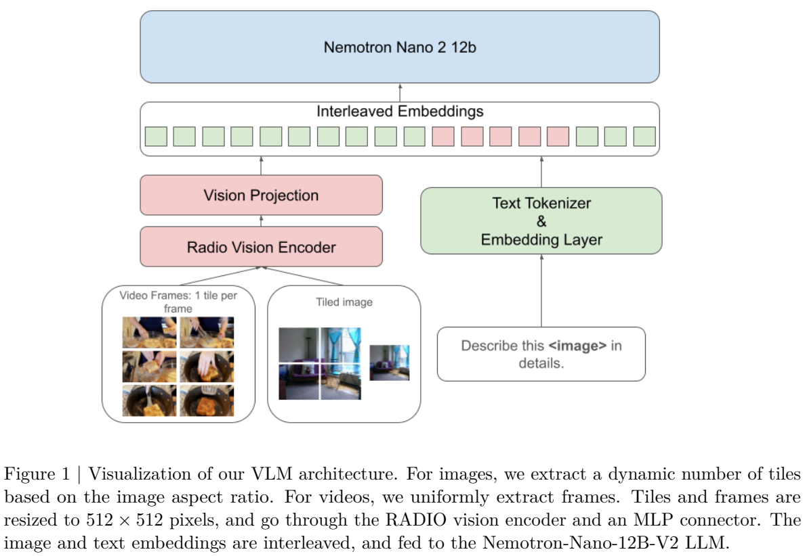
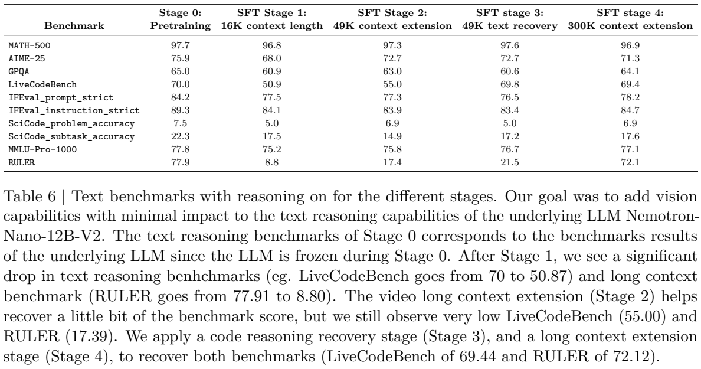
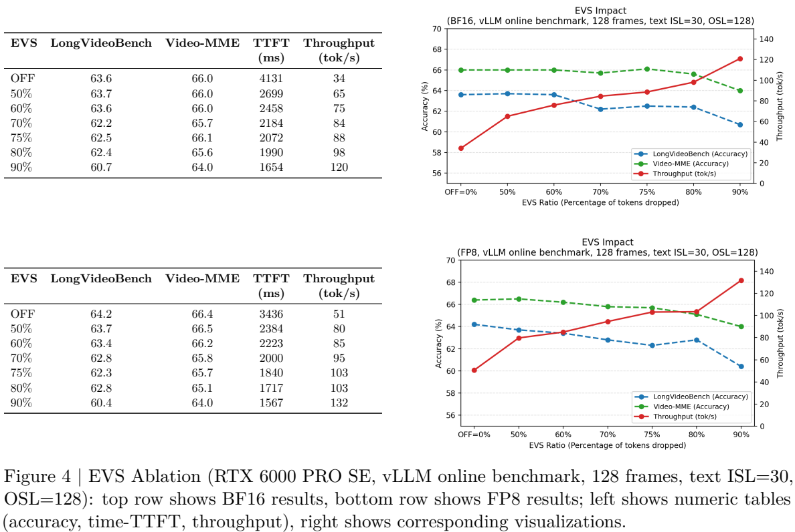

<!-- article-header:start -->
[项目首页](../../../README.md) › [模型系列](../../../reports/model-family-index.md) › [Nemotron](../README.md)
<!-- article-header:end -->

# Nemotron Nano V2 VL：动态切图、能力恢复与高效长视频理解

> 解读 NVIDIA 的 **NVIDIA Nemotron Nano V2 VL**，固定采用 arXiv **2511.03929v1**。首次提交为 2025-11-06，PDF 首页另印 2025-11-07；下文的训练、量化与实验均对应此版本。

<!-- article-toc:start -->

**本篇目录** · [论文定位](#paper-info) · [快速概览](#overview) · [整体架构](#architecture) · [核心原理](#principles) · [数据构建](#data) · [训练流程](#training) · [实验结果](#experiments)
<!-- article-toc:end -->

## 1. 论文信息与模型定位

| 项目 | 内容 |
|---|---|
| 团队与系列 | NVIDIA；Nemotron 视觉语言系列 |
| 规模与组件 | 报告称 12B VLM；语言底座为 Nemotron-Nano-12B-V2，另接 RADIO 视觉编码器与 MLP |
| 输入输出 | 文字、图像、多页文档与视频帧输入；文字回答及结构化文字输出 |
| 语言骨干 | 混合 Mamba–Transformer，区别于前代 Llama-3.1 语言主干 |
| 上下文口径 | 发布定位为 128K；最后训练阶段最大序列为 311,296 token，二者不是同一个部署承诺 |
| 开放情况 | 发布 BF16、FP8、NVFP4-QAD 权重，以及超过 8M 样本的数据集子集和部分训练代码 |
| 官方资料 | [固定报告](https://arxiv.org/pdf/2511.03929v1) · [BF16 模型](https://huggingface.co/nvidia/NVIDIA-Nemotron-Nano-12B-v2-VL-BF16) · [训练框架](https://github.com/NVIDIA/Megatron-LM) |

这篇报告的重点是把文档、视频和推理能力加入语言底座，同时减少文本能力遗忘与长视觉输入的推理成本。公开资料足以解释视觉输入路径和训练课程，但本文不据混合骨干名称猜测 Mamba/Attention 层数比例、状态维度或全部激活参数。[§1–3，PDF 第1–6页](https://arxiv.org/pdf/2511.03929v1#page=2)

## 2. 快速概览

图片按照长宽比动态切成 512×512 图块，并补充全局缩略图；每块先产生 1,024 个 patch 表示，再经二维下采样压成 256 个视觉 token。它们通过 MLP 映射后与文字嵌入交错，输入混合语言主干。视频采用每帧单块，避免把每一帧都展开为多个高分辨率视图。

训练不是一次视觉 SFT 后立即结束。连接器预热后，模型经历 16K 多模态 SFT、49K 视频/多图扩展、纯代码推理恢复和更长序列扩展。后两步直接针对实验中出现的 LiveCodeBench 与 RULER 回退，因此“加入视觉后维持语言能力”是通过额外训练检验和恢复的结果，不是架构自动保证。

推理时支持 reasoning-on/off，并使用 EVS 剔除相邻帧中近乎不变的视觉位置。开启思考对 STEM 题目有明显帮助，却可能降低 OCR、定位或视频任务表现；EVS 则以少量精度取舍换取更低 TTFT 与更高吞吐。两种开关解决不同瓶颈，不能用一组最高分代表所有部署配置。

## 3. 整体架构

*原文 Figure 1，PDF 第2页。图片动态切块、视频逐帧单块，经 RADIO 和连接器进入交错序列；图中没有展开混合语言骨干的逐层结构。*

| 模块 | 输入与输出 | 公开机制 |
|---|---|---|
| 图像视图构建 | 原图 → 512×512 图块及全局缩略图 | 匹配长宽比后切成非重叠块，训练最多12个局部块，另加单块缩略图 |
| 视频帧组织 | 视频 → 有序单块帧序列 | 训练每秒2帧、最多128帧；超过64秒时均匀取128帧，每帧不再多块切分 |
| RADIO 视觉编码器 | 图块/帧 → 1,024个 patch 表示 | §2 指定 c-RADIOv2-VLM-H 初始化，patch16、输入边长512 |
| 视觉压缩与 MLP | 空间特征 → 256个语言条件向量/块 | 2倍空间下采样的 pixel shuffle，视觉序列长度变为四分之一，再用 MLP 连接 |
| 文字嵌入与序列融合 | 文字、图像表示 → 交错上下文 | 文本 tokenizer/embedding 与视觉投影共同组成语言模型输入 |
| Nemotron-Nano-12B-V2 | 多模态上下文 → 回答文字 | 混合 Mamba–Transformer 语言底座，支持思考开/关；本报告未逐层列网络配置 |
| 可选 EVS | 视频视觉表示 → 保留动态证据的较短序列 | 推理时裁掉时间上近乎静止的 patch，保留位置身份，无需重新训练 |

一次多页文档问答先为每页建立局部块和缩略图，计算投影表示，再与问题和页序上下文一起进入语言主干。缩略图负责提供整页关系，局部块保留文字细节；二者不是两个互相独立的模型。若有 $`m`$ 个局部块，按公开表示数可估算视觉输入为 $`256(m+1)`$ 个向量；这是每幅图片的表示预算，不包含文字或格式 token，视频单帧也不额外套用该缩略图公式。[§2–3.6，PDF 第2–6页](https://arxiv.org/pdf/2511.03929v1#page=3)

## 4. 核心创新与数学原理

### 4.1 动态切图与空间压缩：先保留细节，再控制语言序列

512边长、patch16产生 $`(512/16)^2=1024`$ 个视觉位置。2倍二维下采样将网格两条轴各缩一半，位置数因此变为256，而不是只减半。Pixel shuffle 重排空间与通道信息，MLP负责跨到语言输入空间；本文不将该操作等同于删除四分之三的原始像素，或声称压缩完全无损。

切图还改变了模型实际看到的尺度。§4.5 对比整图原生分辨率加卷积压缩，发现部分任务接近或更好，但 OCRBench 与英文 OCRBench-V2下降。把整图先缩放到切图算法选定的尺寸，可恢复前者，却未恢复后者。该消融只训练到 Stage1、去掉纯文本推理数据，并从最后10个 checkpoint 选平均分最高者，不能当作最终发布模型的完整替代实验。[§2、§4.5、Table7，第3、12–13页](https://arxiv.org/pdf/2511.03929v1#page=13)

### 4.2 代码与长上下文恢复：针对不同遗忘分别补训练

多模态 Stage1 后，LiveCodeBench 从70.0降到50.9，RULER从77.9降到8.8。即使训练已经混入原语言底座的文本推理数据，能力仍可能下降；作者尝试增加代码数据或关闭 loss scaling，未获得理想结果，最终另设恢复阶段。

Stage3 仅用约1M代码推理样本、15B token，使 LiveCodeBench 从Stage2的55.0恢复到69.8；Stage4再用平均约160K的长文本样本，使 RULER 从21.5恢复到72.1。视觉Table4的大部分成绩同时保持稳定。两种恢复分别对准代码轨迹与长上下文，但最终AIME为71.3、低于原底座75.9，不能概括为文本能力全部完全恢复。[§3.4–3.5、§4.2、Table6，第5、9–11页](https://arxiv.org/pdf/2511.03929v1#page=10)

*Table6，PDF第10页。Stage0语言模型冻结，因此该列反映原语言底座；不同任务的运行次数和评测口径见第7节。*

### 4.3 思考预算：限制过长轨迹不等于统一增加能力

作者对2K、4K、8K、12K思考预算设置500-token宽限期，并与关闭思考、最大生成16,384的开放思考比较。预算控制可以在某些任务上改善结果；报告推测它可能提前结束重复循环或截断没有必要的冗长思考，但没有把这一解释证明为唯一原因。

Table3 中 MMMU 从55.3升至67.8，MathVision从31.5升至53.6；相反，OCRBench从85.6降至83.5，Video-MME从66.0降至63.0。它说明任务所需计算不同，思考长度并非可靠性单调增加的保证。预算、采样温度和最终答案长度均影响结果，应先固定评测模式再比较模型。[§4.1、§4.3、Figure3，第7–8、11–12页](https://arxiv.org/pdf/2511.03929v1#page=11)

### 4.4 EVS：删除时间冗余，而非简单少抽视频帧

EVS在已经形成的视频视觉表示中识别相邻帧近乎不变的空间区域，删掉重复patch，同时维持位置身份与语义一致性。它针对的是时间上的冗余，区别于把128帧改为更少帧的均匀采样；报告没有公布本模型所用的完整相似度阈值或逐步实现，不在此补造算法。

*Figure4，PDF第12页。上排BF16、下排FP8；硬件RTX6000 PRO SE，vLLM在线测试，128帧、文字ISL30、OSL128。*

BF16下，EVS60%保持LongVideoBench63.6与Video-MME66.0，TTFT从4,131ms降至2,458ms，吞吐从34增至75 token/s，约2.21倍。90%则提高至120 token/s，但两项精度降到60.7/64.0。由此可以选择速度与精度的工作点，不能把“2倍以上”扩展成所有设备、帧数与精度格式的固定收益；FP8同档也有自己的基线。[§4.4、Figure4，第12页](https://arxiv.org/pdf/2511.03929v1#page=12)

### 4.5 FP8训练与QAD：区分训练量化、部署校准和恢复

训练采用 delayed-scaling FP8，缩放因子根据历史激活最大值更新；部署框架通常使用一次校准后固定的缩放。因此“FP8训练过”并不意味着训练时权重可直接作为任意推理框架的静态低精度格式。

作者用1,024个训练样本校准权重和激活。NVFP4 PTQ出现部分下降后，再由BF16教师对PTQ学生做最终输出logit匹配的QAD，学习率为 $`2\times10^{-6}`$，并在BF16中模拟低精度行为。主要量化语言骨干线性层，embedding、KV等保留较高精度。

Table8的DocVQA-val由NVFP4-PTQ92.38恢复到QAD93.95，仍略低于BF1694.22；OCRBench则从863变为851。因此QAD改善部分质量，不是每项都提高。此表OCRBench采用原始分数，不能与Table3的百分制85.6直接混记；报告也注明运行框架会带来小幅差异。[§4.6、Table8，第13–14页](https://arxiv.org/pdf/2511.03929v1#page=14)

## 5. 数据构建与处理

| 数据用途 | 来源与构建 | 公开规模及边界 |
|---|---|---|
| 连接器预热 | 从Stage1抽取caption、VQA、grounding、OCR与文档任务 | 约2.2M样本，最多36B token |
| 综合SFT | 纯文本推理及图像、OCR、图表、GUI、视频等多任务 | 约32.5M样本、112.5B token；约6.5M为纯文本 |
| 视频/多图扩展 | 分类、时序定位、描述、多页QA、跨图描述转成QA | Stage2约11M样本、55B token；包含Stage1约25%复用及新数据 |
| OCR合成 | NVPDFTex从LaTeX生成带标注资料，结合公开文档/表格及多语言资料 | 未公开全部来源的最终采样比例 |
| 推理与QA补全 | 人工轨迹及Qwen2.5-VL、GLM生成轨迹；Qwen系列从OCR或caption构造QA | 合成教师的输出仍可能有误，非全部人工核验 |
| 后续恢复 | 约1M代码推理样本；约74K长上下文样本 | 分别约15B与12B token，不是新增图像数 |

公开视频按时间采样，非QA标签通过任务模板或LLM转换成问答；多页文档QA也利用解析工具的抽取结果。公布的超过8M样本是释放子集，不是全部32.5M或所有阶段数据。各阶段有复用，不能简单加总为独立样本数或推算统一epoch。[§3.1–3.5，第3–5页](https://arxiv.org/pdf/2511.03929v1#page=4)

## 6. 训练流程与目标

| 阶段 | 上下文/训练量 | 可训练部分与目的 |
|---|---|---|
| Stage0 | 16,384；约36B token | 视觉和语言冻结，仅训练MLP连接器 |
| Stage1 | 16,384；约112.5B | 解冻全部组件，综合视觉与文本SFT |
| Stage2 | 49,152；约55B | 视频/多图扩展，混入旧数据维持原能力 |
| Stage3 | 49,152；约15B | 仅代码推理数据恢复文本能力；无图像时不产生视觉任务监督 |
| Stage4 | 最大311,296；约12B | 长上下文恢复；不能直接等同于服务端开放300K窗口 |

优化器为AdamW，$`\beta_1=0.9,\beta_2=0.999`$，线性预热与余弦调度；在线balance-aware packing减少padding，loss square-averaging缓和不同长度样本的权重偏差。本文不由该名称推定完整损失归一化实现。

长阶段采用context parallelism：Stage2–3为2路、Stage4为8路，按序列分割语言输入；视觉编码与投影副本按batch分片，汇集后送入语言主干。这是训练并行方式，区别于模型内部多专家路由。训练使用H100、Megatron与Transformer Engine，保留LLM首末层及视觉Transformer块的BF16计算；报告是混合精度训练，并非每个算子都FP8。[§3.6、Tables1–2，第5–6页](https://arxiv.org/pdf/2511.03929v1#page=6)

## 7. 实验设置与主要结果

视觉评测采用VLMEvalKit及vLLM。关闭思考时贪心解码、通常最大输出1,024，RDTableBench为16,384；开启时温度0.6、top-p0.95、最大16,384。下表使用Table3同模型两种模式，避免跨设置拼出单一综合分。

| 基准 | 思考关闭 | 思考开启 | 解读 |
|---|---:|---:|---|
| MMMU val | 55.3 | 67.8 | 多学科视觉推理受益 |
| MathVista-Mini | 69.0 | 75.5 | 图像数学任务提高 |
| DocVQA test | 94.7 | 93.2 | 文档读取未随思考提高 |
| ChartQA test | 89.8 | 84.9 | 需保留这一回退 |
| Video-MME，无字幕 | 66.0 | 63.0 | 视频理解与长推理不同 |
| ScreenSpot-Pro | 4.8 | 5.5 | 仍远低于表内Qwen3-VL-Instruct54.6 |

纯文本评测使用NeMo-Skills、最大32,768输出，温度0.6、top-p0.95；AIME取16次pass@1平均，MATH/GPQA/LiveCodeBench/IFEval平均4次，RULER等为1次，MMLU-Pro只取1,000题子集。训练阶段表中的DocVQA为val，而主要对比表为test，不能替换。[§4.1–4.2、Tables3–6，第7–10页](https://arxiv.org/pdf/2511.03929v1#page=9)

效率结论也各有条件：报告称相对前代多页文档吞吐提高35%，但其语言底座、数据和训练配方同时变化，不能把差异全部归因于Mamba；EVS的定量配置则在Figure4单独给出。模型在文档、视频和部分推理任务上有明确进步，仍存在GUI定位、跨图推理和思考模式取舍，未证明所有视觉任务或全部文本能力都优于同规模对照。

<!-- article-footer:start -->
---

[← 上一篇：Emu3.5](../../emu/arxiv-2510.26583/README.md) · [按发表时间浏览](../../../reports/paper-reading-guide.md#year-2025) · [下一篇：Gemini 3 Pro →](../../gemini/document-fd75097b0235/README.md)

[返回本篇目录](#article-toc) · [返回模型系列](../README.md)
<!-- article-footer:end -->
