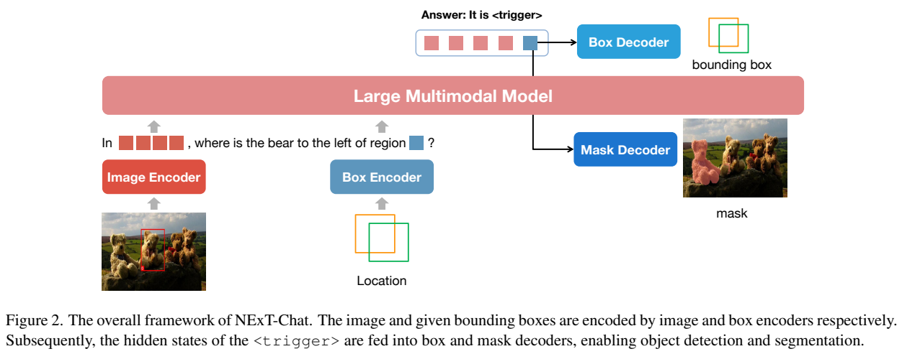
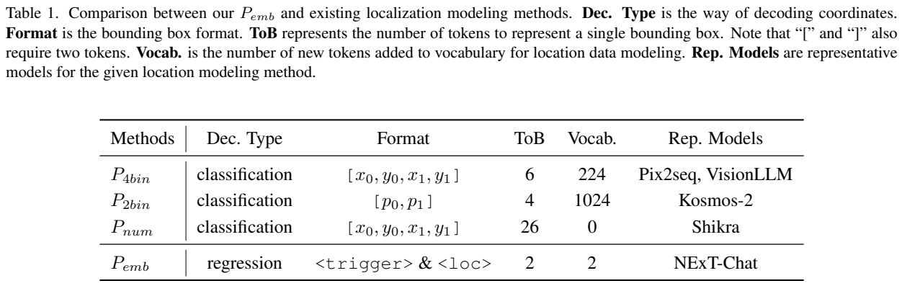
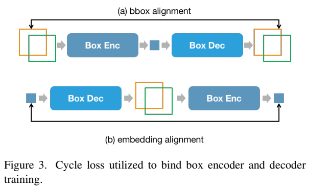
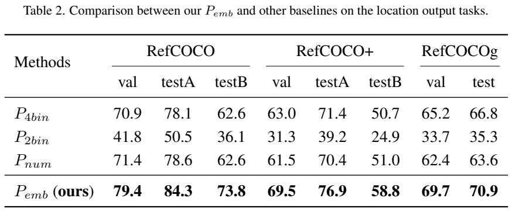
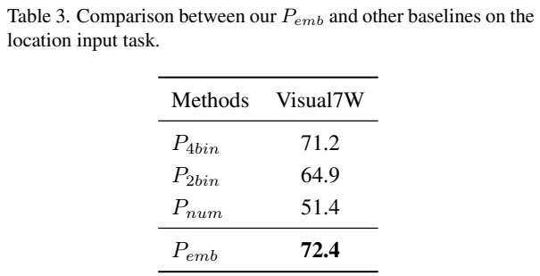
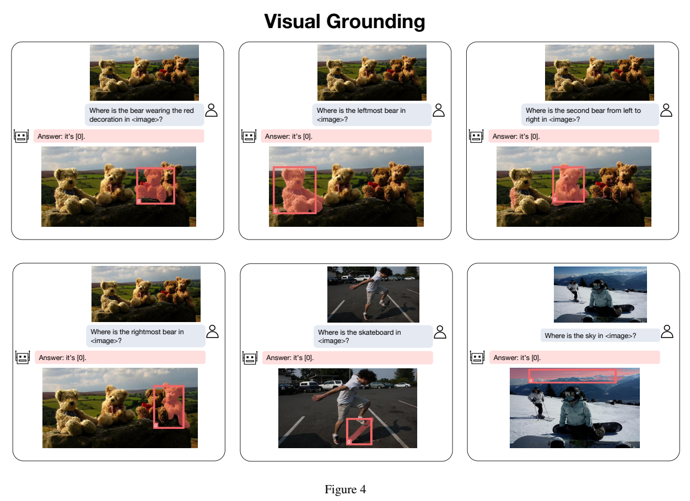
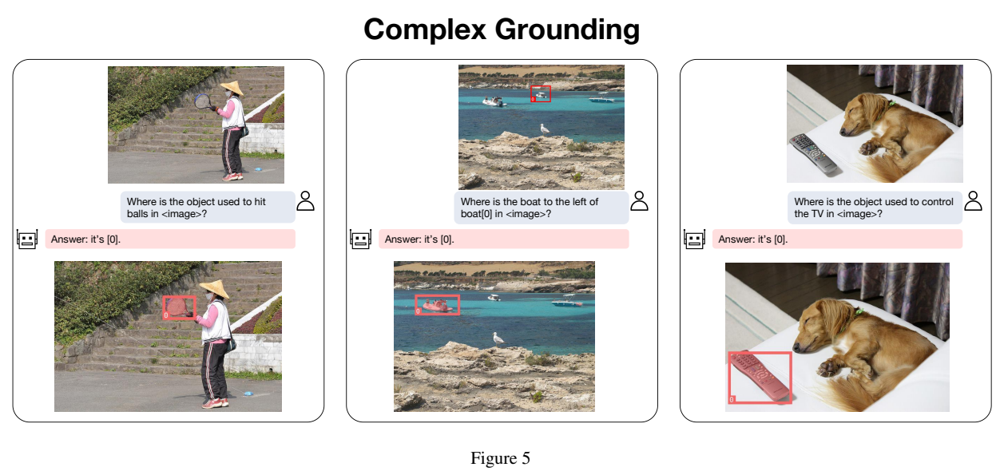

<!-- article-header:start -->
[项目首页](../../../README.md) › [模型系列](../../../reports/model-family-index.md) › [NExT-Chat](../README.md)
<!-- article-header:end -->

# NExT-Chat：以位置嵌入统一对话、框定位与分割

<!-- article-toc:start -->
<a id="article-toc"></a>

**本篇目录** · [论文定位](#paper-info) · [快速概览](#overview) · [整体架构](#architecture) · [核心原理](#principles) · [数据构建](#data) · [训练流程](#training) · [实验结果](#experiments)
<!-- article-toc:end -->

<a id="paper-info"></a>

## 1. 论文信息与模型定位

论文为 **NExT-Chat: An LMM for Chat, Detection and Segmentation**，由新加坡国立大学与阿里巴巴的 Ao Zhang、Liming Zhao、Chen-Wei Xie、Yun Zheng、Wei Ji、Tat-Seng Chua 提出。本介绍依据 **arXiv 2311.04498v1，2023 年 11 月 8 日**，共 13 页。[固定版本 PDF](https://arxiv.org/pdf/2311.04498v1)；[官方项目页](https://next-chatv.github.io/)。

模型以 LLaMA-2-Chat 7B/13B 为语言底座，在图文对话中既接收区域框，又输出文字、框和分割掩码。核心方法 **pixel2emb** 把空间位置表示为连续嵌入，再由专门的解码器输出几何结果；它不同于把四个坐标写成长串文字的 pixel2seq。

这里的“检测”主要服务于语言指代和对话定位，不应仅凭标题认定已经给出完整开放词汇检测 mAP 榜单。本版定量实验重点是受控定位表征对照、Visual7W 区域问答和 POPE，分割主要展示定性例子。

<a id="overview"></a>

## 2. 快速概览

模型新增两个 token：**`<trigger>`** 触发位置解码，**`<loc>`** 放入区域位置嵌入。一个 trigger 的隐藏状态可通过两层 MLP 得到框，也可映射到 SAM 的提示空间得到掩码；已知或预测框再经位置编码器转成可供语言模型引用的嵌入。

框编码器与解码器增加双向循环约束：框编码后应能还原，预测位置嵌入解码成框后也应能回到相近嵌入。这样位置输入不只依靠间接文字监督。

控制实验中 RefCOCO validation 为 **79.4**，数字文字方案为 **71.4**；Visual7W 为 **72.4**，四坐标离散方案 **71.2**。这些是同预算实验下的表征比较，不能直接理解为压倒全部已发表完整系统。

<a id="architecture"></a>

## 3. 整体架构



**Figure 2，PDF 第 3 页** 左边图像由 image encoder 编码，输入区域由 box encoder 编码；语言模型根据图片、区域和问题生成文字。当它输出 `<trigger>`，该位置的隐藏状态送入 box decoder 与 mask decoder。读图时应区分蓝色的区域接口和红色视觉/语言主干，位置不是由输出文本中的数字再用正则表达式解析。

视觉侧采用 **CLIP ViT-L/14**，输入 **224×224**，形成 **16×16 视觉 patch 嵌入网格**，投影到语言词嵌入维度后进入 decoder-only LLM。语言底座为 **LLaMA-2-7B-Chat 或 13B-Chat**。

框编码器和框解码器均为**两层 MLP**。分割使用 SAM，trigger 隐藏状态经**线性投影**变成 SAM 的提示嵌入；同时把预测框经 SAM prompt encoder 编码，再与文本衍生提示拼接，结合原图产生掩码。它不是语言模型逐像素生成掩码文本，而是语言语义触发专门分割解码。

输入的不同位置格式统一转成框再编码。因此它能够输出精细掩码，不表示输入接口保留任意掩码的全部不规则形状。224 分辨率也会限制小字和小目标感知，论文明确将其列为限制。

| 模块 | 输入与输出 | 公开机制 |
|---|---|---|
| CLIP与投影 | 图像 → 256视觉嵌入 | 16×16网格投影至语言维度，视觉感知路径继承LLaVA式设计。 |
| Box Encoder | 输入框 → 单位置嵌入 | 两层MLP将位置编码到LLM空间，其他位置格式先转框。 |
| LLaMA-2-Chat | 图像、位置、问题 → 文本及trigger状态 | 7B/13B主干生成语义条件，不以数字字符串承担框输出。 |
| Box Decoder | trigger隐状态 → 四坐标 | 两层MLP连续回归，以L1与GIoU监督。 |
| SAM分割接口 | trigger投影、预测框、原图 → 掩码 | 语言提示与SAM框提示拼接，专门mask头输出像素区域。 |

[模块依据：v1 §3.1–3.3、Eq.1–4，PDF第3–4页](https://arxiv.org/pdf/2311.04498v1)。

<a id="principles"></a>

## 4. 核心创新与数学原理

### 4.1 触发位置把语言决策接到几何回归

设 trigger 隐藏状态为 $`t`$，框解码器为 $`F`$，论文 **Equation (1)** 为


```math
b=F(t),\qquad b=[x_0,y_0,x_1,y_1]\in\mathbb R^4.
```


位置输出因而成为连续回归任务，允许直接使用几何损失。**Equation (2)** 组合坐标 L1 与 GIoU 损失：


```math
\mathcal L_{\mathrm{det}}=\mathcal L_1(b,b_{gt})+0.4\,\mathcal L_{\mathrm{GIoU}}(b,b_{gt}).
```


这里按正文含义写明 GIoU 是损失，避免把需要最大化的 GIoU 指标与最小化目标混同。L1 约束四坐标数值接近，GIoU 关注预测框与目标框的几何覆盖，特别能为没有重叠的框提供几何信息。它比只预测“某个坐标类别”的监督更直接，但也需要额外的回归接口。

模型先决定在文字中何时产生trigger，再用该位置隐状态解码框，因而“要定位哪个对象”由上下文语言表征决定，“坐标怎样连续变化”交给回归器。相比将每个数拆成多个文本token，这减少位置序列长度，但引入独立参数和几何监督；两种表示的成本应同时比较。 [§3.2、Eq.1–2，PDF第3页](https://arxiv.org/pdf/2311.04498v1)

### 4.2 双向循环绑定位置输入与输出空间

位置输入通过 $`G(b)`$ 变成嵌入。单靠文字生成损失，编码器可能只学到对回答足够有用、却不精确的空间表示。因此 **Equation (4)** 增加


```math
\mathcal L_{\mathrm{cyc}}=
\mathcal L_1\bigl(b,F(G(b))\bigr)+
\mathcal L_2\bigl(t,G(F(t))\bigr).
```


第一项检查“框→嵌入→框”，第二项检查“嵌入→框→嵌入”。两条路径把编码和解码绑定起来，减少两种接口各自漂移。它是位置表示的循环约束，不是图像重建，也不能证明所有语言语义经四维框都可无损保留。





**Figure 3，PDF 第 4 页** 的上下两条闭环分别对应上述两项。**Table 1，同页** 区分新增词表规模和每个框占用 token：四坐标离散方案为 6 token/224 新词，两个点离散方案为 4 token/1024 新词，三位小数文本方案约 26 token/0 新词，pixel2emb 为 **2 token/2 新词**。这描述作者的表示设置，不代表所有 tokenizer 的数字坐标都固定占 26 token；新增词少也不等于整体模型没有额外参数。

第一条循环从真实框出发，确保输入位置编码还能被框解码器还原；第二条从模型trigger状态出发，要求预测框再编码后接近原状态。前者约束坐标保真，后者约束两个接口在模型实际使用的表示上兼容。四维框是低维瓶颈，因此循环鼓励可用几何表示，并不要求承载全部语言语义。 [§3.2、Eq.4、Figure3，PDF第4页](https://arxiv.org/pdf/2311.04498v1)

### 4.3 框与语义共同提示专门分割头

分割监督 **Equation (3)** 为


```math
\mathcal L_{\mathrm{seg}}=\mathcal L_{\mathrm{IoU}}+
\mathcal L_{\mathrm{Dice}}+20\,\mathcal L_{\mathrm{Focal}}.
```


IoU/Dice 约束掩码重叠，Focal 调整像素分类贡献。这里使用原文明确的 **20** 系数，不把它替换为其他 SAM 适配论文的配方。

SAM同时得到原图、trigger衍生的提示以及预测框的提示，前者表达对象语义，后者给出粗空间范围，mask头再恢复细致边界。这样先学定位再轻量扩展到分割，避免让LLM生成巨量像素token。它仍可能受预测框偏差影响，原图进入SAM也不能补证语言端是否指错对象。 [§3.2–3.3，PDF第3–4页](https://arxiv.org/pdf/2311.04498v1)

<a id="data"></a>

## 5. 数据构建与处理

第一阶段混合 **Flickr30K Entities、Visual Genome、RefCOCO、RefCOCO+、RefCOCOg、VQAv2、PointQA、Visual7W、VCR、LLaVA 预训练数据**。这些来源提供图文、对象框、区域问答及指代表达，让模型同时学习语言回答、位置输入和位置输出。

第二阶段使用 **VQAv2、RefCOCO、Flickr30K Entities、LLaVA 指令数据、Shikra-RD**，强化对话与区域指令。第三阶段使用 **RefCOCO/+/g 的 referring segmentation 划分**，对位置语言接口增加掩码输出。

固定报告未公开每个来源的样本数、混合比例、重复采样、总 token 或过滤去重。不能根据列出的多个数据集估算唯一图片总量，也不能把第三阶段的分割标注说成前两阶段都已使用。

探索实验另采用统一设置：位置输出合并 RefCOCO/+/g 的训练划分，在各自验证/测试集评估；位置输入在 Visual7W 的四候选区域中选答案，并从前一步位置输出训练检查点初始化。这个初始化条件应与结果一起记录，不是每种输入表征都从完全随机开始单独训练。

<a id="training"></a>

## 6. 训练流程与目标

**第一阶段**训练语言模型与位置相关接口，图像编码器冻结。batch **128**，学习率 **$`2\times10^{-5}`$**，训练 **50K steps**；目标为 $`\mathcal L_{text}+\mathcal L_{det}+\mathcal L_{cyc}`$。13B 配置使用 **8 张 A100 80GB，约 90 小时**。文字监督提供交互语义，框与循环监督提供空间精度。

**第二阶段**继续指令微调，batch **64**、学习率 **$`2\times10^{-6}`$**，目标与第一阶段相同。13B 使用 **8 张 A100 80GB，少于 20 小时**。报告未给出精确 step/epoch，也没有对这一阶段逐个模块另列完整冻结表，本文不自动补成一个确定的全模块配置。

**第三阶段**为避免改变已有对话/定位能力，冻结大部分组件，**只训练语言模型到 SAM 的线性投影器与 SAM decoder**，使用 $`\mathcal L_{seg}`$。它使用 **4 张 A100 80GB，约 4 小时**。不能把“轻量分割训练四小时”当作从头训练整个 NExT-Chat 的总时间。

报告未完整披露 optimizer、精度、序列长度、学习率 schedule 与第三阶段 batch/LR。前两阶段也未使用论文明确命名的强化学习流程；各解码损失是监督式训练的一部分。

<a id="experiments"></a>

## 7. 实验设置与主要结果





**Table 2–3，PDF 第 5 页** 在架构、数据、batch、学习率、训练计划等保持一致的前提下比较表征。定位输出中，pixel2emb 在 RefCOCO **val/testA/testB 为 79.4/84.3/73.8**，RefCOCO+ 为 **69.5/76.9/58.8**，RefCOCOg 为 **val/test 69.7/70.9**，均高于这组离散/数字文本基线。

RefCOCO val 的数字文本方案为 **71.4**，因此差 **8.0 分**；Visual7W 的 **72.4** 比四坐标离散的 **71.2** 高 **1.2 分**，比数字文本的 **51.4** 高 **21.0 分**。作者推测多候选框造成的长数字上下文影响数字方案，但这属于解释假设，并不是独立验证过的唯一原因。原文没有在本版完整重述定位成绩的阈值定义，本文不自行加上未经披露的 IoU 门槛。

POPE 在 PDF 第 6 页 Table 4 中，NExT-Chat 的 random/popular/adversarial accuracy 为 **82.34/79.80/79.43**，F1 为 **80.80/78.19/78.27**。它低于 Shikra 的对应 accuracy **86.90/83.97/83.10**；popular 还低于 InstructBLIP **82.77**。因此正文“popular 与 adversarial 都第二”的叙述与表格不完全一致：popular 按该表是第三，adversarial 才是第二。较低的 yes 比例也不能单独作为更好指标，因为减少误报可能同时漏掉真实物体。





**Figure 4，PDF 第 8 页** 用不同描述选择四只熊中的不同目标，并展示框与掩码；还包括滑板和天空。**Figure 5，同页** 根据用途定位球拍/遥控器，或根据已给船只的位置找另一只船。这些案例直观显示框输入、语言推理与多格式输出结合，但报告没有提供标准分割 mIoU 表，不能据图宣称分割质量超越 SAM/LISA 全部基准。

报告还列出区域描述、带位置引用的图像描述和多轮推理例子。训练以单图为主，多图、医学与卫星等分布缺少验证，224 分辨率也限制细节。NExT-Chat 的价值是把语言模型的空间接口从长坐标文本变成可训练连续嵌入，并让同一语义状态触发框与掩码。本介绍核对全文与四页原图，没有运行模型或复现实验。

<!-- article-footer:start -->
---

[← 上一篇：OtterHD](../../otter/arxiv-2311.04219/README.md) · [按发表时间浏览](../../../reports/paper-reading-guide.md#year-2023) · [下一篇：LLaVA-Plus →](../../llava/arxiv-2311.05437/README.md)

[返回本篇目录](#article-toc) · [返回模型系列](../README.md)
<!-- article-footer:end -->
