<!-- article-header:start -->
[项目首页](../../../README.md) › [模型系列](../../../reports/model-family-index.md) › [NExT-GPT](../README.md)
<!-- article-header:end -->

# NExT-GPT：以语言模型连接四种模态的理解与生成

<!-- article-toc:start -->
<a id="article-toc"></a>

**本篇目录** · [论文定位](#paper-info) · [快速概览](#overview) · [整体架构](#architecture) · [核心原理](#principles) · [数据构建](#data) · [训练流程](#training) · [实验结果](#experiments)
<!-- article-toc:end -->

<a id="paper-info"></a>

## 1. 论文信息与模型定位

| 项目 | 信息 |
| --- | --- |
| 论文 | NExT-GPT: Any-to-Any Multimodal LLM |
| 作者 | Shengqiong Wu、Hao Fei、Leigang Qu、Wei Ji、Tat-Seng Chua |
| 机构 | 新加坡国立大学 NExT++ |
| 固定来源 | [arXiv 2309.05519v1](https://arxiv.org/abs/2309.05519v1)，2023-09-11，22 页；标注 work in progress |
| 项目 | [项目页](https://next-gpt.github.io/)；[代码](https://github.com/NExT-GPT/NExT-GPT) |
| 输入与输出 | 文本、图像、视频、音频，可在对话中组合与切换 |

这是把语言模型、模态编码器与多个生成器连接起来的系统。Any-to-any 在本版本中限定为四类模态，不代表已支持网页、三维或任意传感器。它也不是将所有模态直接统一成一个自回归离散 token 生成模型：语言模型输出文字和模态信号，后者控制外部预训练扩散模型。下文页码均对应 v1。

<a id="overview"></a>

## 2. 快速概览

传统多模态助手多以文字回应图像或声音。NExT-GPT 进一步让语言模型决定何时输出图像、视频和音频，并把相关隐藏表示映射为生成器可以理解的条件。其区别于纯文字调用工具的地方，是输入、输出两端的表示有可训练对齐，并在多轮对话中监督模态切换。

系统先进行输入到语言模型的对齐，再进行语言模型到生成器条件空间的对齐，最后用理解、生成和多模态切换指令联合调优。MosIT 数据包含 5,000 段对话，每段 3–7 轮，平均 4.8 轮。训练利用冻结的预训练大模块，调整约 131M 参数；这是可训练占比约 1%，不是运行时只加载 131M 参数。

原文报告单轮生成、描述、编辑结果及多模态人工评分。图像生成接近所用底座，部分 caption 指标较好，但图像和视频编辑不是所有指标领先。复杂多轮交互评测缺少统一基准、细化协议和组件消融，能力判断不能只靠 any-to-any 名称。

<a id="architecture"></a>

## 3. 整体架构

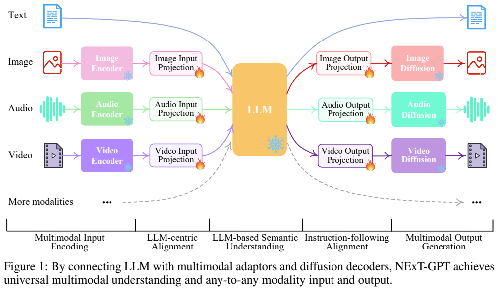

**读图：** 左侧编码图像、音频、视频，输入投影把特征送进中间 LLM；右侧输出投影分别连接图像、音频、视频扩散模型。文字直接进出 LLM。雪花表示冻结的大模块，火焰表示可训练接口。底部的更多模态箭头是扩展方向，并非已完成的实验证据。

| 部件 | v1 的具体实现与规模（Table 1，第 5 页） |
| --- | --- |
| 输入编码器 | ImageBind，1.2B；输入线性投影共 4M |
| 语言核心 | Vicuna-7B，版本 v0；LoRA 33M |
| 图像生成 | Stable Diffusion v1.5，1.3B；输出 Transformer 31M |
| 音频生成 | AudioLDM-l-full，975M；输出 Transformer 31M |
| 视频生成 | Zeroscope_v2_576w，1.8B；输出 Transformer 32M |

图像信号 token 为 $`\langle IMG_i\rangle`$，$`i=0,\ldots,4`$，音频为 $`i=0,\ldots,8`$，视频为 $`i=0,\ldots,24`$，分别 5、9、25 个。它们是指示生成与承载条件表示的信号序列，不是图像像素、音频采样点或视频帧数。若 LLM 没输出某模态信号，该生成器不启动；输出文字则直接返回用户。Figure 2 第 4 页以海边旅行对话示意不同轮次启用不同模块。

编码器和扩散生成器保留原参数，投影层负责跨空间转换。所谓端到端包含跨模块接口和语言 LoRA 的联合学习，不意味着把所有扩散骨干全参数训练，也不保证多种输出在时间、人物或场景层面严格同步。

<a id="principles"></a>

## 4. 核心创新与数学原理

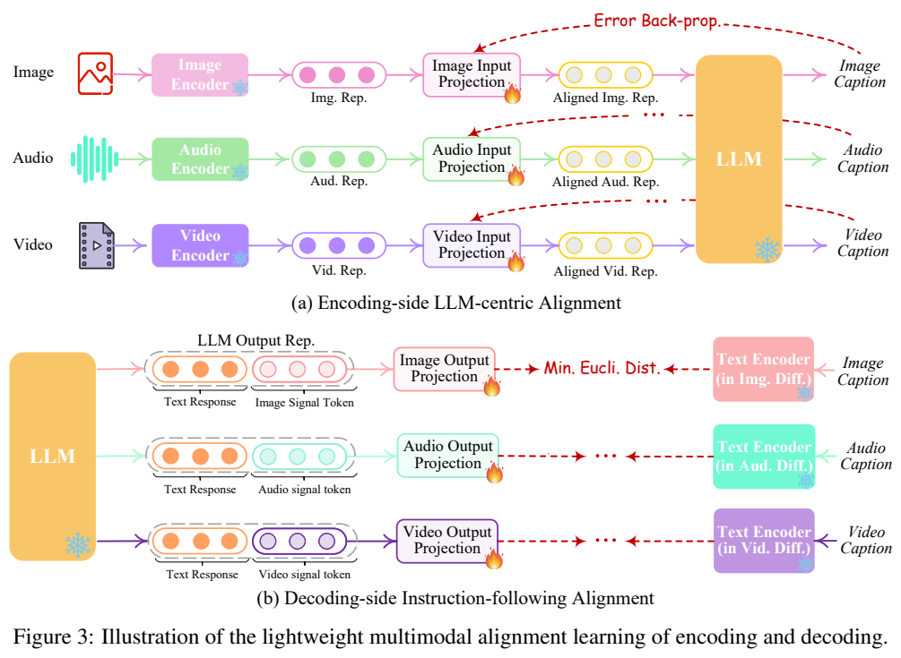

**读图：** 上半部让输入内容经过投影后驱动冻结 LLM 生成正确 caption；下半部让 LLM 的模态信号表示对齐各生成器原本的文本条件表示。下半部训练只需 caption 文本，无须每次真正生成图像或波形。

原文没有编号损失公式。为说明其机制，设模态编码器为 $`E_k`$、输入投影为 $`P_k`$，caption 为 $`c`$，输入对齐可用标准语言生成损失表示：

```math
\mathcal L_{in}=-\sum_t\log p_\theta(c_t\mid c_{\lt t},P_k(E_k(x))).
```

输出端设 LLM 信号隐藏状态为 $`H_k`$、输出投影为 $`O_k`$、冻结的扩散文本条件编码器为 $`T_k`$，原文采用最小化欧氏距离的表示对齐：

```math
\mathcal L_{out}\propto\Vert O_k(H_k)-T_k(c)\Vert _2.
```

这两式是对文字机制的解释，原文没有明确平方形式、归一化方式或各项权重，本文不补写精确实现。关键是目标来自生成器熟悉的条件空间，减少语言隐藏状态与扩散条件之间的失配。

MosIT 同时监督文字及模态信号的交叉熵，并保留信号表示到生成器条件的距离监督。语言模型负责理解对话、选择模态和组织内容；扩散骨干负责输出细节。该版本没有把生成质量损失直接穿过扩散采样全过程回传的完整推导，也未提出各模态共享一个像素级生成目标。

<a id="data"></a>

## 5. 数据构建与处理

理解型指令来自 LLaVA、MiniGPT-4、VideoChat 等，输入为文字加非文字内容，输出为文字。生成型 T2M 以 WebVid、CC3M、AudioCaps 等内容-caption 对为基础，借助 GPT-4 用不同指令包装描述，要求文字加图像、视频或音频输出；Table 2 给出三个模态各约 4.9K，共 14.7K 单轮实例。

MosIT 从人工设计的人机对话模板出发，用超过 100 个主题或关键词提示 GPT-4 生成 3–7 轮对话，要求前后语义相连、包含明确或隐含要求并切换输入输出模态。需要的真实内容通过 YouTube 等外部资源检索，或通过 Stable-XL、Midjourney 等生成；再人工检查和筛除不合适实例。Table 2 记录 5K 对话、约 4K 图像/4K 视频/4K 音频，平均 4.8 轮，这些模态内容计数不能直接与对话数相加。

论文主体称数据为高质量，但第 9 页末出现“5K dialogues in low quality”，与摘要、第 5.2 节的叙述矛盾。本文保留明确的构建和人工检查事实，将“高质量”视为作者定位，不把这个措辞矛盾当作已验证的标注质量。原文未提供审查一致性、去重比例、分割清单或完整数据配比，Table 2 列出的其他工作也不等于全部用于本系统。

<a id="training"></a>

## 6. 训练流程与目标

输入对齐阶段以各模态-caption 对训练输入投影，固定编码器与语言底座，目标是让 LLM 描述内容。输出对齐阶段利用纯 caption 文本训练各输出投影，把模态信号映射到冻结生成器的文本条件；它没有重新训练 Stable Diffusion、AudioLDM 或 Zeroscope。

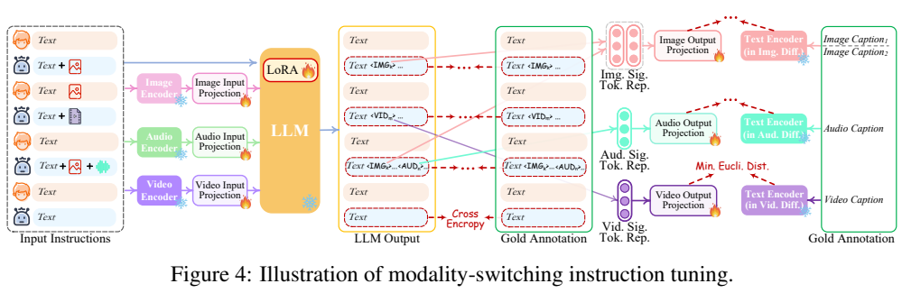

**读图：** 多轮指令进入左端，LLM 的文字和信号与中间标注做交叉熵，信号表示再与右端 caption 条件做距离对齐。LLM 上的 LoRA 在该阶段更新，编码器及生成器仍冻结，接口投影参与调优。

Table 1 的可训练总量为 $`4+33+31+31+32=131`$M；大模块约 12.275B，比例为 $`131\mathrm M/(131\mathrm M+12.275\mathrm B)\approx1.06\%`$。因此摘要的“约 1% 投影层”应结合正文理解，其中也计入 33M LLM LoRA，而不是完全不调整语言模型。

v1 未公布各阶段 optimizer、batch、学习率、训练步数/epoch、LoRA rank、硬件用量、输入分辨率、视频采样帧数和音频长度，也未明确给出不同数据来源的权重。可公开还原的是阶段目标和更新范围，不能据参数占比推导训练时间缩短 99% 或系统显存只需要原来的 1%。

<a id="experiments"></a>

## 7. 实验设置与主要结果

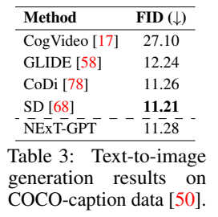

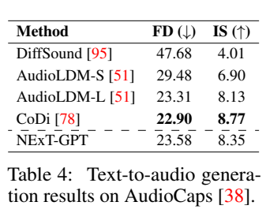

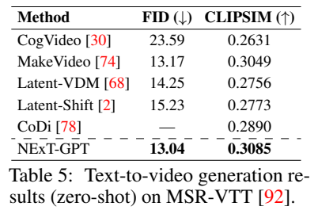

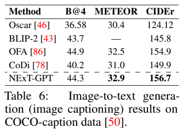

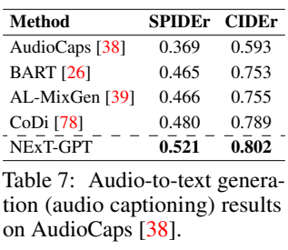

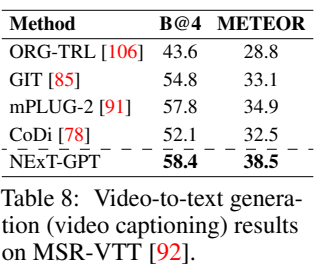

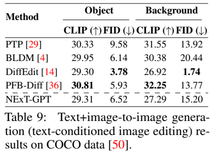

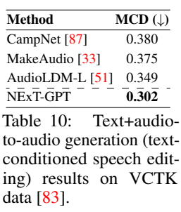

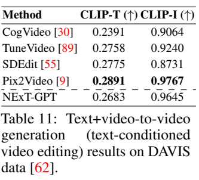

**读表：** 顶排为文字生成其他模态，中排为其他模态生成文字，底排为文字条件编辑。箭头指明方向：FID、FD、MCD 越低越好，IS、CLIP 相似度和 caption 指标越高越好。AudioCaps CIDEr 使用小数标度，不能与 COCO 表中百分标度的 CIDEr 直接比较。

| 任务与基准 | NExT-GPT | 表内参照与限定 |
| --- | --- | --- |
| 文字→图像，COCO | FID 11.28 | SD 11.21、CoDi 11.26 更低，接近而非超过 |
| 文字→音频，AudioCaps | FD 23.58、IS 8.35 | CoDi 22.90/8.77；AudioLDM-L 23.31/8.13，两指标取舍不同 |
| 文字→视频，MSR-VTT 零样本 | FID 13.04、CLIPSIM 0.3085 | MakeVideo 13.17/0.3049；表内两个指标较高 |
| 图像 caption，COCO | BLEU-4 44.3、METEOR 32.9、CIDEr 156.7 | OFA 44.9/32.5/154.9，BLEU 并非最高 |
| 音频 caption，AudioCaps | SPIDEr 0.521、CIDEr 0.802 | CoDi 0.480/0.789 |
| 视频 caption，MSR-VTT | BLEU-4 58.4、METEOR 38.5 | mPLUG-2 57.8/34.9 |
| 文字条件音频编辑，VCTK | MCD 0.302 | AudioLDM-L 0.349，原文称 speech editing |

编辑任务的短板更明显。COCO 图像编辑中，NExT-GPT 的 object/background FID 为 6.52/15.20，DiffEdit 为 3.78/1.74；其 CLIP 分数 29.31/27.29 也不是表内最优。DAVIS 视频编辑中 CLIP-T 0.2683、CLIP-I 0.9645，Pix2Video 为 0.2891/0.9767。因此“统一框架支持多任务”不等于每项任务达到专门编辑模型的性能。

这些定量测试按第 6.1 节模拟单轮交互，原文没有给出全部样本数量、采样步数、随机种子、统计区间和每个基线的完整运行配置。Figure 5 的复杂跨模态组合由数位评估者按 1–10 打分，作者观察图像输出较强、混合输出略弱，但没有详细报告评估者数量、评分准则、一致性或对照模型。它不能单独证明长对话的稳健性。

该版本没有输入对齐、输出对齐、LoRA、MosIT 各组件的系统消融。原文也明确生成质量受冻结扩散模型限制，未来计划扩展底座和数据。本文介绍对应早期系统的公开证据，未复现模型训练、扩散生成或人工评测。

<!-- article-footer:start -->
---

[← 上一篇：LaVIT](../../lavit/arxiv-2309.04669/README.md) · [按发表时间浏览](../../../reports/paper-reading-guide.md#year-2023) · [下一篇：大规模视觉指令微调 →](../../an-empirical-study-of-scaling-instruction-tuned-large-m-805afa2bda72/arxiv-2309.09958/README.md)

[返回本篇目录](#article-toc) · [返回模型系列](../README.md)
<!-- article-footer:end -->
