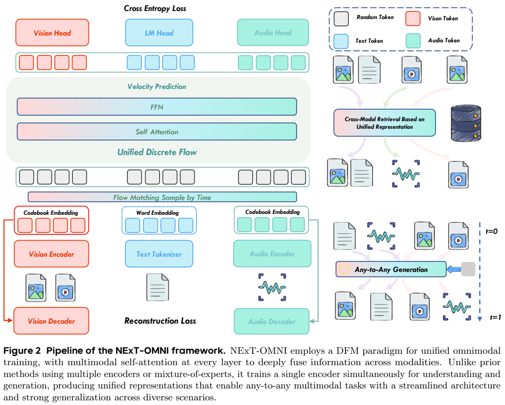
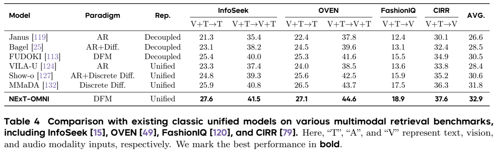
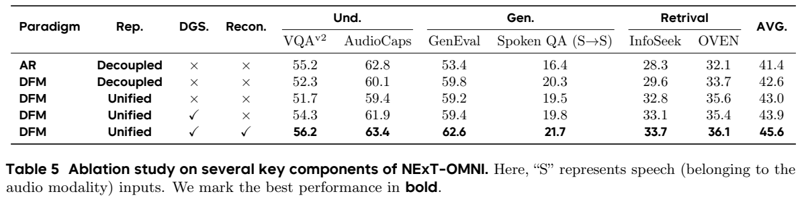
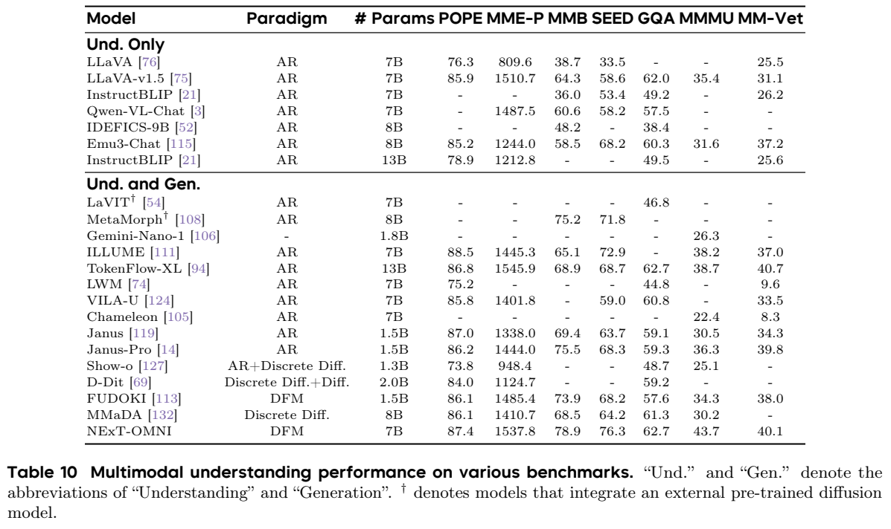
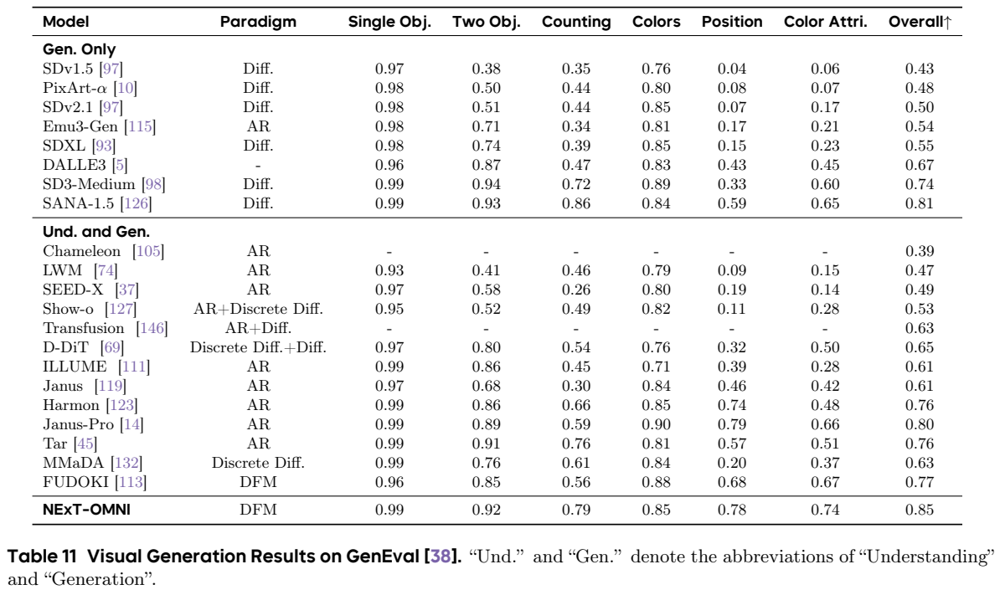

# NExT-OMNI：用离散流统一全模态理解、生成与检索

## 1. 论文信息与模型定位

| 项目 | 信息 |
| --- | --- |
| 原标题 | NExT-OMNI: Towards Any-to-Any Omnimodal Foundation Models with Discrete Flow Matching |
| 作者与机构 | Run Luo、Xiaobo Xia、Lu Wang 等；中科院深圳先进技术研究院、中国科学院大学、NUS、NExT++ |
| 原文版本 | [arXiv 2510.13721v1](https://arxiv.org/abs/2510.13721v1)，2025 年 10 月；36 页 PDF |
| 基础模型 | Qwen2.5-7B；视觉编码器 CLIP-ViT-Large、音频编码器 Whisper-Turbo 初始化 |
| 核心范围 | 文本、图像、视频、音频之间的理解与生成，多轮交互，以及额外训练后的跨模态检索 |

NExT-OMNI 希望让同一组融合表示既能理解内容，也能保留足够细节用于生成，再能用于相似度检索。与只在共享语言模型外接若干生成器的路线相比，它把主要序列建模改为离散 flow matching（DFM），用双向注意力多次修正 token。论文的 7B 指 backbone 档位，仍有编码器、解码器和约 128M 参数的模态 heads；不能据此认定整个系统恰好只有 7B 参数。本文根据 v1 正文和技术附录整理，未运行模型复现。

## 2. 快速概览

NExT-OMNI 的主要设计是“兼顾语义与重建的离散表示＋双向离散流＋动态长度和缓存”。图像或音频编码器同时受到语义监督和重建监督，防止只能理解大概意思却无法重现细节。共享 backbone 在每层融合不同模态的 token，用离散 token 分类预测驱动连续时间的状态跳转，逐渐把随机输入转为目标内容。

| 设计 | 要解决的问题 |
| --- | --- |
| 同模态统一编码 | 理解与生成不再各用一套彼此分离的视觉或音频编码器 |
| 多码本量化 | 在有限词表内保留较丰富的语义和细节 |
| metric-induced DFM | 概率路径利用 token embedding 距离，状态沿更接近目标的方向转移 |
| 重建反馈 | backbone 训练时继续约束图像、音频的细节保留 |
| 动态长度 | 根据 EOS 置信度扩展响应，避免固定长度去噪限制文字回答 |
| 检索微调 | 用 EOS 的融合特征表示查询和候选，额外学习排名 |

主要结果包括 OmniBench/WorldSense/AV-Odyssey 汇总均值 39.7，OpenING 多轮图文评测均值 55.0，检索 Top-5 均值 32.9，图像 GenEval 0.85。它同时具备音频与短视频功能，但论文设置是最多抽取 8 帧、长音频按 15 秒分段，不等于无上限视频或实时流式双工系统。

## 3. 整体架构

**读图：**Figure 2 中红色、蓝色、青色分别表示视觉、文本、音频 token。底部先做模态编码，上方通过共享 self-attention 和 FFN 融合，最后经不同分类 heads 输出 token。图右侧同时列出任意模态生成与检索，左侧重建回路则说明细节约束持续参与训练。图中有独立视觉和音频编码器，“single encoder”的含义是每个模态不再为理解和生成分别配置编码器，不能读成所有模态共用同一前端。

视觉前端以 CLIP-ViT-Large 为起点，音频前端以 Whisper-Turbo 为起点。warmup 阶段在两者上加入量化器和解码器：视觉兼顾图文对比与像素重建，音频兼顾 caption token 预测和声音重建。视觉使用 4×4,096 子码本，音频使用 2×2,048；这里是多个独立子码本大小，不是一个 16,384 或 4,096 项的单码本。进入 backbone 的是所选码本的连续代表向量，经轻量投影对齐文本 embedding 维度，而不是只把离散编号当作普通词编号重新随机编码。

backbone 从 Qwen2.5-7B 迁移，使用深层双向注意力。训练保留 logits 向一位移位的操作来继承基础模型，但这不意味着仍使用因果注意力或必须按 token 顺序生成。文本、视觉、音频分别使用轻量输出 head，不把所有模态词表直接塞入原语言 head。

还有一个容易遗漏的细节：附录 E.2 比较多子码本同时预测与在单个位置内依次预测。实际选择的是**同一位置各子码本索引的局部自回归预测 head**，因为更稳定；共享序列的整体生成仍是 DFM。因此“完全基于 DFM”描述主要 backbone 和序列路径，不能进一步夸大成系统里没有任何自回归操作。

## 4. 核心创新与数学原理

**统一表示需要两种约束。**量化先把连续编码 $z^M$ 映射到最近码本向量，标准最近邻表达为 $c^*=\arg\min_{c\in C^M}\|z^M-c\|^2$。原文 Eq. (1) 把每个模态 warmup 的目标写成：

$$\mathcal L^M_{\mathrm{total}}=\mathcal L^M_{\mathrm{rec}}+\mathcal L^M_{\mathrm{sem}},\qquad M\in\{A,V\}.$$

视觉重建还包含像素、LPIPS 感知、量化、判别损失；音频包含 mel 频谱、特征匹配、量化、判别损失。视觉语义使用句子级对比，音频使用 token 级 caption 监督。单纯语义监督可能忽略字体边缘或音色细节，单纯重建又未必具备易于推理的高层语义，组合目标用于平衡两者。

**离散流的“速度”是转移率。**附录 A 定义 $t=0$ 为来源分布、$t=1$ 为目标 $x_1$。metric-induced 路径（Eq. (5)）为：

$$p_t(x^i\mid x_1^i)=\mathrm{Softmax}_{x^i}\big[-\beta_t d(x^i,x_1^i)\big],\qquad
\beta_t=3\left(\frac{t}{1-t}\right)^{0.9}.$$

$d$ 是 token embedding 的余弦距离。随着 $\beta_t$ 增大，离目标近的类别得到更多概率。该日程在 $t\to1$ 发散，是端点极限；数值推理怎样截断需要实现确定。网络学习预测目标 token 的条件分布，继而用它构造状态跳转，不能把离散编号直接当成像素坐标做连续线性插值。

Eq. (6) 对当前状态 $z^i$ 跳到候选 $x^i$ 的条件速度写为：

$$u_t^i(x^i,z^i\mid x_1)=p_t(x^i\mid x_1^i)\,\dot\beta_t\,\max\{d(z^i,x_1^i)-d(x^i,x_1^i),0\}.$$

只有候选离目标更近时该转移率才为正。网络先采样预测终点，再计算离开当前状态的总率 $\lambda_i$；长度为 $h$ 的时间步中，按 $1-e^{-h\lambda_i}$ 决定是否跳转，再按归一化率选新 token。这是连续时间马尔可夫链采样，用 Euler 时间推进模拟，并非对文本 embedding 直接积分一个连续速度向量。

**训练分类、推理跳转。**正文 Eq. (2) 用交叉熵恢复 $x_1$，Eq. (3) 加上图像与音频重建约束：

$$\mathcal L_{\mathrm{overall}}=\lambda_1\mathcal L_{\mathrm{ce}}+\lambda_2\mathcal L^V_{\mathrm{rec}}+\lambda_3\mathcal L^A_{\mathrm{rec}}.$$

权重通过 GradNorm 动态调整。这里的 CE 是目标 token 分类，而不是连续 flow matching 常见的速度向量 MSE；指令数据只对 response 做纠错训练。双向 attention 带来融合上下文的机会，但本身仍有长序列开销，不能由并行去噪推出整体计算线性或一次前向生成全部正确内容。

动态长度生成在训练时把回答 pad 成 64 的倍数，推理先根据 EOS 置信度判断是否需要再扩一块，之后多步去噪。缓存保存 instruction 特征，并根据 response 的 value 特征与缓存的余弦相似度决定更新。它利用特征在相邻步间变化较小的观察，属于推理近似与工程加速，需要结合质量结果判断。

## 5. 数据构建与处理

视觉编码器 warmup 约 70M 图文对，来源 LAION、DataComp 等；正文与附录数据表还列 COYO。图像初始 256×256、下采样 16 倍。音频 warmup 约 102K 小时，其中公开 LibriSpeech、WenetSpeech、AudioCaps 约 2K 小时，其余约 100K 小时为私有语音和音乐；单段上限 15 秒，caption 辅助模型 Qwen2.5-0.5B。开放代码和配方不代表全部训练音频公开可重建。

| 阶段 | 数据概貌 | 代表来源与处理 |
| --- | --- | --- |
| PT | Table 9 约 83M，图文、音文对及短文本 | 图像生成与重描述，语音/声音双向转换，Infinity/Evol 文本维持语言能力 |
| CPT | 约 52M，加入交错、多图、视频和长音频 | MMC4-Core、OmniCorpus、ShareGPT4Video；视频均匀抽 8 帧，长音频拆成最多 15 秒的片段 |
| SFT | 约 18M，多种模态指令与多轮交互 | LLaVA-Video、OpenOmni、InterSyn、ShareGPT-4o-Image、TIP-I2V 等 |

复杂视觉指令以 LLaVA-OneVision、PixMo 采样的 1.2M 数据为种子，用 Qwen2.5-VL 与 MMEvol 做三轮演化、采样筛选，得到约 4M 的 Und-4M。图像生成以 JourneyDB 和 Midjourney prompts 为起点，用 Qwen2.5 扩充更细描述，再用 FLUX 4 步、512×512 合成约 5M Gen-5M。训练图像分辨率升至 384×384 与合成原图 512×512 是不同环节，不能混为同一输出设置。

Table 8 分任务给出尺寸，例如 PT 图像理解 32M、图像生成 25M、音频理解 16M、音频生成 6M；CPT 图像理解 10M、图像生成 12M、视频理解 12M、视频生成 2M。部分正文把 LLaVA-OneVision/PixMo SFT 用途写成 image generation，但数据表及其惯常构建用途列为 I→T；本文按 Table 8 归为图像理解，并保留来源文本的口径问题。未披露完整私有数据过滤、去重规则，不自行补全。

## 6. 训练流程与目标

| 配置 | PT | CPT | SFT |
| --- | --- | --- | --- |
| 图像分辨率 | 256×256 | 384×384 | 384×384 |
| 最大 token 长度 | 2K | 16K | 16K |
| 训练迭代 | 10K | 18K | 25K |
| 每 GPU batch | 16 | 8 | 4 |
| 编解码器学习率 | $2\times10^{-5}$ | $10^{-6}$ | $10^{-6}$ |
| 其他模块学习率 | $10^{-4}$ | $2\times10^{-5}$ | $2\times10^{-5}$ |
| warmup | 1K 步 | 500 步 | 500 步 |

Table 9 的优化器均为 AdamW、weight decay 0.05、余弦学习率；PT 的 $(\beta_1,\beta_2,\epsilon)$ 是 $(0.9,0.995,10^{-6})$，后两阶段为 $(0.9,0.999,10^{-8})$。没有据此猜 GPU 总数、全局 batch 或把 2T token 声明反算成确定训练成本。附录限制段声明 7B 与 2T token，而尺寸消融 Table 7 的短训练 0.5K–2K 不是 Table 9 完整配方。

一个 batch 只处理一种模态，多个任务通过交错训练和梯度累积完成联合优化，以减少模块负载不平衡。论文声称这种安排提高训练效率约 1.4 倍，但没有完整硬件计时表。生成任务 classifier-free 条件丢弃概率为 0.1；该概率是训练时设置，不是推理 guidance 强度。

检索另外从 M-BEIR 抽 100K 子集做排名微调，遵循 MM-Embed，用 EOS 的深融合特征表示查询、候选。因此 Table 4 的检索能力不是未经训练的零样本自动涌现，图像与文本编码也不是先各自输出向量再做简单 late fusion。

## 7. 实验设置与主要结果

Table 1 在三个全模态基准的多个输入组合上比较，NExT-OMNI 均值 39.7、OpenOmni 36.5，差 3.2 个绝对分数点。OpenING 的 GPT 与 IntJudge 多种平局计分组合均值为 55.0，超过 MMaDA 47.7、VILA-U 48.4、SEED-X 50.2；这是评判模型对多轮交错一致性的评分，不能作为真实用户满意度。Spoken QA 的 S→T 均值 62.0，高于 OpenOmni 59.6；S→S 47.4 则低于 OpenOmni 48.1，说明输出声音的答案内容仍有改进空间。

**读表：**检索报告 Top-5 命中，InfoSeek、OVEN 各区分文本候选和图文候选，FashionIQ、CIRR 为组合查询找图。NExT-OMNI 六列为 27.6/41.5/27.1/44.6/18.9/37.6，平均 32.9；MMaDA 平均 31.8，差 1.1 点。这支持统一双向表示在此微调设置中的价值，不能由跨模型表直接证明所有架构差异具有唯一因果。

**读表：**AR 解耦基线均值 41.4，改 DFM 解耦为 42.6；但 VQAv2 55.2→52.3、AudioCaps 62.8→60.1 下降。进一步统一表示，生成/理解部分仍略降；加入动态长度后 VQAv2 51.7→54.3，加入重建后达到 56.2，最终均值 45.6。统一表示并非自动全面改善，需要动态生成和细节约束共同补偿。消融 GenEval 最终 62.6 与主实验 0.85 属不同评测/训练设置，论文未充分解释二者映射，不能只改百分制就认为数值一致。

**读表：**视觉理解 MMMU 43.7、MMBench 78.9、SEED 76.3、GQA 62.7。POPE 87.4 仍低于 ILLUME 88.5，MM-Vet 40.1 低于 TokenFlow-XL 40.7；表中优势不能写成每项第一。GenEval 0.85 高于 FUDOKI 0.77、MMaDA 0.63，单物体 0.99、双物体 0.92、计数 0.79、位置 0.78、颜色属性 0.74，但位置略低于 Janus-Pro 0.79。DPG-Bench 总分 84.46，多个分项依然有其他模型更高。

音频 Table 13 中 LibriSpeech S→T 的 clean/other WER 为 3.0/7.0（越低越好），仍不及 Qwen2-Audio 的 2.0/4.5；T→S WER 为 3.1/7.2。AudioCaps 表给 A→T 84.8、T→A 1.65，却没有在该表充分标明具体评分量纲，本文保留方向讨论的限制，不把 1.65 宣称为准确率。视频 MSVD-QA 76.2、MSRVTT-QA 62.7、ActivityNet-QA 56.4，但 TGIF-QA 58.1 低于 Video-LLaVA 70.0；VBench 总分 80.1、质量 80.8、语义 77.5，比较对象有限且为短视频。

Figure 12 的缓存设置下 8 帧视频生成速度为 NExT-OMNI 57.2 token/s、Janus 48.7、MMaDA 7.9、FUDOKI 8.2；57.2/48.7 约 1.17 倍，与正文约 1.2 倍表述相近。论文没有给足同硬件、相同 token 表示长度与完整用户延迟配置，因此该图支持具体设置的吞吐改善，不能外推所有模态实时响应。最终价值在于把生成、理解和经过微调的检索纳入共享表示，同时通过消融揭示统一表示的代价与补救。
