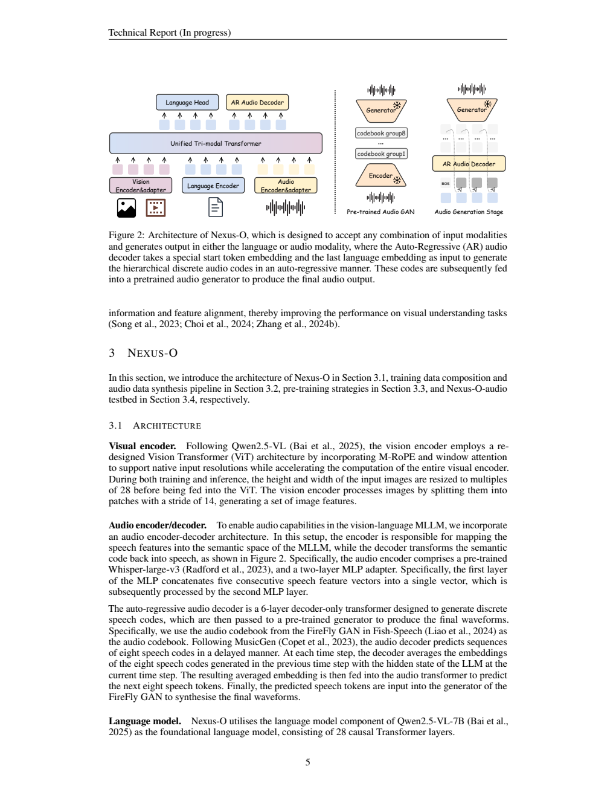
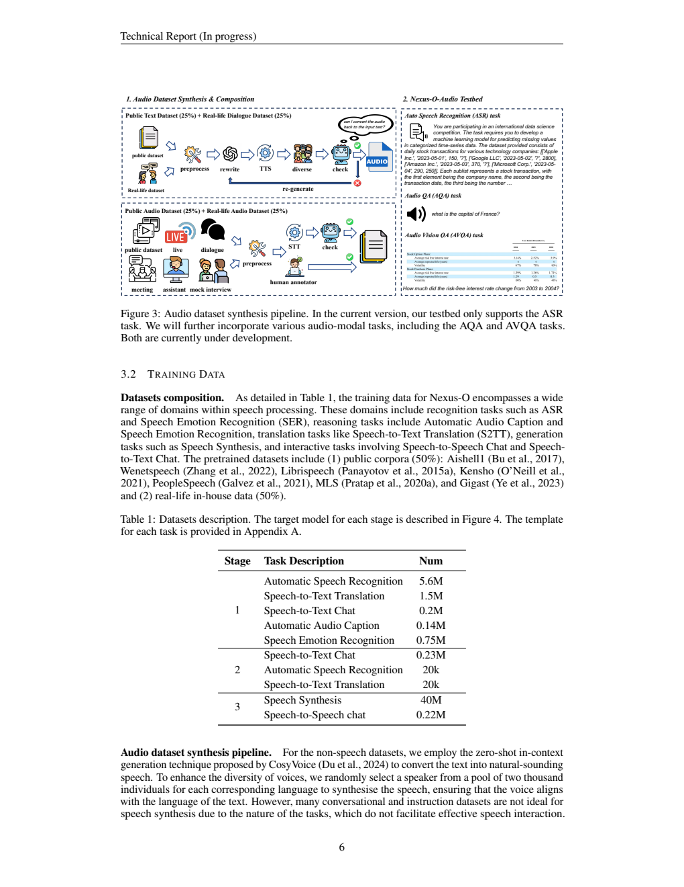
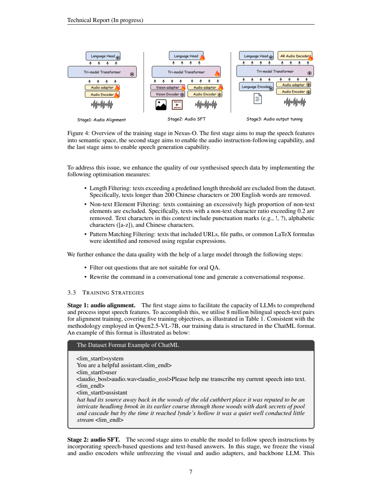
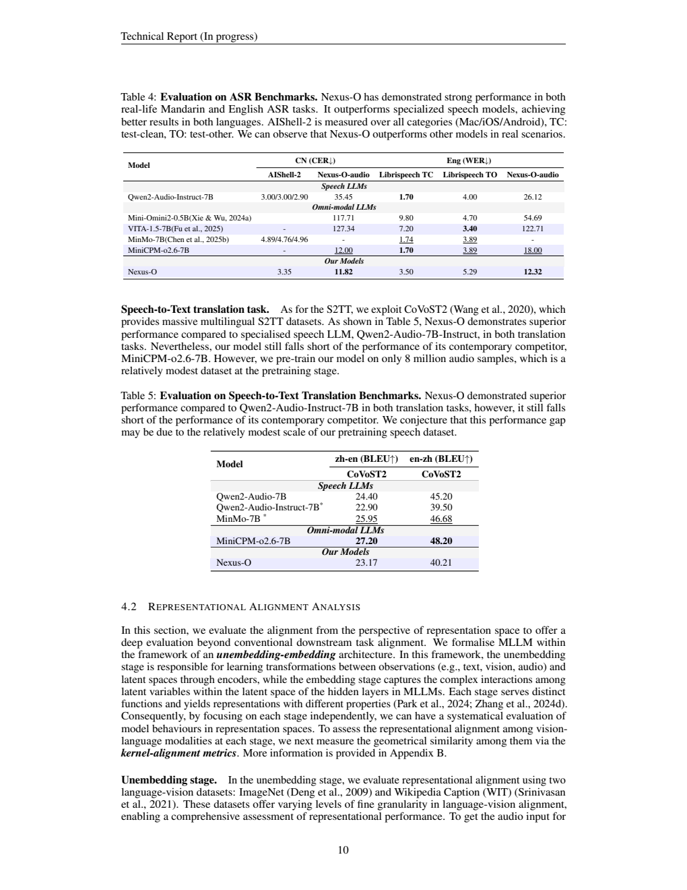

# Nexus-O：在视觉语言基座上加入语音理解与生成

## 1. 论文信息与模型定位

**论文**：[Nexus-O: An Omni-Perceptive And -Interactive Model for Language, Audio, And Vision](https://arxiv.org/abs/2503.01879v1)，以2025年2月26日v1、23页PDF为依据。作者包括Che Liu、Yingji Zhang、Dong Zhang、Weijie Zhang、Chenggong Gong、Haohan Li等，主要来自HiThink Research并有帝国理工、曼彻斯特大学等合作机构。

Nexus-O继承Qwen2.5-VL-7B-Instruct已经具备的视觉语言能力，再加入音频编码器、适配器和语音解码器。相较从纯LLM开始同时学习视觉与语音，它把已有视觉对齐作为出发点，重点学习语音输入、口语指令和语音输出。支持的输入设计包括文字、图像、视频和音频组合，输出为文字或语音，不包含图像生成器。

这份v1每页注明“Technical Report (In progress)”。附录明确把TTS评测、真实三模态任务、多轮对话能力与流式音频列为未来工作。因此，“可生成语音”是架构与训练能力说明，不能写成语音生成质量、低延迟全双工交互都已经充分验证。[§1、未来实验，PDF第3、20页](https://arxiv.org/pdf/2503.01879v1#page=20)。

## 2. 快速概览

| 方面 | 报告内容 |
|---|---|
| 基座 | Qwen2.5-VL-7B，28层因果语言Transformer |
| 语音输入 | Whisper-large-v3，连续五个特征合并后经两层MLP适配 |
| 语音输出 | 六层自回归解码器、八组FireFly GAN离散语音码，再生成波形 |
| 训练阶段 | 音频语义对齐 → 音频SFT → 只训练音频输出解码器 |
| 数据 | 首阶段约8M中英语音文本；第三阶段40M语音合成、0.22M语音对话 |
| 新评测 | Nexus-O-audio：8.1K中文、2.8K英文真实场景ASR样本 |
| 结果边界 | 新场景ASR较强，但LibriSpeech和翻译仍低于若干对照，TTS没有定量实验 |

它的主要贡献是把已有VLM扩展为语音视觉模型，并尝试用真实会议、直播、客服等数据补足常规语音基准的场景覆盖；不是证明新增语音训练在所有视觉任务上无损。

## 3. 整体架构

**Figure 2怎么读。** 左侧三路输入映射到同一Transformer，文字头输出文本，音频头输出离散语音码；右侧把预训练音频GAN和实际生成链分开，雪花代表固定的预训练组件。生成波形不是直接由语言词表解码，而是经过语音码本和音频生成器。

视觉路径沿用Qwen2.5-VL的动态尺寸处理、窗口注意力和多模态位置表示，图片宽高调整为28的倍数，视觉patch步长14。本文没有重新发明视觉塔。音频路径使用Whisper-large-v3特征，适配器按五个连续向量成组，缩短语音进入主干的序列长度。主干把音频嵌入与文字、视觉信息结合，生成语义表示。[§3.1，PDF第5页](https://arxiv.org/pdf/2503.01879v1#page=5)。

输出侧为六层decoder-only Transformer，采用Fish-Speech的FireFly GAN码本。每个时间位置有八组语音码，按MusicGen式延迟模式预测。解码器结合上一位置的八个码嵌入与当前LLM隐藏状态，生成下一组码；最后由预训练FireFly生成器还原波形。小型解码器承担声学展开，主LLM承担语义理解，避免让主语言词表直接负担所有声学细节。

## 4. 核心创新与数学原理

**复用VLM减少对齐任务。** 原始Qwen2.5-VL已建立图像到语言的映射，新增音频适配器学习音频到该语义空间的映射。可用\(z_a=P_a(E_a(a))\)、\(h=F(z_a,z_v,x)\)表达输入链，其中\(E_a\)为Whisper、\(P_a\)为适配器、\(F\)为三模态主干；这是本文解释性记号，原论文并没有用该公式定义一个额外对比损失。

**层级音频码预测。** 可把八码本的自回归建模理解为最大化\(p(c_{t,1},\ldots,c_{t,8}\mid c_{<t,*},h)\)，具体生成顺序采用延迟排布而非在一个位置串行展开八个码。这样在保留多个码本声学细节的同时控制序列开销。该概率式用于解释任务，v1没有给出音频目标权重、码本大小或完整延迟调度的数学细节，不能补成可复现损失配方。

**用核几何分析模态对齐。** 附录B把同一对象不同模态的表示写为\(f(x)\)，构造内积核\(K_{ij}=\langle f(x_i),f(x_j)\rangle\)，再比较文字核与视觉核的CKA、SVCCA及邻域一致性。进入主干前，视觉和音频表示拼接，原文式(1)是

\[
K^{v+a}_{ij}=\langle[f_v(x_i);f_a(x_i)],[f_v(x_j);f_a(x_j)]\rangle.
\]

进入主干后，原文式(2)则用同时输入视觉与音频产生的LLM表示构造核。这两种融合不能混为一谈：前者是分析时拼接编码器特征，后者是联合条件下的主干隐藏表示。核相似度衡量样本间几何关系接近程度，并不直接等于事实正确率。

分析语音来自CosyVoice把ImageNet概念或WIT描述读出来，因此音频本身带有文字语义。加入它能提高对齐有合理解释，但不能据此证明任意环境声音都会改善图像理解，PCA投影重叠也不是充分的因果证据。[§4.2、附录B，PDF第10—13、22页](https://arxiv.org/pdf/2503.01879v1#page=22)。

## 5. 数据构建与处理

**Figure 3怎么读。** 左上把公开文字和真实对话改写后转为语音，再检查是否能转录回原始文本；左下处理公开音频和真实场景音频，经STT、人工标注及检查得到文本。右侧示意ASR、AQA与AVQA，但图注明确目前自建testbed只支持ASR，后两项仍在开发。下方Table 1列的Num是样本数，不是音频小时数。

报告概括预训练来源为公开语料50%、内部真实生活数据50%，图示进一步按公开文字、真实对话、公开音频、真实音频各25%呈现。公开源包括Aishell1、Wenetspeech、LibriSpeech、Kensho、PeopleSpeech、MLS和GigaST，真实来源包含会议、直播、客服、对话与模拟面试。不同音频长度分布与精确小时数未披露，不能把样本比重当作总时长比重。

文字转语音采用CosyVoice零样本上下文合成，每种对应语言从约2,000位说话人的池中随机取声线。先去掉超过200个中文字或200个英文词的文本，过滤非文字字符比例超过0.2的样本，并以正则过滤URL、文件路径、常见LaTeX公式；随后用大模型排除不适合口头问答的问题，把书面指令改成自然对话语气。这样避免朗读长表格或公式，却也减少了训练语音对复杂结构化内容的覆盖。

Table 1首阶段包括ASR 5.6M、语音翻译1.5M、语音到文本对话0.2M、音频描述0.14M、情感识别0.75M。逐项合计约8.19M，正文简称8M，应按近似规模理解。第二阶段0.23M对话加20K ASR、20K翻译；第三阶段40M语音合成加0.22M语音到语音对话。这些阶段计数不能加总成保证互不重复的独立样本数。[§3.2，PDF第6—7页](https://arxiv.org/pdf/2503.01879v1#page=6)。

自建testbed包含8.1K中文和2.8K英文样本，用现成ASR系统产生文本并结合图示中的检查、人工处理；报告没有展开完整人工金标准标注流程、音频切段规范和污染审计。它更贴近作者目标场景，但其优势需要在独立数据和公开评测流程上进一步确认。

## 6. 训练流程与目标

**Figure 4怎么读。** 火焰为训练、雪花为冻结。第一阶段图示训练音频编码器与适配器，冻结三模态主干与文字头；第二阶段冻结视觉和音频编码器，训练两个适配器、主干与语言输出；第三阶段仅音频解码器有火焰。这里第一阶段冻结范围主要由图给出，正文没有详细列成超参数表。

第一阶段用约8M中英语音文本完成ASR、翻译、对话、描述、情感五类任务，格式沿用ChatML，音频边界使用专门标记。目的是让音频特征在现有语义空间中可被理解。第二阶段加入语音问题、文字回答，增强指令遵循；固定编码器表示，调整适配器与语言主干。第三阶段先做文本到语音对齐，再以语音到语音数据学习回应输出；正文明确只有音频解码器参数可训练。[§3.3，PDF第7—8页](https://arxiv.org/pdf/2503.01879v1#page=7)。

这些任务可以用条件token交叉熵理解，但报告没有呈现统一损失式、任务权重、各阶段学习率、batch、步数、GPU数或训练成本。本文不把Qwen2.5-VL自身的预训练设置移植到Nexus-O，也不声称使用了RL/DPO。冻结主干的语音输出阶段有助于保留语义能力，却不等于已验证声音自然度与语义同步质量；v1没有TTS实验。

## 7. 实验设置与主要结果

视觉表Table 2使用八个视觉理解基准，部分MMMU数字来自val而非test。Nexus-O对Qwen2.5-VL-7B的Video-MME为57.0对56.0、MMMU val 53.2对51.8、MathVista62.1对61.1、OCRBench882对877、MME2315.5对2299.1；HallusionBench却为71.1对71.7，不能概括成所有视觉能力都提高。OCRBench保持原论文千分计数形式，未转换成与其他报告不同口径的百分比。闭源模型表中部分参数数值是作者表述，不作为官方披露的精确规模。

口语问答LLaMA Q.准确率67.33%，高于表中MiniCPM-o2.6的61.00与GLM-4-Voice的64.70。该结果衡量语音问题理解与回答，不能替代语音输出听感、实时交互或三模态联合任务评测。[§4.1、Table 2—3，PDF第8—9页](https://arxiv.org/pdf/2503.01879v1#page=9)。

**Table 4—5怎么读。** ASR中文CER和英文WER越低越好，翻译BLEU越高越好，不能沿用一个统一方向。Nexus-O-audio中文11.82、英文12.32，优于MiniCPM-o2.6的12.00、18.00及Qwen2-Audio-Instruct的35.45、26.12。但LibriSpeech clean/other为3.50/5.29，弱于MiniCPM-o2.6的1.70/3.89；AIShell2的3.35也不优于Qwen2-Audio三平台的3.00/3.00/2.90。因此收益集中于自建真实场景，而非所有ASR数据集。

CoVoST2中译英23.17、英译中40.21 BLEU，略高于Qwen2-Audio-Instruct的22.90/39.50，但低于MiniCPM-o2.6的27.20/48.20，也低于表中的非Instruct Qwen2-Audio 24.40/45.20。作者推测训练数据规模限制了翻译，尚未通过受控扩展实验确证。

表示分析中，WIT主干末层平均token的CKA从Qwen基座0.20811到纯视觉Nexus0.20746、加入音频后0.25915；但末token设置下Nexus视觉+音频0.12787仍低于基座0.21278。不同对齐指标并非一致领先。音频能补充语义结构是有支持的观察，却不能把核分数和PCA图当成“必然更准确”的证明。

报告提供了一个在VLM上加语音的具体路线及真实场景ASR结果，但完整三模态、TTS、多轮、流式延迟仍待评估。本文按v1保留这些阶段性限制，核验原图与数值，未运行模型或复现实验。
