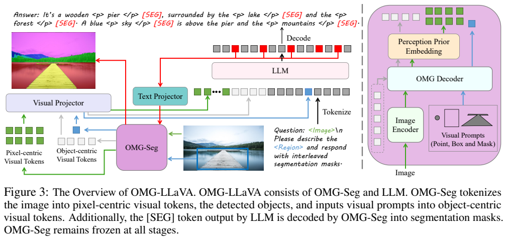
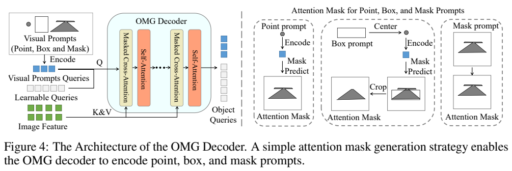
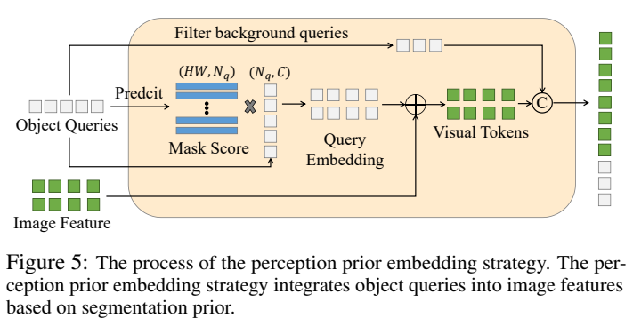
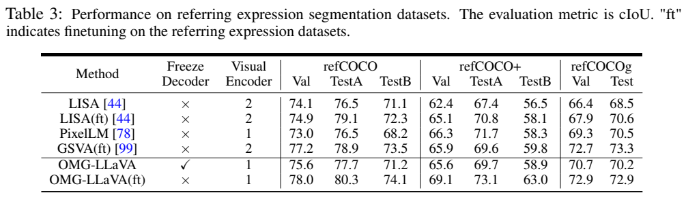
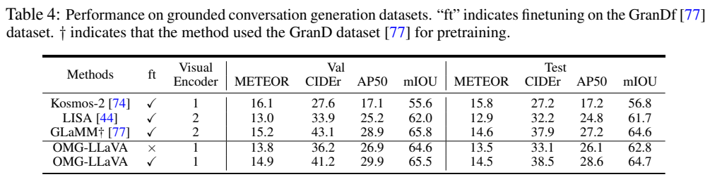
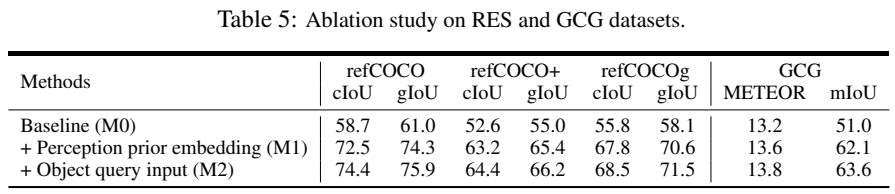
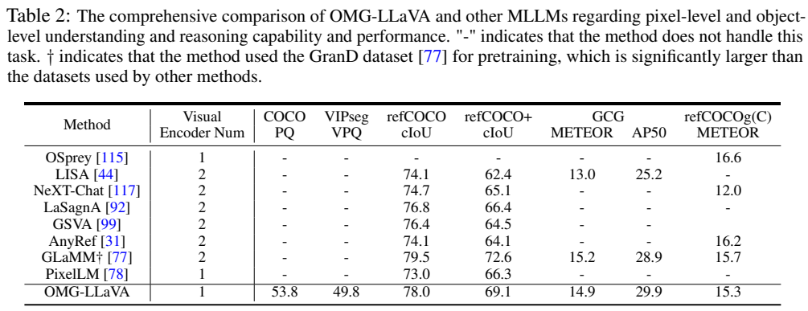
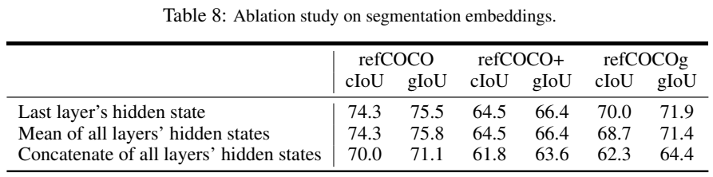
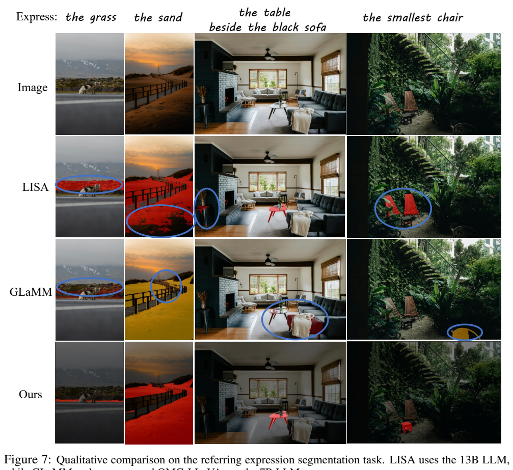

<!-- article-header:start -->
[项目首页](../../../README.md) › [模型系列](../../../reports/model-family-index.md) › [OMG-LLaVA](../README.md)
<!-- article-header:end -->

# OMG-LLaVA：用统一分割模型连接图像、对象与像素推理

<!-- article-toc:start -->
<a id="article-toc"></a>

**本篇目录** · [论文定位](#paper-info) · [快速概览](#overview) · [整体架构](#architecture) · [核心原理](#principles) · [数据构建](#data) · [训练流程](#training) · [实验结果](#experiments)
<!-- article-toc:end -->

<a id="paper-info"></a>

## 1. 论文信息与模型定位

| 项目 | 信息 |
| --- | --- |
| 论文 | OMG-LLaVA: Bridging Image-level, Object-level, Pixel-level Reasoning and Understanding |
| 作者 | Tao Zhang、Xiangtai Li、Hao Fei、Haobo Yuan、Shengqiong Wu、Shunping Ji、Chen Change Loy、Shuicheng Yan |
| 机构 | 武汉大学、Skywork AI、南洋理工大学 S-Lab |
| 固定版本 | [arXiv 2406.19389v1](https://arxiv.org/abs/2406.19389v1)，2024-06-27，24 页 |
| 项目 | [项目页](https://lxtgh.github.io/project/omg_llava)；[OMG-Seg 代码仓库](https://github.com/lxtGH/OMG-Seg) |
| 定位 | InternLM2-7B 加 OMG-Seg，接受图像、文字、点/框/掩码提示，输出文字和分割掩码 |

OMG-LLaVA 把语言理解与统一视觉感知结合起来，用一个图像编码器、一个视觉解码器和一个 LLM 支持多层次任务。名称中的 LLaVA 表明其指令训练思路，而非语言底座就是 Vicuna。其视觉组件本来支持视频全景分割，但该版本明确尚不能进行像素级时空语言推理。下文页码对应 v1 PDF。

<a id="overview"></a>

## 2. 快速概览

普通图文助手能谈论整张图，却未必能按描述返回目标掩码；增加独立 SAM 或区域编码器又会引入重复组件。OMG-LLaVA 复用 OMG-Seg 的对象查询：它们既携带分割先验，又能表示用户指定区域，还能作为掩码生成的接口。

模型输入包含稠密的像素中心 token 和对象中心 token。前者加入分割先验，后者明确给出前景对象或视觉提示信息。LLM 输出的 `[SEG]` 隐藏状态被映射回视觉空间，由同一个 OMG 解码器生成掩码；答案可以把对象短语与掩码交替排列。

原文主要验证指代表达分割、带定位的对话生成、区域描述及原视觉模块的通用分割。冻结视觉解码器的主配置在 refCOCO/refCOCO+/refCOCOg 验证集 cIoU 为 75.6/65.6/70.7；专门微调并解冻解码器后为 78.0/69.1/72.9。两者配置不同，不能把较高数值直接用于“始终冻结”的宣传。

<a id="architecture"></a>

## 3. 整体架构



**读图：** 下方 OMG-Seg 同时产生像素和对象 token，视觉投影送入 LLM；用户的区域标记替换成对应对象 token。上方输出中的对象短语后跟 `[SEG]`，其状态经 text projector 回到 OMG 解码器，形成右侧彩色掩码。图中冻结说明针对常规联合训练配置，专门分割微调另有例外。

图像编码器是 ConvNeXt-L 构建的 CLIP，输入 1024×1024。取 32 倍下采样的低分辨率特征，再通过 pixel shuffle 进一步使空间采样间隔达到 64，得到 16×16、256 个稠密视觉 token；对象 token 还会额外拼接，因而不能说总视觉输入永远只有 256。

OMG 解码器使用 masked cross-attention 读取图像，self-attention 处理对象间关系。可学习查询负责自动发现对象，视觉提示查询负责读取指定区域。点提示沿用原支持；框提示屏蔽框外像素，掩码提示直接限定注意力区域，避免粗暴地将所有提示都转换成中心点。

视觉投影由两种 MLP 分别处理像素与对象 token；提示生成的对象和自动发现的对象共用对象 MLP。另一个 text projector 将最后一层 `[SEG]` 隐藏状态变成可供冻结解码器使用的分割查询。感知先验嵌入本身没有新增可训练参数。

| 模块 | 输入与输出 | 公开机制 |
|---|---|---|
| CLIP ConvNeXt-L编码 | 1024×1024图像 → 低分辨率特征 | 取32倍下采样层，再用pixel shuffle使间隔到64；形成256个像素位置 |
| OMG Decoder | 图像、学习查询/视觉提示查询 → 对象表示与掩码 | masked cross-attention读取区域，self-attention关联对象；框/掩码直接约束可见区 |
| 感知先验嵌入 | 对象查询、掩码、置信度及图像特征 → 像素/对象token | 沿对象维归一化mask-score，再将对象加权表示加入对应像素；本身无新增参数 |
| 双视觉MLP与LLM | 像素/对象token、区域及文字 → 回答和[SEG] | 像素与对象分别投影，区域占位符可替换为提示对象表示 |
| Text projector及掩码解码 | [SEG]最后层状态 → 查询 → 分割掩码 | MLP映射回视觉空间后送入OMG解码器；不是语言模型逐像素预测 |


<a id="principles"></a>

## 4. 核心创新与数学原理

### 4.1 统一输入输出保留像素与对象的互补职责

整图细节需要稠密像素路径，对象描述和区域交互则需要可指代的对象状态；本文并没有把二者压成同一种查询。文字生成在对象短语后产生[SEG]，让语言关联与掩码输出共享对象接口；最终掩码仍由感知解码器恢复。用户提示限定对象，自动查询发现对象，两种来源共用后续语言接口。[原文 §3.1–3.2、Figure 3–4](https://arxiv.org/pdf/2406.19389v1#page=6)

原文 Eq. 1 将任务统一为

```math
(T_t^{out},T_{ov}^{out})=\mathrm{LLM}(T_{pv}^{in},T_{ov}^{in},T_t^{in}).
```

$`T_t`$ 为文本，$`T_{pv}`$ 为像素中心表示，$`T_{ov}`$ 为对象中心表示。caption 主要生成文本；区域描述额外读取用户区域；分割任务则生成可解码的对象表示。这里的对象输出实际通过 `[SEG]` 隐藏状态承载，不是让 LLM 直接逐像素生成二值掩码。





**读图：** Figure 4 右侧区分点、框、掩码的注意力区域；Figure 5 先将对象查询的分割掩码及置信度结合，再给每个空间位置求对象加权表示，与原图像特征相加。前景查询也单独接到视觉序列尾部。

### 4.2 感知先验为每个位置提供软对象归属

先验并非只给整幅图增加一份检测摘要，而是根据各查询在每个位置的掩码响应和置信度分配权重，再将对象表示注入该位置。前景对象查询还单独拼接，语言侧因此同时看到空间场与对象集合。所用掩码来自模型预测，不是额外提供的真实分割答案；冻结感知器产生的误差也可能进入先验。[原文 §3.2 Perception Prior Embedding、式 (2)–(3)](https://arxiv.org/pdf/2406.19389v1#page=7)

设图像特征 $`F\in\mathbb R^{HW\times C}`$，对象查询 $`Q\in\mathbb R^{N_q\times C}`$，掩码为 $`M`$，对象置信度为 $`S`$。原文 Eq. 2/3 为 mask-score softmax 与特征融合。为明确广播和转置，可在像素位置 $`p`$ 写成

```math
w_{p,j}=\frac{\exp(M_{j,p}S_j)}{\sum_{k=1}^{N_q}\exp(M_{k,p}S_k)},\qquad T_{pv}=WQ+F.
```

这与原式 $`M_S=\mathrm{Softmax}(M\odot S)`$ 的逐像素、沿查询维度归一化含义一致，避免原文列出掩码与结果相反轴序造成的矩阵歧义。先验让 LLM 接触“这个位置更像属于哪个对象”的信息，降低生成查询时从零适配冻结分割器的难度；它不新增 ground-truth 掩码作为推理输入。

### 4.3 双向投影约束保持对象接口兼容

视觉投影把对象信息送到语言空间，文字投影再将生成状态送回感知空间。如果只优化文字流畅性，这一往返路径未必保留可用分割查询。回归项约束接口重建，指令阶段的CE/DICE进一步监督实际掩码；两类约束分别面向表示兼容与像素结果，不能把前者当作完整分割质量保证。[原文 §3.3、式 (4)–(5)，PDF 第 8 页](https://arxiv.org/pdf/2406.19389v1#page=8)

预训练中原文 Eq. 4 用对象表示的往返约束：

```math
\mathcal L_{pre}=\mathcal L_{text}+\mathcal L_{reg},\qquad\mathcal L_{reg}=(T_{ov}-P_t(P_v(T_{ov})))^2.
```

目的是在视觉→文本→视觉投影后保留对象信息。指令阶段 Eq. 5 为 $`\mathcal L_{text}+\alpha\mathcal L_{CE}+\beta\mathcal L_{DICE}`$，同时学习回答和掩码。原文未明确报告 $`\alpha,\beta`$ 数值及平方项聚合方式，不能补出精确权重。

<a id="data"></a>

## 5. 数据构建与处理

预训练沿用 LLaVA 的图文对齐数据，该文未单列样本总数。指令数据按粒度组成：LLaVA 的 665K 图像描述、推理和对话；Osprey 约 74K 区域对话；MDVP 约 200K 点提示；refCOCO、refCOCO+、refCOCOg、refClef 合计约 74K 指代分割；ADE20K 和 COCO-stuff 约 26K 语义分割；GranDf 约 200K 带掩码对话。数字是来源规模，不能在缺少去重和重采样信息时宣称唯一图像数约 1.239M。

统一格式使用 `<Image>`、`<Region>`、`[SEG]`。图像标记替换为视觉序列，区域标记替换为提示编码的对象表示，答案中的对象短语通过 `<p>…</p>` 与后续分割标记相连。附录比较固定“它是 `[SEG]`”与可变化的对象短语格式，避免只学固定回应而削弱普通聊天。

文章没有新增大规模人工标注语料或完整清洗规则。推理分割演示虽表现出一定泛化，但文中明确未使用 reasoning-segmentation 专门数据；不能将这些图例写成一个未报告的 ReasonSeg 数值成绩。

<a id="training"></a>

## 6. 训练流程与目标

| 阶段 | 更新模块 | 公开配置 |
| --- | --- | --- |
| 图文预训练 | 视觉与文本投影；冻结编码器、OMG head 与 LLM | 1 epoch，lr 0.001，batch 256 |
| 联合指令训练 | 两种投影及 LLM LoRA；冻结感知模型 | 1 epoch，lr $`2\times10^{-4}`$，batch 128 |
| 特定任务 ft | 根据结果表另行微调 | 指代分割 ft 明确解冻 OMG 解码器 |

最大语言序列 2048，图像 1024×1024，基于 XTuner。正文报告 4 张 80GB A800，两个阶段约 7/48 小时；附录却同时列 batch 256、每 GPU 32 和 batch 128、每 GPU 16，若不含累积会对应 8 张 GPU，累积次数未披露。本文分别保留这些记录，不能替作者指定不存在的梯度累积设定。optimizer、调度、LoRA rank 和训练参数占比也未完整提供。

监督掩码的梯度能够通过冻结 OMG head 回到可训练接口与 LLM LoRA，冻结不代表这段计算不能传递梯度。测试指代分割采用固定提问；若模型没有输出 `[SEG]`，返回空掩码。纯文本回答会移除用于分割的特殊标记。原模型已有的语义、实例及视频分割能力主要通过冻结模块保留，不等于新增语言视频推理训练。

<a id="experiments"></a>

## 7. 实验设置与主要结果









**读表：** Table 3 区分冻结解码器的 OMG-LLaVA 与解冻并任务微调的 ft 行；Table 4 的 ft 指是否在 GranDf 微调，是另一个维度。Table 2 摘要列用了部分 ft 结果，不能把它作为唯一主配置。cIoU 为累积交并比，GCG 同时评文字与掩码。

| refCOCO 系列 cIoU | refCOCO Val/TestA/TestB | refCOCO+ Val/TestA/TestB | refCOCOg Val/Test |
| --- | --- | --- | --- |
| OMG-LLaVA，视觉解码器冻结 | 75.6 / 77.7 / 71.2 | 65.6 / 69.7 / 58.9 | 70.7 / 70.2 |
| OMG-LLaVA(ft)，解码器解冻 | 78.0 / 80.3 / 74.1 | 69.1 / 73.1 / 63.0 | 72.9 / 72.9 |
| LISA(ft) | 74.9 / 79.1 / 72.3 | 65.1 / 70.8 / 58.1 | 67.9 / 70.6 |

冻结配置并非每个 split 都超过 LISA(ft)，例如 refCOCO TestA 77.7 对 79.1。Table 2 中 GLaMM 使用更大的 GranD 预训练数据，refCOCO/refCOCO+ 79.5/72.6 也高于 OMG 的 ft 值，因此可以强调统一性和竞争力，不能宣称所有任务最优。区域 caption 的 refCOCOg METEOR 15.3 低于 Osprey 16.6。通用分割 COCO PQ 53.8、VIPSeg VPQ 49.8 是保留的视觉分割能力。

GCG 在 GranDf 微调后的测试 METEOR/CIDEr/AP50/mIoU 为 14.5/38.5/28.6/64.7，GLaMM 为 14.6/37.9/27.2/64.6：描述指标各有高低，像素指标略高。未 GranDf 微调配置为 13.5/33.1/26.1/62.8，两种设置需分列。

Table 5 更直接验证设计。简单连接基线在 refCOCO/refCOCO+/refCOCOg cIoU 为 58.7/52.6/55.8；加先验嵌入后为 72.5/63.2/67.8；再输入对象查询为 74.4/64.4/68.5。GCG mIoU 从 51.0 到 62.1 再到 63.6。附录 Table 6 中加复杂 cross-attention 或拆开对象 MLP 都未胜过共享 MLP；这些是特定训练配置下的消融，不是所有连接器复杂度的普遍定律。





**读图与表：** Figure 7 对照草地、沙地、沙发旁桌子和最小椅子的分割，红色或黄色区域是各模型预测；它是挑选样例。Table 8 显示采用最后层、所有层平均、所有层拼接的 refCOCOg cIoU 分别 70.0/68.7/62.3，支持使用最后层 `[SEG]`，并不支持“拼更多层一定更好”。

附录也承认像素任务联合训练会削弱部分图像级能力，OMG-Seg 缺乏部件级多粒度分割，且没有语言驱动的像素时空推理。本文未给出该版本不存在的 MMMU、MMBench 或视频语言问答成绩，也未进行模型训练或测试复现。

<!-- article-footer:start -->
---

[← 上一篇：LongVA](../../longva/arxiv-2406.16852/README.md) · [按发表时间浏览](../../../reports/paper-reading-guide.md#year-2024) · [下一篇：InternLM-XComposer-2.5 →](../../internlm-xcomposer/arxiv-2407.03320/README.md)

[返回本篇目录](#article-toc) · [返回模型系列](../README.md)
<!-- article-footer:end -->
