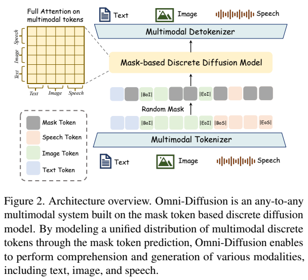
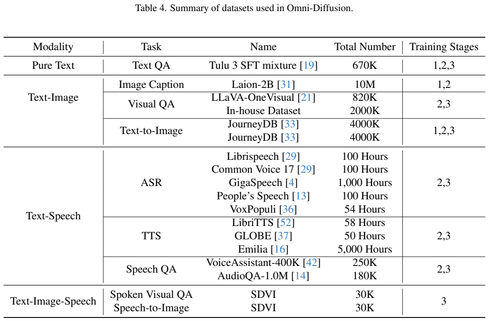
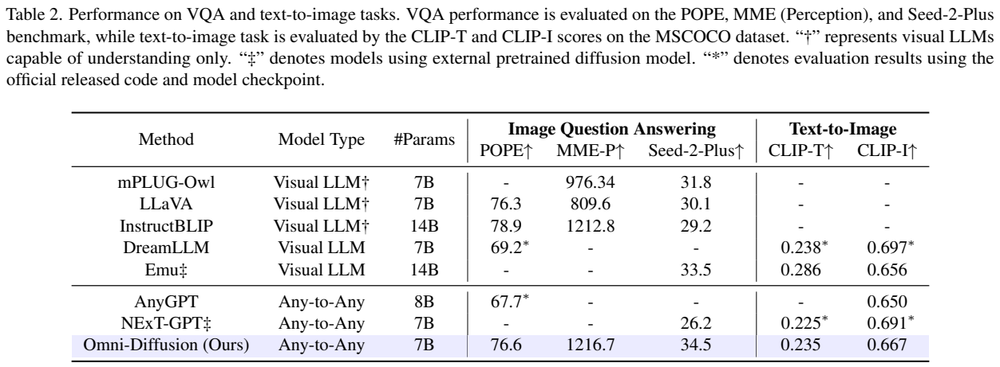
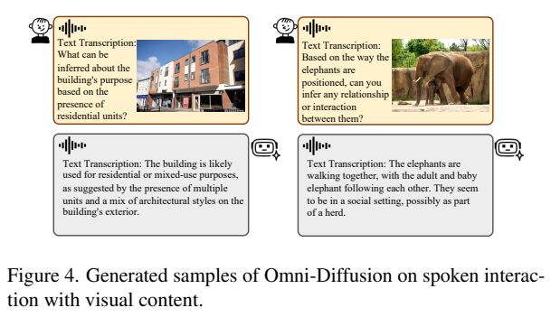
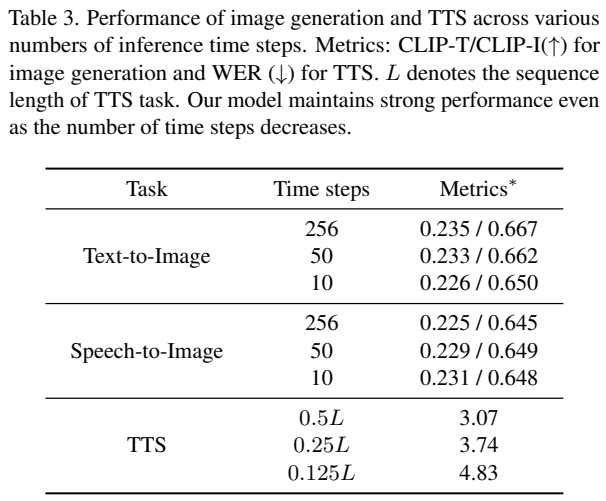
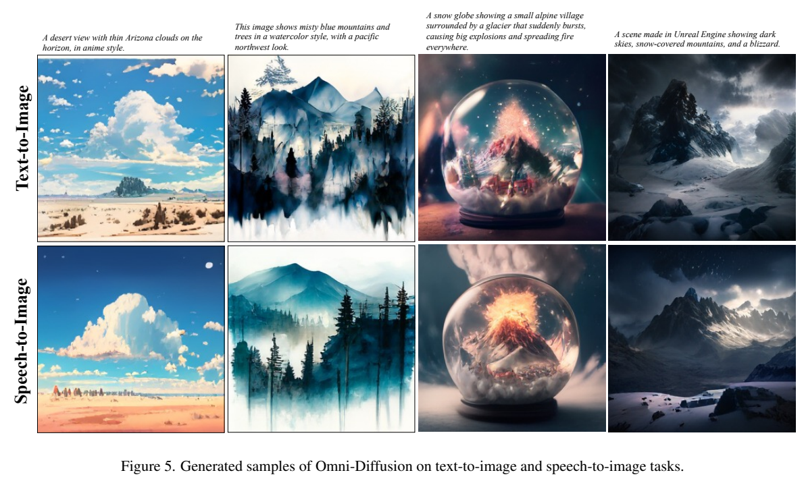
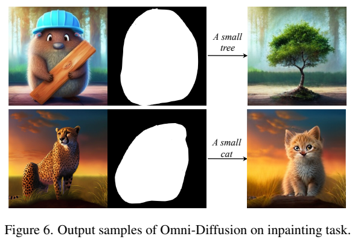
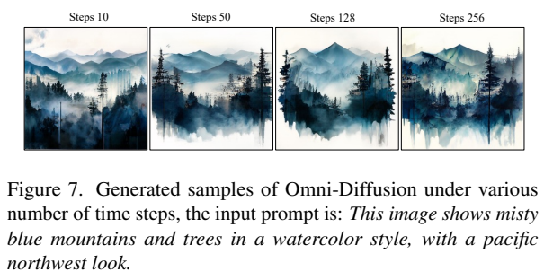

<!-- article-header:start -->
[项目首页](../../../README.md) › [模型系列](../../../reports/model-family-index.md) › [Omni-Diffusion](../README.md)
<!-- article-header:end -->

# Omni-Diffusion：以掩码离散扩散统一图像、文字与语音

<!-- article-toc:start -->
<a id="article-toc"></a>

**本篇目录** · [论文定位](#paper-info) · [快速概览](#overview) · [整体架构](#architecture) · [核心原理](#principles) · [数据构建](#data) · [训练流程](#training) · [实验结果](#experiments)
<!-- article-toc:end -->

<a id="paper-info"></a>

## 1. 论文信息与模型定位

| 项目 | 信息 |
| --- | --- |
| 原标题 | Omni-Diffusion: Unified Multimodal Understanding and Generation with Masked Discrete Diffusion |
| 作者与机构 | Lijiang Li、Zuwei Long、Yunhang Shen 等；南京大学、腾讯优图、中科院自动化所 |
| 核验版本 | [arXiv 2603.06577v1](https://arxiv.org/abs/2603.06577v1)，2026-03-06，13 页 PDF |
| 项目 | [Omni-Diffusion 官方项目页](https://omni-diffusion.github.io) |
| backbone | Dream-7B-Instruct 掩码离散扩散语言模型 |
| 范围 | 文字、图像、语音理解与生成，语音驱动的看图问答和图像生成 |

Omni-Diffusion 把多模态输出直接组织成共享序列中的离散 token，用同一预测模型完成去掩码。重点不是增加一个独立图像生成专家，而是探索 diffusion language model 在跨模态对齐中的能力，并处理固定响应长度、重复图案和语音输出缺乏文字语义辅助的问题。论文中的 any-to-any 限定于其文字、图像和语音任务，未验证视频或任意传感器模态。本文根据 v1 全文及附录介绍；实验是作者报告，未执行推理复现。

<a id="overview"></a>

## 2. 快速概览

模型先学文字与图像，再加入语音，最后使用约 60K 语音驱动视觉交互数据打通组合任务。它允许“说一句提示，生成图像”和“展示图像并用语音提问，再收到语音答案”，同时保留普通视觉问答、文生图、ASR、TTS。

| 关键设计 | 作用 |
| --- | --- |
| 扩展 Dream 词表 | 新增 8,192 个图像码和 16,384 个语音码，共用序列预测 |
| 衰减尾部 PAD 掩码 | 避免长 padding 占据过多恢复训练，改善可变长度回答 |
| 负熵置信度解码 | 优先确定分布集中、较有把握的位置 |
| 图像位置惩罚 | 给序列尾部 logits 降温度系数，软限制过早两端同时解码 |
| 语音起始 token 预填 | 在响应内部预留文字与语音区域，使生成语音能参考文字 |
| 自适应初始长度 | TTS 根据文字长度，ASR 根据语音长度设置待恢复 token 数 |

其价值是把理解和多模态生成放进一个可控掩码过程。结果也暴露了代价：ASR WER 7.05 仍明显高于 GLM-4-Voice 的 2.82，TTS 减少去噪步数后 WER 逐步上升。支持多任务不等于每项均达到专家模型最佳水平。

<a id="architecture"></a>

## 3. 整体架构



**读图：** Figure 2 的文本、图像、语音片段由各自的开始/结束标记包围，随机替换部分内容为 MASK，网络用 full attention 恢复不同颜色的 token。图中没有语言自回归路径与独立图像扩散路径的分叉；同时，图下的 tokenizer 和图上的 detokenizer 仍不可缺少，“统一 backbone”不能说成无需模态编码解码。

图像使用预训练 MAGVIT-v2，空间下采样因子 16，码本 8,192。理解与生成共享这套离散图像表示，生成后的码序列交给对应图像解码器还原像素。语音输出采用 GLM-4-Voice 的离散表示和解码器，其 finite scalar quantization 码本为 16,384，速率 12.5 token/s；一个语音 token 表示一段压缩声音信息，并不是一个音素或一个单词。

输入语音的实现另有重要细节：论文 §3.2 使用 SenseVoiceSmall 提取语义表示，再用轻量 MLP 投到 backbone 隐藏维度。这是连续特征输入路径，与 GLM-4-Voice 输出离散 token 的路径并不相同。虽然 §3.1 用统一离散语音 token 的理想化符号表达联合建模，实际架构不能写成“所有输入语音都由同一个 GLM 离散 tokenizer 编码”。

Dream-7B-Instruct 的 embedding 和输出层随新增图像/语音词表扩展，其余 backbone 架构保持。模型读取混合条件后，针对完整输出序列并行计算各位置分类分布，通过多轮确定部分位置实现生成。固定某些 token 也可以定义局部补全任务，不需要从第一位置开始生成到最后位置。

<a id="principles"></a>

## 4. 核心创新与数学原理

**共同训练目标。** 原文 Eq. (1) 令干净序列为 $`x_0`$、损坏后为 $`x_t`$，时间决定掩码比例：

```math
\mathcal L=-\mathbb E_{t,q(x_t\mid x_0)}\left[\sum_{i=1}^{L}\mathbf1[x_t^i=\mathrm{MASK}]\log p_\theta(x_0^i\mid x_t)\right].
```

只有被掩码的位置计入交叉熵，图像与语音的生成也都是离散分类任务。**这篇的公式没有 MMaDA 的 $`1/t`$ 因子**，不能因同属离散扩散就照搬另一篇的加权目标。它也没有给每个模态另设连续噪声 MSE。联合损失鼓励在可见文字、图像、语音条件中恢复缺失内容，但共享词表本身并不保证所有组合任务均已有效对齐，还需要数据覆盖。

**负熵决定先生成哪里。** 论文 Eq. (2) 是：

```math
c_t^i=-H(p_t^i)=\sum_{v=1}^{V}p_t^{i,v}\log p_t^{i,v},\qquad p_t^i=\mathrm{softmax}(z_t^i).
```

分布越集中，熵越小，$`c`$ 越大。每步选择最高置信度的 top-$`k`$ 位置，从这些位置的概率分布采样 token，其余位置继续保持 MASK。选择位置和选择具体 token 是两个环节，不是对每个位置直接 argmax。重复惩罚与 classifier-free guidance 先调整 logits，再算分布；报告没有给全套推理系数，不能补出一个唯一默认配置。

**位置惩罚为何会改变解码顺序。** 作者观察到两端向中间同时生成时，上下图像区域容易出现相似重复图案，因而在早期将最后 $`N_t`$ 个位置 logits 乘 $`\gamma_p\lt 1`$。这不是强制的块状自回归，而是降低尾部的确定性。用标准 softmax 温度解释，$`\mathrm{softmax}(\gamma_p z)`$ 等价于升高温度，通常使分布更平，负熵置信度降低，在 top-$`k`$ 排序中更晚被选中。

更精确地，对固定 logits $`z`$，标准微分给 $`\frac{d}{d\gamma}H(\mathrm{softmax}(\gamma z))=-\gamma\,\mathrm{Var}_{p_\gamma}(z)\le0`$；减小正数 $`\gamma`$ 因而增加熵。这是本文用于解释策略的数学推导，**不是论文另一个编号公式或对重复图案消除的严格保证**。附录配置为 $`\gamma_p=0.5`$、$`N_T=L-100`$，未完整给出每个时间点如何随 $`t`$ 调整惩罚范围。

**尾部 PAD 的训练权重。** 在样本结尾随机加 PAD 后，若普通 token 掩码概率为 $`r`$，PAD 使用 $`\gamma r`$，$`\gamma=0.6`$。在相同 $`r`$ 下，一个 PAD 进入恢复损失的期望次数降为普通 token 的 0.6 倍。这是采样频率衰减，不是把 PAD 损失硬置零；模型仍能学习回答何时结束。也不能据此说可变长度问题完全解决，因为推理仍需预设一个待恢复序列长度。

**文字辅助的语音去噪。** 在输出约 $`0.25L`$ 位置预填 `[begin-of-speech]`，前段引导文字响应、后 $`0.75L`$ 引导对应语音。双向注意力使语音位置在逐轮修正时能利用逐渐确定的文本语义，而不是等全部文字完成再调用独立 TTS。这个布局是解码控制手段，不代表任意 utterance 都恰好按 1:3 token 比例占用空间。

<a id="data"></a>

## 5. 数据构建与处理



**读表：** Table 4 中语音规模以小时表示，文字和图像以样本数表示，不能直接相加成统一“样本总量”。Tulu 3 SFT mixture 670K 跨三阶段维持纯文本能力；LAION-2B 选出 10M caption，视觉 QA 包含 LLaVA-OneVision 820K 和内部 2M。表中 JourneyDB 4M 写了两次，报告没有说明是重复排版还是两个数据版本，本文不把它们擅自相加成 8M 唯一样本。

ASR 包含 LibriSpeech 100 小时、Common Voice 17 100 小时、GigaSpeech 1,000 小时、People's Speech 100 小时、VoxPopuli 54 小时。TTS 包含 LibriTTS 58 小时、GLOBE 50 小时、Emilia 5,000 小时；Speech QA 另用 VoiceAssistant-400K 的 250K 和 AudioQA-1.0M 的 180K。数据集名称里的“400K/1.0M”不是本项目最终采用数量。

SDVI 的 spoken visual QA 以 LLaVA-OneVision 图像问答为基础，先去掉数学计算和编程题，把多选答案替换为相应文本内容并改成开放问答，再删除回答超过 100 个词的样本。CosyVoice2 用 GigaSpeech 随机 1,000 个语音样本做 question 侧声音克隆；answer 侧采用固定声音。每条包含图像、输入语音问题、文本答案和输出语音答案，约 30K。其处理有助于日常短对话，同时意味着不应把 SDVI 当成复杂数学或编程口语推理数据。

speech-to-image 则以 Blip3o-Pretrain-JourneyDB 的流畅描述和图像构建，采用同样的 1,000 种输入声音条件生成 30K 语音图像对。这是合成语音覆盖，不等于真实用户在噪声环境、重口音或口语省略情况下的稳健性验证。全文未完整披露内部 2M VQA 的来源和全部去重规则，介绍保留这一信息缺口。

<a id="training"></a>

## 6. 训练流程与目标

| 阶段 | 任务与目的 | 学习率 |
| --- | --- | --- |
| Stage 1 | caption 与文生图，先做图像—语言对齐，保留纯文本 QA | $`10^{-4}`$ |
| Stage 2 | 图文继续训练，增加 ASR/TTS 与语音 QA，建立语音—文字联系 | $`10^{-4}`$ |
| Stage 3 | SDVI spoken visual QA/speech-to-image，辅以文字与语音问答，强化组合任务 | $`10^{-5}`$ |

附录 A 指定 AdamW，$`\beta_1=0.9`$、$`\beta_2=0.95`$、$`\epsilon=10^{-8}`$；各阶段最大序列长度 3,072。正文和 Table 4 在个别任务加入时间上不完全一致，例如 VQA 表列 Stage 2/3，speech QA 也列 2/3，故以数据表细项理解阶段内容，不把正文的概括列表当作排他清单。报告没有完整给 GPU 数、训练步数、global batch、哪些前端冻结或所有采样超参数，不编造这些设置。

推理长度使用经验倍率：TTS 初始化长度约为输入文本 token 长度的 3.5 倍，ASR 约为语音 token 长度的 0.2 倍。这是同训练表示下的启发式比例，不是语言学普适关系，且不能将 SenseVoice 连续特征长度与 GLM 输出 token/s 无条件互换。适当缩短待恢复序列可以减少解码负担，但过短也可能截断内容。

图像采样实验从 256 个 MASK 开始，比较 256、50、10 步；TTS 用 $`0.5L`$、$`0.25L`$、$`0.125L`$ 步。这些代表前向次数与输出 token 数的相对关系，没有硬件吞吐和端到端计时，不能直接宣布获得 25.6 倍真实速度。模型也未在本报告中采用 CoT RL、GRPO 或 DPO，避免把相近扩散论文的后训练配方移植过来。

<a id="experiments"></a>

## 7. 实验设置与主要结果

语音评测 Table 1 的 LibriSpeech ASR WER 为 Omni-Diffusion 7.05、AnyGPT 8.50、GLM-4-Voice 2.82，越低越好：它改善了 AnyGPT，但仍明显落后于语音专用 LLM。LibriTTS TTS WER 为 3.07，对比 CosyVoice 2.89、GLM-4-Voice 5.64。TTS WER 由 Whisper-Large-v3 转写合成声音后计算，评价内容可识别性，不能独自涵盖自然度、说话人相似度和情感控制。表注声称优于专用 TTS，数值实际仍略差于 CosyVoice，本文按数值描述。







**读表：** Table 2 的星号表示作者用公开代码/权重复测，双匕首表示使用外部预训练扩散模型，不能忽略基线实现差异。Omni-Diffusion POPE 76.6、MME-P 1,216.7、Seed-2-Plus 34.5；POPE 低于 InstructBLIP 78.9，但 MME-P 略高于其 1,212.8。本文的 LLaVA 行是早期 76.3/809.6/30.1，不能冒称 LLaVA-v1.5 或当前最佳。Seed-2-Plus 与常用 SEED-Bench 也不是同一个指标。

文生图从 MSCOCO 2014 validation 随机 10,000 样本比较：CLIP-T 0.235、CLIP-I 0.667。前者是提示与生成图像的 embedding 余弦相似度，后者是生成与参考真图的相似度。CLIP-T 高于 NExT-GPT 0.225，却低于 Emu 0.286 和 DreamLLM 0.238；CLIP-I 高于 AnyGPT 0.650、Emu 0.656，低于 DreamLLM 0.697、NExT-GPT 0.691。它在多模态覆盖与质量间具有一定平衡，不能写成文生图所有基线第一。

| 采样任务 | 多步设置与指标 | 少步设置与指标 |
| --- | --- | --- |
| 文生图 CLIP-T / CLIP-I | 256 步：0.235 / 0.667；50 步：0.233 / 0.662 | 10 步：0.226 / 0.650 |
| 语音生图 CLIP-T / CLIP-I | 256 步：0.225 / 0.645；50 步：0.229 / 0.649 | 10 步：0.231 / 0.648 |
| TTS WER | $`0.5L`$ 步：3.07；$`0.25L`$ 步：3.74 | $`0.125L`$ 步：4.83 |

语音生图输入用 CosyVoice2 把同一 COCO captions 合成为语音。文本与语音条件的分数接近但未完全相等，语音结果也不单调随步数改善；说明跨模态对齐有可行性，不能断言没有误差。TTS 从 3.07 到 4.83 的错误率变化则明确显示少步生成的质量成本。Table 3 没有置信区间，细小差异不宜写成统计显著结论。







**读图：** Figure 5 上下行对应同内容的文字和语音提示，语义近似而构图并不相同；Figure 6 在保留背景的条件下替换中心对象；Figure 7 的 10/50/128/256 步例子仍呈现不同细节。图中全部提示、行标签和图注保留。局部补全利用掩码目标，作者称无需额外 inpainting 微调，但只给定性例子，未提供大规模编辑一致性或局部保真度评测。

报告没有提供足够的策略逐项消融来单独量化尾部掩码、位置惩罚、预填 token 各自的增益，也没有与所有同期大型全模态模型在统一预算下比较。其主要贡献是证明 Dream 类掩码语言模型可扩展到文字、图像和语音的组合任务，并通过可控解码改善输出；现有结果仍不足以认定其在全面理解、实时交互和专家级生成上均领先。

<!-- article-footer:start -->
---

[← 上一篇：Beyond Language Modeling](../../beyond-language-modeling/arxiv-2603.03276/README.md) · [按发表时间浏览](../../../reports/paper-reading-guide.md#year-2026) · [下一篇：InternVL-U →](../../internvl/arxiv-2603.09877/README.md)

[返回本篇目录](#article-toc) · [返回模型系列](../README.md)
<!-- article-footer:end -->
