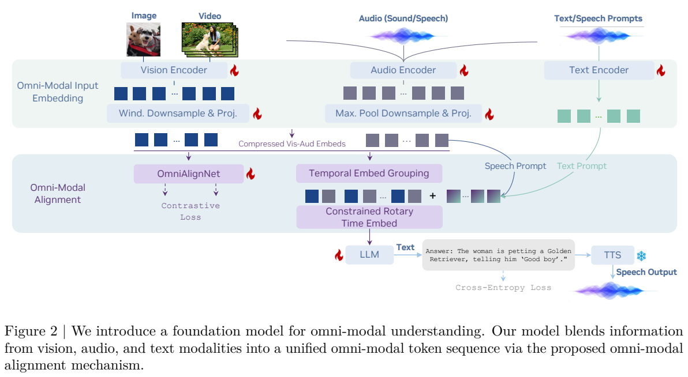
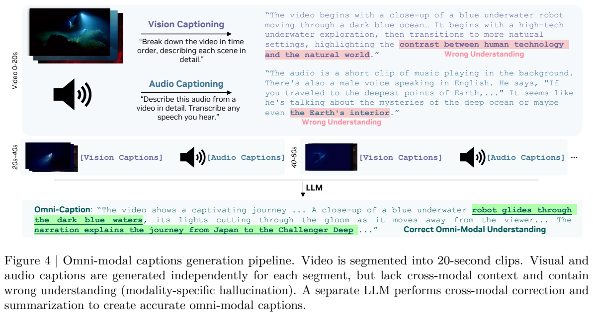
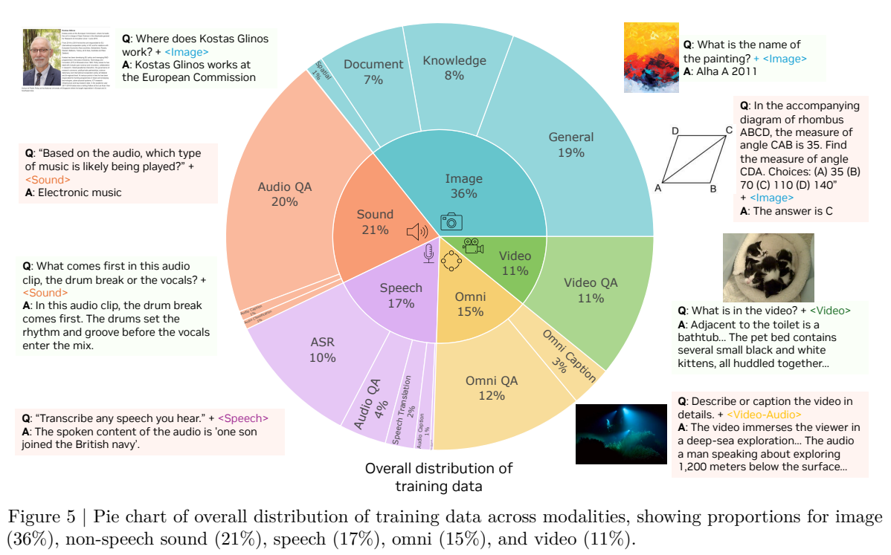
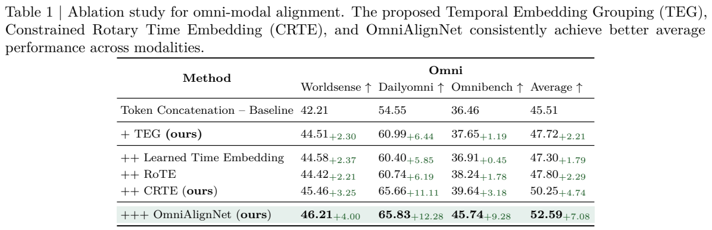
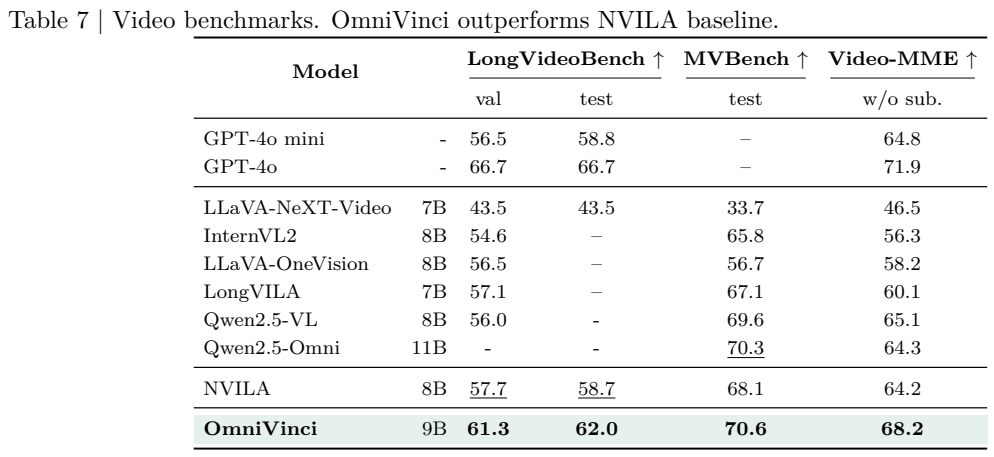
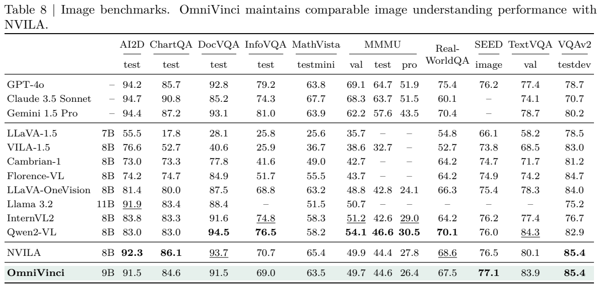

<!-- article-header:start -->
[项目首页](../../../README.md) › [模型系列](../../../reports/model-family-index.md) › [OmniVinci](../README.md)
<!-- article-header:end -->

# OmniVinci：让视觉、声音与时间在共享空间中对齐

<!-- article-toc:start -->

**本篇目录** · [论文定位](#paper-info) · [快速概览](#overview) · [整体架构](#architecture) · [核心原理](#principles) · [数据构建](#data) · [训练流程](#training) · [实验结果](#experiments)
<!-- article-toc:end -->

## 1. 论文信息与模型定位

[OmniVinci: Enhancing Architecture and Data for Omni-Modal Understanding LLM](https://arxiv.org/abs/2510.15870) 是 NVIDIA 团队的全模态理解报告，作者包括 Hanrong Ye、Chao-Han Huck Yang 等。本文固定依据 **2510.15870v1**：arXiv 标注提交于 2025 年 10 月 17 日，PDF 首页另印 2025-10-20。模型以 Qwen2.5-7B-Instruct 为语言起点，在主实验表中归为 **9B 总规模**，支持图像、视频、自然声音、语音与文字输入。[PDF 第 1、5、10 页](https://arxiv.org/pdf/2510.15870v1#page=1)

研究重点是理解同一事件中的多种感官信号。例如，画面中的动作与解说中的名称必须关联，某个声音发生的时间必须对应到画面的变化。模型直接生成文本；需要说话时连接现成 TTS，不能将其描述为从头训练、与理解主干同一生成机制的端到端原生语音模型。机器人、医疗和工厂任务是报告中的下游适配与评测应用，并非模型默认就获得通用机器人控制或临床决策能力。

## 2. 快速概览

| 技术层面 | OmniVinci 的选择 |
|---|---|
| 视觉输入 | SigLIP 与 NVILA 风格的多尺度压缩，图片和视频帧共享编码管线。 |
| 音频输入 | Audio Flamingo 3 的 AF-Whisper 编码器同时处理语音、音乐与自然声音，最大池化压缩 token。 |
| 语义对齐 | OmniAlignNet 将同一视频的视觉和音频汇聚表示做双向对比学习。 |
| 相对时间 | Temporal Embedding Grouping，按时间窗交错视觉与音频 token。 |
| 绝对时间 | Constrained Rotary Time Embedding，使用受时间尺度控制的多频率旋转。 |
| 数据 | 约 2,400 万对话、150 多个子数据集；隐式带音视频监督与显式联合描述、问答共同训练。 |
| 联合阶段 | 约 200B token，视觉与音频编码器冻结；可追加 GRPO 全模态推理后训练。 |

与简单拼接所有视频 token 再拼接所有音频 token 相比，本文的方法同时回答三个问题：两路是否说同一件事、哪段信息发生在一起、它发生在什么绝对时间。这三个目标由不同模块承担。[PDF 第 2–5、30 页](https://arxiv.org/pdf/2510.15870v1#page=2)

## 3. 整体架构

**Figure 2 的读法。** 上方是图像/视频、音频、文字或语音提示的输入路径；中间左侧 OmniAlignNet 提供对比学习，中间右侧对 token 做时间分组与旋转；下方 LLM 生成文本，最右侧 TTS 将文本渲染成声音。图中的训练符号描述总体框架，具体冻结范围仍应按训练阶段阅读，不能从总图推断联合阶段所有编码器都训练。

视觉编码器固定版本为 `paligemma-siglip-so400m-patch14-448`。多尺度 Dynamic S2 管线把最大尺度调到可被 448 整除的切片布局并保留长宽比，将各尺度特征对齐、拼接，再由两层 MLP 投影到公共潜在空间。视频均匀采样帧，使用同样的图片管线，并进一步进行时间池化；音视频都保留时间戳，为后续排列与编码提供依据。

音频统一采样到 16 kHz，以 STFT / mel 谱进入 AF-Whisper，卷积与 Transformer 同时提取局部声音及长程信息，再经两层 MLP 投影。附录设置为 128 通道 mel、25 ms 窗和 10 ms 步长，描述 30 秒音频形成 750 个顺序特征。最大池化进一步减半 token 数，降低长音频对上下文的占用。语音提问使用同一音频编码器，不必先转录成文字；文字则使用语言模型的 token 嵌入。[PDF 第 28、30–31 页](https://arxiv.org/pdf/2510.15870v1#page=28)

OmniAlignNet 接收已投影的视觉序列 $`E_v\in\mathbb R^{N_v\times C}`$ 与音频序列 $`E_a\in\mathbb R^{N_a\times C}`$，各用一个查询读取固定长度表示，再经过三层自注意力模块和 L2 归一化，得到用于对比的视觉与音频向量。它是训练的语义对齐机制，不把完整视频压缩成一个向量后供所有任务使用；进入 LLM 的仍是压缩并按时间组织的 token 序列。[PDF 第 3 页](https://arxiv.org/pdf/2510.15870v1#page=3)

## 4. 核心创新与数学原理

首先是视频级语义对齐。对同一批 $`K`$ 个视频，令归一化表示为 $`V_i,A_i`$，相似度 $`s_{ij}=V_i^\top A_j`$。将原文 Eq. (1) 的批大小统一写成 $`K`$，双向目标为：

$$
L_{v\to a}=-\frac1K\sum_i\log
\frac{\exp(s_{ii})}{\sum_j\exp(s_{ij})},\qquad
L_{a\to v}=-\frac1K\sum_i\log
\frac{\exp(s_{ii})}{\sum_j\exp(s_{ji})},
$$

$$L_{\mathrm{o-align}}=\tfrac12(L_{v\to a}+L_{a\to v}).$$

同一视频的两路为正样本，不同视频为负样本。该目标使“画面与声音表达相同事件”更容易被主干利用，但视频级对比无法单独判断第几秒的声音对应第几秒的动作，因此还需要时间机制。原文公式没有显式温度项，本篇不自行添加温度超参数。

TEG 把时间分成长度为 $`T_G`$ 的窗口。若两个窗口的视觉组为 $`G_v^1,G_v^2`$，音频组为 $`G_a^1,G_a^2`$，输入改排为：

$$E_{\mathrm{group}}=[G_v^1,G_a^1,G_v^2,G_a^2].$$

这保留同一时间窗内的邻近关系，让因果语言模型更容易把同期画面与声音联系起来。但组序本身只告诉模型“先后”，无法单独区分相同事件间隔 1 秒还是 1 分钟。

CRTE 向嵌入加入真实时间戳。原文使用由最大时间尺度 $`T_{\max}`$ 与频率缩放参数 $`\theta`$ 控制的几何频率族，令 $`\Omega_{i,j}=\omega_i t_j`$，Eq. (5) 为：

$$\mathrm{CRTE}(x,\Omega_{:,j})=
x\odot\cos\Omega_{:,j}
+\mathrm{RotateHalf}(x)\odot\sin\Omega_{:,j}.$$

高频维度对近距离时间变化敏感，低频维度提供更长时间尺度的线索。时间尺度限制尝试平衡局部与全局敏感度，而不是声称任意长视频上绝无周期混叠。报告没有给出足以将 $`T_G,T_{\max},\theta`$ 全部数值化复现的统一配置，本篇保留机制不编数值。[PDF 第 3–5 页](https://arxiv.org/pdf/2510.15870v1#page=3)

推理后训练的 GRPO 使用同一全模态问题的 8 个回答，以规则评定格式和准确性，再按组内均值与标准差得到 $`A_i=(r_i-\bar r)/\sigma(r)`$。原文 Eq. (6) 包括新旧策略概率比的截断优化与参考策略 KL 惩罚。这与某些报告移除 KL 的 GRPO 变体不同，不能混写。它增强已有理解基础，不会凭组内相对奖励自动解决所有音视频标注错误。[PDF 第 10–11 页](https://arxiv.org/pdf/2510.15870v1#page=10)

## 5. 数据构建与处理

**Figure 4 的读法。** 顶部独立视觉描述和音频描述分别可能误解视频主题；中部按 20 秒切片生成两路文本，底部另一 LLM 综合这些描述形成联合 caption。例子中深海画面与解说共同解释潜水地点，单看图或单听音都容易遗漏线索。合成模型综合两路描述，这不等于获得完全正确的人工全模态标注。

作者采用两类音视频数据。隐式数据保留已有视频 QA 的音轨，使模型回答原问题时可以利用声音；但标签未必必须同时依赖两路。显式数据通过数据引擎分别描述视觉与音频，再跨模态校正与汇总，主文提到形成每 2 分钟片段的联合描述，再用推理 LLM 从联合描述产生带推理轨迹的问答。20 秒底层切片与 2 分钟汇总属于不同层级，不应写成互相冲突的唯一片长。Magpie TTS 另把文字问题合成语音，形成语音提示与视觉内容配对的数据。[PDF 第 5–6 页](https://arxiv.org/pdf/2510.15870v1#page=5)

**Figure 5 的读法。** 内环为模态类别，外环为任务；图片 36%、非语音声音 21%、语音 17%、全模态 15%、视频 11%。全模态又包括约 12% QA 与 3% caption。图下的 Table 1 是对齐机制消融，不能将三项基准平均分解释为训练数据类别的准确率。

整体约 2,400 万对话，150 多个子数据集，包含一般视觉、知识、文档、空间、声音问答、ASR、翻译和视频 QA；附录明确给出约 360 万全模态对话，并继承 NVILA 与 Eagle-2.5 的视频数据。附录 C.4 的绝对计数段有两个类别都写成 speech-text，且与 Figure 5 的比例不能完全相互还原，因此本篇采用图中明确分类和整体近似规模，不替作者修正类别名称或编出精确清单。[PDF 第 30 页](https://arxiv.org/pdf/2510.15870v1#page=30)

## 6. 训练流程与目标

训练先形成各模态能力，再联合融合这些能力。视觉路线沿用 NVILA 五阶段：仅训练投影器；训练视觉编码器与投影器；冻结视觉编码器而训练投影器和 LLM 的大规模预训练；全参数图片指令微调；全参数视频指令微调。得到视觉 checkpoint 后，音频第一阶段冻结语言与视觉侧，仅对齐音频编码器及压缩/投影模块，使用 5 万音频语言对；第二阶段对音频编码器、投影器与 LLM 端到端训练，使用约 960 万音频 SFT 样本。

作者观察到仅音频训练后视觉能力下降，因此联合阶段混合旧的单模态数据、隐式音视频和显式合成全模态数据。联合阶段**冻结视觉与音频编码器**，基础学习率 $`2\times10^{-5}`$，前 3% 数据线性预热，之后余弦调度，约 **200B token**。自动回归回答的交叉熵与 OmniAlignNet 对比目标分别学习任务输出与跨模态表示；报告没有公布可补全所有阶段的损失权重、GPU 总数与步数。200B 是报告明确的联合阶段 token 口径，语言主干、视觉及音频初始化仍继承上游预训练成本，不能据此声称模型从零开始只用这些 token。[PDF 第 29–30 页](https://arxiv.org/pdf/2510.15870v1#page=29)

追加 GRPO 使用数据引擎构建的 1.8 万全模态选择题。Long-RL 框架允许最多 64 帧，最大提示 1,024 token、回答 2,048 token；更新批量 64，每问题 rollout 8 条，温度 1.0、top-p 0.99。强化学习 checkpoint 与基础 OmniVinci 成绩分别报告，不能把 RL 后分数统一填到主表。语音输出采用外接 Magpie 等 TTS；ASR 进一步提升的 cascaded/RAG 路线还引入额外 ASR 系统和决策式适配，也不是基础模型无额外成本的成绩。[PDF 第 11、32–36 页](https://arxiv.org/pdf/2510.15870v1#page=11)

## 7. 实验设置与主要结果

架构消融使用按原始数据规模加权采样的 10B token 子集。Table 1 的全模态平均分从直接拼接的 45.51，依次到 TEG 的 47.72、TEG+CRTE 的 50.25、再加 OmniAlignNet 的 52.59。OmniAlignNet 的边际增益是 2.34，累计增益 7.08 则相对最初基线，两者口径要区分。数据消融在 27 万带音视频对话上继续训练：无字幕 Video-MME 从仅视觉 61.67，提高至隐式音视频 63.76，再加显式数据引擎 67.37；短视频部分仅加隐式数据反而回退，增益并非每个子集一致。[PDF 第 6–8 页](https://arxiv.org/pdf/2510.15870v1#page=6)

| 主实验指标 | OmniVinci | Qwen2.5-Omni / 相关对照 |
|---|---:|---|
| WorldSense | 48.23 | Qwen2.5-Omni 45.40。 |
| DailyOmni | 66.50 | Qwen2.5-Omni 47.45，增加 19.05 个百分点。 |
| OmniBench | 46.47 | Qwen2.5-Omni 56.13，此项更低。 |
| 三项全模态平均 | 53.73 | Qwen2.5-Omni 49.66。 |
| MMAR 音频问答 | 58.40 | Qwen2.5-Omni 56.70。 |
| MMAU 完整 test 平均 | 71.60 | Qwen2.5-Omni 71.00；不能与 test-mini 混比。 |
| LibriSpeech clean / other WER | 1.7 / 3.7 | 跨五项平均 WER 为 6.3，低于 Qwen2.5-Omni 表中 6.8，但高于 Phi-4-MM 5.2。 |

**实验页的读法。** 上表将视频 val/test 分开，Video-MME 为无字幕口径：OmniVinci 68.2，Qwen2.5-Omni 64.3、Qwen2.5-VL 65.1。下表同时展示图像成绩，例如 DocVQA 91.5 低于 NVILA 93.7，MathVista 63.5 低于 NVILA 65.4，TextVQA 83.9 高于 NVILA 80.1。全模态能力扩展仍有任务取舍，不能将总体增益写成所有基准领先。

GRPO 后三项全模态平均由 53.73 到 54.52。附录部署测量采用量化：视觉与音频 W8A8，LLM W4A16，结合 AWQ/SmoothQuant；单张 24GB RTX 4090 可处理最多 64 帧的实验配置。报告称首 token 约 1.7 倍、解码约 2.72 倍加速，16 帧带音频约 160 ms 首 token。该结论依赖量化、输入长度和实现，不能当全精度无限长视频的实时保证。[PDF 第 11、32 页](https://arxiv.org/pdf/2510.15870v1#page=32)

应用结果也有边界：语音导航是在 R2R-CE 微调、Habitat 模拟器中评测，成功率 50.6 低于 NVILA 53.3；医疗实验为 49 段去标识化 CT 解读视频形成的 588 道选择题，而非真实诊断决策；晶圆分类经过领域微调，WM-811K 达 98.1%。这些结果支持特定流程中的适用性，不能推出未经适配的泛化部署。原文某些应用叙述与表格数值有舍入或矛盾，本篇涉及数值时采用对应表格。[PDF 第 22、25–26 页](https://arxiv.org/pdf/2510.15870v1#page=22)

<!-- article-footer:start -->
---

[← 上一篇：NExT-OMNI](../../next-omni/arxiv-2510.13721/README.md) · [按发表时间浏览](../../../reports/paper-reading-guide.md#year-2025) · [下一篇：DeepSeek-OCR →](../../deepseek/arxiv-2510.18234/README.md)

[返回本篇目录](#article-toc) · [返回模型系列](../README.md)
<!-- article-footer:end -->
