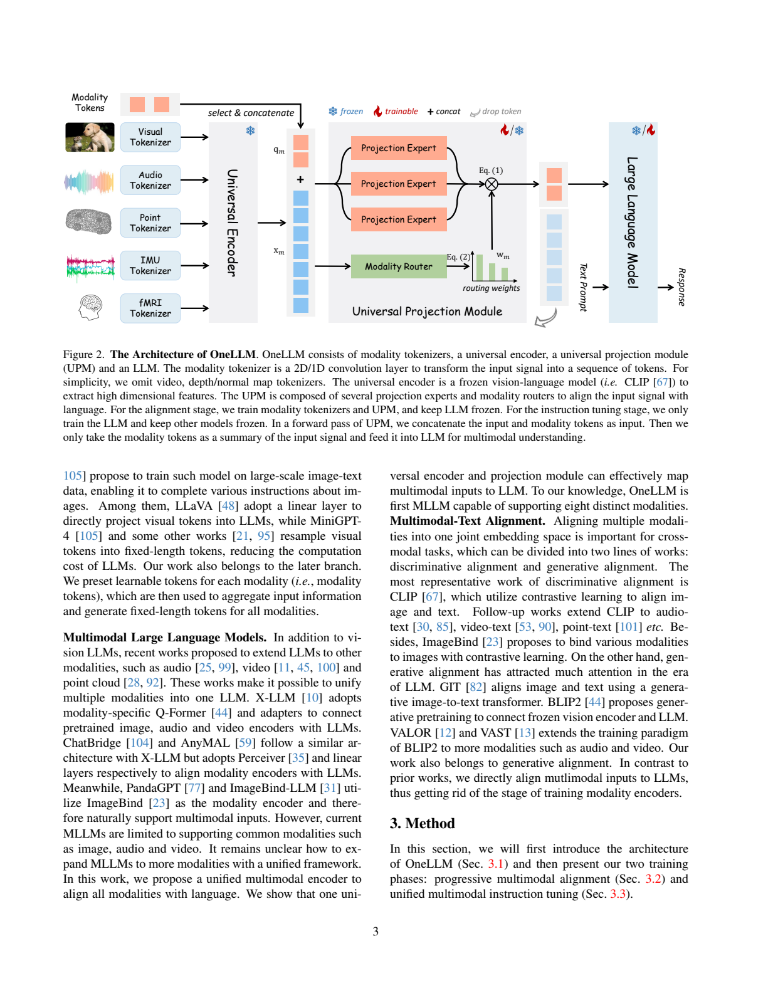
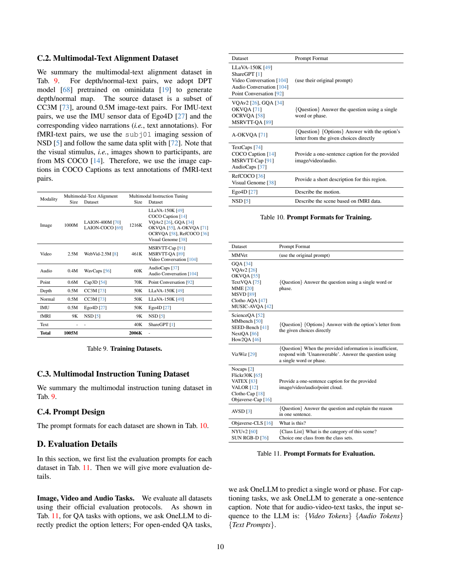
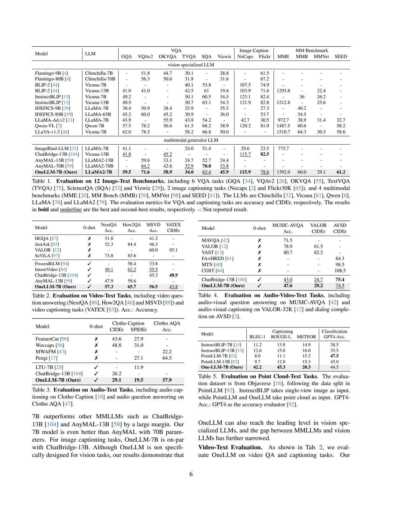
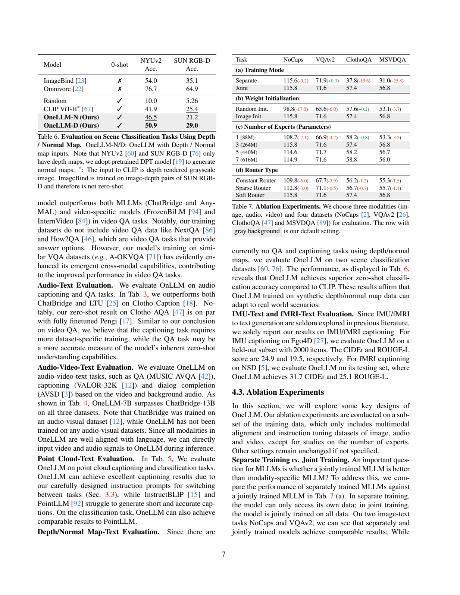

# OneLLM：共享编码器与投影专家对齐八类输入

## 1. 论文信息与模型定位

| 项目 | 信息 |
| --- | --- |
| 原文 | OneLLM: One Framework to Align All Modalities with Language |
| 作者与机构 | Jiaming Han、Kaixiong Gong、Yiyuan Zhang、Jiaqi Wang、Kaipeng Zhang、Dahua Lin、Yu Qiao、Peng Gao、Xiangyu Yue；香港中文大学 MMLab、上海人工智能实验室 |
| 固定版本 | [arXiv 2312.03700v1](https://arxiv.org/abs/2312.03700v1)，2023-12-06，18 页 |
| 项目 | [csuhan/OneLLM](https://github.com/csuhan/OneLLM) |
| 定位 | LLaMA2-7B 的多模态理解框架；八类非文字输入，文字输出 |

八类输入是图像、视频、音频、点云、深度图、法线图、IMU 和 fMRI。OneLLM 探索用共享 Transformer 处理不同信号，保留各模态轻量 tokenizer。它不生成八种模态，fMRI 实验也仅针对 NSD 中受试者观看场景后的信号与 caption，不是任意思想读取或医学诊断。以下页码对应 v1。

## 2. 快速概览

为每种模态配一个大编码器会增加组件数量，也受制于是否存在成熟的预训练底座。OneLLM 将输入先转换成 token，再让一个冻结的 CLIP-ViT 作为共享计算引擎，用通用投影模块 UPM 聚合成固定长度表示，交给语言模型生成回答。

UPM 混合三个从图文对齐初始化的投影专家。各模态有自己的可学习查询和动态路由，专家主体共享。对齐顺序从图像扩展到视频、音频、点云，再扩展到数据较少的其他模态，同时重放先前数据；最终以约 2M 指令样本全参数微调 LLM。

论文在 25 个基准报告能力。其贡献更集中在统一输入接口和跨模态迁移：少数据模态的问答从联合训练受益，但高质量图像 OCR、专门音频 caption 和视频 caption 仍有差距。Table 1 的 TextVQA 为 34.0，LLaVA-1.5 为 58.2，说明支持广泛输入与精细视觉能力需要分别衡量。

## 3. 整体架构

**读图：**左边不同 tokenizer 输出都经过同一 Universal Encoder；中间连接模态查询 $q_m$ 与输入特征 $x_m$，三个投影专家按路由权重融合；右边丢弃输入 token，仅将查询的输出作为固定长度模态摘要送入 LLM。雪花与火焰的变化表示对齐和指令两个阶段的不同冻结范围。

视觉共享编码器为在 LAION 上预训练的 CLIP ViT-L，语言模型为 LLaMA2-7B。UPM 有三个专家，每个含八层 Transformer、约 88M 参数，三个合计 264M；每模态有 30×1024 的可学习查询。进入 LLM 的是查询输出，因此通常每个模态贡献 30 个摘要 token，而不是直接输入所有网格、全部视频帧或音频 patch。

视觉类 tokenizer 为 14×14、stride 14 的二维卷积，输出通道 1024。视频各帧平行经过编码器，再逐 token 平均；这种方式降低成本，但限制细粒度时序信息，不等同于完整时间注意力。音频先转成默认 128×1024 的谱图，再用 16×16、stride 10 的卷积。点云包含位置与颜色六维信息，经最远点采样 8192 点、KNN 分组、1×1 卷积和组内 max 处理；IMU/fMRI 使用一维卷积转换。

附录部分形状无法直接按声明参数复算，例如点云 512 组与末端 1024-token 描述、IMU 的卷积参数与 391 长度、fMRI 的 8196 与 1024×8 reshape。本文保留可明确确认的信号处理路线，不把这些形状写成已验证的可运行代码。输入时多个模态的摘要都放在文字之前，音视频评测为 video tokens、audio tokens、文本提示顺序。

## 4. 核心创新与数学原理

原文 Eq. 1/2 的核心是软路由投影。设第 $k$ 个专家为 $P_k$，模态路由为 $R_m$，输入为 $[q_m,x_m]$，可按输出位置 $i$ 明确写成

$$
w_{m,i,:}=\mathrm{softmax}(R_m([q_m,x_m])_i),\qquad \bar q_{m,i}=\sum_{k=1}^{K}w_{m,i,k}P_k([q_m,x_m])_i.
$$

$K=3$，各专家权重非负且和为一。查询与输入一起在专家 Transformer 中交互，输出仅保留查询位置。原文同时给出整段序列的融合记号和 $N\times K$ 路由形状，上式着重解释实际保留的 $N=30$ 个模态位置。

这里是软融合，所有专家都有贡献；并非每个 token 只启动一个专家的稀疏 LLM MoE。常量路由固定权重为 $1/K$，稀疏路由选最大权重专家，软路由利用输入决定混合，实验偏向最后一种。使用多个图像投影专家初始化，意在把已学到的图文接口迁移给其他模态，而不是为每模态单独训练一个全新大型编码器。

逐步对齐针对数据规模不均衡。新模态加入时，从新数据与已有模态数据均衡抽样，降低遗忘；它依赖此前的数据重放，不是无需数据的零样本接口。训练属于以 caption/回答生成实现的对齐，论文没有提出新的对比式损失或信号重建目标。用标准形式 $-\sum_t\log p(y_t\mid y_{<t},\bar q_m,\mathrm{prompt})$ 可理解语言监督，但原文未明确列出所有 token 的损失掩码和各模态 loss 权重，本文不补填。

## 5. 数据构建与处理

**读表：**左表区分对齐数据和指令数据，右上是训练提示，右下是评测提示。数据来源规模不能等同于每阶段唯一消费样本数；不同任务通过提示控制长描述、单词答案和选项字母。

| 模态 | 对齐来源与规模 | 指令规模 |
| --- | --- | ---: |
| 图像 | LAION-400M 与 LAION-COCO，共 1000M | 1216K |
| 视频 | WebVid-2.5M，2.5M | 461K |
| 音频 | WavCaps，0.4M | 60K |
| 点云 | Cap3D，0.6M | 70K |
| 深度/法线 | CC3M 子集经 DPT 生成，各 0.5M | 各 50K |
| IMU | Ego4D 的传感器信号及视频叙述，0.5M | 50K |
| fMRI | NSD subj01 与对应 COCO caption，9K | 9K |
| 纯文本 | 不在该表对齐部分 | ShareGPT 40K |

指令共约 2006K，图像来源包括 LLaVA、VQAv2、GQA、OKVQA、A-OKVQA、OCRVQA、RefCOCO、Visual Genome 等；视频使用 MSRVTT caption/QA 与对话，音频使用 AudioCaps 与音频对话。深度和法线指令来自随机选出的 LLaVA-150K 图像指令再生成对应地图，并非全部真实传感器深度标注。

fMRI caption 使用受试者看到的图像描述作目标，采用与引用工作相同分割；IMU 使用 Ego4D 动作叙述。这些监督覆盖有限环境，不能外推到跨受试者或任意动作。原文未给完整重复样本、泄漏检查和清洗统计。

## 6. 训练流程与目标

对齐阶段冻结 CLIP 和 LLM，训练 tokenizer 与 UPM；指令阶段反过来冻结其他组件，**全参数微调 LLM**，并非只训练 LoRA。先学好图文投影，复制初始化 UPM 专家，然后按模态规模逐步联合对齐。

| 阶段 | 资源与步数 | 有效 batch | 最大学习率 |
| --- | --- | ---: | ---: |
| I：图像对齐 | 16 A100，200K iterations | 5120 | $5\times10^{-5}$ |
| II：视频/音频/点云加入 | 8 GPU，200K | 1080 | $10^{-5}$ |
| III：其他模态加入 | 8 GPU，100K | 1080 | $10^{-5}$ |
| 指令训练 | 8 GPU，原文写 1 epoch（96K） | 512 | $2\times10^{-5}$ |

优化器 AdamW，$\beta_1=0.9,\beta_2=0.95$，weight decay 0.1，前 2K iterations 线性 warmup。有效 batch 已计入梯度累积，不能直接视为单 GPU batch。原文对指令训练“1 epoch（96K）”与 2006K 数据、batch 512 的简单换算并不吻合，未解释采样或步数口径，本文不将它替换为推算的准确更新数。图像尺寸、视频采样帧数和音频时长未在 recipe 中充分披露，也没有墙钟成本或本仓库复现记录。

## 7. 实验设置与主要结果

**读表：**图像表将专门视觉助手与多模态 generalist 分组；下方其他模态表有 0-shot 列，不能把训练过对应任务的专门模型与未在该基准微调的模型解释成同一数据条件。caption 的 CIDEr/SPIDEr 与问答准确率也不能混成一个平均分。

| 任务 | OneLLM | 主要比较 |
| --- | --- | --- |
| 图像 VQA | GQA 59.5、VQAv2 71.6、OKVQA 58.9、TextVQA 34.0 | LLaVA-1.5 GQA 62.0、VQAv2 78.5、TextVQA 58.2；精细文字理解仍有差距 |
| 综合视觉 | MME 1392.0、MMBench 60.0、MM-Vet 29.1、SEED 61.2 | LLaVA 为 1510.7/64.3/30.5/58.6，只有 SEED 较高 |
| 视频零样本 | NextQA 57.3、How2QA 65.7、MSVD QA 56.5 | InternVideo 49.1/62.2/55.5；但监督 SeViLA NextQA 73.8 |
| 视频 caption | VATEX CIDEr 43.8 | ChatBridge 48.9 更高 |
| 音频零样本 | Clotho CIDEr 29.1、SPIDEr 19.5；AQA 57.9 | ChatBridge caption 26.2；Pengi AQA 64.5，训练条件不同 |
| 音视频 | MUSIC-AVQA 47.6、VALOR CIDEr 29.2、AVSD CIDEr 74.5 | ChatBridge 43.0/24.7/75.4；AVSD 并未超过 |
| 点云 | BLEU-1 42.2、ROUGE-L 45.3、METEOR 20.3；GPT-4 判别分类 44.5 | PointLLM-7B 分类 47.5，caption 好不等于分类最好 |

正文称音视频三项均超过 ChatBridge，但 Table 4 的 AVSD 74.5 低于 75.4；本文以表为准。OneLLM 未用成对音视频数据训练，组合输入的表现支持一定跨模态迁移，不能据此保证所有音画联合推理。不同训练条件的 Pengi 与专门模型也不能简单解释成统一模型全方面领先。

**读表：**OneLLM-D/N 的实际输入应按 D 为 depth、N 为 normal 理解，表注顺序存在歧义。深度输入在 NYUv2/SUN RGB-D 为 50.9/29.0，法线输入为 46.5/21.2；灰度深度 CLIP 为 41.9/25.4，因此法线的 SUN 分数更低，不能概括所有设置都优于 CLIP。监督 ImageBind 与 Omnivore 的数据条件不同。

IMU 在 2000 个保留样本的 CIDEr/ROUGE-L 为 24.9/19.5，fMRI NSD 测试为 31.7/25.1；没有竞争基线和跨受试者验证。Table 7 的三模态子集消融中，单独训练与联合训练 ClothoQA 为 37.8/57.4、MSVDQA 31.0/56.8；图像投影初始化比随机初始化提高 NoCaps 98.8→115.8，但 ClothoQA 57.6→57.4 略降。软路由比常量路由提升四项，增加专家至 5/7 个却没有一致收益。消融的 ClothoQA 57.4/MSVDQA 56.8 不等于主表 57.9/56.5，不能拼成同一最终配置。

附录冻结 CLIP 的显存 46GB、解冻 74GB，解冻使 ClothoQA 57.4→62.1，却使 NoCaps 115.8→106.0，体现跨模态取舍。作者承认非图像高质量数据不足，以及高分辨率图像、长音视频的细粒度理解限制。本文未运行模型或将共享结构称作已经证明最优的架构。
