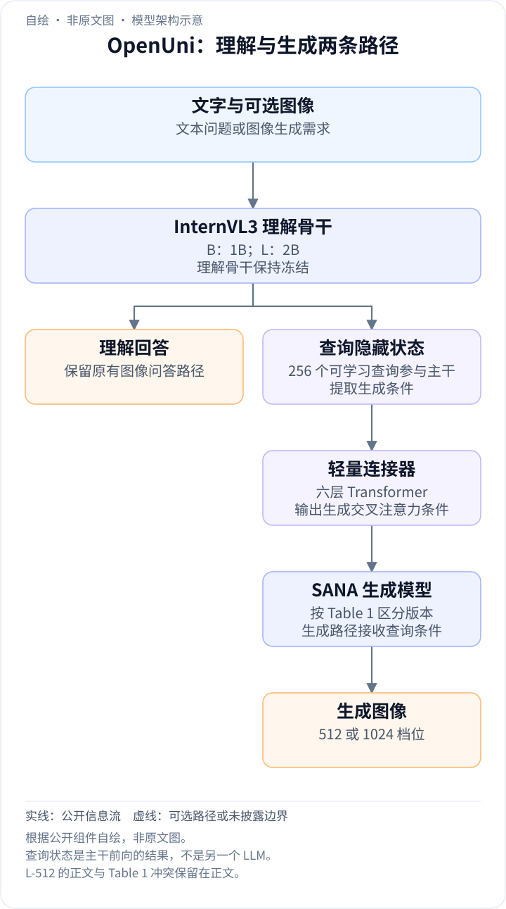
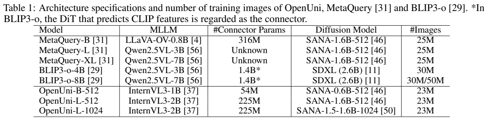
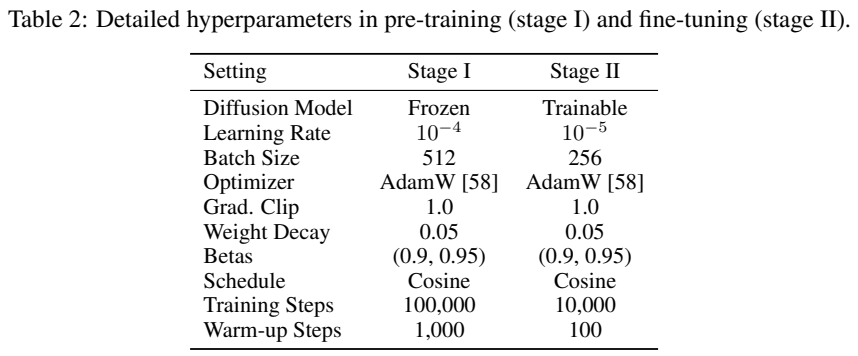
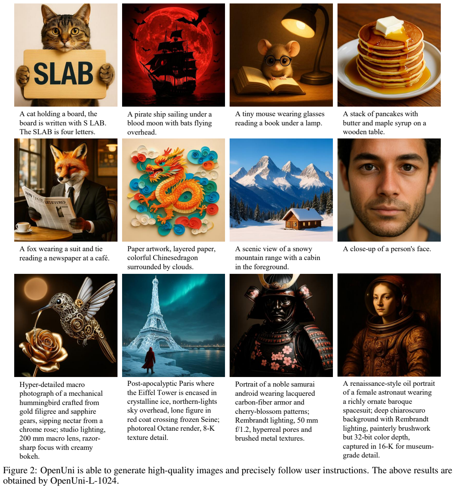
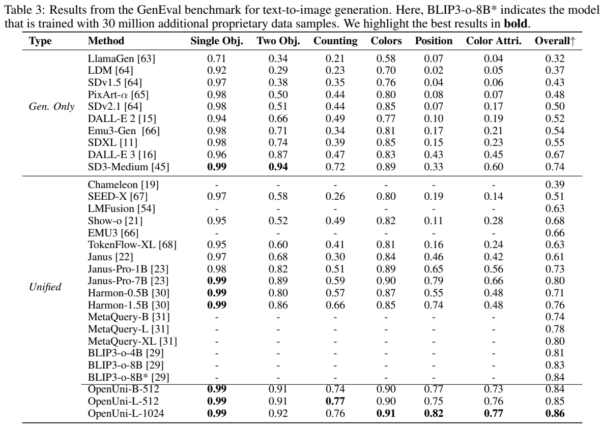
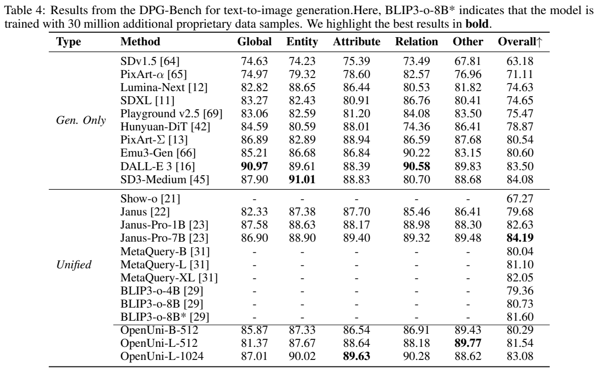
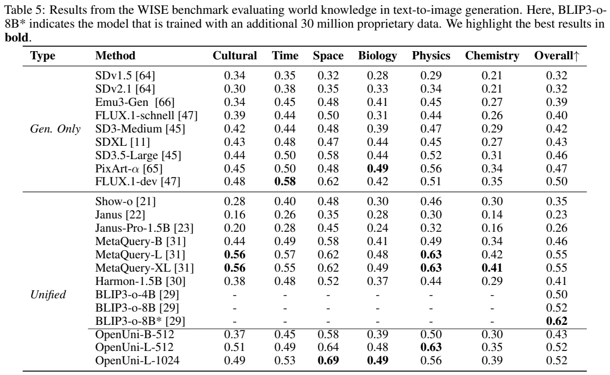

<!-- article-header:start -->
[项目首页](../../../README.md) › [模型系列](../../../reports/model-family-index.md) › [OpenUni](../README.md)
<!-- article-header:end -->

# OpenUni：用轻量查询与连接器衔接视觉语言模型和图像生成模型

<!-- article-toc:start -->
<a id="article-toc"></a>

**本篇目录** · [论文定位](#paper-info) · [快速概览](#overview) · [整体架构](#architecture) · [核心原理](#principles) · [数据构建](#data) · [训练流程](#training) · [实验结果](#experiments)
<!-- article-toc:end -->

<a id="paper-info"></a>

## 1. 论文信息与模型定位

| 项目 | 信息 |
|---|---|
| 原文 | [OpenUni: A Simple Baseline for Unified Multimodal Understanding and Generation](https://arxiv.org/abs/2505.23661v1) |
| 本文依据版本 | arXiv:2505.23661v1，2025 年 5 月 29 日，12 页 |
| 作者 | Size Wu、Zhonghua Wu、Zerui Gong、Qingyi Tao、Sheng Jin、Qinyue Li、Wei Li、Chen Change Loy |
| 机构 | 南洋理工大学 S-Lab、SenseTime Research、Tetras.AI |
| 模型 | OpenUni-B-512、OpenUni-L-512、OpenUni-L-1024 |
| 能力范围 | 图像理解产生文字回答；文字描述生成图像 |
| 定位 | 组合既有 InternVL3 与 SANA，建立训练复杂度较低、数据公开的统一理解生成基线 |

OpenUni 采用模块连接方案，把冻结的多模态语言模型知识送入独立的图像生成模块。报告以 1.1B/3.1B 激活参数强调生成规模，但没有给出覆盖全部视觉编码器、连接器及其他模块的精确总参数核算。本文将它作为作者报告的规模口径，不解释成整个系统仅拥有这些权重，也不推断模型采用稀疏专家路由。

<a id="overview"></a>

## 2. 快速概览

问题是如何给已有图像理解模型增加生成图像的能力，同时保留其理解表现。作者沿用 MetaQuery 的基本想法：用可学习查询从语言模型提取提示相关表征，经六层 Transformer 连接器转换成 SANA 可以使用的条件，通过生成模型的交叉注意力控制图像。

训练分两阶段。第一阶段用约 **23M 图文对**只学习查询和连接器，理解模型与生成模型都冻结；第二阶段使用 BLIP3-o 提供的 **60K 高质量合成图文对**，解冻生成模型并继续训练连接部分，理解模型保持冻结。

三种配置在 GenEval 上分别得到 **0.84、0.85、0.86**。最大模型在 DPG-Bench 得到 **83.08**、WISE 得到 **0.52**。理解表现则继承 InternVL3，OpenUni-L 的 MMBench 为 81.1、MMMU 为 48.6。这些证据表明轻量连接可以使既有系统兼具两种任务，但不能据此证明理解和生成在共享训练中相互改善。

<a id="architecture"></a>

## 3. 整体架构

<!-- derived-architecture:start -->


*自绘模型架构示意（非原文图）。依据下述公开资料归纳；方框表示功能组件，不代表逐层实现。*

依据：[2505.23661v1; Architecture / Table 1 / implementation details](https://arxiv.org/pdf/2505.23661v1)。
<!-- derived-architecture:end -->





**读表：** 三行 OpenUni 区分理解骨干、连接器与生成模型。54M/225M 是连接器参数，不能当作整个模型大小；512/1024 是生成图像分辨率，也不是语言上下文长度。下表中生成模块第一阶段冻结、第二阶段可训练，理解骨干在两阶段保持冻结。

| 模型 | 理解骨干 | 连接器 | 生成骨干（依据 Table 1） |
|---|---|---:|---|
| B-512 | InternVL3-1B | 54M | SANA-0.6B-512 |
| L-512 | InternVL3-2B | 225M | SANA-1.6B-512 |
| L-1024 | InternVL3-2B | 225M | SANA-1.5-1.6B-1024 |

**版本内矛盾：** 正文 Model Variants 一段将 L-512 的生成模型写成 SANA-0.6B，而 Table 1 写成 SANA-1.6B。本文配置表采用专门列出的 Table 1，并保留这个矛盾；没有运行权重或检查训练代码，因此不能宣布已经判定哪一处是实际实现。

生成时使用 **256 个可学习查询**。这些查询在语言模型前向计算中提取用户描述的条件表征，由连接器映射后送入生成模型的交叉注意力。连接器参考 SigLIP 视觉编码器架构，缩减为六层 Transformer；报告没有展开其各配置的隐藏宽度、注意力头数等完整结构表。

理解时仍使用 InternVL3 的原有图像问答能力。冻结权重使理解路径在相同输入处理和推理配置下可以保留原函数，不需要通过生成数据重新学习全部视觉理解。生成路径则多了查询、连接器和 SANA；这是一种系统级统一，不是让一个自回归语言模型直接输出全部图像像素。

SANA 的选择主要为了生成效率。本文报告说明其采用较高压缩率和线性注意力，但未给出 OpenUni 的端到端延迟、峰值显存或完整 FLOPs 对照。冻结参数减少更新与优化器状态，不等于免去理解骨干的前向计算。

<a id="principles"></a>

## 4. 核心创新与数学原理

**让查询承担从语言知识到生成条件的转换。** 以下是本文对报告文字机制的符号整理，报告没有这些编号公式。设提示为 $`p`$，可学习查询为 $`Q\in\mathbb R^{256\times d}`$，冻结的理解模型为 $`F_\phi`$，连接器为 $`P_\psi`$：


```math
H_Q=F_\phi(p,Q)\big\vert _Q,\qquad c=P_\psi(H_Q).
```


$`H_Q`$ 表示查询位置得到的表征，$`c`$ 是生成条件。具体查询位置与完整注意力掩码没有在报告中详述，这个表达式只说明数据流。相比生成一个长篇显式描述再转给图像模型，条件可以直接以连续表征传递。

**冻结模型仍可帮助学习输入查询。** 第一阶段不更新 $`\phi`$，但查询是可训练输入。若图像生成损失为 $`\mathcal L`$，梯度仍可以通过固定的 $`F_\phi`$ 传到 $`Q`$：


```math
\nabla_Q\mathcal L=J_{F,Q}^{\top}J_{P,H}^{\top}\nabla_c\mathcal L.
```


这只是链式法则的解释，并非报告新提出的定理。冻结参数不等于把整个理解模型放在阻断所有梯度的模式中；能否对查询有效反向传播取决于实现保留所需计算图。它说明为何少量新增参数可以在强预训练骨干上学习新任务。

**通过交叉注意力控制连续生成。** 生成模型的视觉或潜变量特征作为查询，连接器条件作为键值，可由标准 $`\mathrm{softmax}(Q_vK_c^\top/\sqrt{d_k})V_c`$ 理解条件注入。这里的 $`Q_v`$ 是生成模块内部注意力查询，与前面的 256 个可学习查询 $`Q`$ 不同。报告没有完整展开其生成损失、时间采样、噪声参数化或求解器，因此本文不编写成一个已经披露的特定 flow matching 训练式。

**无分类器引导。** 训练时 10% 样本将 caption 设为空，为条件和空描述两种预测提供学习机会。标准 CFG 可解释为 $`f_{\rm guide}=f_{\varnothing}+w(f_c-f_{\varnothing})`$，其中 $`f`$ 是生成模型对应的预测量。这个公式是通用机制说明；本文不把它特指为原文披露的噪声或速度形式，也不补写未给出的引导权重。它通常强化提示约束，但报告没有提供 CFG 系数消融。

<a id="data"></a>

## 5. 数据构建与处理

第一阶段组合 text-to-image-2M、LAION-Aesthetic-6M、Megalith-10M、RedCaps-5M，得到约 23M 图文对。作者说明这些图像经语言模型重新描述，用于提供更适合生成控制的语言条件。原文没有完整列出所有重标注模型版本、提示、文本长度、过滤阈值、去重规则或各来源实际保留数量，因此四个名称中的规模不能当作已逐图审计后的精确数量。

第二阶段使用 BLIP3-o 的 60,000 个高质量图文对。报告描述其通过多样 caption 和 GPT-4o 等流程生成材料，并使用 DALL-E 3、Midjourney 等进行图像合成。这个数据来源具有模型合成监督性质，不能称为全是真实拍摄、人工配对的数据，也不能断言这些上游模型权重或训练集都是公开的。

生成提示采用“用户要求生成一张图像并给出 caption，随后 Assistant 开始输出”的对话形式。空 caption 的 10% 是训练条件丢弃策略，不是从数据集中永久删除 10% 图像。23M 和 60K 是语料规模，训练步数乘批大小所代表的样本呈现次数可能包含重复，二者不是同一统计口径。



**读图：** 示例覆盖动物动作、风景、纸艺、科幻和长描述；左上猫持牌展示短文字渲染，不能证明任意长文本都能正确生成。下排提示中的“8-K”“16-K”等词描述风格或细节期望，实际模型配置为 1024 分辨率，不能把提示文字当作生成输出达到 16K 的技术指标。

<a id="training"></a>

## 6. 训练流程与目标

| 配置 | 阶段一：对齐 | 阶段二：高质量微调 |
|---|---|---|
| 主要数据 | 约 23M 重描述图文对 | 60K 高质量合成图文对 |
| 理解骨干 | 冻结 | 冻结 |
| 生成骨干 | 冻结 | 可训练 |
| 新增查询与连接器 | 学习对齐 | 继续训练连接部分 |
| 学习率 | 10⁻⁴ | 10⁻⁵ |
| 批大小 | 512 | 256 |
| 训练步数 / 预热步数 | 100,000 / 1,000 | 10,000 / 100 |

两阶段均采用 AdamW、余弦学习率、梯度裁剪 1.0、权重衰减 0.05、β=(0.9,0.95)。训练的实际生成目标通过既有生成模块及图文监督驱动，但报告没有单独给出其完整损失公式。第一阶段先让轻量连接模块适配两个固定骨干，第二阶段再开放生成模块自由度，避免一开始就同时更新整个系统。

报告没有给出训练卡数、GPU 型号、墙钟时长、完整精度策略和各配置端到端成本。理解性能保留是冻结路径的结果，不是本文实验中通过联合问答损失重新取得的改善；报告没有提供生成训练反向帮助理解的实验证据。

<a id="experiments"></a>

## 7. 实验设置与主要结果



**读表：** GenEval 测试物体、数量、颜色、位置与颜色属性绑定，Overall 是该基准的聚合分数。OpenUni 最大版本 Overall 领先于表内统一模型，但计数最高的是 L-512 的 0.77，1024 版本为 0.76；不能把分辨率提升说成每个分项都提高。

| 模型 | GenEval | DPG-Bench | WISE |
|---|---:|---:|---:|
| OpenUni-B-512 | 0.84 | 80.29 | 0.43 |
| OpenUni-L-512 | 0.85 | 81.54 | 0.52 |
| OpenUni-L-1024 | **0.86** | **83.08** | 0.52 |
| Janus-Pro-7B | 0.80 | 84.19 | 本表未列对应 7B 行 |
| MetaQuery-L | 0.78 | 81.10 | 0.55 |
| BLIP3-o-8B | 0.83 | 80.73 | 0.52 |
| BLIP3-o-8B*，额外私有数据版本 | 0.84 | 81.60 | **0.62** |





**读表：** DPG-Bench 用较长、密集提示考察语义对齐，WISE 用文化、时空和科学知识相关提示考察生成中的世界知识。星号版本另用了私有样本，训练来源不同；报告中部分相关数据规模描述也不完全一致，本文只注明其为额外私有数据版本，不作精确公平成本对照。

最大 OpenUni 在 DPG-Bench 超过列出的 MetaQuery 和 BLIP3-o，但低于 Janus-Pro-7B 的 84.19，也低于 SD3-Medium 的 84.08。WISE 的 0.52 与普通 BLIP3-o-8B 相同，低于 MetaQuery-L/XL 的 0.55 和带星号版本的 0.62；B-512 的 0.43 也低于 MetaQuery-B 的 0.46。因此它不是所有生成评价维度全面领先，世界知识转移的证据应按各规模比较。

Table 6 的图像理解分数来自冻结的 InternVL3：B/L 的 MMBench 为 **72.6/81.1**、MME-P 为 **1934.4/2221.2**、MMMU 为 **43.4/48.6**、TextVQA 为 **74.1/77.0**、POPE 为 **90.7/89.6**。MME-P 的数值尺度不是百分比，也不能与 MMBench 直接平均。L 模型 MMBench 更高，但 POPE 低于 B；MMMU 也低于 MetaQuery-L 的 53.1，说明理解能力继承强骨干仍有具体短板。

报告未详列每个生成基准的采样步数、引导系数、提示改写策略、随机种子和误差条，也没有独立消融证明六层连接器、23M 重描述或 60K 精调各自带来多少改善。作者明确承认图中文字渲染仍较弱，图像重建和编辑留待后续，因此本文依据的 v1 不应介绍成已验证的通用图像编辑模型。它的贡献是提供轻量、模块化的理解生成连接基线，而结论的边界由各任务指标和公开配方细节共同决定。

<!-- article-footer:start -->
---

[← 上一篇：BAGEL](../../bagel/arxiv-2505.14683/README.md) · [按发表时间浏览](../../../reports/paper-reading-guide.md#year-2025) · [下一篇：MiMo-VL →](../../mimo/arxiv-2506.03569/README.md)

[返回本篇目录](#article-toc) · [返回模型系列](../README.md)
<!-- article-footer:end -->
