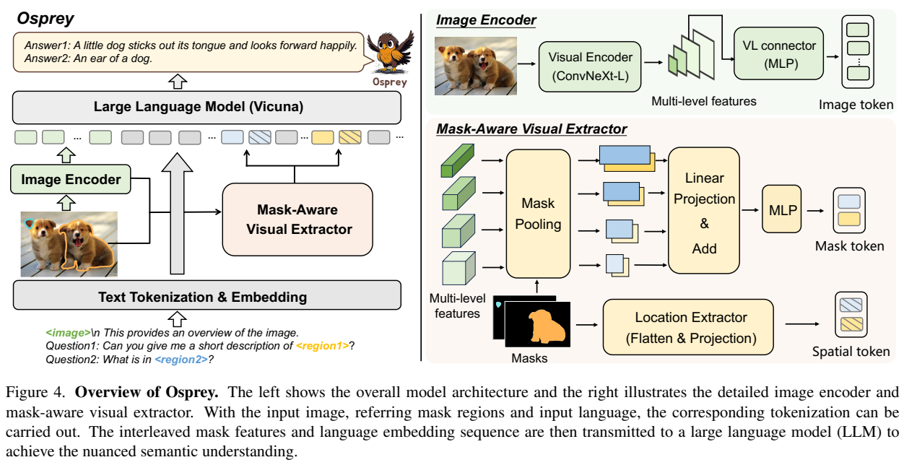
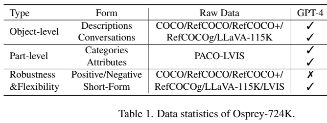
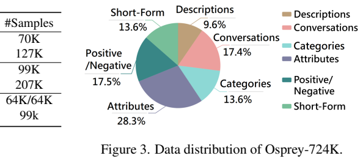
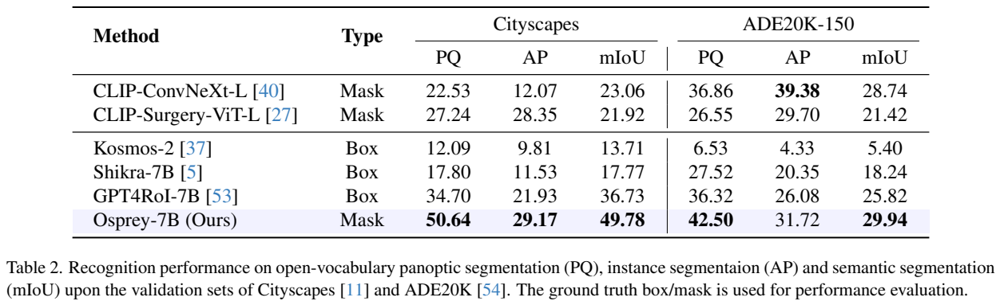
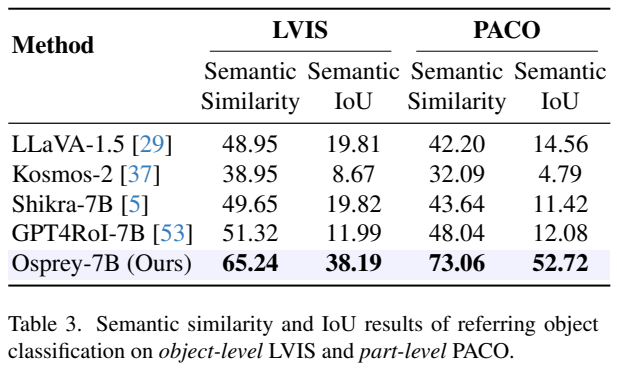
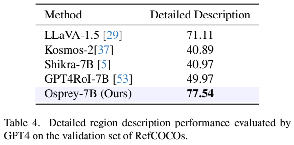
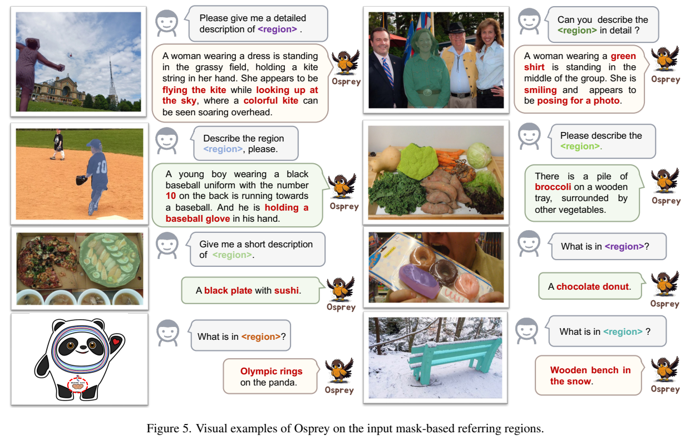
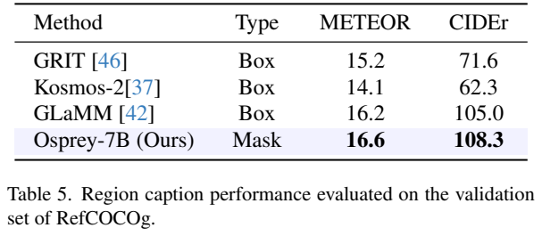

# Osprey：用掩码区域与多尺度视觉特征实现像素级语义理解

## 1. 论文信息与模型定位

**论文**：*Osprey: Pixel Understanding with Visual Instruction Tuning*；**作者**：Yuqian Yuan、Wentong Li、Jian Liu、Dongqi Tang、Xinjie Luo、Chi Qin、Lei Zhang、Jianke Zhu；**机构**：浙江大学、蚂蚁集团、微软、香港理工大学；**版本**：[arXiv:2312.10032v1](https://arxiv.org/abs/2312.10032v1)，2023 年 12 月 15 日；**项目**：[CircleRadon/Osprey](https://github.com/CircleRadon/Osprey)。本文整理首版 20 页 PDF。

Osprey 是一个支持掩码区域引用的视觉语言模型。用户提供图像、区域掩码和指令，它生成物体类别、部件属性、短描述或复杂区域解释。论文试图减少边界框包含背景带来的语义干扰，并让语言模型理解“狗的耳朵”“杯子的边缘”等细粒度区域。[原文 §1、§4，PDF 第 1–6 页](https://arxiv.org/pdf/2312.10032v1#page=1)

这里的“像素级”指区域输入和视觉特征提取依据像素掩码。Osprey 主体输出语言，不是根据任意指令直接预测分割掩码的解码器。结合 SAM 后，可先得到类别无关掩码，再由 Osprey 给它们语义；模型理解结果与前端掩码质量共同影响系统效果。

## 2. 快速概览

| 项目 | 首版内容 |
|---|---|
| 语言模型 | Vicuna，主要报告 Osprey-7B |
| 视觉底座 | ConvNeXt-Large CLIP，主配置 512×512 |
| 区域表示 | 多尺度掩码池化形成 mask token，二值掩码位置投影形成 spatial token |
| 数据 | Osprey-724K，包含物体、部件、属性、正负判断和短回答指令 |
| 训练 | 图文对齐、掩码文字对齐、指令微调三阶段；视觉编码器保持冻结 |
| 主结果 | Cityscapes PQ 50.64、LVIS 语义相似度 65.24、区域描述相对评分 77.54 |
| 评测边界 | 多项识别评测给定真实掩码；区域 caption 另行微调 RefCOCOg |

方法的三个配合点是：卷积编码器支持较高分辨率与多尺度特征；掩码池化减少区域外背景；带有长短回答及难负例的数据让区域语义与指令格式同时对齐。它们共同构成方案，不能用一个单独排行榜结果证明“只靠掩码就解决了所有细粒度幻觉”。

## 3. 整体架构

**读图方式**：左图的语言模型同时接收整图 token、文字和区域 token。右上是 ConvNeXt-L 的多层特征与整图 MLP；右下把同一个掩码用于多层特征池化，得到语义表示，另将掩码形状编码成位置表示。两个区域 token 的职责不同：一个提供区域是什么，另一个提供区域在哪里及其形状。

整图路径使用视觉编码器的 res4 阶段特征，经 MLP 连接到语言空间，提供背景上下文。区域路径使用多个层级的特征图，按用户指定掩码聚合，再投影融合。文本中的区域名，例如 region1，后附一个占位符，实际由 `<mask>` 与 `<position>` 两种嵌入替换。整图、区域、文字交错进入 Vicuna 解码器。[原文 §4.1，PDF 第 5–6 页](https://arxiv.org/pdf/2312.10032v1#page=5)

保留整图很重要：只看局部区域可能无法判断动作、相对位置或部件所属对象。区域 token 负责精确指向，整图 token 提供解释上下文。论文还添加整图提示前缀，明确该视觉输入用于图像概览。语言模型由这一组合生成回答，不需要把每个区域单独裁成一张图后独立问答。

主输入图像为 512×512；位置分支把二值掩码缩放到 224×224 后展平投影。这两个分辨率属于不同路径，不能写成整个模型只看 224 图像。区域仍压缩为少量 token，因此“掩码输入精确”也不意味着语言模型保留了掩码内每个原始像素。

## 4. 核心创新与数学原理

设区域为 \(R_i\)，第 \(j\) 层图像特征为 \(Z(x)_j\)。原文 Eq. (1) 定义区域池化：

\[
V_{ij}=\operatorname{MP}(R_i,Z(x)_j).
\]

只汇聚落在掩码区域内的特征，从而减少矩形框里同时出现邻近对象或背景时的混杂。不同层级包含不同感受野与语义粒度，作者再用线性映射 \(P_j\) 统一维度并求和，Eq. (2) 为：

\[
t_i=\sigma\left(\sum_{j=1}^{4}P_j(V_{ij})\right).
\]

**这里 \(\sigma\) 是论文所称的 MLP，不是 sigmoid 函数。** \(t_i\) 是视觉 mask token。原文没有展开池化内部所有边界处理，也没有给出各尺度不同的可学习加权系数，不能自行加入。[原文 §4.1.2、Eq. (1)–(2)，PDF 第 5 页](https://arxiv.org/pdf/2312.10032v1#page=5)

位置 token \(s_i\) 来自二值掩码：先缩放至 224×224，再展平并投影。视觉语义与空间几何分成两个嵌入，避免只有池化语义时遗失形状及相对位置信息。正文说明二者一起作为区域嵌入，并没有把它们定义成一个相加后唯一 token。

卷积 CLIP 的选择还涉及分辨率开销。ViT 全局注意力会随视觉 token 增加承担较高成本；ConvNeXt 以卷积和多层特征自然支持高分辨率区域提取。论文以多分辨率识别消融支持这项选择，但高分辨率最终产生的整图 token 仍进入语言模型，所以语言端开销依然会增长。图像编码器效率不等于整个系统可以无成本提高分辨率。

数据创新对应两个常见失败。难负例用位置接近或语义接近的错误类别，迫使模型区分“区域里确实是什么”；短回答指令明确要求单词或短语，避免在分类任务中输出冗长描述。后者直接影响自动评测的输出格式，不能将其收益全解释为视觉表征变强。[原文 §3.3、§5.3，PDF 第 4、10 页](https://arxiv.org/pdf/2312.10032v1#page=4)

## 5. 数据构建与处理

**读表方式**：表按指令类型列数据来源与约数，勾号表示使用 GPT-4 构造。正负判断分别 64K，不能把 64K 当成二者合计。表中各类按千计的约数并不能严格重建标题的 724K 总量，本文沿用约 724K 的总体称呼，不编造精确样本清单。

物体级共约 **197K**：详细描述 70K、对话 127K。构造时，把 LLaVA-115K 的整图描述、COCO/RefCOCO 系列的区域简短描述和框坐标提供给**纯文本 GPT-4**，生成区域描述与对话。掩码来自原有数据标注，而不是 GPT-4 看图后画出来的。附录明确视觉图像只是示意，并未传给 GPT-4。[原文 §3.1、Table A1/A4/A5，PDF 第 3–4、15、17 页](https://arxiv.org/pdf/2312.10032v1#page=3)

部件级约 **306K**：类别 99K、属性 207K。数据来自 PACO-LVIS，涵盖 75 个物体类别、456 个特定物体部件类，以及 55 种属性，包括颜色、纹理标记、材质、反射特性。GPT-4 将已有类别与属性改成 QA，不能将输出理解为新增独立视觉标注。[原文 §3.2、Table A2/A7，PDF 第 4、16、18 页](https://arxiv.org/pdf/2312.10032v1#page=4)

鲁棒性数据平衡“是/否”。空间难负例关注相邻对象，类别难负例用 SentenceBERT 找与真实类名语义接近的类别，从前 8 个候选随机选一个。正文说该策略用于 LVIS，而 Table 1 在正负例与短回答的合并来源栏还列 COCO/RefCOCO/LLaVA/LVIS；这里保留正文对 LVIS 难例挖掘的具体说明，不声称每个列名都执行了同一套挖掘。短回答约 99K，涵盖类别、颜色、类型、位置和数量，要求一个词或短语。

GPT-4 是依据描述和坐标合成文字，因此生成数据也可能有区域编号或细节不一致。首版没有给出全面人工验收比例、错误率或精确去重统计。附录的生成提示要求只问可确定问题，这是一条构造规则，不能替代对实际数据准确性的统计验证。

第三阶段还加入 Visual Genome 与 VCR，扩大多区域理解。VG 只有框标注时，用 HQ-SAM 根据框生成掩码；这些属于自动掩码，需与原数据真实掩码区分。[原文 §4.2，PDF 第 6 页](https://arxiv.org/pdf/2312.10032v1#page=6)

## 6. 训练流程与目标

三个阶段均采用下一 token 预测监督。第一阶段用 LLaVA 引入的过滤 CC3M 图文数据，只训练整图 MLP 投影器，冻结视觉编码器和 Vicuna。第二阶段加载第一阶段权重，只训练 mask-aware extractor，用 COCO/RefCOCO/RefCOCO+ 及 Pascal Part、Part ImageNet 的短文字与掩码对完成区域对齐。第三阶段视觉编码器仍冻结，更新整图投影器、区域提取器与语言模型，数据为 Osprey-724K 以及 VG、VCR。[原文 §4.2，PDF 第 6 页](https://arxiv.org/pdf/2312.10032v1#page=6)

| 阶段 | batch size（原文） | 学习率 | epoch | 耗时 |
|---|---:|---:|---:|---:|
| 图文对齐 | 128 | 1×10⁻³ | 1 | 7 小时 |
| 掩码文字对齐 | 4 | 2×10⁻⁵ | 2 | 15 小时 |
| 指令微调 | 4 | 1×10⁻⁵ | 2 | 48 小时 |

作者使用 AdamW、余弦学习率日程、DeepSpeed；序列最大长度 **2048**，设备为 **4 张 NVIDIA A100 80GB**，输入 **512×512**。论文没有明确这些 batch 值是每设备还是全局，也没有披露梯度累积与全部优化器参数，因此不由显卡数推算“实际全局 batch”。[原文 §5.1，PDF 第 6 页](https://arxiv.org/pdf/2312.10032v1#page=6)

作为目标的数学解释，可写 \(\mathcal L=-\sum_t\log p_\theta(y_t\mid I,R,u,y_{<t})\)，表示依据图像 \(I\)、掩码区域 \(R\)、指令 \(u\) 学习回答。原文只声明下一 token 损失，并未给出完整 token 掩码与各数据权重；上式是本文对该声明的解释，不是额外分割损失。三个阶段也没有训练 SAM 成为语言模型内部解码头。本仓库未运行模型或复现训练。

## 7. 实验设置与主要结果

**读表方式**：Table 2 直接声明使用 ground-truth box/mask。它评区域的语义识别，不测试模型能否自行找到正确掩码。Table 3 的 Semantic IoU 是标签文字重叠相关指标，与像素掩码 IoU 不同。Table 4 的 77.54 来自相对 GPT-4 的评分比例，也不是二分类准确率。

Cityscapes 与 ADE20K-150 实验给定真实区域，模型生成短描述，再用 SentenceBERT 将回答匹配到数据集词表。Osprey-7B 的 Cityscapes PQ/AP/mIoU 为 **50.64/29.17/49.78**，高于表中 GPT4RoI 的 34.70/21.93/36.73；ADE20K 为 **42.50/31.72/29.94**。但 ADE20K AP 低于 CLIP-ConvNeXt-L 的 **39.38**。不能写成每项分割指标都领先，更不能将这些数值视为 SAM+Osprey 的端到端分割结果。[原文 §5.2.1、Table 2](https://arxiv.org/pdf/2312.10032v1#page=7)

区域分类从 LVIS 验证集抽取 1000 图、4004 个物体，从 PACO 抽取 1000 图、4263 个物体。语义相似度/语义 IoU 分别为 LVIS **65.24/38.19**、PACO **73.06/52.72**，高于表中的区域模型；两项衡量回答与类别文字的相关性，不是“1200 类闭集正确率”。图像级 LLaVA-1.5 对照使用框裁剪输入。[原文 §5.2.2，PDF 第 7–8 页](https://arxiv.org/pdf/2312.10032v1#page=7)

详细描述使用 RefCOCO 系列验证集随机 **80 图**。GPT-4 生成参考答案并按 1–10 分评估，结果为模型得分相对参考答案得分的百分比：Osprey **77.54**，LLaVA-1.5 **71.11**，GPT4RoI **49.97**。正文称 accuracy，但方法定义的是相对评分，因此本文采用后者解释。小规模与自动评审限制其泛化结论。

**读图方式**：示例用着色掩码指定人物、食物、标志或长凳，回答随指令输出详细或短文字。下表区域 caption 中 Osprey METEOR **16.6**、CIDEr **108.3**，GLaMM 为 16.2、105.0。CIDEr 108.3 是该指标的分数，不是超过 100% 的准确率。此实验**额外在 RefCOCOg 训练集微调**，应与通用模型直接评测区别。[原文 §5.2.3–5.2.4](https://arxiv.org/pdf/2312.10032v1#page=8)

消融显示短回答指令作用很大：移除它，LVIS SS/语义 IoU 从 65.24/38.19 降到 56.41/25.65；移除正负例则降到 63.55/36.70。视觉骨干比较中，ConvNeXt 使用 512 输入、ViT 使用 224，因此 42.50 对 38.86 PQ 同时包含骨干与分辨率差异。不能据此完全隔离卷积结构的收益。[原文 Table 7–8，PDF 第 9–10 页](https://arxiv.org/pdf/2312.10032v1#page=9)

提高输入至 800×800，LVIS SS/语义 IoU 达 68.29/42.66，但图像 token 从 512 配置的 1024 增至 2500；单张 A100 上处理速度从 3.5 降至 1.9 个 mask-text pair/秒。作者因此选择 512 为主配置。速度单位是区域文字对，不是每秒生成 token 数，也不是完整视频 FPS。[原文 Table 9，PDF 第 10 页](https://arxiv.org/pdf/2312.10032v1#page=10)

首版充分展示给定区域的细粒度语义优势，但未系统测量自动掩码错误、全场景幻觉率或真实用户任务的成功率。模型使用标注区域与针对性数据进行学习，评测范围需要与通用整图助手和端到端分割模型区分。
