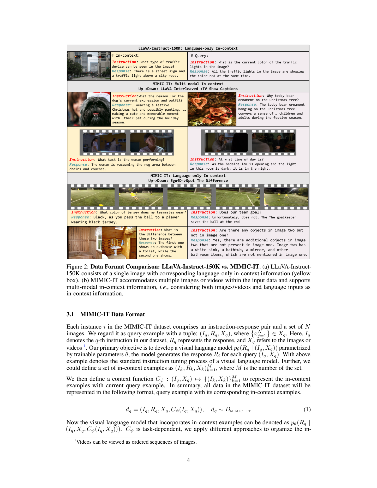
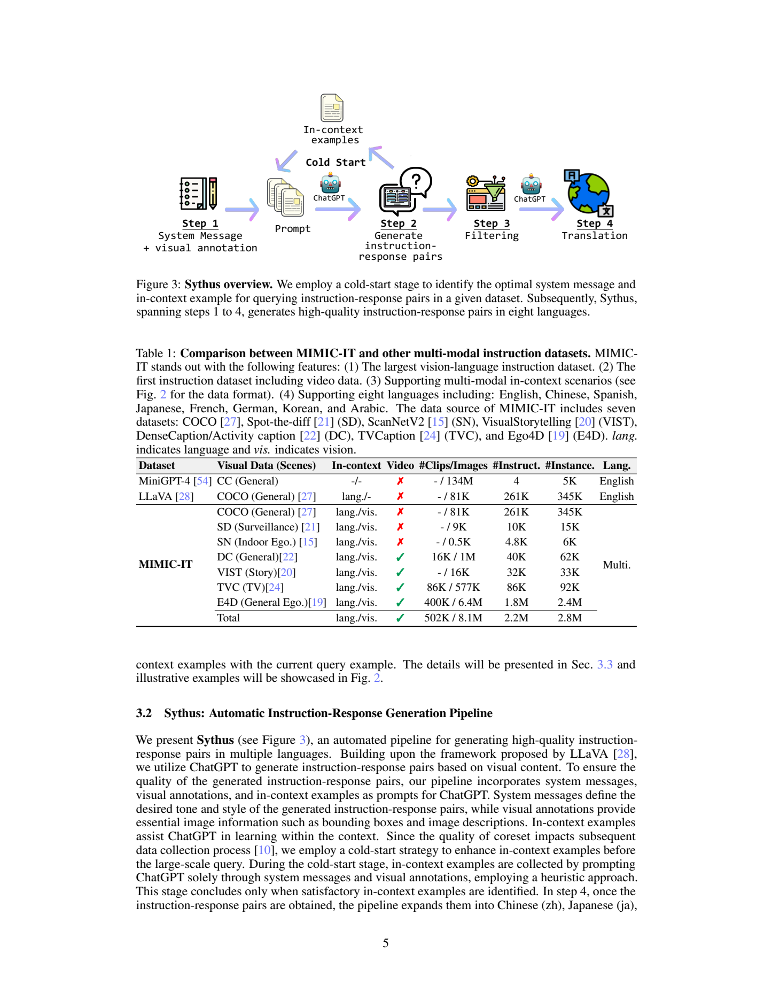
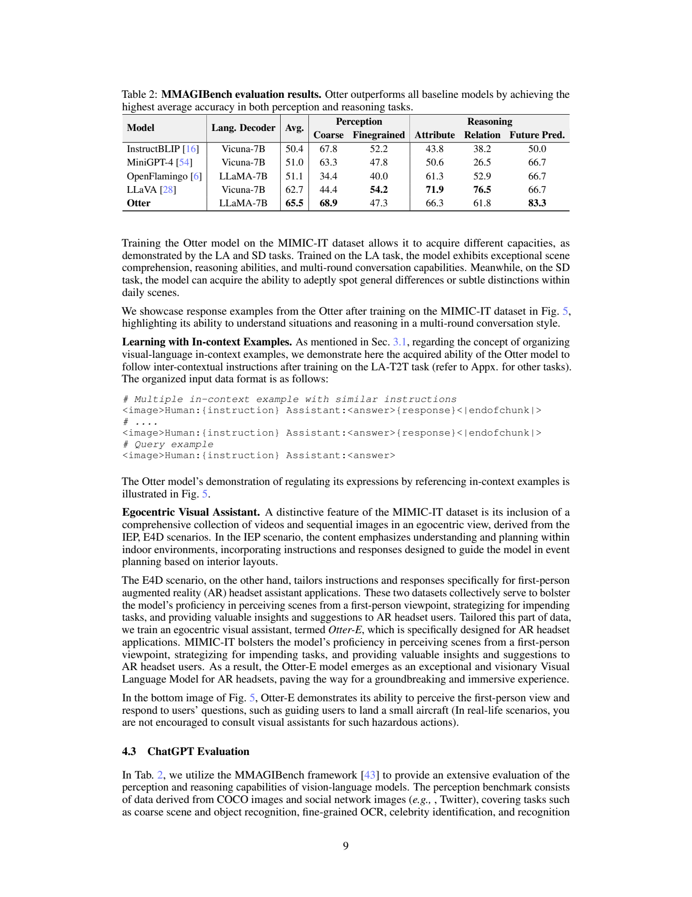
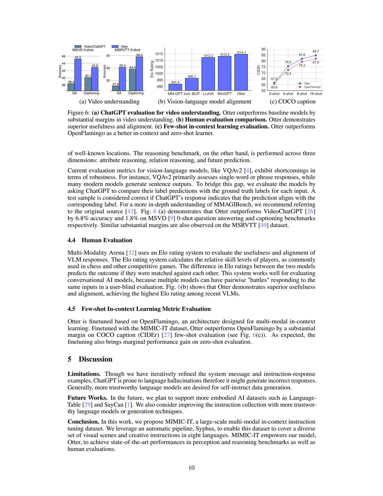

# MIMIC-IT：为多模态指令加入可参考的图文与视频上下文

## 1. 论文信息与模型定位

| 项目 | 信息 |
|---|---|
| 原文 | [MIMIC-IT: Multi-Modal In-Context Instruction Tuning](https://arxiv.org/abs/2306.05425v1) |
| 本文依据版本 | arXiv:2306.05425v1，2023 年 6 月 8 日，22 页预印本 |
| 作者 | Bo Li、Yuanhan Zhang、Liangyu Chen、Jinghao Wang、Fanyi Pu、Jingkang Yang、Chunyuan Li、Ziwei Liu |
| 机构 | 南洋理工大学 S-Lab、Microsoft Research |
| 核心产物 | MIMIC-IT 多模态上下文指令数据；Sythus 自动标注流程；基于 OpenFlamingo 调优的 Otter 与面向第一视角的 Otter-E |
| 模型定位 | 根据一幅或多幅图像、视频及已有示例，生成符合用户指令的文字回答 |

这篇论文以数据构建和上下文指令组织为核心。它提供约 **2.8M 指令回答实例、2.2M 唯一指令**，覆盖感知、推理和规划。Table 2 中 Otter 的语言解码器是 **LLaMA-7B**，该数值是语言骨干规模，原文没有给出完整多模态模型的精确总参数量。文中的规划主要表现为文字建议和室内活动安排，没有验证机器人执行或闭环控制。

## 2. 快速概览

早期单图指令数据通常把问题和对话历史围绕同一幅图组织。MIMIC-IT 希望模型还能理解“给你几个示例，按相同方式回答新的图像”，并扩展到不同图像之间的比较、事件序列和第一视角视频。

工作可分为三步：从七类既有图像视频数据中取得视觉内容及文字标注；让 ChatGPT 根据系统消息、标注和种子示例生成指令回答；把这些实例与相关上下文组织起来，调优已有的多模态模型。数据翻译到中文、西班牙语、日语、法语、德语、韩语、阿拉伯语，加上英语共八种语言。

在论文的评估设置中，Otter 的 MMAGIBench 平均准确率为 **65.5**，OpenFlamingo 为 51.1，LLaVA 为 62.7；COCO 描述的 16-shot CIDEr 为 **84.7**，对应 OpenFlamingo 的 81.8。这些结果支持上下文指令调优后的能力改善，但原文没有完整隔离“更多数据”“指令质量”和“上下文组织”各自贡献的消融实验。

## 3. 整体架构



**读图：** 黄色区域是可参考示例，紫色区域是当前查询。中间两组把示例图像或视频与问答一起提供；下方则围绕相同视觉内容保留文字对话。区别不只是一次输入更多图片，还在于示例与查询之间具有可供模仿的回答方式或内容关系。

数据实例由查询指令 \(I_q\)、目标回答 \(R_q\)、视觉输入 \(X_q\) 与上下文函数 \(C_\psi\) 组成。视觉输入可以是多幅图片；视频在论文形式化中被视为有序图片序列。上下文函数依任务而变化，既可以按指令文字或图像相似性寻找示例，也可以把同一事件、同一组图片的问答组织在一起。

Otter 基于 OpenFlamingo，将语言模型条件化于对应的视觉媒体。本文原文没有完整展开视觉编码器、重采样器及跨模态层的具体配置，也没有给出这些组件的完整参数表，因此不能直接把某个其他 Flamingo 版本的层数、视觉 token 数或冻结策略当作本实验事实。可以确定的是，它支持媒体与文字交错的输入格式，语言解码器采用 LLaMA-7B。

一轮训练数据采用类似下面的格式，把媒体位置、角色和回答边界显式编码：

```text
<image>Human:{instruction} Assistant:<answer>{response}<endofchunk>
```

有多个上下文示例时，先连续排列完整的示例块，再加入只给定指令、等待生成回答的查询块。正文另一处把结束标记写成 `<|endofchunk|>`；这份介绍保留原文的格式概念，不将两种拼写差异解释为实际 tokenizer 存在两个不同结束 token。

针对室内布局和第一视角 Ego4D 数据，作者另外训练 Otter-E，用于展示第一视角视觉助手场景。它不是论文中另一个经过完整独立定量评测的机器人策略；应用示例也不能证明模型已具备可靠的现实操作指导能力。

## 4. 核心创新与数学原理

**把上下文示例纳入监督条件。** 原文公式（1）把一个实例表示为：

\[
d_q=(I_q,R_q,X_q,C_\psi(I_q,X_q)),\qquad d_q\sim D_{\rm MIMIC\text{-}IT}.
\]

生成模型建模 \(p_\theta(R_q\mid I_q,X_q,C_\psi(I_q,X_q))\)。正文先定义示例为完整的 \((I_k,R_k,X_k)\)，随后上下文函数的集合记法省略了 \(R_k\)；结合实际训练格式，示例回答显然也可用作上下文。本文理解为完整示例，不把该记法省略解释为训练不提供示例答案。

用标准条件语言建模可解释这种训练目标：

\[
\mathcal L=-\sum_t\log p_\theta(r_{q,t}\mid I_q,X_q,C_q,r_{q,<t}).
\]

这是本文用于解释生成监督的标准表达，原文没有给出相同编号损失，也没有精确披露 token loss mask。不能据此断定训练只计算查询答案损失，还是也监督上下文中的回答。已知的是，答案可利用视觉输入和之前示例的内容及表达方式。

**检索相似示例提供条件，而不是更新模型参数。** LA-I 为每个指令回答检索十个上下文候选，依据指令文字或图像之间的相似性。概念上可将它理解为在候选库中选出与查询最相近的条目，但原文没有给出相似度编码器、归一化方式或近邻搜索超参数。测试时的 4/8/16-shot 是提供相应数量示例的上下文学习，不能改写为每个测试样本先做几步参数微调。

**把多模态任务变成自然对话。** 不同数据来源不只换视觉材料，还换问题目的：比较两图差异、询问视频中后续动作、理解人物关系、根据室内布局建议活动。其监督来自既有标注的语言化和扩展，GPT 并未在这套流程中直接观看所有图像或视频。回答的可信度取决于原标注和生成过程是否忠实。

## 5. 数据构建与处理



**读图表：** 冷启动阶段反复修订系统消息和种子示例，然后执行生成、过滤、翻译。表中 `#Instruct.` 与 `#Instance.` 不同，前者是唯一指令数，后者是组织后的实例数；`#Clips/Images` 也不能当作互不重复的原始图片数量，视频帧占据很大部分。

| 来源或任务 | 数据怎样转成指令 |
|---|---|
| COCO / LA-I | 复用 LLaVA 指令材料，按图像或指令相似性加入上下文候选 |
| Spot-the-Diff / SD | 用监控两帧的差异标注生成细微差异问题；另用 COCO 相似图构建一般场景差异 |
| Visual Storytelling | 将图片组、叙事和事件信息改成观察者式问答，鼓励跨图叙事 |
| ActivityNet Captions / DC | 根据视频片段时间戳和描述询问动作、事件顺序与因果关系 |
| TV Captions / TVC | 基于电视剧片段描述生成关系和人物动机问题，并避免直接使用标注中的人物姓名 |
| ScanNetv2 / IEP | 从 RGB-D 场景取得多幅 2D 视图，根据房间布局和生成的用户角色安排活动 |
| Ego4D / E4D | 使用第一视角视频描述、对象和时间信息模拟 AR 助手的实际问答 |

ScanNetv2 的来源包含深度信息，但本文提供给指令模型的是采样的 2D 视觉输入，不能称 Otter 已验证直接处理 RGB-D 的深度模态。视频输入也不意味着它处理原始音轨，论文没有音频模型实验。

表中总体约 **502K 视频片段、8.1M 图像或帧**，Ego4D 是数据量最大的组成部分。Figure 4 为了展示更平衡的统计只保留 25% Ego4D 指令，这个图表采样口径不等同于模型训练固定下采样到 25%。Table 1 的分项使用近似值，实例分项加总也不精确等于列出的 2.8M 总量，因此本文将它们作为原文近似统计，不宣称掌握逐条精确库存。

附录 A 指明生成使用 **ChatGPT-0301**，输入 859,677,150 token、输出 147,069,090 token，总计 1,006,746,240；作者估计成本为 **20,134.9248 美元**。这是原文历史估算，不是当前 API 报价。正文泛称 GPT-4 或 ChatGPT 的流程能力，实际这份数据的生成版本应以附录为准。

过滤部分主要说明遵循 GPT 内容规则，并未披露逐阶段剔除率、全面人工验收比例或完整过滤实现。附录种子示例本身也存在矛盾：Spot-the-Diff 的“右图是否更多人”回答先说 Yes，又说左图多两人。由此不能把自动生成数据笼统称为逐条验证的无错标签。八种语言由 GPT 翻译扩展，论文没有逐语言质量表或多语言模型能力评测。

## 6. 训练流程与目标

工作先构建多模态上下文指令数据，再在 OpenFlamingo 基础上调优 Otter。一般场景任务支持场景理解、多轮问答和图像差异；相似指令示例支持表达方式模仿；IEP 和 Ego4D 子任务支持 Otter-E 的第一视角展示。训练的核心是让模型在对应媒体和对话条件下生成回答。

论文没有公布可复现的完整训练表：学习率、优化器、全局批大小、训练步数、各任务混合比例、冻结模块、最大输入长度、视频采样帧数及阶段精确配置均未充分披露。也没有清楚列出每个定量结果所对应的全部训练子集组成。因此本文不借 OpenFlamingo 的预训练配置或其他 Otter 文献来补成作者实际使用的配方。

上下文学习与指令调优也应区分：指令调优通过训练数据更新参数，让模型学会回答和参考示例；few-shot 评估是在输入中添加示例，改变本次生成条件。论文没有采用 RLHF、DPO 或任务环境强化学习流程，不能把“符合用户意图”解释成已经进行了人类偏好优化。

## 7. 实验设置与主要结果



**读表：** Otter 的平均分最高，但细粒度感知、属性推理和关系推理均不是最高。表格要连同分项阅读，不能把平均领先改成每种视觉能力都领先。

| 模型 | Avg. | 粗粒度感知 | 细粒度感知 | 属性推理 | 关系推理 | 未来预测 |
|---|---:|---:|---:|---:|---:|---:|
| InstructBLIP | 50.4 | 67.8 | 52.2 | 43.8 | 38.2 | 50.0 |
| OpenFlamingo | 51.1 | 34.4 | 40.0 | 61.3 | 52.9 | 66.7 |
| LLaVA | 62.7 | 44.4 | **54.2** | **71.9** | **76.5** | 66.7 |
| Otter | **65.5** | **68.9** | 47.3 | 66.3 | 61.8 | **83.3** |

MMAGIBench 感知材料来自 COCO 和社交网络图片，覆盖场景物体识别、OCR、名人和地点；推理分为属性、关系、未来预测。作者让 ChatGPT 比较模型输出与真值标签，判断是否一致后计算准确率。评判器并不是对全部视觉证据进行独立专家核验；COCO 同时也是训练来源，原文未披露完整的训练评测交叉去重方案。



**读图：** 左侧蓝色是 Otter、灰蓝色是 VideoChatGPT；中间是当时模型集合的人工偏好 Elo；右侧是不同示例数的 CIDEr。三者指标含义不同，不能合并成一个统一准确率。

| Figure 6 视频零样本任务 | VideoChatGPT | Otter | 图中绝对增幅 |
|---|---:|---:|---:|
| MSVD 问答 | 38.4 | 45.2 | 6.8 个百分点 |
| MSVD 描述 | 40.1 | 42.9 | **2.8 个百分点** |
| MSRVTT 问答 | 27.8 | 35.3 | 7.5 个百分点 |
| MSRVTT 描述 | 34.5 | 39.5 | 5.0 个百分点 |

原文正文把 MSVD 描述增幅写成 1.8%，与图中的 42.9−40.1 不一致；本文依据图上标注报告 2.8 个百分点。这组描述任务使用 ChatGPT 判断的图中 accuracy，不是 COCO 曲线的 CIDEr。

COCO 0/4/8/16-shot 的 Otter CIDEr 分别为 **61.5、75.5、81.8、84.7**，OpenFlamingo 为 **60.8、72.4、79.3、81.8**。对应改善为 0.7、3.1、2.5、2.9，支持该实验中的上下文利用能力改善。没有示例检索策略和完整解码设置，不能声称这条曲线证明任意上下文都能带来同样收益。

人工 Arena Elo 中 Otter 为 **1014.7**、MiniGPT 为 1013.2、LLaVA 为 1012.2，InstructBLIP 为 996.3、MM-GPT 为 991.9。它反映当时参加评测模型之间的相对用户偏好，不是成功率；与 MiniGPT 的差距只有 1.5，论文未给出置信区间和完整投票规模，不能据此推断稳定的大幅优势。

这篇工作的主要价值是把多模态示例关系和视频语境纳入大规模指令数据，并展示调优后的感知、视频问答与 few-shot 改善。自动生成幻觉、部分种子矛盾、语言覆盖缺乏逐语言验证、训练细节缺失及评判器局限，仍影响结论的可复现性和适用范围。
