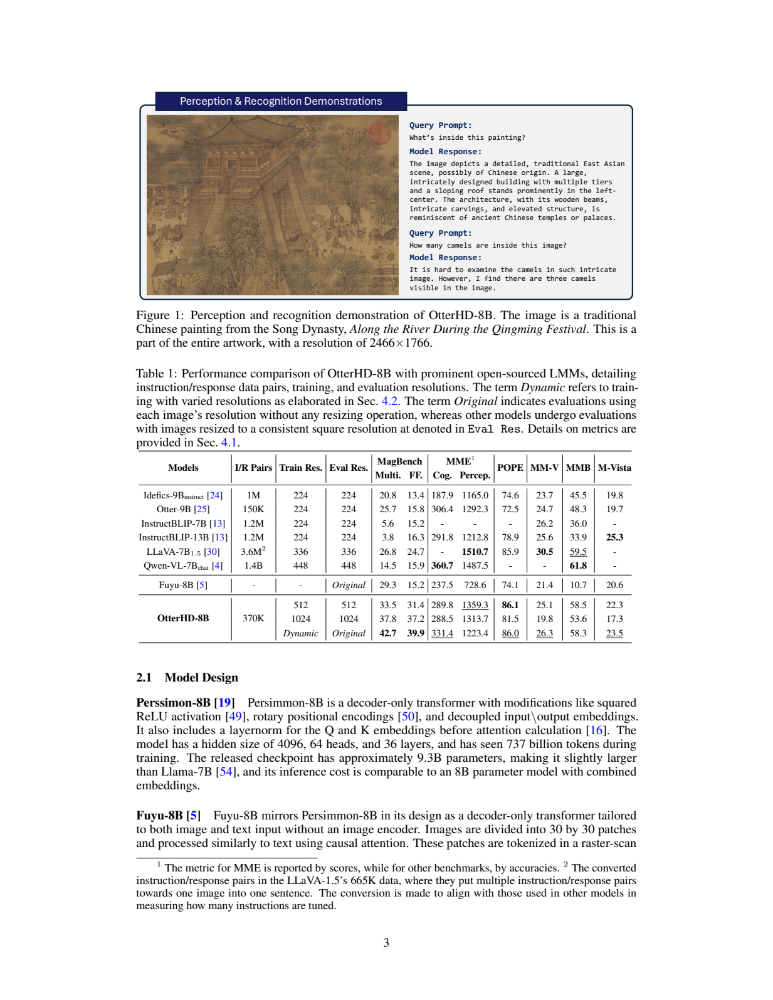
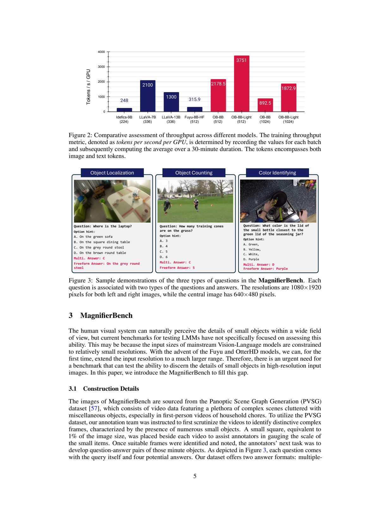
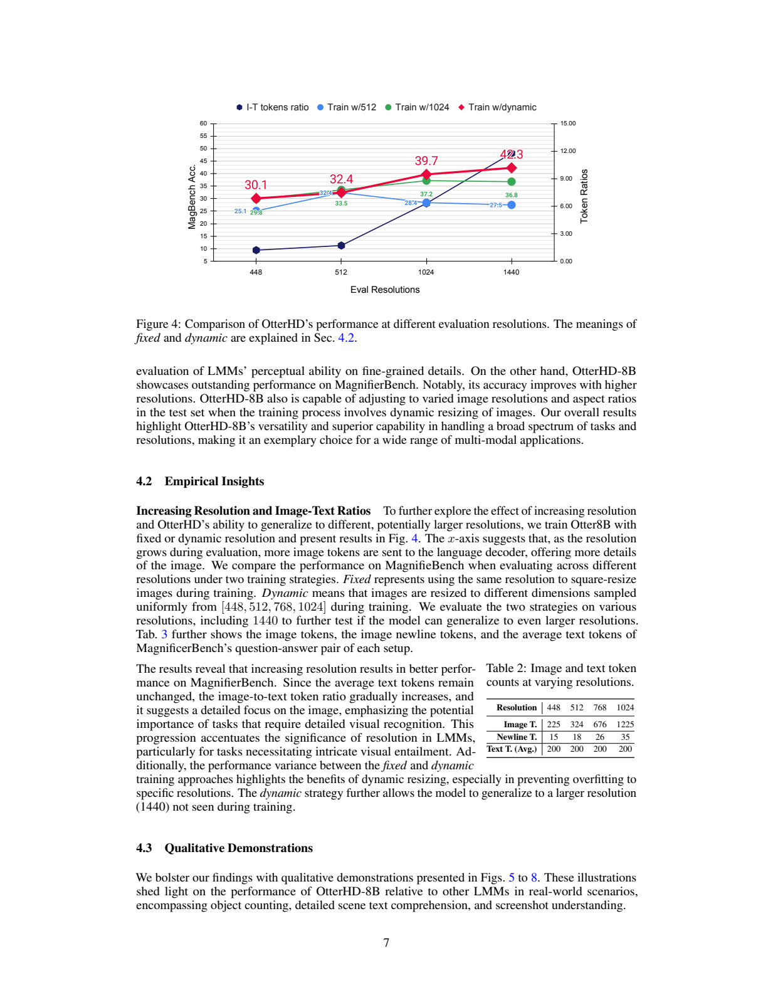
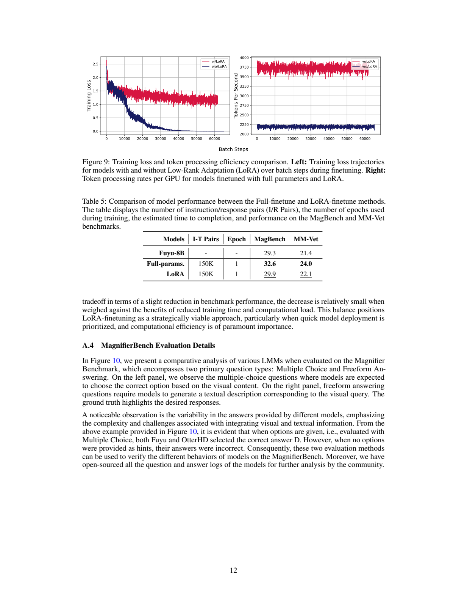

# OtterHD：从 Fuyu 出发研究高分辨率与动态图像输入

## 1. 论文信息与模型定位

| 项目 | 信息 |
| --- | --- |
| 论文 | OtterHD: A High-Resolution Multi-modality Model |
| 作者 | Bo Li、Peiyuan Zhang、Jingkang Yang、Yuanhan Zhang、Fanyi Pu、Ziwei Liu；南洋理工大学 S-Lab |
| 固定版本 | [arXiv 2311.04219v1](https://arxiv.org/abs/2311.04219v1)，2023-11-07，17 页 |
| 项目 | [Luodian/Otter](https://github.com/Luodian/Otter)；[MagnifierBench](https://huggingface.co/datasets/Otter-AI/MagnifierBench) |
| 模型 | OtterHD-8B：Fuyu-8B 的图像文本指令微调模型 |

虽然属于 Otter 项目，本篇 OtterHD 的底座是 Fuyu，而不是早期 Otter-9B 使用的 OpenFlamingo。它接受图像和文字、输出文字，不是视频音频生成模型。8B 为模型命名；原文介绍底层 Persimmon 的独立输入输出嵌入使发布权重约 9.3B，推理规模类似嵌入共享的 8B，不能把名称当作精确权重计数。以下页码对应 v1。

## 2. 快速概览

OtterHD 研究的是提高输入分辨率能否增强小物体、细文字和复杂场景的理解，以及一个模型能否在推理时灵活改变分辨率。Fuyu 没有独立的预训练视觉编码器，图像 patch 线性映射后与文字由同一个 decoder-only Transformer 处理，因此没有固定 ViT 位置表造成的同类分辨率接口约束。

作者用约 370K 指令问答，分别训练固定 512、固定 1024 和动态分辨率模型，新增 283 题的 MagnifierBench。动态训练、原图分辨率测试的选择题/自由回答为 42.7/39.9；Fuyu 为 29.3/15.2。它明显改善这个细节基准，但并未全面超过专门视觉助手：例如 MM-Vet 26.3 低于表中 LLaVA-1.5 的 30.5。

设计重点是输入与训练分布，不是新的图像编码器或数学推理损失。扩大图像还会增加序列、显存和注意力成本，而且固定分辨率训练的模型并不一定在更大图像上更好。

## 3. 整体架构

模型沿用 Fuyu/Persimmon：隐藏维度 4096、64 个 attention heads、36 层，使用 squared ReLU、RoPE、Q/K LayerNorm 与独立输入输出嵌入。原文列出的 Persimmon 737B 文本预训练 tokens 是底座背景，不是 OtterHD 新执行的预训练。

图像被划成 30×30 像素块，经线性映射进入语言序列，按行优先排列，每行加入 image-newline 标记。输入图像先缩放到指定目标，右边与底部补齐到 patch 网格。文字格式包含 User/Assistant，Fuyu 原生 `\x04` 标记表示答案起点，后续生成答案和 EOS。

**读图：**上方以《清明上河图》局部展示复杂图像的描述和计数，下方记录模型训练、评测分辨率及结果。此页没有新的网络结构图；原文的架构描述主要是文字，不能把演示绘图称为架构图。Table 1 的 Original 指使用各图自身分辨率而不重新缩放，其他行则按指定方形尺寸测试。

OtterHD 没有额外 CLIP 编码器、Q-Former 或多窗口 LoRA，也没有把高分辨率图像压缩到固定 256 个视觉 token。输入分辨率提高直接增加 patch 数，空间布局通过 raster 序列和换行信息进入共享 Transformer。

## 4. 核心创新与数学原理

原文未提出编号数学公式。根据 patch 及换行规则，若补齐后图像共有 $n_h=\lceil H/30\rceil$ 行、$n_w=\lceil W/30\rceil$ 列，可用

$$
N_{patch}=n_hn_w,\qquad N_{image+newline}=n_h(n_w+1)
$$

解释 token 成本；这是机制换算。Table 2 给出方形 448/512/768/1024 下 patch 为 225/324/676/1225，加换行为 240/342/702/1260，文字平均约 200 token。细节预算增大同时提高视觉相对于文字的序列比例，这与“模型一定更关注每个细节”的因果证明不同。

对普通全注意力而言，序列增大使注意力成本近似随总长度平方增长；这是通用复杂度解释，不是论文测得的完整 FLOPs。FlashAttention-2 和 fused LayerNorm、squared ReLU、RoPE 优化实现，减少基础 HuggingFace Fuyu 实现的训练瓶颈，并不消除序列增长的代价。

动态训练在 448、512、768、1024 中均匀采样目标分辨率，学习不同图像 token 比例。第 4.1 节的集合误写成 418，4.2 节及实验图采用 448，本文按后者解释并保留版本差异。论文未使用随机裁剪，增加分辨率也不会凭空恢复原图不存在的真实细节。

## 5. 数据构建与处理

指令来源包括 LLaVA-DD/CR、VQAv2、GQA、OKVQA、OCRVQA、A-OKVQA、COCO-GOI、COCO-Caption、TextQA、RefCOCO、COCO-ITM、ImageNet 与 LLaVA-RLHF。附录 Table 3 总计 371,017 个问答对：例如 LLaVA-DD/CR 53,240、ImageNet 与 LLaVA-RLHF 各 50,000、GQA 30,000、A-OKVQA 34,112。原文合并成 dataloader 后均匀抽样，未报告复杂新增标注或清洗统计。

这里计算的是 instruction/response 对，而非唯一图像。Table 1 将 LLaVA-1.5 的多轮样本展开得到约 3.6M 问答，因此与常见的 665K 多轮样本并不矛盾；Qwen 行的 1.4B 又包含不同规模语料，不能仅凭这一列证明训练效率高出几千倍。

**读图：**Figure 3 分别测试小物体位置、计数和颜色，每题有选项答案和自由答案两种格式；Figure 2 的 tokens/s 包括图像与文字，是训练吞吐。细节基准不只考 OCR，也不等于通用图像能力。

MagnifierBench 从 PVSG 视频选复杂帧，参考约占画面 1% 的物体尺度，人工放大检查并写干扰选项，再剔除大目标或靠常识容易猜中的题。最终 166 张图、283 QA：EpicKitchen 108 图/172 QA，Ego4D 38 图/80 QA，VidOR 20 图/31 QA。多数前两类图约 1920×1080，VidOR 通常 640×480。规模较小且偏家庭杂物场景，原文未提供置信区间。

## 6. 训练流程与目标

OtterHD 直接从 Fuyu 指令微调，采用文本生成监督，原文没有新的像素重建损失或单独视觉预训练。OB 为全参数微调，OB-Light 为 LoRA，$r=32,\alpha=32$，覆盖注意力和线性层包括 head。原文没有完整列出生成损失 mask 的细节，不能把仅回答监督的具体实现冒充已披露公式。

训练使用 PyTorch、Transformers、FlashAttention-2 与 fused 算子，8 张 A100。AdamW 学习率 $10^{-5}$、weight decay 0.1、cosine、warmup ratio 0.03、DeepSpeed ZeRO-2。附录 Table 4 区分全参 batch 64、3 epochs 与 LoRA batch 128、6 epochs；正文统一 batch64 的概述不能覆盖 LoRA 设置。峰值每 GPU 显存约 72GB/70GB。

作者报告全参约 3 小时/epoch，LoRA 约 1 小时/epoch；附录还有基于 150K LLaVA 数据、1 epoch 的受控比较，不能直接把这些成本与主表 370K 模型混为同一训练。Figure 2 在 512 下基础 HF 315.9 tokens/s/GPU，优化全参 2178.5、LoRA 3751；1024 下为 892.5/1872.9，分辨率代价明显。这些是作者 30 分钟窗口的平均训练吞吐，不是聊天输出速度。

## 7. 实验设置与主要结果

MagnifierBench 选择题要求直接输出字母，采用严格正确选项匹配；自由回答无选项，由 GPT-4 与标准答案比较给二元正确判断。四选一随机正确率约 25%，但自由回答不能用同一随机线解释。MMBench 采用 test set；MME 分认知与感知原始分，其他表列按原文评分协议。

| 配置（Table 1） | Mag 多选/自由 | MME 认知/感知 | POPE | MM-Vet | MMBench | MathVista |
| --- | --- | --- | ---: | ---: | ---: | ---: |
| Fuyu，Original | 29.3 / 15.2 | 237.5 / 728.6 | 74.1 | 21.4 | 10.7 | 20.6 |
| OtterHD，512→512 | 33.5 / 31.4 | 289.8 / 1359.3 | 86.1 | 25.1 | 58.5 | 22.3 |
| OtterHD，1024→1024 | 37.8 / 37.2 | 288.5 / 1313.7 | 81.5 | 19.8 | 53.6 | 17.3 |
| OtterHD，动态→Original | 42.7 / 39.9 | 331.4 / 1223.4 | 86.0 | 26.3 | 58.3 | 23.5 |

扩大固定分辨率提高细节基准，但 1024 配置的 POPE、MM-Vet、MMBench、MathVista 低于 512，说明收益依赖任务与训练。动态配置 Mag 多选较 Fuyu 增加 13.4 个百分点、自由增加 24.7；但其 MME 感知低于 512，MMBench 也不是本表最高。不能说高分辨率全面改善推理能力。

**读图：**左轴为 MagBench 准确率，右轴为 token 比例。动态训练在 448/512/1024/1440 测试约 30.1/32.4/39.7/42.3；512 固定训练在 1440 仅 27.5，低于 512 测试的约 32.4。图中 1440 是未见过的训练分辨率，但该图按指定尺寸评测，与 Table 1 原图评测 42.7 不是同一配置。它证明的是该实验中的预算泛化，并非任意大图无上限支持。

**读图与表：**150K、1 epoch 下全参 MagBench/MM-Vet 为 32.6/24.0，LoRA 为 29.9/22.1。右图 LoRA 吞吐较高，左图却是全参训练损失更接近零，不能照正文概括写成 LoRA 损失更低。低训练损失也不自动证明更好的泛化，表中成绩才是对应评价。

Figure 10 还展示给选项时答对、自由问答时答错及反向情况，说明两种协议具有互补价值。论文缺少更大规模细节评测、重复实验、GPT-4 判别一致性与动态训练之外的充分机制消融；本文未执行模型或复现实验。
