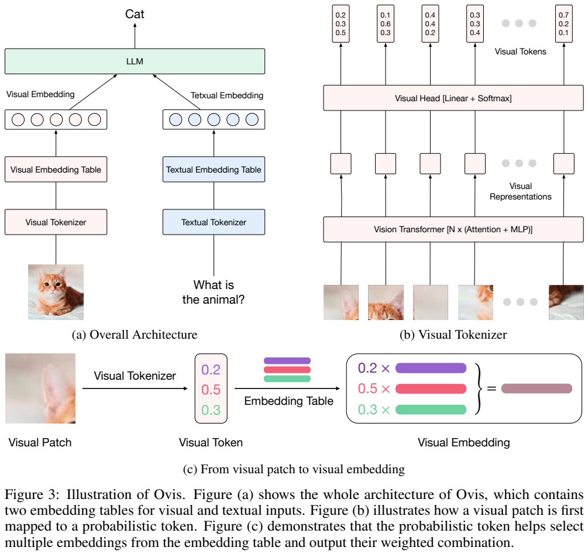
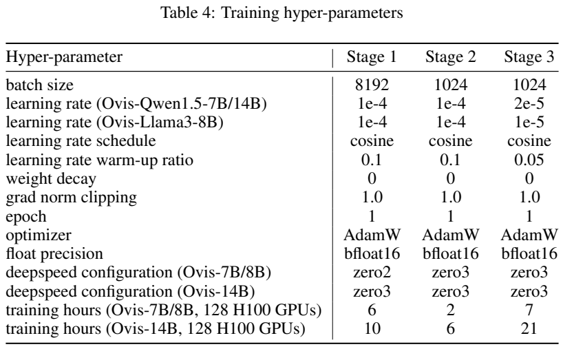
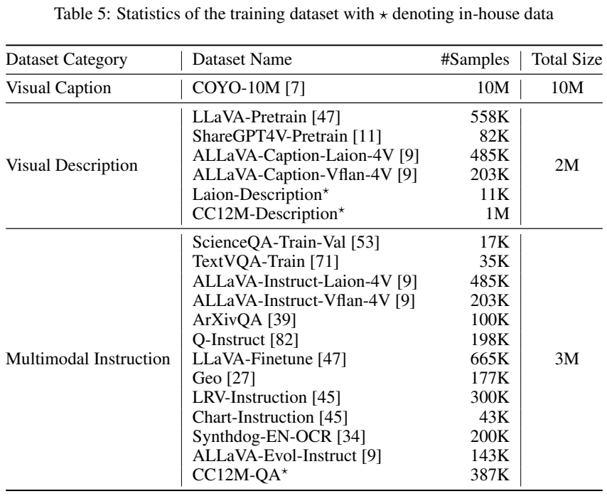
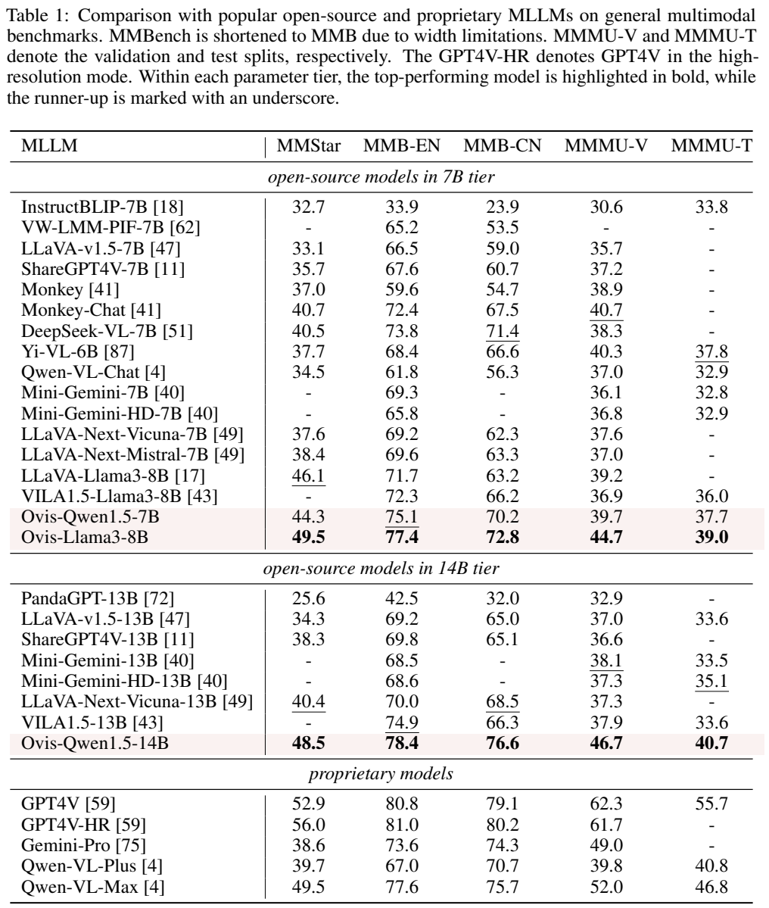
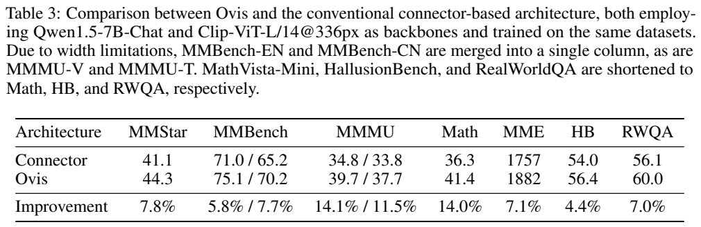

<!-- article-header:start -->
[项目首页](../../../README.md) › [模型系列](../../../reports/model-family-index.md) › [Ovis](../README.md)
<!-- article-header:end -->

# Ovis：用概率视觉词表对齐图像与语言的嵌入结构

<!-- article-toc:start -->
<a id="article-toc"></a>

**本篇目录** · [论文定位](#paper-info) · [快速概览](#overview) · [整体架构](#architecture) · [核心原理](#principles) · [数据构建](#data) · [训练流程](#training) · [实验结果](#experiments)
<!-- article-toc:end -->

<a id="paper-info"></a>

## 1. 论文信息与模型定位

**论文：** *Ovis: Structural Embedding Alignment for Multimodal Large Language Model*。作者包括 Shiyin Lu、Yang Li、Qing-Guo Chen、Zhao Xu、Weihua Luo、Kaifu Zhang 和 Han-Jia Ye，来自阿里巴巴 AI Business 与南京大学。本篇固定介绍 [arXiv 2405.20797v1](https://arxiv.org/abs/2405.20797v1)，提交于 2024 年 5 月 31 日，共 21 页；不混入后续 Ovis 版本。

Ovis 是图像输入、文本输出的多模态大模型架构。它使用 CLIP 视觉编码器和现有指令语言模型，考察一个具体问题：视觉 patch 通常经过连续投影直接进入 LLM，而文字先经过词表和嵌入表，这种输入结构的不对称是否妨碍对齐？论文的回答是为视觉也建立可学习的词表与嵌入表，但以概率分布保留一个 patch 的多重含义。

报告训练了 Qwen1.5-Chat 7B、14B 和 Llama3-Instruct 8B 三种语言骨干。它属于视觉理解模型，不是图像生成 tokenizer；本版本也没有高分辨率、多图或视频专项训练。[原文 §3–4，PDF 第 4–6、10 页](https://arxiv.org/pdf/2405.20797v1#page=4)

<a id="overview"></a>

## 2. 快速概览

| 关注点 | 原文实现与含义 |
|---|---|
| 视觉输入 | CLIP ViT-L/14，336×336 分辨率；视觉特征经过线性层与 softmax |
| 视觉词表 | 131,072 个可学习视觉词，不与文本词表共用嵌入参数 |
| 送入 LLM 的表示 | 对视觉嵌入表按概率加权，得到连续向量，与文字嵌入共同输入 LLM |
| 训练组织 | 约 10M 简短描述、2M 详细描述、3M 多模态指令，依次扩大可训练模块 |
| 核心证据 | 相同 Qwen1.5-7B、视觉骨干和数据下，比连接器基线得到更好的多项成绩 |
| 阅读边界 | 连接器基线采用 LLaVA 训练范式，不能把全部增益只归因于一个结构改动 |

这里的“结构对齐”不是保证图像词与语言词一一对应，也不是让视觉 token 变成可读汉字。它让两种输入都通过“词表表示→嵌入表”这一层次组织，而视觉保留软选择，文字仍使用普通离散 token。[原文 §3，PDF 第 4–6 页](https://arxiv.org/pdf/2405.20797v1#page=4)

<a id="architecture"></a>

## 3. 整体架构



**原图：Figure 3，PDF 第 4 页。** 左上图沿两条路径阅读：图像进入视觉 tokenizer，再进入独立视觉嵌入表；文字进入文字 tokenizer 和文字嵌入表，最后二者汇合到 LLM。右上图展开视觉 tokenizer，底部图说明一个 patch 不只查一个词，而是按 0.2、0.5、0.3 这样的概率组合多个嵌入。图中的三项仅为示意，真实词表有 131,072 项。

图像切成 patch 后，由 ViT 产生具有上下文信息的表征。视觉 head 的线性层把每个表征映射到视觉词表维度，softmax 输出一个概率向量。随后一个专用视觉嵌入表把词表分布转成 LLM 所需宽度的向量。文字按语言模型原有 tokenizer 与嵌入表处理，语言模型以这些输入生成回答。

这一设计仍然在视觉侧做连续变换，却引入了可解释的中间层：概率向量表示哪些视觉词参与当前 patch 的表达。视觉嵌入表由视觉语言任务的梯度学习，并非从文本表里挑一些现成词。也没有附加图像重建 decoder，模型训练的出口是文本预测。[原文 §3.2，PDF 第 5–6 页](https://arxiv.org/pdf/2405.20797v1#page=5)

<a id="principles"></a>

## 4. 核心创新与数学原理

设 ViT 给第 $`i`$ 个 patch 的特征为 $`r_i\in\mathbb R^d`$，视觉词表大小为 $`K`$，线性参数为 $`W\in\mathbb R^{K\times d}`$。原文式 (2) 定义：


```math
v_i=\mathrm{softmax}(Wr_i),\qquad \sum_{k=1}^{K}v_{i,k}=1.
```


每一维对应一个可学习视觉词，而不是一个固定对象类别。一个 patch 可能同时包含颜色、纹理、局部轮廓或文字，把它强制归入单个离散索引容易丢掉其他信息。概率分布使模型能够分配多个视觉词，并通过下游语言任务调整这些组合。

设视觉嵌入表的第 $`k`$ 行为 $`e_k\in\mathbb R^{d'}`$，其中 $`d'`$ 与语言模型输入宽度一致。原文式 (3) 将最终视觉嵌入写成：


```math
V_i=\sum_{k=1}^{K}v_{i,k}e_k
=\mathbb E_{k\sim v_i}[e_k].
```


右侧期望是对加权和的数学解释；论文实际采用概率加权嵌入，不能据此说推理时随机抽取一个视觉词。它也没有使用 argmax 把所有 patch 变成硬离散 token。图像特征、视觉 head、嵌入表均可从文本损失接收梯度，训练不要求人工给 patch 标注词表索引。

与两层 MLP 连接器相比，视觉嵌入可以理解为词表基向量的凸组合：先学习组合系数，再学习一组输入 LLM 的表达基底。这是本文对式 (2)–(3) 的解读，原文没有证明该约束必然优于任意投影网络，也没有宣称视觉词表得到明确语义标签。[原文式 (2)–(3)，PDF 第 5–6 页](https://arxiv.org/pdf/2405.20797v1#page=5)

附录 E 用 ImageNet-1K 随机取出的 10,000 张图检查 Ovis-Llama3-8B 的概率分布：仅 0.22% 的概率值大于 $`10^{-4}`$，20.16% 落在 $`10^{-5}`$ 至 $`10^{-4}`$ 区间，79.62% 小于 $`10^{-5}`$。这说明分布在所用阈值下相当稀疏，但 softmax 数学上仍是稠密分布；报告没有把它实现成裁剪后的稀疏计算，也没有由该统计给出加速比例。[原文 Figure 8，PDF 第 21 页](https://arxiv.org/pdf/2405.20797v1#page=21)

<a id="data"></a>

## 5. 数据构建与处理





**原表：Table 4、Table 5，PDF 第 18 页。** Table 4 列出三阶段训练超参数；Table 5 按数据用途分组，列出类别、来源、样本数与类别总量；带星号的条目是内部构建数据。约 10M、2M、3M 是表中汇总值，不能把舍入后的条目数当作精确去重统计。

第一类是 **10M 图像短描述**，来自 COYO。筛选要求 `clip-similarity-vitb32` 与 `clip-similarity-vitl14` 两项都大于 0.36，并处理不合适的描述。两个相似度门槛共同约束图文相关性；它们并不构成事实性或敏感内容无误的保证。

第二类是约 **2M 详细视觉描述**。公开来源包含 LLaVA-Pretrain 558K、ShareGPT4V-Pretrain 82K，以及 ALLaVA 的 Laion 485K、Vflan 203K。内部来源为 Laion-Description 11K 和 CC12M-Description 1M。作者调用 Gemini-Pro 或 GPT-4V，为采样图像产生描述；统一提示要求简洁清楚地陈述视觉信息、必要时识别文字，并避免修饰和主观解读。Figure 6 展示自然图像、建筑、插画和图表等样本。

第三类是约 **3M 多模态指令**，包含 LLaVA-Finetune 665K、ALLaVA 两路指令 485K 与 203K、ArXivQA 100K、Q-Instruct 198K、Geo 177K、LRV-Instruction 300K、Chart-Instruction 43K、Synthdog-EN-OCR 200K、ALLaVA-Evol-Instruct 143K，以及 ScienceQA-Train-Val 17K、TextVQA-Train 35K、内部 CC12M-QA 387K。内部指令让 Gemini-Pro/GPT-4V围绕图像自问自答，产生问题及参考回答。

详细描述与指令数据转换为 LLaVA-Finetune 的格式。不同来源为 OCR、图表、科学和空间理解提供监督，但论文未逐项披露去重后规模、采样权重或跨基准污染审计；ScienceQA 的 train-val 出现在训练来源中，解读相关任务需注意数据划分。v1 写的是计划公开完整数据和代码，不能将这一未来计划描述成报告提交时已经发布。[原文 §4.1、附录 B–D，PDF 第 6–7、18–20 页](https://arxiv.org/pdf/2405.20797v1#page=18)

<a id="training"></a>

## 6. 训练流程与目标

三阶段都以条件文本生成交叉熵训练，没有单独的视觉词分类标签、VQ 重建目标或偏好优化阶段。若以 $`I,q,y`$ 表示图像、提示和目标文本，其目标可以概括为 $`-\sum_t\log p_\theta(y_t\mid I,q,y_{\lt t})`$；这是对原文训练说明的通常数学表达，不是额外提出的损失。[原文 §3.3，PDF 第 6 页](https://arxiv.org/pdf/2405.20797v1#page=6)

| 阶段 | 数据 | 冻结与可训练模块 | 全局 batch / 学习率 |
|---|---|---|---|
| 1：建立视觉输入接口 | COYO 短描述 | 冻结 LLM 与 ViT 大部分层；ViT 最后一块随机重初始化并训练，视觉 head、视觉嵌入表训练 | 8192；所有版本 $`10^{-4}`$ |
| 2：丰富视觉细节 | 详细视觉描述 | LLM 继续冻结；ViT 全部、head 和视觉嵌入表训练 | 1024；所有版本 $`10^{-4}`$ |
| 3：指令学习 | 多模态指令 | 包括 LLM 在内的全部参数训练 | 1024；Qwen 7B/14B 为 $`2\times10^{-5}`$，Llama3-8B 为 $`10^{-5}`$ |

从第一阶段到第三阶段，训练先让视觉输入适应固定语言模型，再调整完整视觉编码器，最后共同适应问答与推理任务。这样解释冻结顺序，比将三阶段简单称为三次“全参数微调”更准确。

附录 Table 4 披露每阶段各 1 epoch、AdamW、cosine 学习率、BF16、weight decay 0、梯度范数裁剪 1.0。warm-up ratio 依次为 0.1、0.1、0.05。7B/8B 使用 ZeRO-2、ZeRO-3、ZeRO-3，14B 三阶段都使用 ZeRO-3。在 **128 张 H100** 上，7B/8B 的阶段时长依次为 6、2、7 小时，14B 为 10、6、21 小时。这是原文配置下的训练时长，不是消费设备可复现的时间承诺。报告没有在 Table 4 给出完整上下文长度、精确优化步数或 AdamW 的全部参数，本文不补造。[原文 Table 4，PDF 第 18 页](https://arxiv.org/pdf/2405.20797v1#page=18)

<a id="experiments"></a>

## 7. 实验设置与主要结果



**原表：Table 1，PDF 第 7 页。** MMMU-V/T 分别是验证集与测试集，MMB-EN/CN 是 MMBench 的英文/中文版本。表按模型规模分组，高亮表示组内比较，不能直接读成超过全表所有模型。作者使用 VLMEvalKit，另在 Table 2 报告 MathVista-Mini、MME、HallusionBench 和 RealWorldQA。

| 模型 | MMStar | MMB-EN / CN | MMMU-V / T | MathVista | MME | HallusionBench | RealWorldQA |
|---|---:|---:|---:|---:|---:|---:|---:|
| Ovis-Qwen1.5-7B | 44.3 | 75.1 / 70.2 | 39.7 / 37.7 | 41.4 | 1882 | 56.4 | 60.0 |
| Ovis-Llama3-8B | 49.5 | 77.4 / 72.8 | 44.7 / 39.0 | 40.8 | 2009 | 61.1 | 57.9 |
| Ovis-Qwen1.5-14B | 48.5 | 78.4 / 76.6 | 46.7 / 40.7 | 43.4 | 1961 | 57.6 | 62.7 |

这些指标不是同一量纲：MME 为综合分数，HallusionBench 使用表中 Question Accuracy，其余需按相应基准定义解释。更大的语言骨干没有让每个指标同步增长：Llama3-8B 的 MMStar 高于 Qwen14B，但 MathVista 与 RealWorldQA 低于后者。

14B 在多项任务上超过表中的 Qwen-VL-Plus，但不是全面胜出：MMMU 测试为 40.7 对 40.8，MME 为 1961 对 2230，HallusionBench 同为 57.6。RealWorldQA 62.7 高于普通 GPT-4V 的 61.4，却低于 GPT-4V-HR 的 68.0；GPT-4V 的 MMMU 验证集 62.3 也明显高于 Ovis。按具体测试与输入模式比较，比把论文概括成“超过 GPT-4V”更有信息。[原文 Table 1–2，PDF 第 7–8 页](https://arxiv.org/pdf/2405.20797v1#page=7)



**原表：Table 3，PDF 第 9 页。** 两行使用同一个 Qwen1.5-7B、CLIP ViT-L/14@336 和同一训练数据。连接器采用两层 GELU MLP，隐藏维度设置为 Ovis 视觉词表大小以匹配参数量。Ovis 将 MMStar 从 41.1 提升至 44.3，MMMU 验证从 34.8 提升至 39.7，MathVista 从 36.3 提升至 41.4，RealWorldQA 从 56.1 提升至 60.0。最后一行是相对提升，作者汇总的平均 8.8% 不是平均提高 8.8 个百分点。

这组实验支持整套 Ovis 方案的有效性，但连接器沿用 LLaVA 的训练范式，未将训练流程完全固定为同一个三阶段设置。因此不能宣称它已经严格排除训练日程影响。论文也没有给视觉词表每一项做人类语义标注，或展示硬离散化、不同词表大小的系统消融。本版本主要证据来自单图、336 分辨率的理解基准；高分辨率、多图、视频、医疗或安全部署的可靠性仍不能由这些分数推出。

<!-- article-footer:start -->
---

[← 上一篇：MQT-LLaVA](../../mqt-llava/arxiv-2405.19315/README.md) · [按发表时间浏览](../../../reports/paper-reading-guide.md#year-2024) · [下一篇：VideoLLaMA 2 →](../../videollama/arxiv-2406.07476/README.md)

[返回本篇目录](#article-toc) · [返回模型系列](../README.md)
<!-- article-footer:end -->
