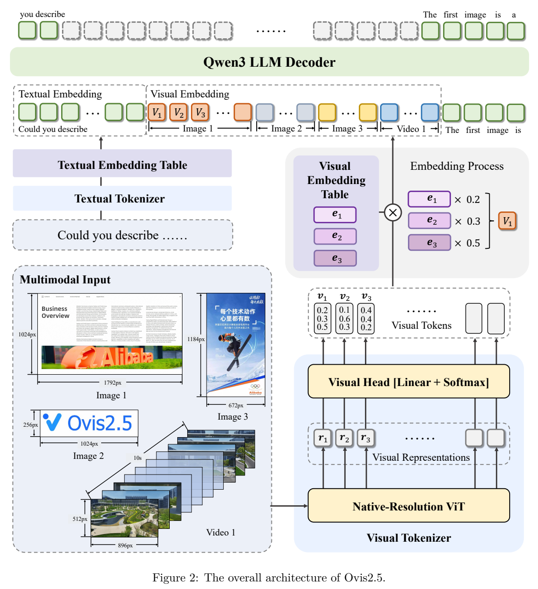
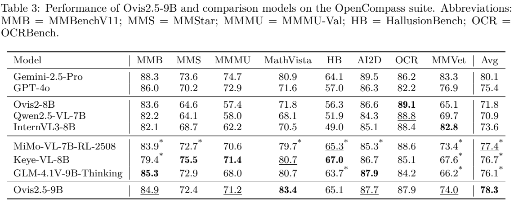

<!-- article-header:start -->
[项目首页](../../../README.md) › [模型系列](../../../reports/model-family-index.md) › [Ovis](../README.md)
<!-- article-header:end -->

# Ovis2.5：原生分辨率视觉与可切换的深度推理

<!-- article-toc:start -->
<a id="article-toc"></a>

**本篇目录** · [论文定位](#paper-info) · [快速概览](#overview) · [整体架构](#architecture) · [核心原理](#principles) · [数据构建](#data) · [训练流程](#training) · [实验结果](#experiments)
<!-- article-toc:end -->

<a id="paper-info"></a>

## 1. 论文信息与模型定位

| 项目 | 信息 |
|---|---|
| 原文 | **Ovis2.5 Technical Report** |
| 团队 | Ovis Team，Alibaba Group |
| 发表日期 | arXiv v1 提交于 **2025-08-15**；PDF 首页另印 2025-08-19 |
| 固定版本 | [2508.11737v1](https://arxiv.org/pdf/2508.11737v1) |
| 代码与权重 | [官方仓库](https://github.com/ATH-MaaS/Ovis) · [9B 模型卡](https://huggingface.co/AIDC-AI/Ovis2.5-9B) |
| 模型形态 | 2B / 9B 视觉语言理解模型，支持图像、多图和视频输入，输出文字 |

Ovis2.5 延续 Ovis 的概率视觉词和视觉嵌入表，主要更新是用原生分辨率视觉前端保护密集图表的空间结构，并通过反思数据、偏好优化和强化学习增强推理。它提供可选 thinking mode，定位是可调节回答成本的理解模型，报告没有发布原生图像生成出口。[§1–2，PDF 第2–4页](https://arxiv.org/pdf/2508.11737v1#page=2)

<a id="overview"></a>

## 2. 快速概览

| 核心问题 | 解决方式 | 阅读时注意 |
|---|---|---|
| 固定切图破坏全局布局 | NaViT 按原比例处理可变分辨率输入 | 原生分辨率仍有像素预算，不等于无限尺寸 |
| 图像特征与文字嵌入结构不同 | Visual Tokenizer 预测视觉词分布，VET 求期望嵌入 | 没有对每个位置硬选一个离散词 |
| 线性思维链缺少检查与修订 | Qwen3 骨干、反思式监督、DPO 和 GRPO | thinking 带来额外延迟，正确性仍需评测 |
| 变长多模态训练浪费计算 | 数据 packing 与 DP / TP / CP 混合并行 | 3–4倍加速是作者相对既有框架的报告值 |

9B 模型在报告 OpenCompass 八任务平均值上为 **78.3**，2B 为 **73.9**。这些平均值属于特定任务与计分口径，不能作为任意视觉应用的统一准确率。[Tables2–3，PDF 第6–7页](https://arxiv.org/pdf/2508.11737v1#page=6)

<a id="architecture"></a>

## 3. 整体架构



*原文 Figure 2，PDF 第3页；保留架构区域与图注。*

图像和视频帧先进入 Native-Resolution ViT。视觉头对每个位置输出视觉词概率；Visual Embedding Table（VET）把这些概率变成语言宽度的连续嵌入。文字经过自己的 tokenizer 和嵌入表，随后按输入顺序与视觉嵌入共同交给 Qwen3 解码器。图中右侧的乘法与求和是视觉词嵌入的加权组合，不能理解成外部目标检测器为每幅图生成文字标签。[§2，PDF 第3–4页](https://arxiv.org/pdf/2508.11737v1#page=3)

| 模块 | 输入与输出 | 公开机制 |
|---|---|---|
| 原生分辨率视觉主干 | 保持比例的图像 / 视频帧 → patch 特征 | NaViT 从 SigLIP2-so400m-patch16-512 初始化；后续阶段在每个 ViT block 启用 RoPE |
| Visual Head | patch 特征 → 视觉词概率分布 | 线性映射加 softmax；每个位置保留对词表的软分配 |
| Visual Embedding Table | 视觉词分布 → 连续视觉嵌入 | 以概率加权求和可学习的视觉词向量 |
| 文字输入接口 | 问题、历史文字 → 文字嵌入 | 使用语言模型 tokenizer 与文字嵌入表，与视觉序列组合 |
| Qwen3 解码器 | 视觉 / 文字条件 → 回答与可选思考过程 | 自回归文字生成；2B、9B 为不同规模发布模型 |

一次图表问答依次经过“保比例预处理→视觉 patch 表示→词分布→VET 加权嵌入→Qwen3 回答”。与早期固定子图方案相比，视觉编码阶段更能保留整图空间关系；但它仍需控制输入总像素并承受视觉 token 的计算成本。报告没有逐项列出每种视频任务的采样帧数、词表大小与连接宽度，本文不补造这些参数。

<a id="principles"></a>

## 4. 核心创新与数学原理

### 4.1 从连续 patch 特征到概率视觉词

原文§2用文字解释了 VT 与 VET 的计算，下面是对应的说明性记号，非论文编号公式：

```math
p_i=\mathrm{softmax}(W r_i+b),\qquad v_i=\sum_{k=1}^{K}p_{ik}e_k.
```

$`r_i`$ 是位置 $`i`$ 的视觉特征，$`K`$ 为视觉词表大小，$`e_k`$ 为 VET 的第 $`k`$ 行。$`p_{ik}`$ 是该位置分配给视觉词的概率，$`v_i`$ 是送入语言模型的连续向量。期望嵌入允许一个位置同时组合多个视觉原语，避免硬取 argmax 丢弃其余概率；它也提供一张可学习的表，与文字嵌入表形成结构上的对应。这里的“视觉词”不是人工标注的对象名称，报告也没有要求它们逐项可解释。[§2 / Figure2，PDF 第3页](https://arxiv.org/pdf/2508.11737v1#page=3)

### 4.2 原生分辨率与位置编码的渐进适配

NaViT 避免先把整图强制变成相同大小的子图，图表轴线、长文档与跨区域关系可以在统一网格中表示。不过，预训练 SigLIP2 并没有当前使用的 RoPE：第一阶段以位置嵌入插值支持变长，暂不开启 RoPE；第二阶段扩大像素范围时才在每层打开 RoPE。这样把视觉嵌入表的稳定学习与空间编码升级分开。

第一阶段允许总像素介于 $`448^2`$ 与 $`896^2`$，第二阶段扩展到 $`448^2`$ 至 $`1792^2`$。这些是保持比例后的**总像素范围**，不能写成任意输入的长宽都等于1792，也不能把训练阶段暂时关闭RoPE描述成最终架构没有RoPE。[§3.1.2，PDF 第5页](https://arxiv.org/pdf/2508.11737v1#page=5)

### 4.3 反思数据、偏好对齐与可验证强化学习

监督数据先包含普通思维链，再加入带 `<think>…</think>` 的检查、修订过程。DPO阶段从同一问题生成多份候选，并据可验证答案或MLLM评分形成偏好对；训练目标还加入NLL辅助项，避免只优化成对偏好时偏离正常回答。报告没有给出两项权重，不能从通常的DPO实现补写成某个固定系数。

最后的GRPO阶段冻结视觉模块，仅更新LLM；数据以数学为主，并包含科学和逻辑视觉问答。作者将部分选择题转成填空，降低靠猜选项获得奖励的机会。因而本代不是仅靠延长输出的提示技巧：数据形式、偏好对齐和可验证奖励都参与了训练。但报告没有隔离每一因素的完整因果消融，不能据综合提升断言反思文字本身保证正确。[§3.1–3.2，PDF 第5–6页](https://arxiv.org/pdf/2508.11737v1#page=5)

### 4.4 变长样本 packing 与混合并行

图像、视频、文字样本长度差异大，按最长样本padding会让部分设备浪费计算。Packing把多个短样本组合成长序列，减少无效填充；DP分配样本，TP分割模型内张量计算，CP分摊长上下文。作者报告这些基础设施改进相对其旧框架带来3–4倍端到端速度提升。该数字没有统一硬件、batch等完整复现条件，不应解读为对任意部署系统的固定倍数收益。[§3.3，PDF 第6页](https://arxiv.org/pdf/2508.11737v1#page=6)

<a id="data"></a>

## 5. 数据构建与处理

公开来源包括COYO、LAION、Wukong、DataComp、SAM和已有grounding标注，另包含内部及网上收集的数据。不同任务采用不同处理路径：[§3.1.1–3.2.1，PDF 第4–5页](https://arxiv.org/pdf/2508.11737v1#page=4)

| 数据类别 | 构建过程 | 质量控制与边界 |
|---|---|---|
| OCR与密集图表 | MLLM集合标注文档、海报、图表、截图并合成问答 | 按分辨率、语言、场景筛选；教师错误仍可能传递 |
| Grounding | 使用已有框标注，或先检测实体再生成定位问答 | 检测器给位置、MLLM给指令；不是人工核验全部自动框 |
| 推理监督 | 收集普通CoT，给直接答案补推理，再合成反思式样本 | 多个MLLM交叉核验筛选，不能等同形式化证明 |
| 偏好与RLVR | 候选比较、可验证答案、数学/科学/逻辑问答 | 质量及离线难度过滤；部分选择题改填空 |

报告没有公开各阶段精确样本数、完整去重阈值和所有教师版本，也没有提供可据此重建全部训练语料的清单。

<a id="training"></a>

## 6. 训练流程与目标

| 阶段 | 更新范围 | 数据与作用 |
|---|---|---|
| 预训练P1 | ViT最后一层、视觉头、VET；其余冻结 | 图像caption，先建立视觉词接口；RoPE关闭 |
| 预训练P2 | VT、VET、LLM全参 | OCR/caption/grounding对话，启用RoPE并扩大像素预算 |
| 预训练P3 | 全参 | 文本、多图、视频及领域指令，加入反思过程 |
| 后训练P1 | 全参 | 多模态DPO加辅助NLL，改善偏好与回答稳定性 |
| 后训练P2 | 仅LLM | GRPO与可验证任务，视觉模块冻结 |

阶段顺序和冻结边界来自§3 / Table1。生成监督学习条件回答，DPO学习候选相对偏好，GRPO利用任务可验证奖励；它们分别承担接口适配、偏好校准和推理强化，不能混称为一种新的“视觉对齐损失”。固定v1未列全套学习率、batch、步数、训练设备与耗时，本文不从上游Qwen3或SigLIP2推定本模型使用相同配方。

<a id="experiments"></a>

## 7. 实验设置与主要结果



*原文Table3，PDF第7页；保留表头与缩写说明。星号表示作者复测，其余优先使用原模型官方报告值。*

| 指标 | Ovis2.5-2B | Ovis2.5-9B | 来源 |
|---|---:|---:|---|
| OpenCompass八任务平均 | 73.9 | 78.3 | Tables2–3 |
| MMMU | 59.8 | 71.2 | Tables4–5 |
| MathVista | 81.4 | 83.4 | Tables4–5 |
| OCRBench v2英文 / 中文 | 60.6 / 54.0 | 63.4 / 58.0 | Table6 |
| ChartQA Pro | 53.1 | 63.8 | Table6 |
| Grounding八分割平均 | 89.6 | 90.1 | Table7 |
| VideoMME有 / 无字幕 | 63.6 / 60.2 | 72.8 / 68.6 | Table8 |

这些数值是原文报告结果，本仓库没有运行模型。八任务平均混合了不同能力；OCRBench与OCRBench v2也是不同评测，不能把Table3的87.9与v2英文63.4当作同一指标的波动。9B视频无字幕68.6只略高于Ovis2-8B的68.0，有字幕72.8低于表中GLM-4.1V的73.6，故综合排名不表示每一任务都最佳。报告没有对所有行统一重跑，也没有逐项披露thinking开关和生成预算；跨模型比较应保留这些限制。[§4 / Tables2–8，PDF 第6–9页](https://arxiv.org/pdf/2508.11737v1#page=6)

<!-- article-footer:start -->
---

[← 上一篇：GPT-5](../../gpt/document-d0807662cb93/README.md) · [按发表时间浏览](../../../reports/paper-reading-guide.md#year-2025) · [下一篇：Thyme →](../../thyme/arxiv-2508.11630/README.md)

[返回本篇目录](#article-toc) · [返回模型系列](../README.md)
<!-- article-footer:end -->
