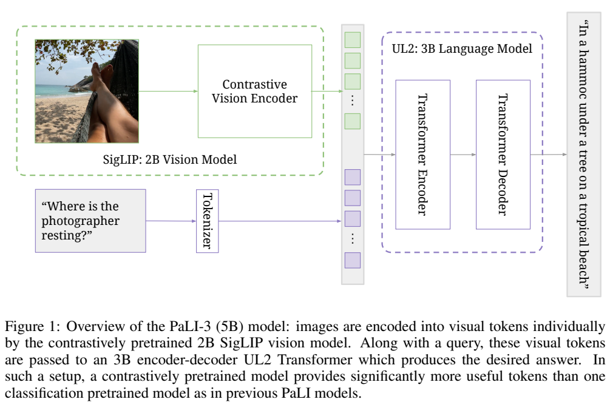
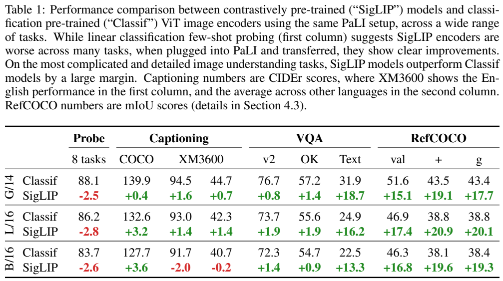
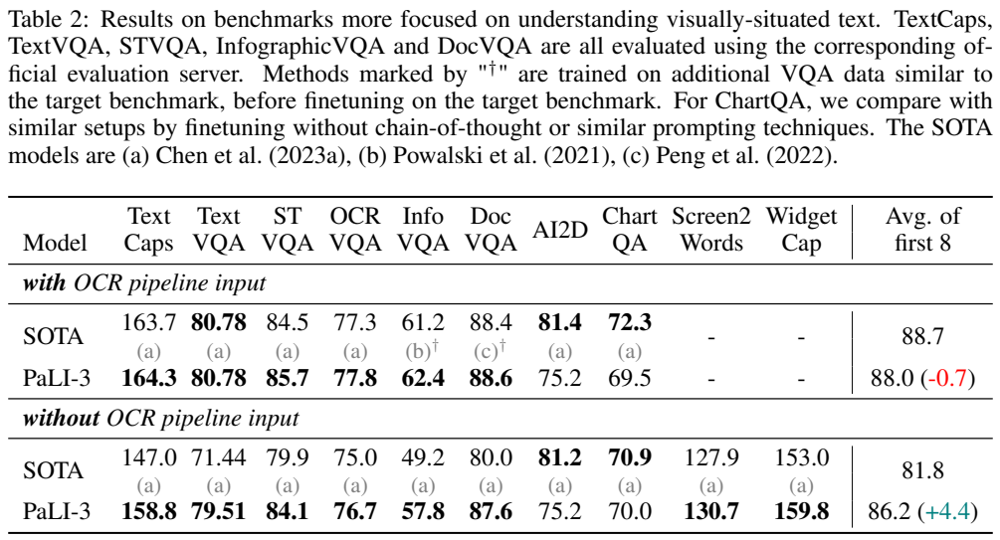
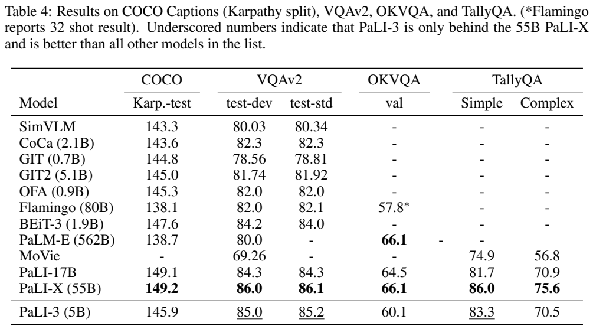
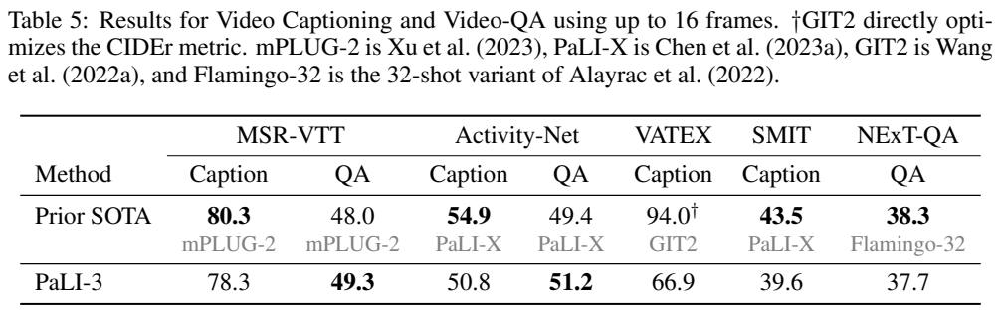
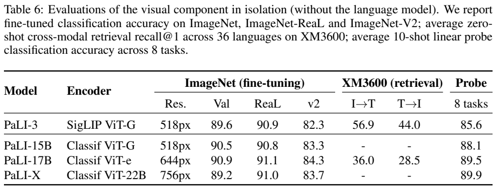

<!-- article-header:start -->
[项目首页](../../../README.md) › [模型系列](../../../reports/model-family-index.md) › [PaLI](../README.md)
<!-- article-header:end -->

# PaLI-3：以 SigLIP 视觉预训练增强 5B 视觉语言模型

<!-- article-toc:start -->

**本篇目录** · [论文定位](#paper-info) · [快速概览](#overview) · [整体架构](#architecture) · [核心原理](#principles) · [数据构建](#data) · [训练流程](#training) · [实验结果](#experiments)
<!-- article-toc:end -->

## 1. 论文信息与模型定位

| 项目 | 信息 |
| --- | --- |
| 论文 | PaLI-3 Vision Language Models: Smaller, Faster, Stronger |
| 作者 | Xi Chen、Xiao Wang、Lucas Beyer、Alexander Kolesnikov 等，Xiaohua Zhai 与 Radu Soricut 牵头 |
| 机构 | Google Research、Google DeepMind、Google Cloud |
| 固定版本 | [arXiv 2310.09199v1](https://arxiv.org/abs/2310.09199v1)，2023-10-13，16 页 |
| 模型 | 2B SigLIP ViT-G/14 与 3B UL2 encoder-decoder，总计约 5B |
| 定位 | 图像文字理解、文档/界面问答、caption、定位与任务迁移 |

PaLI-3 属于 PaLI 系列，重点验证视觉编码器预训练方式和分辨率课程。它不是只靠通用聊天指令集微调的对话助手：主要基准结果包含针对每个任务训练集的专门微调。该版本没有给出完整训练代码和开放权重链接，不能把后续 SigLIP 发布与整个 PaLI-3 模型开放混为一谈。下文页码均对应 v1。

## 2. 快速概览

PaLI-X 达到约 55B，而 PaLI-3 将总规模降至约 5B，同时更换视觉表示的学习方法：用图文 sigmoid 对比预训练的 SigLIP，替代主要靠 JFT 分类学习的视觉编码器。论文发现图像分类探针分数略低，并不代表这些表示在文字理解和定位任务中更差。

流程还增加了密集文字 PDF 和文档图像，先以 224 分辨率联合训练，再全模型提高到 812/1064，最后冻结视觉编码器做任务迁移。无外部 OCR 的 TextVQA 达到 79.51，DocVQA ANLS 87.6；但 AI2D 75.2、ChartQA 70.0 仍低于表中较大的 PaLI-X。

“更小”可以由参数计数验证；标题中的“更快”没有在本文以完整硬件延迟或吞吐实验量化。省参数也不意味着高分辨率成本为零。视频结果来自图像预训练后在各视频任务上微调，不能写成未训练任何视频的零样本成绩。

## 3. 整体架构

**读图：** SigLIP 先独立编码图像；视觉 token 与问题 token 拼接进入 UL2 的 Transformer encoder，再由 decoder 生成答案。它是 encoder-decoder 架构，不是把图像放进一个 decoder-only 聊天模型。

视觉编码器 ViT-G/14 约 2B，嵌入维度从原配置 1664 改为 1536，以改善硬件利用。取 pooling 之前的 token，线性投影后前置到输入文字嵌入。SigLIP 预训练时使用的文本嵌入 Transformer 在接入 PaLI 时丢弃，UL2 是另一个预训练的 3B 语言模型。

文字提示包含任务、语言和必要问题信息，使 caption、VQA、检测等转成序列生成。patch 边长 14，因此按规则可算 224/812/1064 下分别为 16²/58²/76²，即 256/3364/5776 个图像网格；这是架构换算，不是论文报告的全部序列长度或性能测量。该文没有固定长度 Query Transformer 压缩机制。

指代分割额外利用 VQ-VAE：先生成四个框坐标，再生成框内掩码的 16 个离散 token；token 的码本有 128 种。这里 128 是字典大小，16 是序列长度，二者不能混淆。解码成 64×64 的框内掩码后还原位置，不是用 `[SEG]` 隐藏状态直接驱动 SAM。

## 4. 核心创新与数学原理

SigLIP 将图文匹配视为二分类。原文描述了 sigmoid cross-entropy 与图文嵌入点积，没有列编号公式；可用标准形式解释：

$$
\mathcal L_{sig}=-\sum_{i,j}\log\sigma(z_{ij}s_{ij}),\qquad z_{ij}\in\{+1,-1\}.
$$

$s_{ij}$ 是图像 $i$ 与文本 $j$ 的匹配分数，正负标签表示是否对应。它与 CLIP 在整个 batch 上做 softmax 的对比目标不同，逐对判断匹配。上式仅解释原理，具体温度、偏置、采样与归一化应按引用的 SigLIP recipe，本文没有补写 PaLI-3 未公布的数值。

**读表：** Classif 行是原始分数，SigLIP 行列的是增减量，绿色“+18.7”不是最终 TextVQA 分数。G/14 的分类探针 88.1，SigLIP 低 2.5；但 TextVQA 从 31.9 提高 18.7 到 50.6，RefCOCO 三项提高 15.1/19.1/17.7。实验使用 224 分辨率与完整第一阶段的 20% 训练预算，不能拿它与高分辨率主结果直接比。

这些结果说明分类线性可分性不是多模态表示价值的充分指标。但对照也改变了预训练数据：Classif 使用 JFT，SigLIP 使用 WebLI，不能把全部收益严格归因到 sigmoid 一个操作。对较简单的 caption 并非全都改善，B/16 的 XM3600 英文和其他语言均有小幅下降。

多模态部分将任务监督转成文本生成，可用标准自回归目标 $-\sum_t\log p(y_t\mid y_{<t},\mathrm{image},\mathrm{prompt})$ 理解，原文没有设计新的奖励函数或 RLHF。分割则预测 VQ-VAE 离散掩码码，保持语言式输出接口；文中未给 VQ-VAE 全套 loss 或码本训练超参，本文不推造。

## 5. 数据构建与处理

Stage 0 从 WebLI 网页图文对做 SigLIP 预训练，模型过滤保留约 40% 配对。这个比例属于视觉编码器预训练，不意味着 PaLI 所有后续数据都采用相同比例。UL2 使用引用的 mixture-of-denoisers 语言预训练。

Stage 1 主要为经过文本质量启发式过滤的 WebLI 与 SplitCap 目标，混入 CC3M-35L 多语言 caption、WebLI OCR、VQ²A-CC3M-35L 跨语言 VQA/VQG、对象相关问答和检测。新增 dense-text PDF、海报及文档网页图，覆盖超过 100 种语言。论文未给各来源完整样本数、比例、去重、清洗阈值与 tokenizer 明细，不能将 WebLI 全部规模视为真实消费量。

Stage 2 数据更侧重视觉文字和检测。迁移阶段使用各 benchmark 的训练集；指代分割合并 RefCOCO、RefCOCO+、RefCOCOg，并从 PaLI 与 VQ-VAE 的训练中排除验证/测试图。外部 OCR 版本的输入识别文字来自与训练集相同服务，无 OCR 版本不输入这个外部文本，两者分别微调和评测。

视频附录明确指出抓取时存在失效链接，多个基准测试只有官方 split 的一部分，例如 MSR-VTT caption test 2135/2990，VATEX test 5242/6000，ActivityNet-QA test 7040/8000。它们是原文实际可用子集结果，不能宣称在全部官方样本上评测；附录部分百分比也与计数不完全一致，应以明确计数理解。

## 6. 训练流程与目标

| 阶段 | 更新范围与输入 | 目标 |
| --- | --- | --- |
| 0：底座预训练 | SigLIP ViT 在 224 图文对上预训练；UL2 独立语言预训练 | 图文二分类对齐与语言去噪 |
| 1：联合多模态 | ViT 冻结，224 分辨率 | 任务混合的文本序列生成 |
| 2：提高分辨率 | 解冻 ViT、全模型短课程，保留 812/1064 checkpoint | 重点学习文字及检测细节 |
| 任务迁移 | 在对应训练集微调，ViT 冻结 | 各 caption、VQA、分割任务 |

多数图像任务使用 812，DocVQA 与 InfographicVQA 使用 1064。视频任务从 Stage 1 的 224 checkpoint 出发，最多取 16 帧、固定时间 stride，各帧独立 ViT 编码后拼接，最多 4096 视觉 token；本文没有明确给每个基准的 stride 数值，不能编造统一 fps。

本文未在固定 v1 内列完整 optimizer、batch、learning rate、训练步数、阶段样本数、GPU/TPU、训练时长与生成速度。引用旧 PaLI/SigLIP/UL2 并不意味着这些方法的所有默认 recipe 都在本篇无改动采用。已公开的冻结顺序与分辨率明确，但不足以单靠本文复现整个模型。视频预训练没有使用视频数据，与视频任务微调使用视频数据必须分清。

## 7. 实验设置与主要结果

**读表：** 上半部含外部 OCR pipeline 输入，下半部不含；不是同一模型简单开关。caption 用 CIDEr，TextVQA 用准确率，STVQA/InfoVQA/DocVQA 用 ANLS，OCRVQA/AI2D 用 exact match，ChartQA 用 relaxed accuracy。最后平均是论文对前八列的聚合，不能叫统一准确率。

| 任务 | 无外部 OCR | 有外部 OCR | 无 OCR 的前列方法参照 |
| --- | ---: | ---: | ---: |
| TextCaps CIDEr | 158.8 | 164.3 | 147.0 |
| TextVQA | 79.51 | 80.78 | 71.44 |
| STVQA ANLS | 84.1 | 85.7 | 79.9 |
| OCRVQA | 76.7 | 77.8 | 75.0 |
| InfographicVQA ANLS | 57.8 | 62.4 | 49.2 |
| DocVQA ANLS | 87.6 | 88.6 | 80.0 |
| AI2D | 75.2 | 75.2 | 81.2 |
| ChartQA | 70.0 | 69.5 | 70.9 |

无 OCR 聚合 86.2，前列方法 81.8；有 OCR 88.0，对照 88.7。SOTA 行拼合不同论文的最好结果，并非一个统一对照模型；ChartQA 对照使用不带 CoT 的设置。AI2D 和 ChartQA 仍较弱，且后者加 OCR 不升反降。第 5 页称所有 TextCaps/TextVQA/InfoVQA/DocVQA 增益至少 8，但 DocVQA 实为 +7.6，本文以原表为准。

指代分割 Table 3 的三个验证集 mIoU 为 77.33/73.53/72.72，比 PolyFormer 76.94/72.15/71.15 略高。这是组合训练集后任务微调的表现，不是零样本分割。

**读表：** Table 4 是各任务迁移的图像结果，Table 5 是最多 16 帧的视频结果，Table 6 则评估视觉组件单独使用，不能把检索性能归到 UL2 对话输出。

自然图像 COCO CIDEr 145.9，VQAv2 test-dev/test-std 85.0/85.2，OKVQA 60.1，TallyQA simple/complex 83.3/70.5；55B PaLI-X 分别 149.2、86.0/86.1、66.1、86.0/75.6。5B 在多项接近大模型，但知识问答与复杂计数仍有差距。

视频 MSR-VTT/ActivityNet QA 为 49.3/51.2，高于表中此前 48.0/49.4；NExT-QA 37.7 低于 38.3。caption 的 MSR-VTT、ActivityNet、VATEX、SMIT CIDEr 为 78.3/50.8/66.9/39.6，均低于表内参照，VATEX 对优化 CIDEr 的 GIT2 94.0 差距明显。不能复述正文“平均只差三分”概括全部四列。

独立 SigLIP 编码器在 XM3600 36 语言平均 image→text/text→image recall@1 为 56.9/44.0，分类预训练 ViT-e 为 36.0/28.5；公平比较重新 LiT-tune 两者的文本编码器。ImageNet finetune 89.6 又低于分类 ViT-G 90.5，进一步说明评价任务不同。该版本还有特定 caption 毒性与群体偏差测试，但不能据低检测比例保证任意应用无偏差。本文未训练、推理或独立复现这些结果。

<!-- article-footer:start -->
---

[← 上一篇：Ferret](../../ferret/arxiv-2310.07704/README.md) · [按发表时间浏览](../../../reports/paper-reading-guide.md#year-2023) · [下一篇：MiniGPT-v2 →](../../minigpt/arxiv-2310.09478/README.md)

[返回本篇目录](#article-toc) · [返回模型系列](../README.md)
<!-- article-footer:end -->
