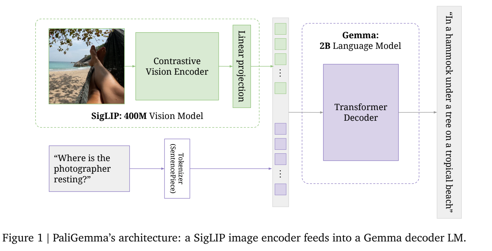
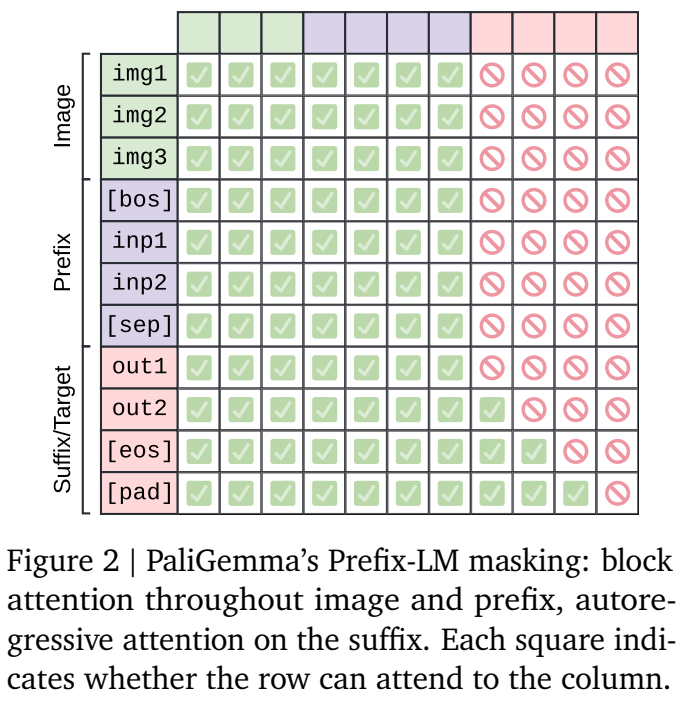
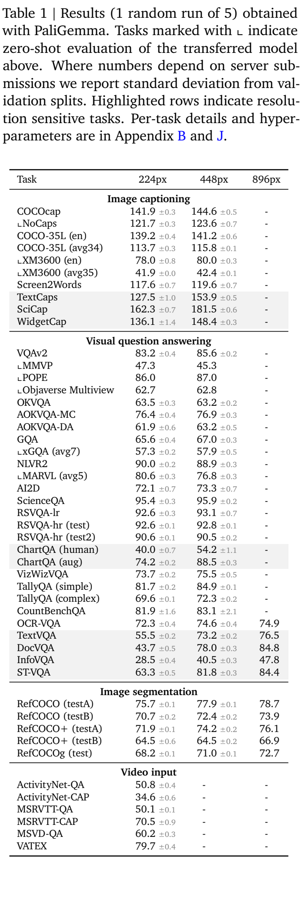

<!-- article-header:start -->
[项目首页](../../../README.md) › [模型系列](../../../reports/model-family-index.md) › [PaliGemma](../README.md)
<!-- article-header:end -->

# PaliGemma：Prefix-LM、全参数预训练与通用视觉迁移

> 解读 **PaliGemma: A versatile 3B VLM for transfer**，采用 arXiv **2407.07726v2**（2024-10-10 修订），首次提交为 2024-07-10。介绍对象是 PaliGemma 第一代基座，不混入 PaliGemma 2 或后续聊天模型。

<!-- article-toc:start -->
<a id="article-toc"></a>

**本篇目录** · [论文定位](#paper-info) · [快速概览](#overview) · [整体架构](#architecture) · [核心原理](#principles) · [数据构建](#data) · [训练流程](#training) · [实验结果](#experiments)
<!-- article-toc:end -->

<a id="paper-info"></a>

## 1. 论文信息与模型定位

| 项目 | 内容 |
|---|---|
| 团队与题名 | Google DeepMind；PaliGemma: A versatile 3B VLM for transfer |
| 系列 | PaLI 路线与 Gemma 语言模型结合的开放视觉语言基座 |
| 规模 | SigLIP 约 400M + Gemma-2B v1.0，合计少于 3B；3B 为型号标签 |
| 输入与输出 | 单图/多图与文字任务提示输入，自回归生成文字及位置/分割 token |
| 发布形式 | 不同分辨率的预训练基座与目标任务微调；mix 是多任务迁移示例，报告不将其称为完整指令训练 |
| 核心定位 | 为下游任务微调，研究小型 VLM 的训练设计与迁移能力 |
| 官方资源 | [固定报告](https://arxiv.org/pdf/2407.07726v2) · [代码/配置](https://github.com/google-research/big_vision/tree/main/big_vision/configs/proj/paligemma) · [模型卡](https://ai.google.dev/gemma/docs/paligemma/model-card) |

论文把“基座学习哪些视觉技能”与“怎样形成用户友好的聊天接口”分开。预训练包含高密度的识别、空间与语言任务，随后用目标数据微调；因此迁移实验的高分不表示原始基座可直接用自然对话完成全部任务。[§1–3，PDF 第 1–5 页](https://arxiv.org/pdf/2407.07726v2#page=2)

<a id="overview"></a>

## 2. 快速概览

架构由 SigLIP 视觉编码器、零初始化线性连接器和 Gemma-2B 解码器构成。视觉序列放在文字前，图像与任务提示内部采用双向注意力，答案采用因果注意力。这个 Prefix-LM 设计允许视觉 token 在语言主干中读取当前问题，同时保证答案逐词生成时不看未来答案。

训练使用已有单模态组件，先以 224 分辨率进行十亿样本的全参数联合预训练，再短程提升到 448、896，最后转到目标任务。视觉编码器并非全程冻结；作者用较慢的视觉学习率预热缓解初始未对齐梯度的破坏。

最有阅读价值的是一系列受控消融：因果掩码与损失位置、冻结策略、线性/MLP 连接器、视觉编码器是否必要，以及图像细节和序列长度对高分辨率收益的不同贡献。它们解释有效配方的由来，也保留了小样本微调高方差、部分私有数据及多任务指标异质性等限制。

<a id="architecture"></a>

## 3. 整体架构



*原文 Figure 1，PDF 第 2 页；图像经 SigLIP 和线性投影进入 Gemma，文字经 SentencePiece 与词嵌入进入同一主干。*

| 模块 | 输入与输出 | 公开机制 |
|---|---|---|
| 图像输入 | 原图 → 固定方形分辨率 | 224/448/896 三种 checkpoint，分别产生 256/1,024/4,096 视觉 token |
| SigLIP ViT-So400m | 图像 → patch 特征序列 | 复用对比预训练视觉编码器，联合多模态训练继续更新 |
| 线性连接器 | SigLIP token → Gemma 嵌入维度 | 零初始化线性映射，保留 token 个数；无额外固定查询池化 |
| 文本 tokenizer/嵌入 | 任务前缀 → 文字嵌入 | Gemma SentencePiece；BOS 标识文字起点，单独分词的换行符分隔前缀与答案 |
| Gemma-2B 主干 | 图文前缀 + 历史答案 → 下一输出 token | 输入区域双向，答案区域因果；仅答案区域提供预测损失 |
| 结构化词表 | 解码 token → 坐标或掩码编码 | 新增 1,024 个定位 token、128 个 VQ-VAE 掩码码本 token |
| 多图/短视频适配 | 多图特征 → 拼接视觉前缀 | 每张图独立编码后直接串接，不加入额外图像分隔/嵌入 token；视频任务采样 16 帧 |

输入排列为“图像序列、BOS、任务前缀、换行分隔、答案、EOS、PAD”。在推理 prefill 中先计算完整图文前缀，再以因果方式续写答案。图像 token 读取问题发生在语言主干的 Prefix-LM 交互中，不意味着 SigLIP 的视觉编码本身先读取问题。16 帧 224 图像产生 4,096 个视觉 token，与单幅 896 图像的 token 数相同，但两者包含的信息和任务含义不同。[§3.1–3.2.4，PDF 第 2–5 页](https://arxiv.org/pdf/2407.07726v2#page=3)

<a id="principles"></a>

## 4. 核心创新与数学原理

### 4.1 Prefix-LM：让输入共同推理，同时保持输出因果性



*原文 Figure 2，PDF 第 3 页；行表示发出查询的 token，列表示可读取的 token。输入块内部全可见，答案区域只读取前缀与已有答案。*

把图像和任务提示的总长度记为 $`P`$，可将允许的注意力关系概括为：

```math
A_{ij}=1\quad\Longleftrightarrow\quad
(i\le P\ \land\ j\le P)\ \lor\ (i\gt P\ \land\ j\lt i).
```

这是 Figure 2 的解释性转写，实际还包含特殊 token 与 padding 的具体实现。输入区域没有答案未来信息；答案 token 能读取整个输入与此前答案。其动机是让全部输入表示参与任务相关的信息整合，而不是强制图像 patch 依照某个自回归扫描顺序依次读取。

§5.2 还检验是否让模型预测前缀文字。只在答案 suffix 上训练更好；“猜问题”虽然增加预测位置，却不等同于增加有用监督。任务前缀对迁移后的平均分影响不明显，但会影响预训练任务的确定性，因此不能由迁移消融推断训练中任务标签完全无用。[§3.1、§5.2，PDF 第 3、8–9 页](https://arxiv.org/pdf/2407.07726v2#page=8)

### 4.2 全参数更新与慢速视觉预热：保护初始化，继续学习空间关系

对比预训练使 SigLIP 擅长全图语义匹配，但复杂关系和定位需要更细监督。PaliGemma 允许视觉编码器、连接器和语言主干共同更新，让 captioning、检测和分割的信号继续改变视觉表示。

零初始化连接器与尚未对齐的语言模型会在早期产生不稳定梯度，因此视觉分支采用慢线性学习率预热。Figure 3 的视觉与语言学习率曲线不同，不能简化成先冻结全部视觉层再突然解冻的独立阶段。预训练整体使用连续 rsqrt 调度，转移到目标任务时再用短预热和余弦衰减完成 cooldown。

冻结消融需要区分指标：图像编码器是否更新，在迁移平均成绩上可能接近，但涉及空间理解的预训练任务困惑度更能看出差异；冻结语言模型或重置已有组件明显更差。结论是此配方充分利用预训练组件并继续适配，而非在所有 VLM 场景中证明冻结视觉一定无效。[§3.2.2、§3.2.6、§5.4，PDF 第 4、6、9–10 页](https://arxiv.org/pdf/2407.07726v2#page=10)

### 4.3 坐标与掩码离散化：把空间输出放进生成词表

模型新增 `loc0000` 至 `loc1023`，表示分箱后的归一化图像坐标；新增 `seg000` 至 `seg127`，表示单物体掩码 VQ-VAE 的码本索引。定位 token 不是像素整数，128 个分割 token 也不意味着图像只有 128 个类别或每个掩码恰好 128 个位置。

这使检测、指代与分割可以沿用 token 生成接口。框坐标限制区域，掩码编码表达该区域中的形状，后续按规定格式解码，而不要求每个视觉任务另接专用回归头。

新词嵌入初始化也经过消融。将新嵌入设为原有词表均值附近，初始困惑度较低，但优势很快消失；标准小高斯噪声初始化（标准差 0.02）在后续分割任务迁移更好。这说明初始 loss 较小并不能替代最终迁移效果。[§5.3、Figure 6，PDF 第 9 页](https://arxiv.org/pdf/2407.07726v2#page=9)

### 4.4 高分辨率的收益：输入信息与模型序列容量都在变化

224→448 不仅让小文字更清晰，也让视觉 token 数从 256 增至 1,024。为分离两种作用，作者把图像先缩到 224，再放大到 448：模型处理长序列，但无法重新获得被缩小丢弃的细节。对受分辨率影响的任务，这组对照显示信息增益与序列容量都贡献收益。

四个 224 裁块拼接也是 1,024 token，但每块独立视觉编码的机制不同。论文比较直接高分辨率适配、窗口方案和只在迁移时改分辨率，完整 Stage 2 高分辨率 checkpoint 的效果最好；窗口在不能继续预训练时仍是可用折中。

窗口没有改变语言主干消费的 token 总数，作者在相关设置中观察到的训练加速最多约 5%。因此“视觉编码分成小块”并不自动使整个系统大幅提速。[§5.7、Figure 9–10，PDF 第 11–12 页](https://arxiv.org/pdf/2407.07726v2#page=11)

<a id="data"></a>

## 5. 数据构建与处理

| 任务/数据环节 | 监督方式 | 公开边界 |
|---|---|---|
| Captioning | WebLI 多语言、CC3M-35L 等图文描述 | WebLI 覆盖超过 100 种语言；完整预训练数据并未全部开放 |
| OCR | 公开 OCR 系统转写，按栅格顺序组织文字 | 可随机跳过片段以适配长度，避免总是只读取开头 |
| VQA/VQG | CC3M-35L 生成式问答/提问，OpenImages 物体存在/数量等任务 | 多语言问题与英文答案等设置分别保留 |
| 检测/分割 | OWL-ViT v2 等伪标签与分割管线 | 学习开放词汇位置与形状 |
| Grounded captioning | 框坐标作为提示，生成区域描述 | 坐标经 1,024 档定位 token 表达 |
| 评测去重 | 移除与迁移任务图像近重复的预训练图像 | 用于更准确检查迁移，不是所有潜在污染的绝对保证 |

原文说明这些预训练任务不使用更大的商业 VLM 输出，不能由此推断全部标签都是人工标注。作者还随机改变缩放方法、JPEG 编码并加入极轻微裁切，减少模型对某一图像处理框架的脆弱依赖。[§3.2.5–3.2.6，PDF 第 5–7 页](https://arxiv.org/pdf/2407.07726v2#page=6)

<a id="training"></a>

## 6. 训练流程与目标

| 阶段 | 规模与处理 | 目的 |
|---|---|---|
| Stage 0 | 复用公开 SigLIP 与 Gemma-2B 预训练 checkpoint | 继承单模态能力 |
| Stage 1 | 十亿样本，224 分辨率，256 视觉 token，文字前后缀合计长度 128 | 全参数学习多任务视觉语言技能 |
| Stage 2 | 448/5,000 万样本，再 896/1,000 万；文字长度升至 512 | 高分辨率识别，重加权 OCR/检测/分割 |
| Stage 3 | 目标任务微调，选择分辨率、轮次、学习率等 | 获得实际任务专用模型 |

损失仅覆盖答案 suffix 的下一 token 预测。将其写为 $`-\sum_{t\in\mathrm{suffix}}\log p_\theta(y_t\mid I,x,y_{\lt t})`$ 是对 §5.2 训练口径的常规表达，不是额外的图像重建目标。PAD 虽属于序列组织和因果掩码范围，不应据此推断它们都提供有效监督。

Stage 1 在 TPUv5e-256 上略少于三天，两次 Stage 2 各约 15 小时；作者报告 Stage 1 略少于 350B token，Stage 2 合计约 90B。文字长度 128/512 不含图像 token，不能据此把总计算预算低估。参数与优化器状态保持 float32，推理经验证可用 bf16；这两种精度属于不同阶段口径。[§3.2、§5.2，PDF 第 3–7、9 页](https://arxiv.org/pdf/2407.07726v2#page=7)

<a id="experiments"></a>

## 7. 实验设置与主要结果



*原文 Table 1，PDF 第 7 页。不同任务有各自微调模型，部分标记项对上方迁移模型做零样本外推；不代表一个通用聊天 checkpoint 同时取得所有结果。*

| 任务与原表指标 | 224 | 448 | 896 |
|---|---:|---:|---:|
| VQAv2 | 83.2 | 85.6 | 未列 |
| DocVQA | 43.7 | 78.0 | 84.8 |
| TextVQA | 55.5 | 73.2 | 76.5 |
| InfoVQA | 28.5 | 40.5 | 47.8 |
| ChartQA human | 40.0 | 54.2 | 未列 |
| NLVR2 | 90.0 | 88.9 | 未列 |
| COCO captioning（CIDEr） | 141.9 | 144.6 | 未列 |

这里省略标准差便于阅读，原图保留完整误差项。COCO 的 CIDEr 不是百分比准确率，NLVR2 也显示高分辨率并非普遍单调受益。超参数在验证集或训练中留出的 minival 上选择，随后用训练与验证数据重训，再报测试指标；消融通常将 Stage 1 缩短至 100M 样本，并在验证集报告，因此不能与最终表直接拼接。[§4–5、Table 1，PDF 第 7–8 页](https://arxiv.org/pdf/2407.07726v2#page=7)

连接器消融中，全参数更新时线性与单隐藏层 MLP 的平均迁移分分别为 77.2、77.1；全部主干冻结仅训练连接器时为 70.7、69.7。它支持本文设置选择简单线性层，但不是证明 MLP 在所有模型中无效。

少样本迁移还需要谨慎读取：作者搜索超参数并取不同种子中的最佳结果，指出部分任务的方差很大。4K 样本下多数任务可接近全数据分数，但不保证任意一次微调都达到该潜力。[§5.5、§6.3，PDF 第 10、13 页](https://arxiv.org/pdf/2407.07726v2#page=13)

<!-- article-footer:start -->
---

[← 上一篇：InternLM-XComposer-2.5](../../internlm-xcomposer/arxiv-2407.03320/README.md) · [按发表时间浏览](../../../reports/paper-reading-guide.md#year-2024) · [下一篇：EVLM →](../../evlm/arxiv-2407.14177/README.md)

[返回本篇目录](#article-toc) · [返回模型系列](../README.md)
<!-- article-footer:end -->
