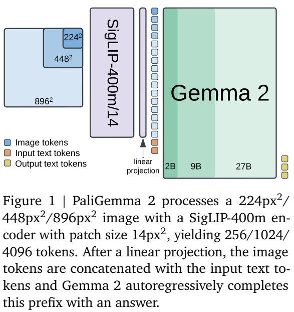
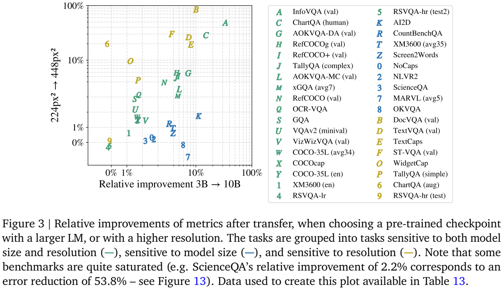
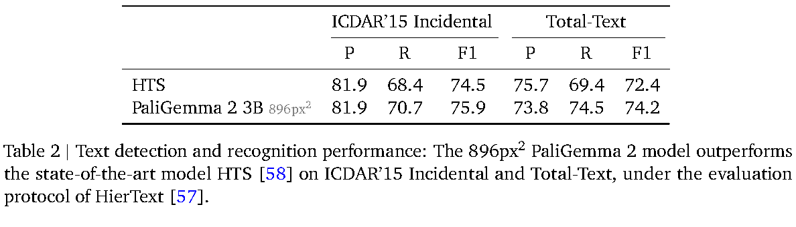

<!-- article-header:start -->
[项目首页](../../../README.md) › [模型系列](../../../reports/model-family-index.md) › [PaliGemma](../README.md)
<!-- article-header:end -->

# PaliGemma 2：模型规模、图像分辨率与任务迁移

> 解读 Google DeepMind 的 **PaliGemma 2: A Family of Versatile VLMs for Transfer**，固定采用 arXiv **2412.03555v1**，首次提交为 2024-12-04。本文介绍报告中的迁移型基座，不将后来发布的 mix 聊天版本混入实验结果。

<!-- article-toc:start -->
<a id="article-toc"></a>

**本篇目录** · [论文定位](#paper-info) · [快速概览](#overview) · [整体架构](#architecture) · [核心原理](#principles) · [数据构建](#data) · [训练流程](#training) · [实验结果](#experiments)
<!-- article-toc:end -->

<a id="paper-info"></a>

## 1. 论文信息与模型定位

| 项目 | 内容 |
|---|---|
| 题名与团队 | PaliGemma 2: A Family of Versatile VLMs for Transfer；Google DeepMind |
| 模型系列 | PaliGemma；将上一代 Gemma 语言组件替换为 Gemma 2 |
| 公开规模 | 型号 3B/10B/28B；对应实际总参数约 3.0B/9.7B/27.7B |
| 输入与输出 | 图像与文字提示输入，文字或含位置/分割编码的序列输出 |
| 分辨率 | 224×224、448×448、896×896 |
| 核心定位 | 为目标任务微调的通用视觉语言基座，研究语言规模与视觉分辨率如何影响迁移 |
| 官方资源 | [固定报告](https://arxiv.org/pdf/2412.03555v1) · [代码及训练配置](https://github.com/google-research/big_vision/tree/main/big_vision/configs/proj/paligemma) · [官方模型卡](https://ai.google.dev/gemma/docs/paligemma/model-card-2) |

与追求单一聊天排行榜的介绍不同，这篇论文关注“给定算力，应该增加图像细节还是扩大语言模型”。相同视觉编码器、相近训练配方和多种规模，使作者能比较这两个因素，而不是把不同厂家的模型成绩直接归因于某个组件。[§1、§4.1，PDF 第 1、3–5 页](https://arxiv.org/pdf/2412.03555v1#page=4)

<a id="overview"></a>

## 2. 快速概览

PaliGemma 2 采用 SigLIP-So400m 视觉编码器、线性投影和 Gemma 2 语言模型。图像 patch 的表示投影后，与文字提示拼成前缀，由语言主干自回归补全答案。编码器不使用固定 token 池化：分辨率从 224 增至 896 时，每图视觉 token 从 256 增至 4,096，因此语言端成本也显著增长。

训练先在 224 分辨率联合学习十亿个多模态样本，再逐步适配 448 与 896，最后针对目标任务微调。论文将文字识别、表格、分子、乐谱、空间关系和胸片报告都转成适合序列生成的任务，不为每种任务增加完全独立的预测网络。

实验表明，文本密集的文档/屏幕更依赖分辨率，多语言和部分视觉推理更受益于语言模型规模；从 10B 到 28B 并非所有任务继续明显提升。高分辨率 3B 在 OCR、表格和乐谱上也可以优于更大的低分辨率模型，选型必须结合任务与算力预算。

<a id="architecture"></a>

## 3. 整体架构



*原文 Figure 1，PDF 第 2 页。沿图像编码、线性投影、图文前缀、语言输出方向阅读；三个语言尺寸与三个分辨率是可选型号，不是一次推理同时运行的九条分支。*

| 模块 | 输入与输出 | 公开机制 |
|---|---|---|
| 图像预处理 | 原图 → 目标分辨率输入 | 224/448/896 方形输入；具体任务可使用保长宽比缩放加补边，如表格识别 |
| SigLIP-So400m | 图像 → 视觉 token 序列 | patch 14；三个分辨率分别产生 256/1,024/4,096 个 token |
| 线性连接器 | 视觉特征 → Gemma 2 输入空间 | 对 token 逐个线性映射，不以 Q-Former 或固定查询压缩序列 |
| Gemma 2 | 图像 token + 文字提示 → 答案序列 | 语言组件为 2B/9B/27B；自回归补全输入前缀 |
| 结构化输出词表 | 生成序列 → 位置或分割描述 | 继承定位 token 与分割 token，用统一序列表达区域信息 |
| 目标任务解码 | 输出 token → HTML/SMILES/kern/文字等 | 根据任务格式解析；相同主干通过不同目标任务微调获得专用能力 |

单次推理先计算所有图像特征并投影，语言模型对图文前缀进行 prefill，再生成答案。这里的前缀采用 Prefix-LM 边界：图像 token 与输入文字前缀之间可双向注意，输出 suffix 采用因果掩码，不能读取未来答案。双向更新发生在语言主干内部；SigLIP 本身仍只编码图像，并未直接接收问题文字。第二代 §3 明确沿用上一代建模，注意力细节依据 [PaliGemma 固定 v2 §3.1 / Figure 2，PDF 第 3 页](https://arxiv.org/pdf/2407.07726v2#page=3)。对于检测或分割，生成的并非直接栅格像素，而是位置或掩码相关 token，需要按规定表示解释；Figure 2 展示了边界框与分割序列的配合。视频或多图任务也属于目标迁移应用，不能把本文每个单图结果都当作统一视频聊天模型的成绩。[§3、Figure 1–2，PDF 第 2–3 页](https://arxiv.org/pdf/2412.03555v1#page=2)

<a id="principles"></a>

## 4. 核心创新与数学原理

### 4.1 控制变量比较：扩大语言模型还是增加图像细节

每幅图的 token 数由 patch 网格决定，可以将 Figure 1 的尺寸关系写为：

```math
N_{\mathrm{vision}}=\left(\frac{R}{14}\right)^2,
\qquad R\in\{224,448,896\}.
```

这是公开 patch 设计的算术关系，三个结果为 256、1,024、4,096。它说明分辨率翻倍使视觉 token 变为四倍，进入语言模型的序列也随之增长。算力增加不仅来自视觉编码器，Table 1 明确指出视觉 token 在语言模型内的处理主导成本。



*原文 Figure 3，PDF 第 4 页；横轴比较 3B→10B，纵轴比较 224→448，均从 3B/224 基线出发。*

其中前者约增加 3.7 倍 FLOPs，后者约增加 4.6 倍，接近但并不严格等算力。文本、文档、屏幕和部分图表任务更多受益于分辨率；多语言与 AI2D、计数、NLVR2 等任务更多受益于语言能力。这是一组受控配置的经验观察，不能简化成“所有 OCR 只需分辨率，所有推理只需大模型”。[§4.1.1、Table 1，PDF 第 3–5 页](https://arxiv.org/pdf/2412.03555v1#page=4)

### 4.2 分阶段提升分辨率：避免全程支付最高视觉成本

Stage 1 从未经后训练的 SigLIP 与 Gemma 2 checkpoint 出发，以 224 分辨率联合训练十亿样本，所有参数均可更新。Stage 2 先用 5,000 万样本适配 448，再用 1,000 万样本适配 896；高分辨率有益的任务被提高采样权重，目标序列长度也增加，以学习更长的 OCR 输出。

这样把广泛跨模态学习放在便宜分辨率，把精细识别适配放到较短的后续阶段。Table 1 中，3B 单样本训练相对成本从 1.0 增至 4.6、23.5，10B/896 为 67.7。最大的 28B/896 约 155.6，但该值包含 TPUv5p 相对 TPUv5e 的 2.3 倍芯片速度假设，不是跨硬件直接实测的绝对时间。

预训练阶段沿用 Gemma 2 的 attention/output logits soft-capping；迁移阶段关闭它，因为部分任务效果变差。这里调整的是不同阶段的数值机制，不能称“模型从未使用 soft-capping”。[§3、Table 1，PDF 第 2–3 页](https://arxiv.org/pdf/2412.03555v1#page=3)

### 4.3 将空间与专业任务转成可生成的结构序列

位置、表格、分子与乐谱共享自回归输出接口，却对应不同表示语义。表格生成 HTML 结构、单元格文字与框坐标；分子图转成 SMILES 字符串；单行钢琴乐谱转成 `**kern`，编码音高、时长、连线和小节等信息。模型学习的是图像到特定结构序列的映射，而非只为图片生成自然语言描述。

以 OCR 为例，输出是“文字转写、边界框”对。按 HierText 协议，预测与真值框 IoU 至少为 0.5，且文字转写直接匹配，才算真阳性；大小写、标点和文字长度不会被统一归一化抹去。表格则使用 TEDS/GriTS，分别检查树结构、单元格拓扑和内容。不同任务的百分数不能混成同一准确率。

这些能力来自目标数据微调。没有证据表明一个未经任务适配的基础 checkpoint 会自动获得论文所有专用任务的最佳成绩。[§4.2–4.5，PDF 第 5–8 页；附录 B](https://arxiv.org/pdf/2412.03555v1#page=6)

### 4.4 迁移学习率与规模：更大的模型需要重新调节更新幅度

作者为每种规模和任务在验证集选择学习率，其他超参数主要沿用上一代的迁移配方。候选学习率为 $`\{0.03,0.06,0.1,0.3,0.6,1.0,3.0\}\times10^{-5}`$；先在 224 分辨率选择，再用于 448。选定设置后重新训练，最后报告测试结果。

Figure 5 的归一化热图显示，大模型的最佳迁移学习率往往更低，同为 3B 的第二代也倾向于比上一代更小的学习率。这里的归一化只用于比较某任务/规模内不同设置的好坏，并不能跨任务比较色块对应的绝对性能。实践含义是改变语言规模后应重新搜索学习率，而不是沿用小模型设置并把退化归因于模型规模本身。[§4.1.2、Figure 5，PDF 第 5–6 页](https://arxiv.org/pdf/2412.03555v1#page=6)

<a id="data"></a>

## 5. 数据构建与处理

预训练任务包含 captioning、grounded captioning、OCR、多种机器生成 VQA、检测和实例分割。报告说明这组预训练标签主要由公开专用模型生成，没有使用商业大型 VLM；这一范围限于对应预训练任务混合。医学迁移数据另用 Gemini 1.5 Pro 删除对既往胸片的提及，不能将前者推广成全论文完全不使用商业模型。[§3、§4.8，PDF 第 3、9 页](https://arxiv.org/pdf/2412.03555v1#page=9)

| 迁移任务 | 数据与处理 | 输出监督 |
|---|---|---|
| OCR | 多个公开文字检测/识别训练集混合 | 转写 + 框坐标 |
| 表格 | PubTabNet 约 516K 图、FinTabNet 约 113K 表格；清理越界等损坏标注 | HTML、单元格文字/位置 |
| 分子 | 从 PubChem 取 100 万分子，用 Indigo 多样样式渲染与扰动 | SMILES |
| 乐谱 | GrandStaff 约 53.7K 图，官方划分，训练含合成增强 | kern 编码 |
| 长描述 | DOCCI 15K 图，人类详细描述 | 逐句事实描述 |
| 医学报告 | MIMIC-CXR 377K 图、228K 检查；删除不可见既往图像相关内容 | Findings/Impressions 等报告文字 |

数据集规模不等于最终每个型号的训练样本总量；例如乐谱采用既定划分，不能把全部 53.7K 当成训练集。表格输入保长宽比缩放再补成方形，避免简单拉伸破坏结构。[§4.2–4.8，PDF 第 6–9 页](https://arxiv.org/pdf/2412.03555v1#page=7)

<a id="training"></a>

## 6. 训练流程与目标

| 阶段 | 数据与规模 | 更新安排 |
|---|---|---|
| Stage 0 | SigLIP 与 Gemma 2 各自的单模态预训练 | 复用已有组件 |
| Stage 1 | 224 分辨率，十亿多模态样本 | 联合更新全模型；3B 学习率 $`10^{-5}`$，10B/28B 为 $`5\times10^{-6}`$ |
| Stage 2 | 448/5,000 万，再 896/1,000 万样本 | 重加权高分辨率任务，扩大目标序列长度 |
| Stage 3 | 目标任务数据 | 按任务/规模选择迁移超参；关闭 logits soft-capping |

训练使用 Adam 与 FSDP，TPU Pod 为 256–1,024 芯片。3B Stage 1 约用 256 芯片训练三天；其他型号的成本按 Table 1 相对量理解。目标是对给定图文前缀生成正确的目标序列，报告沿用上一代建模/训练设置，没有另引入统一的“空间回归损失”或为每个结构任务添加检测头。[§3，PDF 第 2–3 页](https://arxiv.org/pdf/2412.03555v1#page=3)

<a id="experiments"></a>

## 7. 实验设置与主要结果



*原文 Table 2，PDF 第 7 页；模型为经过 OCR 任务微调的 3B/896，使用 HierText 协议。*

| 任务与指标 | 型号/分辨率 | PaliGemma 2 | 报告对照 |
|---|---|---:|---|
| ICDAR’15 F1 | 3B/896 | 75.9 | HTS 74.5 |
| Total-Text F1 | 3B/896 | 74.2 | HTS 72.4 |
| FinTabNet TEDS | 3B/896 | 98.9 | 原表 SOTA 98.2 |
| PubTabNet TEDS | 3B/896 | 97.3 | 原表 SOTA 96.9 |
| ChemDraw 分子完全匹配 | 10B/448 | 94.8 | MolScribe 93.8 |
| GrandStaff 符号错误率 SER↓ | 3B/896 | 2.3 | Sheet Music Tr. 5.1 |
| VSR zeroshot split 准确率 | 10B/224 | 79.8 | 这里的模型经过任务微调，“zeroshot”是数据划分名 |

表格的 PubTabNet S-TEDS 为 97.6，低于对照 97.9，说明“多数指标领先”不是所有表格指标都最高。分子识别在 448 后继续升分辨率未提升，OCR/乐谱扩大语言模型也没有持续获益，支持按任务选择资源分配。[Table 2–7，PDF 第 7–9 页](https://arxiv.org/pdf/2412.03555v1#page=7)

长描述的 DOCCI 人评用不被图像蕴含的句子比例 NES 衡量事实误差，10B/448 为 20.3%，3B/448 为 28.4%。该流程使用 test split 选择 perplexity 设置、随后合并 train/test 重训并在 100 张 qual_dev 上做人评；它不是常规独立测试集的自动准确率，不能与不同基准的百分数横向合并。[§4.6、Table 6，第 8 页](https://arxiv.org/pdf/2412.03555v1#page=8)

论文的主要结论是迁移效率与表现的可预测取舍：提高分辨率对读细节至关重要，扩大语言模型有助于语言和关系推理，但二者都有成本与边际收益。所有专用结果都需保留型号、分辨率、微调数据和评测协议，才能用于实际比较。

<!-- article-footer:start -->
---

[← 上一篇：TimeMarker](../../timemarker/arxiv-2411.18211/README.md) · [按发表时间浏览](../../../reports/paper-reading-guide.md#year-2024) · [下一篇：NVILA →](../../vila/arxiv-2412.04468/README.md)

[返回本篇目录](#article-toc) · [返回模型系列](../README.md)
<!-- article-footer:end -->
