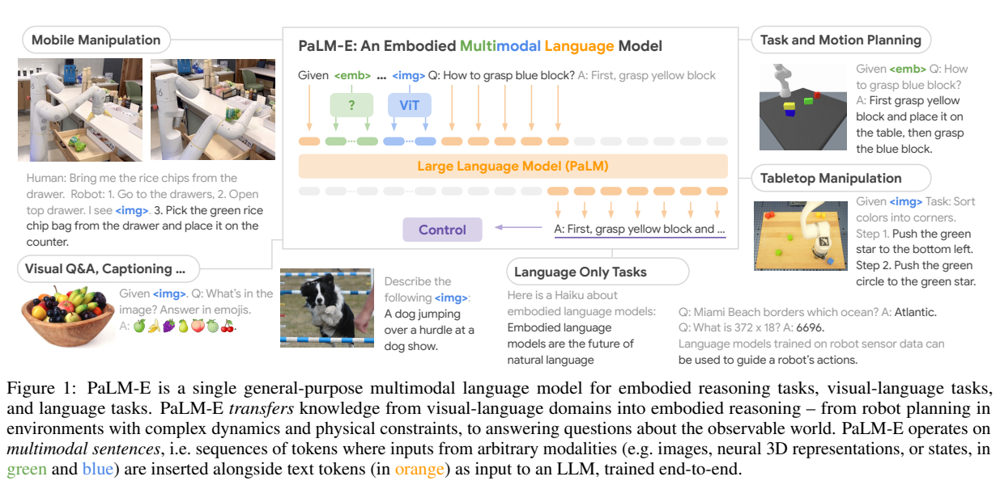
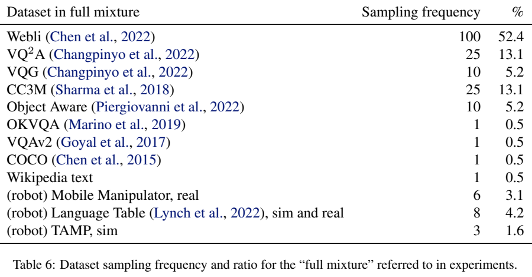
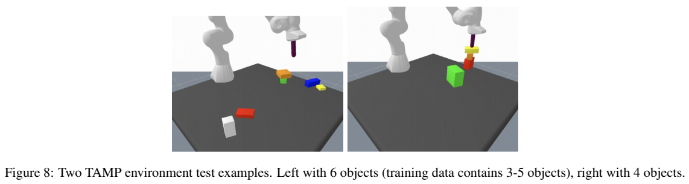
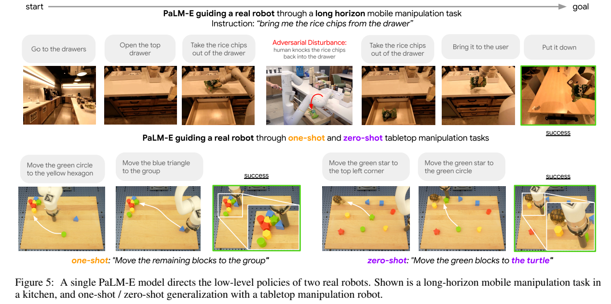
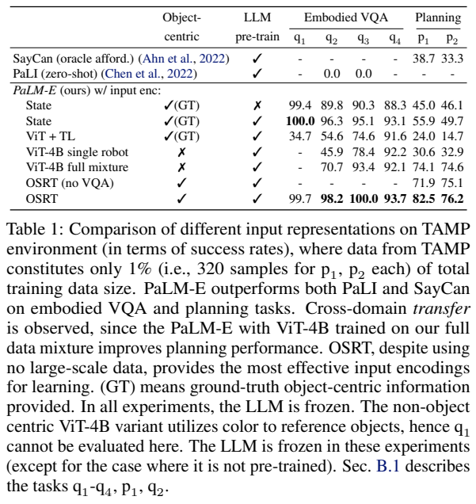
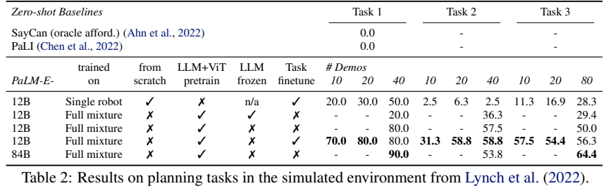
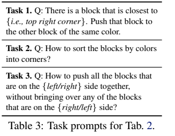
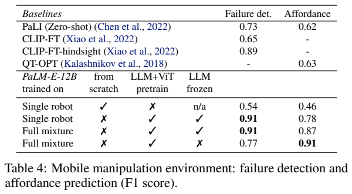
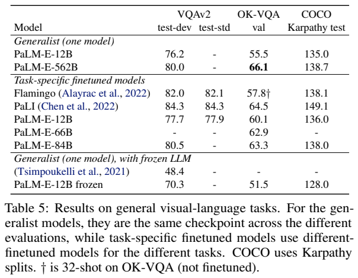
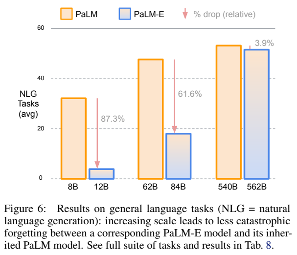

# PaLM-E：把连续感知与机器人状态嵌入语言模型

## 1. 论文信息与模型定位

| 项目 | 信息 |
| --- | --- |
| 原标题 | PaLM-E: An Embodied Multimodal Language Model |
| 作者与机构 | Danny Driess、Fei Xia、Mehdi S. M. Sajjadi 等；Robotics at Google、TU Berlin、Google Research |
| 核验版本 | [arXiv 2303.03378v1](https://arxiv.org/abs/2303.03378v1)，2023-03-06，18 页 PDF |
| 项目 | [PaLM-E 项目页](https://palm-e.github.io) |
| 主要规模 | 12B＝PaLM-8B＋ViT-4B；84B＝PaLM-62B＋ViT-22B；562B＝PaLM-540B＋ViT-22B |
| 输出定位 | 文字回答、场景描述、可供机器人技能执行的高层语言计划 |

PaLM-E 解决语言知识如何接触真实连续世界的问题。它把图像、场景状态或神经三维表示编码为语言模型输入 embedding，使语言模型直接利用观测规划，而不只接收其他系统先写好的场景文字。模型可以指导机器人，但底层动作仍由已有控制策略完成。研究同时考察跨任务迁移、几何表示、冻结与全量训练，以及多模态训练造成的语言遗忘。本文依据 v1 正文和技术附录，结果均来自论文，未运行机器人或模型复现。

## 2. 快速概览

PaLM-E 的输入是“多模态句子”：普通文字之间可以穿插图像或状态的连续向量。输出继续使用 PaLM 的自回归文字预测。规划时，模型读取任务、已执行步骤和当前图像，给出下一个语言子目标；已有策略执行后提供新观测，模型可以修正计划。

| 设计 | 含义 |
| --- | --- |
| 连续感知注入 | 编码器直接进入 LLM embedding 空间，跳过把传感信息先写成离散文字 |
| 灵活多图位置 | 感知向量随文字上下文插入，使用原模型位置编码 |
| 对象级表示 | 状态、带实例掩码 ViT、OSRT slot 为物体提供结构 |
| entity referrals | 将对象表示标成 obj1、obj2，使计划能准确指向同色等难描述物体 |
| 多任务联合训练 | 通用图文与多机器人任务共享模型，机器人数据采样仅 8.9% |
| 冻结与规模对照 | 冻结能保护语言模型；大规模全量训练的语言遗忘较少，但并非自动消失 |

562B 通用 checkpoint 在 OK-VQA 达到 66.1，是当时报告的重要视觉语言结果；但大部分机器人量化研究使用更小模型，不能把每个机器人成功率都归给 562B。TAMP、Language-Table 和移动操作的结果也分别有仿真量化、真实机器人定性展示，需按原文区分。

## 3. 整体架构

**读图：**Figure 1 中橙色为文字 embedding，绿色/蓝色为状态和图像编码，统一送入 PaLM；下方输出文字，并由 control 环节连接机器人。右侧 TAMP 与桌面操作、左侧厨房移动操作展示不同 embodiment。图中的控制模块是高层文字与低层技能之间的接口，不能理解为语言 head 直接输出关节力矩。

视觉输入使用 ViT-4B 或 ViT-22B，初始化来自图像分类预训练；ViT 的特征维度可能不同于 PaLM，因此逐 token 用可学习仿射投影对齐。论文也研究从头训练的 ViT＋TokenLearner，用于不同感知表示的对照。连续状态则经 MLP 映射；状态可含物体姿态、大小和颜色，其精度与是否使用真值必须在实验中说明。

对象级路线有两类。第一类用真实实例掩码先分离物体再编码，因此具有额外对象真值信息；第二类是 OSRT，用新视角合成训练学出三维感知的对象 slot，不需要真实 segmentation。OSRT 每个 slot 经 MLP 变成多个语言 embedding，不是一个物体必然只对应一个 token。两类都能在输入前加“Object j is <obj j>”，在输出里引用对象索引，低层技能也必须理解对应编号。

真实桌面任务中，下层使用 Interactive Language 策略；厨房任务使用 RT-1，输入 RGB 与自然语言技能，输出末端控制。PaLM-E 决定导航、开抽屉、抓取、放置等高层步骤，执行一次技能后读取新画面。这使它能够在物体被重新放回抽屉时再尝试取出，属于观测—计划—执行闭环，不是纯粹离线一次性写完计划。

## 4. 核心创新与数学原理

**连续信息如何进入离散词语言模型。**PaLM 的文字词表约 256,000 项，词 embedding 为 $\gamma:\mathcal W\to\mathbb R^k$。观察编码器则为 $\phi:\mathcal O\to(\mathbb R^k)^q$，一条观察变成 $q$ 个向量。原文 Eq. (3) 的核心是输入位置可以取两种来源：

$$x_i=\begin{cases}\gamma(w_i),&\text{文字位置},\\[2pt]\phi_j(O_j)_i,&\text{观测位置}.\end{cases}$$

因此无需先为视觉创建一个离散图像词表，也无需把状态压成自然语言数值叙述。LLM 的 self-attention 在统一维度上处理两者。对齐的是输入向量空间和任务损失，不代表视觉与词向量天然一一对应，或 embedding 的每一维都具有相同可解释物理含义。

**自回归目标没有改变。**原文 Eq. (1)–(2) 对文字概率作标准条件分解。把多模态 prefix 写作 $X_{1:n}$，目标回答为文字 $w_{n+1:L}$，可记为：

$$p(w_{n+1:L}\mid X_{1:n})=\prod_{l=n+1}^{L}p_{\mathrm{LM}}(w_l\mid X_{1:n},w_{n+1:l-1}).$$

这只是将原文条件模型用混合 prefix 重写以便解释，感知 token 没有成为待生成的图像输出。训练在非 prefix 的答案位置平均交叉熵；机器人规划、视觉问答、caption 都用相同文字恢复目标。全文未提出图像生成扩散损失或直接连续动作回归损失。

**冻结仍需通过 LLM 反向传播。**若 LLM 参数固定，编码器还要学习怎样把观测送到可被理解的输入空间。标准链式法则可解释其梯度：$\nabla_{\theta_\phi}\mathcal L=(\partial\phi/\partial\theta_\phi)^\top\nabla_X\mathcal L$，后者仍来自经过固定语言模型的计算。冻结指参数不更新，不是切断梯度或让投影无监督。OSRT 对照更进一步固定 slot 网络，只更新小投影，利用预训练几何结构与语言知识。

**对象结构与指代。**若两个红色方块位置不同，仅生成“拿红色方块”就可能歧义。对象中心表示把每个实例的视觉/几何特征与编号相连，使文字输出可以引用 obj j。它将感知实体和符号规划连接起来，但编号的绑定依赖输入表示与执行接口，不是文字本身自动解决了视觉跟踪或坐标控制。

**迁移和遗忘是两个不同目标。**通用图文训练能让视觉编码器获得更好的语义、语言模型拥有规划知识，从而减少机器人数据需求；全量多模态训练也可能改变语言参数并降低原有任务成绩。论文通过数据混合、冻结与模型规模对照测这两种现象，而非假设增加模态总会带来正迁移。大模型表现更稳是经验结果，没有给出“参数超过某阈值绝不遗忘”的定理。

## 5. 数据构建与处理

**读表：**Table 6 的 sampling frequency 是相对抽样权重，百分比是混合训练出现频率，既不是原始数据样本数，也不是 token 数。WebLI 52.4%、VQ²A 13.1%、CC3M 13.1%、VQG 与 Object Aware 各 5.2%；OK-VQA、VQAv2、COCO、Wikipedia text 各约 0.5%。移动机器人 3.1%、Language-Table 4.2%、TAMP 1.6%，合计 8.9%。图文数据占大多数是论文观察迁移效果的关键条件。

TAMP 的训练场景有 3–5 个不同大小、颜色和初始姿态的方块，规划由已有任务运动规划器生成。任务包括物体相对位置、上下关系、计划可行性，以及抓取和堆叠。对象中心版本另以编号问颜色。全数据对照使用 96,000 场景；低数据实验只用 1%，每个规划任务 p1/p2 各 320 示例，共 640 规划示例，不能把“1%”解释为整套互联网混合数据也只剩 1%。

Language-Table 的长任务由标注者每隔约 4 秒提供短语言子目标，下层策略执行后继续收集。任务包括把最靠角落的方块推向同色块、按颜色整理角落、只聚拢桌面一侧的方块。论文测试每任务 10–80 demonstrations；另有 100 个长任务、每任务一个示例的微调用于真实 one-shot 展示。多图与部分新物体泛化展示也属于特定示例，没有变成完整无监督机器人训练。

厨房移动规划使用 SayCan 的 2,912 条运行序列，下一步训练输入含用户指令、步骤历史和当前图像。可供性判断问某技能现在能否执行，失败检测问刚才是否成功，两者都有文字答案监督。报告未给全部训练数据版本、每项最终去重样本数和完整隐私过滤配方，不能由抽样表假定全数据公开可复现。

## 6. 训练流程与目标

论文不是固定的“三阶段对齐＋SFT＋RL”报告，而是围绕不同初始化、冻结和数据混合进行实验。共同流程为：加载 PaLM 与所选感知编码器，替换输入中的图像/状态标记为连续向量，用文字答案/计划交叉熵训练，再根据实验选择全量更新或仅更新编码和投影。

| 训练选择 | 更新内容及目的 |
| --- | --- |
| 全量多模态训练 | 编码器、投影、PaLM 共同优化，得到通用图文和具身能力 |
| 冻结 PaLM | 学习可被原语言模型理解的感知输入，保护语言参数 |
| OSRT 冻结表示 | 只学习 slot 到语言空间的小投影，测试几何表示的数据效率 |
| 单机器人 vs full mixture | 分离场景数据与跨任务预训练/混合的迁移收益 |
| 任务微调 | 在已有模型上继续训练指定长任务，避免每个数据量重新训练全模型 |

附录 B.2 的 Language-Table 任务微调为额外 9,000 步。模型全训练的学习率、GPU 总数、global batch、完整训练步数没有充分列出，本文不补猜配方，也不把某个 TAMP 对照的冻结规则推广到所有 PaLM-E。Table 1 的预训练语言模型实验冻结 LLM，Figure 4 又专门比较冻结与全量训练。

正文真实桌面展示写 PaLM-E 约 1Hz 生成子目标、低层约 5Hz 控制；附录数据采集写 10Hz 执行 40 步、每 4 秒请求指令，仿真量化评测也按 4 秒技能块运行。这些是不同流程，不能拼成一个统一频率。真实厨房长任务主要给定性评估；Table 2 是仿真，不能将其成功率直接视为真机部署可靠性。

## 7. 实验设置与主要结果

**读图与表：**Figure 5 上排展示被干扰后重取抽屉里的米片，下排展示 one-shot 与新乌龟物体的 zero-shot 任务。Table 1 则是另一套 TAMP 量化实验：ViT-4B 单机器人 p1/p2 为 30.6/32.9，full mixture 提高至 74.1/74.6；平均约 31.75→74.35，超过两倍。OSRT 达到 82.5/76.2，移除其 VQA 数据后为 71.9/75.1，说明结构和辅助任务都有作用。State 真值输入、实例真值掩码与无分割 OSRT 不具同样信息条件，不能只按分数认定一个编码器无条件更优。

Figure 4 的 PaLM-E-12B 在 full mixture、全量训练下平均规划成功率 94.9，冻结 full mixture 74.3；单机器人全量 48.6、冻结 31.8。这支持跨任务训练的效果，也说明冻结是否划算依赖任务。附录 Table 7 的状态输入中，训练分布 3–5 个物体时从头模型能有 97.2/95.5 的规划分数，8 个物体时降至 24.6/6.7；预训练语言模型为 91.3/89.3。迁移收益在分布外更明显，且部分实验利用真值状态而非原始视觉。

**读表：**Table 2 区分 demos 数和冻结/微调配置。12B full mixture 加任务微调、10 demos 时三任务为 70.0/31.3/57.5；从头单机器人为 20.0/2.5/11.3。未做专项微调的 12B 与 84B，对应可比较列为 Task1 80.0→90.0、Task2 57.5→53.8、Task3 50.0→64.4：扩大模型仅改善三项中的两项。Task1 是单步 validation accuracy，Task2/3 用每任务 80 rollouts 成功率，不应混称全部真机 rollout success。

移动任务 Table 4 的 F1：冻结单机器人 failure detection 0.91、affordance 0.78；冻结 full mixture 0.91/0.87；全量 full mixture 0.77/0.91。全量提高可供性却降低失败检测，不能写成端到端更新总是更好。附录给最后两种 failure detection precision/recall 分别 0.89/0.93 与 0.66/0.91，解释其 F1 变化；F1 不是长任务执行成功率。

通用视觉语言 Table 5 中，同一个 562B checkpoint 的 VQAv2 test-dev 80.0、OK-VQA 66.1、COCO Karpathy test 138.7；12B 为 76.2/55.5/135.0。562B OK-VQA 超过任务微调 PaLI 64.5，但 VQAv2 低于 PaLI 84.3、COCO 低于 149.1。任务专用微调 12B 的 OK-VQA 60.1 与通用 55.5 必须区分，Flamingo 的 57.8 带 32-shot 脚注。COCO 分数遵循报告的 caption 评测口径，不是百分比准确率。

语言 Table 8 用 21 个 1-shot 任务对照原 PaLM。NLU 均值 PaLM-8B→E-12B 为 64.7→55.0，62B→84B 为 72.3→69.2，540B→562B 为 78.2→78.5；NLG 为 32.4→4.1、47.8→18.4、53.8→51.7。Figure 6 标最后相对下降 3.9%，Table 8 写 3.8%，应看成未舍入/呈现口径的小差别，不是下降 3.9 个百分点。它说明较大模型更能保留语言能力，同时小模型的生成能力确有严重遗忘。

PaLM-E 的重要启发是让连续观测进入语言模型，并通过真实闭环与混合训练连接知识和行动。其能力仍依赖已训练的低层技能、感知质量、有限规划 vocabulary 和大量图文先验；零样本多图、CoT、干扰恢复展示也没有提供覆盖所有机器人场景的统一安全/成功率证据。最有力的结论来自具体量化对照，而不是把个别机器人视频扩展成任意具身通用智能。
