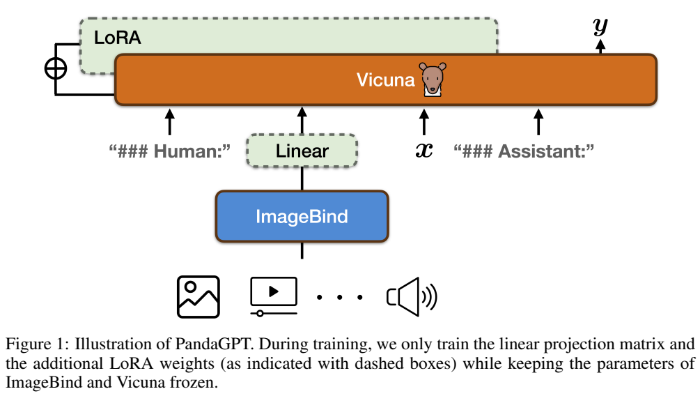
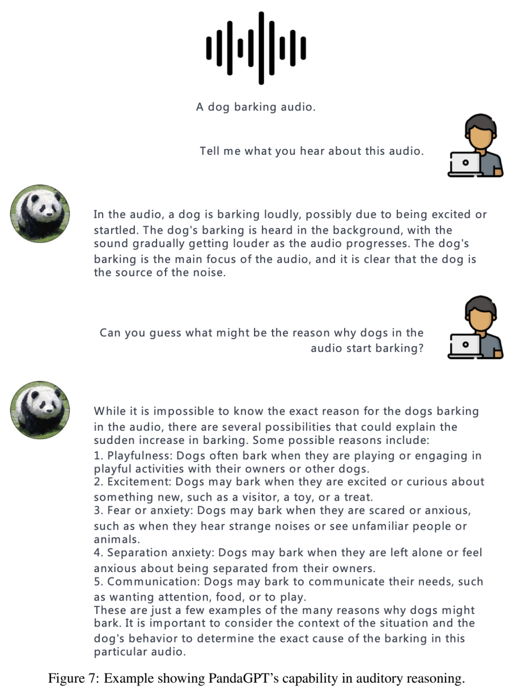
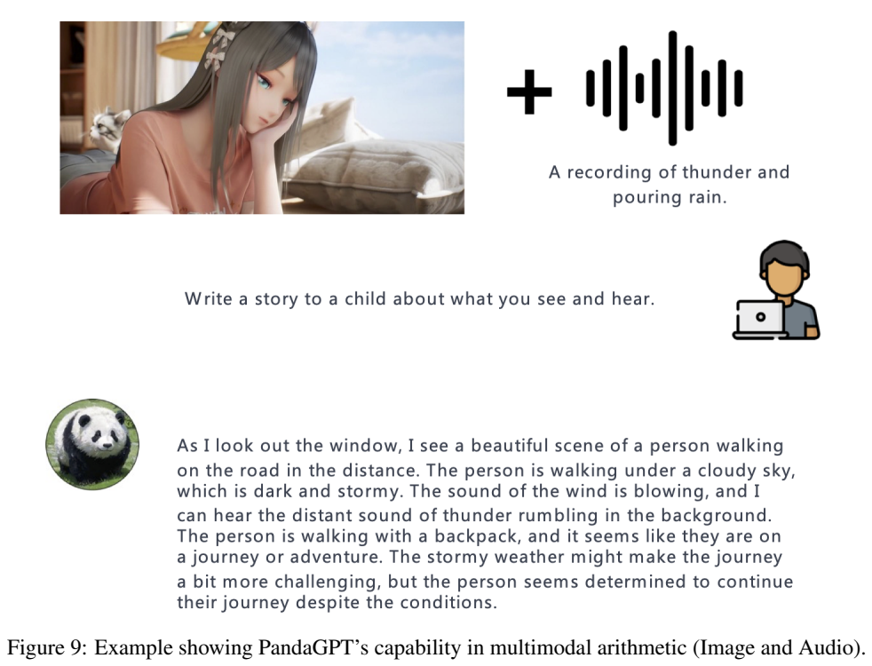
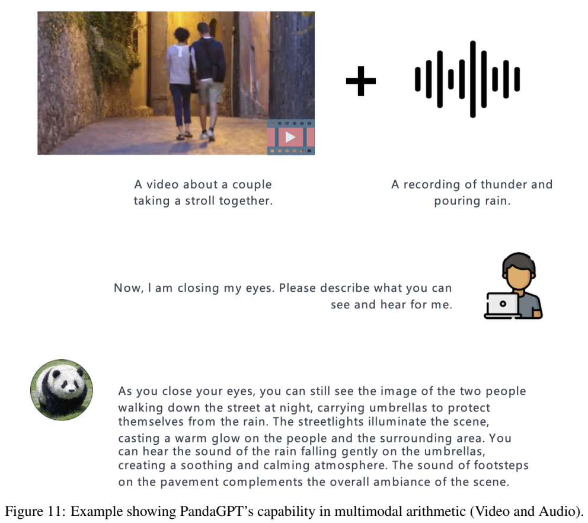

# PandaGPT：通过共享嵌入空间迁移图文指令跟随能力

## 1. 论文信息与模型定位

论文为 **PandaGPT: One Model To Instruction-Follow Them All**，作者为 Yixuan Su、Tian Lan、Huayang Li、Jialu Xu、Yan Wang、Deng Cai，来自剑桥大学、奈良先端科学技术大学院大学和腾讯 AI Lab 等。本介绍依据 **arXiv 2305.16355v1，2023 年 5 月 25 日**，共 16 页。[固定版本 PDF](https://arxiv.org/pdf/2305.16355v1)；[项目页](https://panda-gpt.github.io/)。

PandaGPT 是将 **ImageBind 多模态编码器**接到 **Vicuna-13B v0** 的研究原型。它支持不同形式的感知输入，输出仍是文本；没有训练图像、音频或动作生成器。论文按 ImageBind 的口径讨论六类：图像/视频、文本、音频、深度、热成像、IMU，其中图像与视频归为同一组，不应额外算成第七种。

它探索的是：只进行图文指令训练，能否借助预先对齐的感知空间，让其他模态也获得一定的语言交互能力。公开证据以案例为主，没有提供大规模量化基准。

## 2. 快速概览

系统用一个**线性投影层**把 ImageBind 输出映射到 Vicuna 的输入空间，并在 Vicuna 注意力模块上加入 LoRA。ImageBind 和 Vicuna 原始参数冻结，只有投影层与 LoRA 更新，作者称可训练参数约为 Vicuna 参数的 **0.4%**。

适配数据是 LLaVA 与 MiniGPT-4 公开的 **160K 图像—语言指令样本**，训练 **2 epoch**。音频、深度等模态并没有加入 PandaGPT 这次指令训练，而是通过 ImageBind 已有的跨模态对齐产生迁移。所谓零样本，针对的是 PandaGPT 的模态指令适配；不能解释为底层编码器从未用过音频或深度数据。

论文还展示“多模态算术”：把图像/视频与音频的嵌入相加，再让语言模型作答。它说明共享空间具有一定语义组合潜力，但也会混淆事实来源，原图中一些长回答包含输入没有明确支持的细节。

## 3. 整体架构

**Figure 1，PDF 第 3 页** 下部是图像、视频、音频等输入，经 ImageBind 形成表征；中间 Linear 把表征送到 Vicuna；文本指令与对话角色标记也进入 Vicuna，顶端输出回答。图中虚线框标记的是可训练投影层和 LoRA，不能把整个 Vicuna 框理解为都参加微调。

原文明确指出，非文本内容只使用**一个嵌入向量**。这与把所有视觉 patch、所有音频片段保留为长序列的方案不同：单向量接口紧凑，易于跨模态迁移，但会压缩空间布局、时间顺序和局部细节。作者将更细粒度特征与跨模态注意力列为改进方向，并未在本版实现相应复杂模块。

语言模型接收到的是投影后的感知条件和文本，而不是每种模态的原始像素、波形或传感器序列。具体各编码器的底层结构、视频帧采样和音频切分没有在本报告完整重述，不能将后续项目代码的配置当作本固定版本披露。

## 4. 核心创新与数学原理

设某模态的 ImageBind 表示为 \(h_m\)，线性桥梁可写为 \(z=f(h_m)\)。图文训练让 Vicuna 学习如何利用 \(f(h_I)\) 回答图片问题；如果音频表示 \(h_A\) 已与相应图像语义在共享空间接近，同一桥梁就可能将音频语义送入语言模型。这是迁移的机制解释，不是对所有模态性能的保证。

线性接口还为多模态组合提供简洁的关系。在不考虑额外归一化且 \(f\) 为严格线性映射的解释情形下，有

\[
f(h_I+h_A)=f(h_I)+f(h_A).
\]

论文描述的是嵌入算术相加；上式说明为什么共享表示的组合可以通过桥梁，但**不代表博客/报告披露了全部权重、归一化、缩放和偏置设置**，也不能由线性关系推导语义一定正确相加。不同输入的信息冲突、模态权重和单向量压缩都会影响生成。

LoRA 通过低秩更新适配注意力模块，可用 \(W'=W+BA\) 解释。原始 \(W\) 冻结，新增矩阵可训练。报告没有公布 LoRA rank、alpha 和精确目标投影矩阵列表，因此不补造这些设置。

原文 **Equation (1)** 写成各轮目标回答条件概率的乘积，并称为训练 objective/loss。它在数学形式上更接近需要最大化的似然。若转成通常最小化的负对数似然，可解释为

\[
\mathcal L_{\mathrm{NLL}}=-\sum_{t\in\mathrm{assistant}}\log p_\theta(y_t\mid\text{此前对话及感知条件}).
\]

这是对原式优化含义的解释，不把论文概率乘积原样当作应最小化的数值损失。原文明确只对系统回答部分计算损失，用户指令作为上下文，不作为回答目标。固定版本的条件下标记法也较简略，本文用语义说明完整历史而不自行认定其实现细节。

## 5. 数据构建与处理

训练实例由图像 \(I\) 和多轮对话 \((x_1,y_1,\ldots,x_n,y_n)\) 组成，\(x_i\) 是人类请求，\(y_i\) 是系统回答。160K 样本来自 LLaVA、MiniGPT-4 已发布的指令数据，作者没有在本报告提供二者的精确混合比例、过滤阈值、图像去重、对话长度分布或额外生成流程。

应区分三层数据：ImageBind 预训练带来多个模态的共享空间；Vicuna 预训练/对话适配带来文字能力；PandaGPT 的 160K 图文指令数据负责连接两者。本报告的“只需图文数据”指第三层，不意味着完整系统的全部训练仅使用 160K 样本。

**Figure 7，PDF 第 9 页** 标注输入为狗叫音频，用户先问听到什么，再追问突然吠叫的原因。回答识别狗叫，并给出多种可能原因。这里图中的波形图标是音频输入的示意，PDF 没有提供可直接聆听的原音频；因此本介绍只核对图中记录的交互，不声称验证实际听觉内容。原因分析属于常识推测，不能视为从声音中确定狗的心理状态。

## 6. 训练流程与目标

训练阶段使用冻结的 ImageBind 与 Vicuna-13B v0，更新线性投影层和 Vicuna 注意力上的 LoRA。学习率为 **\(5\times10^{-4}\)**，采用**线性衰减**，训练 **2 epoch**；受计算资源限制，Vicuna 的最大序列长度设为 **400**。

硬件为 **8 张 A100 40GB**，作者报告训练约 **7 小时**。这个计算量对应小规模接口适配，不包含 ImageBind 和 Vicuna 的基础预训练，也不能被换算为从零获得六模态能力的总成本。报告没有完整给出 batch、优化器、warmup、LoRA rank、精度与随机种子，不能声称凭本报告即可逐项复现训练。

推理时可用其他模态的 ImageBind 表示经过同一个投影器，也可把多模态嵌入相加。这不是在推理时额外训练一个音频适配器；报告也没有为深度、热成像、IMU 提供独立的训练阶段或量化成绩。

## 7. 实验设置与主要结果

固定版本没有准确率、BLEU、MMBench 等标准表格，没有受控消融与统计显著性检验。Section 6 的 **Figure 2–12** 展示图像/视频问答、创作、视觉/听觉推理与模态组合。这些结果支持原型能够进行相应形式的交互，不能据此排名其六模态能力或宣称稳定达到人类水平。

**Figure 9，PDF 第 11 页** 将室内人物图与标注为雷雨的音频组合，要求面向儿童编故事。生成文本同时出现人物和暴风雨语义，体现输入组合；但也提到道路上的行人、背包等原图未明确展示的内容。创作任务允许想象，不过不能把这些细节当作感知事实。该图尤其适合说明“语义混合成功”与“内容忠实”是不同评价目标。

**Figure 11，PDF 第 13 页** 的视频标注是一对情侣散步，叠加雷雨音频后，回答形成雨夜行走的整体场景，还出现雨伞等叙述。应看出这是对两个条件的生成式融合，没有证明图像对象与声音来源被精确绑定，也没有测量时间一致性。原报告本身指出，需要新的基准评价多模态组合能力。

PandaGPT 的贡献是以很小的适配参数，验证共享嵌入空间可把图文指令能力迁移到其他输入模态；限制则来自单向量瓶颈、缺少其他模态的指令监督及案例主导的评测。作者明确称其为研究原型。本介绍读取正文并核对四页原图，没有运行模型、试听原音频或复现实验。
