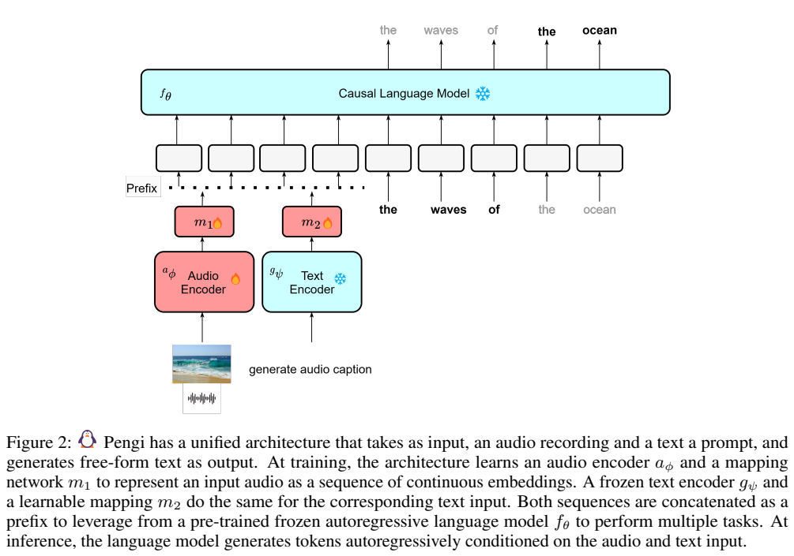
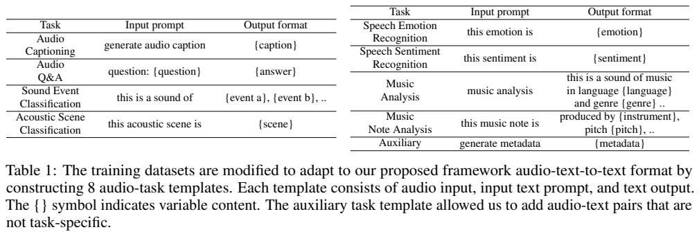
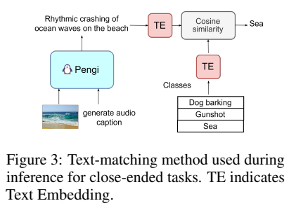
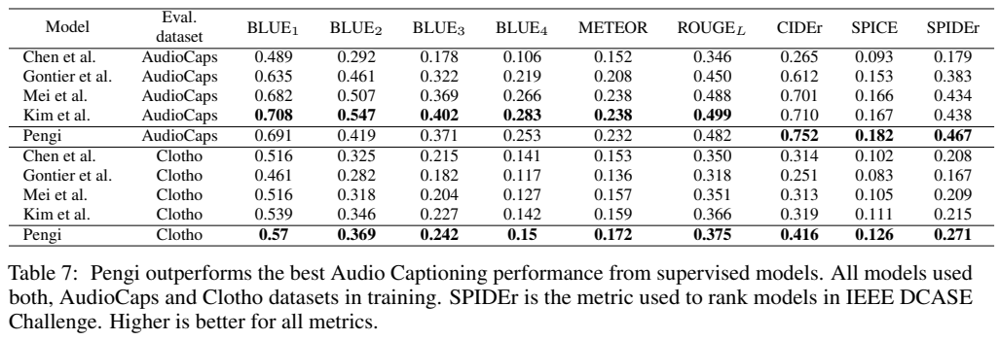
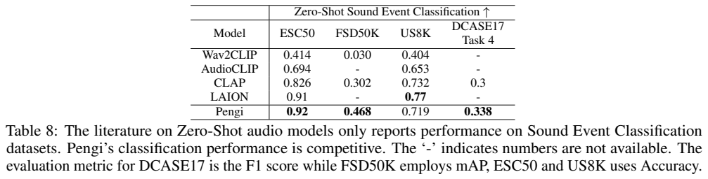
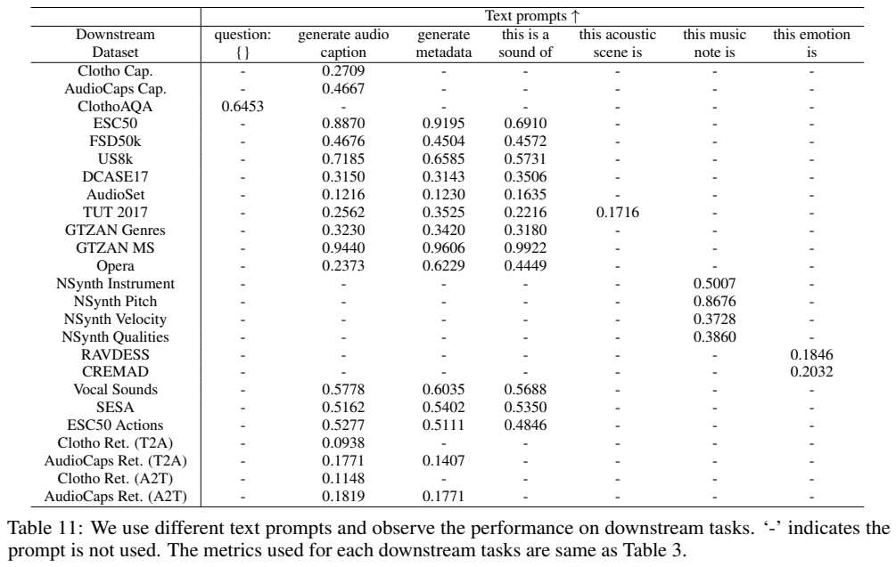
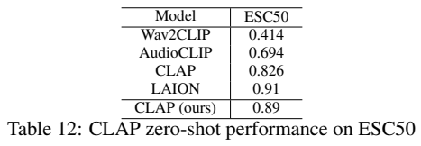
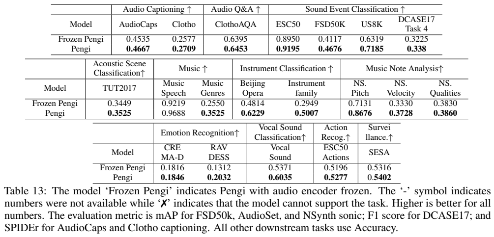

<!-- article-header:start -->
[项目首页](../../../README.md) › [模型系列](../../../reports/model-family-index.md) › [Pengi](../README.md)
<!-- article-header:end -->

# Pengi：用条件文本生成统一音频任务

<!-- article-toc:start -->

**本篇目录** · [论文定位](#paper-info) · [快速概览](#overview) · [整体架构](#architecture) · [核心原理](#principles) · [数据构建](#data) · [训练流程](#training) · [实验结果](#experiments)
<!-- article-toc:end -->

## 1. 论文信息与模型定位

| 项目 | 信息 |
|---|---|
| 原论文 | **Pengi: An Audio Language Model for Audio Tasks** |
| 作者与机构 | Soham Deshmukh、Benjamin Elizalde、Huaming Wang（Microsoft），Rita Singh（Carnegie Mellon University） |
| 固定来源 | [arXiv 2305.11834v1](https://arxiv.org/abs/2305.11834v1)，2023 年 5 月；本文页码指 18 页 PDF |
| 模型定位 | 音频与文本提示输入、自由文本输出的音频语言模型 |

Pengi 把声音描述、音频问答、声音事件分类、情绪和音乐属性分析都转换成条件语言生成。语言骨干是冻结的 **GPT-2 base（124M）**，并非数十亿参数的聊天模型。它不接受图像输入，不合成音频；原图中的照片用于示意声音内容。作者希望借助文本接口减少逐任务专用输出头，但闭集评测仍需要把生成文字映射回规定标签。

## 2. 快速概览

- 以约 **340 万音频文本对**训练，正文按 21 项下游任务讨论结果，覆盖开放式生成和闭集预测。
- 可训练的音频编码器、两个映射网络，将音频内容与任务提示分别变为连续前缀；文本编码器和 GPT-2 保持冻结。
- 每种输入生成 40 个前缀向量，合计 80 个，接在答案词之前；统一优化答案的自回归交叉熵。
- 分类默认先生成句子，再用 CLIP 文本编码器计算句子与类别名称的相似度。因此“听懂什么”与“标签如何措辞”共同影响成绩。
- ESC50 的 0.9195 准确率和 AudioCaps 的 0.4667 SPIDEr 是代表性结果；FSD50K、AudioCaps、Clotho、ClothoAQA 的训练集参与训练，不能统称所有任务零样本。

## 3. 整体架构

**读图：Figure 2，PDF 第 3 页。** 火焰表示更新音频编码器及两个映射网络，雪花表示冻结文本编码器和语言模型。左右两路分别回答“声音是什么”和“本次要求做什么”，最终在 GPT-2 输入空间结合。图下的海滩照片不是第三种输入模态。

音频主干使用 CLAP 的 HTSAT 音频 Transformer，通过作者额外训练的 CLAP 初始化。文本提示经过冻结的 CLIP 文本编码器。两路映射网络均为 8 层 Transformer，各输出 40 个连续嵌入，音频前缀在前、任务前缀在后。这些向量占据语言模型的输入位置，但不是先识别出的离散声音标签。

生成答案时使用束宽 5。冻结 GPT-2 不意味着阻断反向传播：答案误差仍通过它的计算图传回映射器和音频主干，只有 GPT-2 参数不更新。模型因此把语言模型已有的句法表达能力转用于声音，但也继承其按语言先验补全内容的风险。

## 4. 核心创新与数学原理

用原文 Equations 1–3 的记号，音频为 $`x`$，提示为 $`t`$，两个编码器为 $`a_\phi,g_\psi`$，映射器为 $`m_1,m_2`$，可写为：

$$
p=[m_1(a_\phi(x));m_2(g_\psi(t))],\qquad
\mathcal L=-\sum_{j=1}^{\vert y\vert }\log P_\theta(y_j\mid p,y_{<j}).
$$

分号表示前缀序列拼接，$`y`$ 是目标答案。被优化的是音频编码器与映射器参数；$`\theta,\psi`$ 在 Pengi 训练中固定。损失施加于答案词，而不是要求前缀向量对应某个可读词。这让不同任务共享同一生成机制，但不会自动提供可靠的数值回归或分类校准。

闭集任务有两种实现。候选似然法把每个候选答案接在前缀后，比较其语言模型似然，需逐个计算候选。默认的文本匹配法先自由生成 $`\hat y`$，再选择

$$
\hat c=\arg\max_c\frac{g_\psi(\hat y)^\top g_\psi(c)}{\Vert g_\psi(\hat y)\Vert \,\Vert g_\psi(c)\Vert }.
$$

这是对原文余弦匹配流程的表达，比较的是**两段文字**。检索同样先为音频库生成描述，再匹配查询文字与描述，不能将其成绩解释为直接音频文本对比检索。

**读图：Table 1、Figure 3，PDF 第 5 页。** 表列出声音描述、问答、事件、场景、情绪、情感、音乐和音乐音符等主要模板，另列辅助 metadata 模板。下图展示“海浪”描述与候选类别的文本相似度。生成“动物”而标签要求“狗吠”，会形成语义层级不一致；自然语言合理与闭集得分正确并不等价。

## 5. 数据构建与处理

训练仅使用各数据集的训练划分。声音事件来自 AudioSet、FSD50K，场景来自 CochlScene；情绪和情感使用 MSP Podcast、CMU MOSI/MOSEI、MELD；音乐采用 NSynth、FMA；描述采用 AudioCaps、Clotho V2；问答采用 ClothoAQA。WavText5K、SoundDescs、MACS、WavCaps、FreeSound、FindSound 等通过辅助 metadata 模板纳入。约 340 万是音频文本对数量，不等同于互不重复音频文件数；原文没有完整跨来源去重审计。

任务标签和已有描述被转换为“音频、输入提示、目标文本”三元组。如事件标签接在 `this is a sound of` 后，问答保留问题文本，音乐属性串联乐器、音高等字段。模板赋予任务信息，但源标签的颗粒度和措辞也被带入训练。

音频采样率 44.1 kHz，转换为 64 维 Mel 特征，频率范围 50–8000 Hz，训练随机截取 7 秒。原文对 hop 320、window 1024 写了不合理的“secs”单位；本文保留数值并指出单位问题，不将其当作数百秒窗口，也不冒充已验证实现。文本提示最大长度 40。短音频补齐等完整预处理细节没有充分报告。

## 6. 训练流程与目标

先在相同音频文本数据上训练 CLAP，使用对称音频文本对比目标，45 个 epoch、batch 1536、20 张 V100、Adam、基础学习率 $`10^{-4}`$ 和 2000 步线性预热；之后取音频编码器和文本编码器初始化 Pengi。附录 Table 12 该 CLAP 在 ESC50 为 0.89，与正文引用的其他 CLAP 结果应区分。

Pengi 随后使用统一的答案交叉熵训练 60 个 epoch，batch 384，仍为 20 张 V100、Adam、$`10^{-4}`$ 学习率和 2000 步预热。更新音频主干及映射网络，冻结文本编码器与 GPT-2。各任务进入共同训练，并非先为每项测试另训分类头。论文未给出完整精度配置、总训练时长及全部生成参数。

附录还训练了音频表示的线性或多层探针。这需要额外监督训练输出头，是表示质量实验；本文不把它们算作原始 Pengi 的零样本生成能力。多轮提示实验也主要是示例，未提供充分依据证明稳定的通用音频对话能力。

## 7. 实验设置与主要结果

**读图：Table 7、Table 8，PDF 第 8 页。** 描述比较的模型均使用相应训练集。下表的 FSD50K 虽放在“zero-shot”比较表内，正文明确它参与过训练；其 mAP 不能冒充纯零样本。ESC50、US8K 使用准确率，DCASE17 使用 F1，不应把异种指标直接平均为准确率。

| 设置与指标 | Pengi | 原文对照 | 解读 |
|---|---:|---:|---|
| AudioCaps SPIDEr（Table 7） | 0.467 | Kim 等 0.438 | CIDEr、SPICE、SPIDEr 较高，但 BLEU、METEOR、ROUGE 较低 |
| Clotho SPIDEr（Table 7） | 0.271 | Kim 等 0.215 | 同表列出的九项描述指标均更高 |
| ClothoAQA accuracy（Table 3/5） | 0.6453 | M3 0.635 | 提升约 1 个百分点；其训练集已纳入统一训练 |
| ESC50 accuracy（Table 3/8） | 0.9195 | CLAP 0.826；LAION 0.91 | 原文零样本设置，非所有分类数据集结论 |
| FSD50K mAP（Table 3/8） | 0.4676 | CLAP 0.3024 | 训练集使用条件不同，应谨慎归因 |
| US8K accuracy（Table 3/8） | 0.7185 | CLAP 0.7324；LAION 0.77 | Pengi 更低 |
| DCASE17 Task 4 F1（Table 3/8） | 0.338 | CLAP 0.300 | 声音事件指标，不是准确率 |

Table 6 的 Clotho 文本到音频检索 R@1/5/10 为 9.4/26.1/36.7，比同样先生成描述的 Kim 等基线 7.6/19.6/28.8 高；作者明确这种方案仍落后于强对比学习检索。它的优势是共享文本生成接口，代价是描述遗漏的信息无法在后续检索中恢复。

**读图：Table 11–13，PDF 第 17 页。** 提示的最佳选择依任务改变：ESC50 的 metadata 提示 0.9195，高于 caption 0.8870、事件提示 0.6910；US8K 则 caption 0.7185，高于 metadata 0.6585。主表成绩因此应连同具体提示理解。Table 13 显示更新音频主干后，ESC50 从 0.8950 到 0.9195、FSD50K 从 0.4117 到 0.4676、AudioCaps SPIDEr 从 0.4535 到 0.4667，支持在此设置下训练音频表示的必要性。

Table 4 中只训描述与多任务训练的 AudioCaps SPIDEr 为 0.4551/0.4667、Clotho 为 0.2648/0.2709，增益有限但为正。原文不同表的 AudioCaps BLEU-1 存在数值差异，附录提示表的两个情绪数据集行亦与主表对应不一致；本文没有混用它们构造统一排名。实验支持文本生成可统一多类音频任务，并不支持所有指标领先：检索、部分声音分类仍有差距，语言先验、类别层级及 7 秒截断都会限制实际可靠性。以上为原文报告，未在本仓库复现模型。

<!-- article-footer:start -->
---

[← 上一篇：VisionLLM](../../visionllm/arxiv-2305.11175/README.md) · [按发表时间浏览](../../../reports/paper-reading-guide.md#year-2023) · [下一篇：DetGPT →](../../detgpt/arxiv-2305.14167/README.md)

[返回本篇目录](#article-toc) · [返回模型系列](../README.md)
<!-- article-footer:end -->
