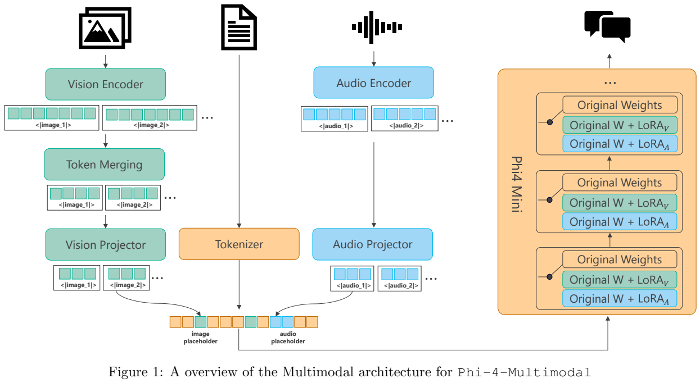
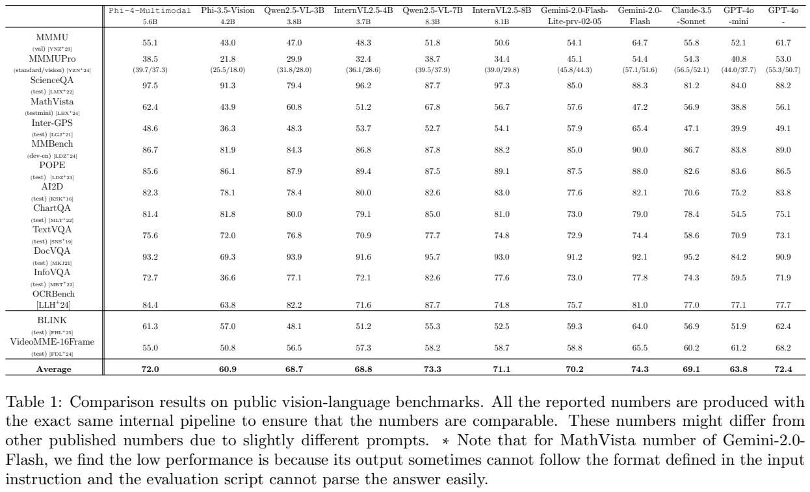
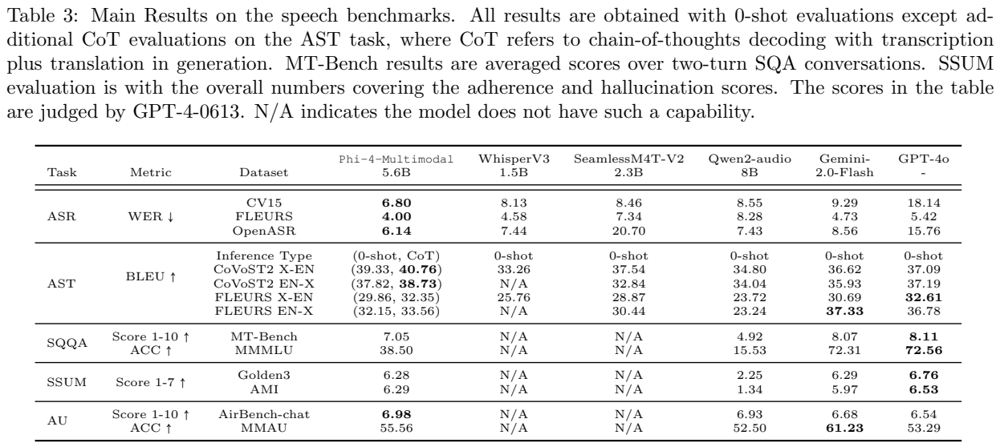
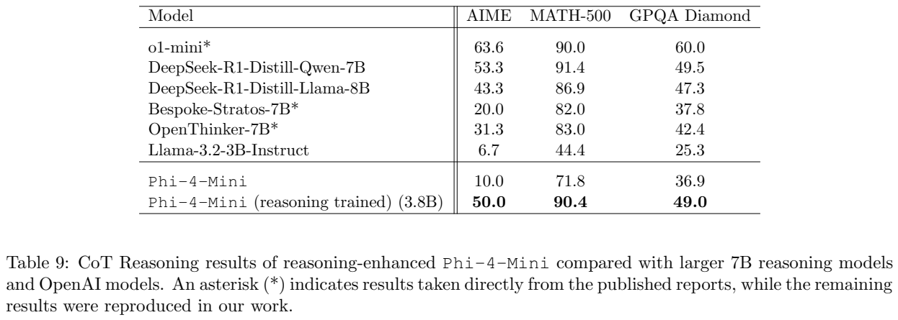

<!-- article-header:start -->
[项目首页](../../../README.md) › [模型系列](../../../reports/model-family-index.md) › [Phi](../README.md)
<!-- article-header:end -->

# Phi-4-Mini 与 Phi-4-Multimodal：用模态 LoRA 保留语言骨干

<!-- article-toc:start -->
<a id="article-toc"></a>

**本篇目录** · [论文定位](#paper-info) · [快速概览](#overview) · [整体架构](#architecture) · [核心原理](#principles) · [数据构建](#data) · [训练流程](#training) · [实验结果](#experiments)
<!-- article-toc:end -->

<a id="paper-info"></a>

## 1. 论文信息与模型定位

| 项目 | 信息 |
|---|---|
| 原文 | [Phi-4-Mini Technical Report: Compact yet Powerful Multimodal Language Models via Mixture-of-LoRAs](https://arxiv.org/abs/2503.01743) |
| 作者／团队 | Microsoft，完整作者名单在 Appendix B |
| 固定版本 | arXiv **2503.01743v1**，2025 年 3 月 3 日，39 页 |
| Phi-4-Mini | **3.8B** 文本语言模型 |
| Phi-4-Multimodal | 文本、图像、语音／音频输入，报告表格按 **5.6B** 系统规模列出 |
| 推理增强模型 | 在 Mini 上额外训练的独立实验版本，报告时仍为预览，不与两个正式模型混用 |

这份报告讨论三种相关但不同的模型。多模态版本在语言骨干训练完成后将其冻结，再增加视觉与音频编码、投影和模态 LoRA。目标是在一个检查点中支持纯文本、图文、音频和图像加语音输入，同时让纯文本路径继续使用原语言权重。主要输出是文字；不能因为有 speech 输入就称它已提供语音合成或双向实时语音输出。

<a id="overview"></a>

## 2. 快速概览

语言模型强调高质量网页、合成数学与代码，使用更大词表、GQA 和 LongRoPE。多模态扩展采用两套 LoRA：视觉适配约 **370M**，音频适配约 **460M**；再加视觉编码器与投影 **440M**、音频编码器与投影 **460M**。按这些约数与 3.8B 相加约为 5.53B，表中 5.6B 是报告规模口径，不是精确总参数逐项审计。

模型分阶段完成单图、多图／视频、语音对齐、音频指令和视觉—语音联合训练。亮点是感知和识别能力，而不是所有任务都超过大模型：报告中的 MMMU 为 55.1、DocVQA 93.2，OpenASR 平均 WER 6.14；但语音版 MMMLU 为 38.50，明显低于表中较大的闭源模型，视频也有差距。

128K 是语言上下文设计长度；多帧视觉训练扩展到 **64K**，语音摘要训练最长 **30 分钟**。这些不同范围要分别理解，不能从一个上下文上限推断所有模态、任意长输入都经过验证。

<a id="architecture"></a>

## 3. 整体架构



**读图：** 图像经过视觉编码、token merging 和投影，音频经过独立编码及投影，文字经 tokenizer，三者在相应占位位置组成输入序列。语言层右侧保留原权重，并可使用视觉或音频 LoRA 分支。图中画出路由选择，但报告没有公开完整的 token 级路由算法、概率归一化或混合门控训练损失，本文不将它套成常规 Top-k 稀疏 MoE。

语言骨干为 **32 层、hidden 3072**，输入输出嵌入共享；o200k base tiktoken 词表 **200,064**。注意力采用 **24 个 query head、8 个 key/value head**，每个 query head 维度为 128。RoPE 只作用于 75% 的 head 维度，留下 25% 不加位置旋转；上下文扩展采用 LongRoPE。

视觉编码器以 **SigLIP-400M** 为基础，经过 LLM2CLIP 图文训练，单 crop 为 **448×448**，二层 MLP 投影到语言维度。视觉 LoRA 加到语言解码器的线性层，只在视觉 SFT 开始部署；图中 token merging 的具体压缩倍率、每 crop 最终 token 数和视觉 LoRA rank 没有在本版正文中列出，因此本文不借其他模型补值。

音频输入为 **80 维 log-Mel filter-bank**，帧间隔 **10ms**。编码器包含 **3 个卷积层＋24 个 Conformer block**，attention width 1024、FFN width 1536、16 个头；卷积总下采样八倍，输出约每 **80ms** 一个 token。二层音频 MLP 投影到 3072 维；音频 LoRA 应用于语言 attention 和 MLP，**rank 320**。这一个分支的 rank 已披露，不代表视觉分支也是同值。

<a id="principles"></a>

## 4. 核心创新与数学原理

核心是冻结基础权重，并按模态使用附加的低秩更新。作为标准 LoRA 解释，若 $`W_0\in\mathbb R^{d_o\times d_i}`$，则 $`\Delta W_m=B_mA_m`$，其中 $`A_m\in\mathbb R^{r\times d_i}`$、$`B_m\in\mathbb R^{d_o\times r}`$。可用以下**概念式**描述分支选择，它不是报告编号公式或已验证的路由实现：


```math
h'=W_0h+g_V\Delta W_Vh+g_A\Delta W_Ah.
```


纯文字路径停用模态更新时，附加项为零，原语言权重也没有在模态训练中被改写，因此可保持该路径的基础函数。不同分支能降低更新相互干扰，但不等于联合图像与语音推理天然无冲突；该用法另有联合训练。报告没有给出 $`g_V,g_A`$ 的完整实现，本文只用它们表示“是否使用相应更新”，不声称二者是作者训练出的 softmax 权重。低秩参数数目约为 $`r(d_i+d_o)`$，所以 rank 320、覆盖大量线性层时，LoRA 仍可能有数亿参数，“LoRA”不意味着训练或部署开销可以忽略。

GQA 则改善 KV cache。在相同层数、序列长度、head 维度和数值精度下，缓存规模与 KV head 数成正比，**8／24=1／3**，所以相对 24 个独立 KV head 的 MHA 减少约三分之二缓存。这个比例只针对 KV cache，不等于整个模型总内存或推理延迟缩减到三分之一。RoPE 留下的 25% 对应每 head 的 32 维，属于结构配置推导，并不是新的注意力头数量。

动态裁切先计算：


```math
n_H=\lceil H/C\rceil,\quad n_W=\lceil W/C\rceil,
\quad n_{\rm crop}=n_Hn_W.
```


这是第 4 页披露的裁切数关系；$`H,W`$ 为图像尺寸、$`C`$ 为 crop 边长。若未超上限，轻微缩放使图片适合该网格；超出则按 InternVL2 的最佳宽高比策略选网格。上限为预训练 **16 crops**、SFT **36 crops**。目的之一是避免为极细小的图片，仅为了匹配宽高比而不合理放大。它不保证无插值误差，也不意味着每个样本都恰有上限数 crop。

音频长度可直接核算：$`N_{\rm audio}\approx T/0.08`$，一分钟约 **750 token**，30 分钟约 **22.5K token**，30 秒约 **375 token**。将整个 128K 都给音频，理论上约为 **2.8 小时**，但文字提示和输出也占位置，而且报告明确没有用这种长音频微调。数学上的上下文容纳上限不能代替长距离语义理解实验。

预训练和 SFT 按标准条件生成训练，视觉部分只在**文字目标位置**计算下一 token 损失，图像位置不计算损失。可以解释为 $`\mathcal L=-\sum_{t\in\mathcal T_{\rm text}}\log p(y_t\mid y_{\lt t},I,A,q)`$；这是目标整理，不是原文编号公式。生成文字描述与预测视觉 token 是不同训练任务。

<a id="data"></a>

## 5. 数据构建与处理

语言预训练建立约 **5T token 的语料库**：用改进质量分类器筛选多语网页，加强指令形式的数学和代码，引入 Phi-4 的合成数据与相应去污染流程，并提高推理类数据占比。报告没有披露完整来源比例、过滤阈值及本模型逐基准去污染计数，5T 应按报告的语料库规模理解。后训练增加函数调用、摘要、指令跟随及代码补全，包含代码中间缺段生成。

视觉预训练包括交错图文文档、图文对、区域数据、PDF／真实图片 OCR 合成和图表理解，共 **0.5T token**，计数包含视觉与文字。多数图片小于 1344×1344，报告将预训练最大图像分辨率设为该范围。SFT 混合文字、公开及内部视觉指令，涉及自然图片、图表表格、PowerPoint、OCR、多图比较、视频摘要和安全，约 **0.3T token**。它们不是对应数量的唯一图片或全部有损失的文字 token。

音频对齐使用约 **2M 小时**匿名化内部语音—文本对，覆盖中、英、法、德、意、日、葡、西八种语言。音频后训练的“约 100M 实例”是**加权重采样后的规模**：ASR 28M、翻译 28M、SQA／SQQA 26M、摘要 1M、音频理解约 17M。原始 ASR 后训练数据约内部 20K 小时＋公开 20K 小时，翻译约 30K 小时，不能把加权实例数写成独立录音数量。

SQA 根据真实语音转写合成问答，SQQA 把文本查询用内部 TTS 转成语音；另一部分根据转写让语言模型生成回应。摘要保留最长 30 分钟的多人对话，并让 GPT-4 据转写产生各种长度、格式和关注点的查询—摘要，**摘要训练仅英语**。声音／音乐理解也利用音频转写或元信息生成 QA。公共数据通过 PII 检测移除检出信息的实例，但这不是整个数据全无隐私风险的形式证明。

视觉—语音联合数据来自部分视觉 SFT，将用户文字查询转为 TTS；再用内部 ASR 转写，与原问题计算 WER 过滤。本文将它理解为查询保真度筛选，而不是音频自然度或任意口音的全面验证。推理增强预览另外使用约 **60B CoT token、200K SFT 轨迹、300K 偏好对**；这些数据明确**没有应用于正式 Mini 检查点**。

<a id="training"></a>

## 6. 训练流程与目标

视觉扩展分四阶段：先仅训练投影做描述对齐；再同时训练编码器和投影强化 OCR 等能力；第三阶段加入视觉 LoRA，与编码器和投影在单帧指令数据上训练；第四阶段采用多帧数据，**冻结视觉编码器**，将训练上下文扩展到 64K。语言基础权重在模态扩展过程中冻结。报告没有列出四阶段完整学习率、batch、步数或优化器配置，本文不据其他 Phi 版本补入。

音频先由 AED ASR 的预训练编码器初始化，训练编码器和投影 **50K 步、LR $`4\times10^{-5}`$**，语言骨干冻结，此时主要只有转写能力。之后冻结音频编码器，训练投影与音频 LoRA **50K 步、LR $`10^{-4}`$**，使用多任务指令数据；摘要最长 30 分钟，其他任务训练音频最长 30 秒。联合视觉—语音阶段冻结语言骨干、音频编码器和投影，更新视觉编码器、视觉投影、视觉 LoRA，并混入语言和视觉后训练数据。

语言模型峰值学习率按报告的 $`LR^*(D)=BD^{-0.32}`$ 估计，使用 12.5B、25B、37.5B、50B token 试验拟合常数 $`B`$，具体值未披露。不能将这个缩放关系写成模型最终已公开的精确学习率表。

独立推理增强版本先学习大规模合成推理轨迹并拒绝采样错误输出，再进行较小的高质量轨迹 SFT，最后用正确／错误输出构建偏好对做 DPO。它是另一训练路径，正式多模态成绩不应借用该预览模型的推理提升。报告也没有把 GPT-4 评测分数作为多模态训练奖励。

<a id="experiments"></a>

## 7. 实验设置与主要结果



**读表：** 视觉 15 项平均为 **72.0**，Phi-3.5-Vision 为 60.9；这混合不同基准计分，不能当作统一总体准确率。MMMU **55.1**，ScienceQA **97.5**，MathVista **62.4**，DocVQA **93.2**，InfoVQA **72.7**，OCRBench **84.4**。OCRBench 在此使用归一化显示尺度，不能与其他论文的 844 式原始分直接混在一列。

优势有明确边界：POPE **85.6** 低于前代 86.1，ChartQA **81.4** 低于前代 81.8；Qwen2.5-VL-7B 在 DocVQA 为 95.7、MathVista 为 67.8。BLINK 为 **61.3**，VideoMME **55.0**，后者每视频均匀采样 **16 帧**，低于 Qwen2.5-VL-3B 的 56.5。不能把整体平均提高写成所有视觉领域都领先。

四个将查询转为语音的视觉任务为 **68.9、69.0、87.3、63.7**，平均 72.2，InternOmni 平均 62.6；但 AI2D 68.9 略低于 Gemini-2.0-Flash 的 69.4。作者对 Gemini 加额外文字格式指令方便提取答案，属于需要说明的协议差异。Table 1 图注称统一内部流程，正文又说明 DocVQA／InfoVQA 等服务器基准的部分基线直接采用报告值，因此不能声称所有数字都在本实验完全重跑。



转写在 CV15、FLEURS、OpenASR 的平均错误率为 **6.80、4.00、6.14**；日语与中文采用 **CER**，其余六语采用 WER，所以前两个多语平均并非全部是同种词级误差。Table 4 中 Canary-1B 的 OpenASR 为 6.50，下降 $`(6.50-6.14)/6.50\approx5.5\%`$ 是**相对误差降低**，不是降低 5.5 个百分点。榜首描述对应报告注明的 **2025 年 1 月 14 日**，本文不将其当作现在的排名。

翻译 CoVoST2 X→English BLEU **39.33**，先转写再翻译为 **40.76**；FLEURS English→X 从 32.15 升到 33.56，但仍低于表中 Gemini 的 37.33。额外的转写输出属于该模型的 CoT 解码协议，其他模型没有做同样的额外输出，不能称推理预算严格匹配。

语音版 MT-Bench 为 **7.05／10**，高于 Qwen2-Audio 4.92，低于 GPT-4o 8.11；语音 MMMLU 准确率 **38.50**，GPT-4o 为 72.56。音频理解 MMAU 为 **55.56**，高于 Qwen2-Audio 52.50，低于 Gemini 61.23。ASR 强并不保证知识问答或一般音频推理也同样强。

会议摘要 Golden3／AMI 的 GPT-4 整体分为 **6.28／6.29（满分 7）**，GPT-4o 为 6.76／6.53。裁判读取真实转写；Golden3 有 108 场会议、1071 查询，AMI 测试有 20 场平均 32 分钟会议、200 查询。摘要中被判有幻觉的比例为 **0.14／0.13**，不是零。Qwen2-Audio 在该对比有 30 秒输入限制，摘要低分也反映输入容量不匹配，不能全部归因于内容理解质量。



**读表：** 正式 Mini 的 AIME／MATH-500／GPQA Diamond 为 **10.0／71.8／36.9**，独立推理训练后为 **50.0／90.4／49.0**。这些是预览推理模型的结果，不能写到多模态检查点名下。Table 7 正式 Mini 的 MATH 为 64.0、HumanEval 为 74.4、IFEval 为 70.1，但多语 MMLU **49.3** 低于前代 55.4，报告也承认提高代码比重后多语数据比例下降。

安全实验还显示取舍：多模态版 XSTest 有害请求拒绝率 **92%**，正常请求误拒绝率 **26.4%**；音频安全训练主要由文字安全样本做 TTS，未覆盖非语音音效或专门音频越狱训练。这些结果限定于报告协议。本文没有运行模型、复现榜单或测量端侧性能；该报告的价值是展示冻结骨干与模态适配的可行路径，同时公开了多语、长音频和知识推理的现实边界。

<!-- article-footer:start -->
---

[← 上一篇：Long-VITA](../../vita/arxiv-2502.05177/README.md) · [按发表时间浏览](../../../reports/paper-reading-guide.md#year-2025) · [下一篇：Nexus-O →](../../nexus-o/arxiv-2503.01879/README.md)

[返回本篇目录](#article-toc) · [返回模型系列](../README.md)
<!-- article-footer:end -->
