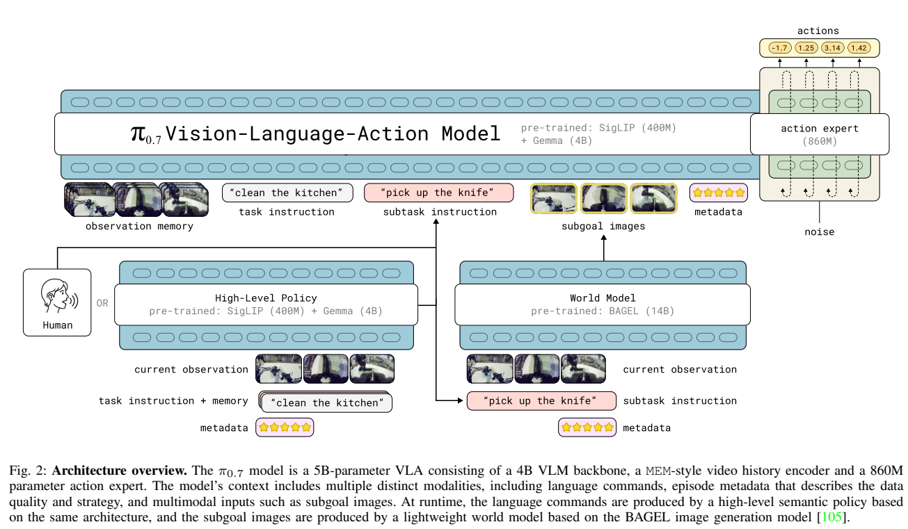
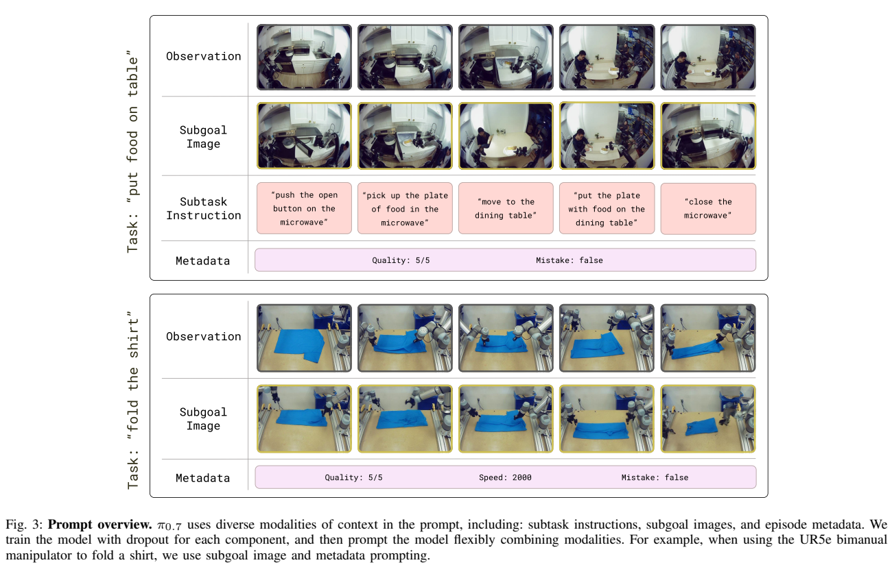
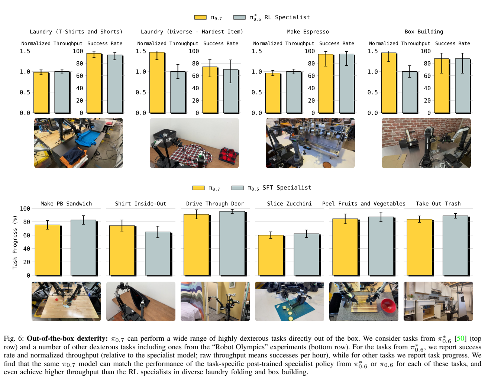
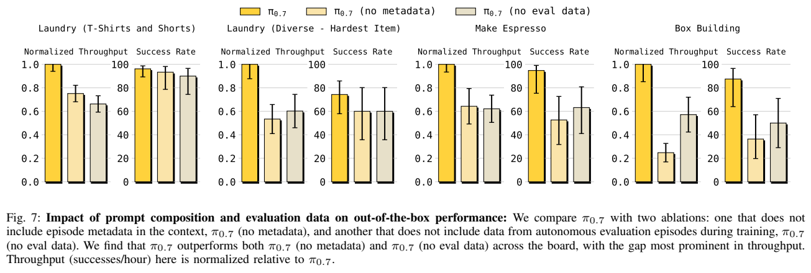
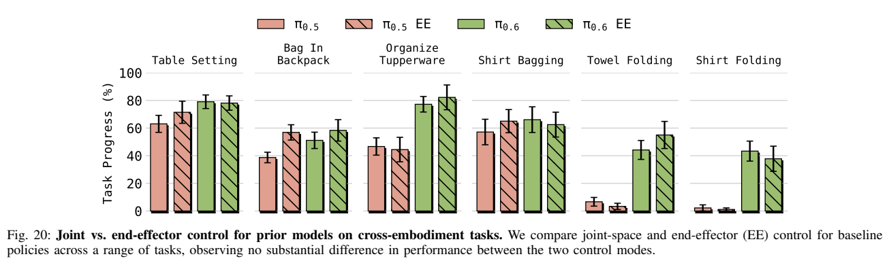
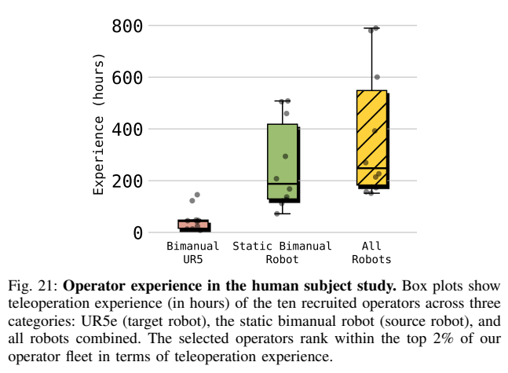
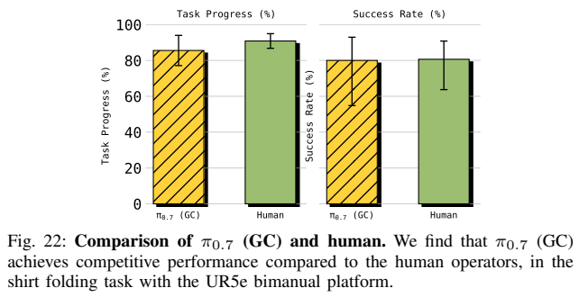

<!-- article-header:start -->
[项目首页](../../../README.md) › [模型系列](../../../reports/model-family-index.md) › [π / Pi](../README.md)
<!-- article-header:end -->

# π0.7：用多模态上下文引导通用机器人策略

<!-- article-toc:start -->

**本篇目录** · [论文定位](#paper-info) · [快速概览](#overview) · [整体架构](#architecture) · [核心原理](#principles) · [数据构建](#data) · [训练流程](#training) · [实验结果](#experiments)
<!-- article-toc:end -->

## 1. 论文信息与模型定位

**论文**：[π0.7: a Steerable Generalist Robotic Foundation Model with Emergent Capabilities](https://arxiv.org/abs/2604.15483v1)，2026年4月16日v1，共25页，作者为Physical Intelligence团队。[官方项目](https://pi.website/pi07)。

π0.7是视觉语言动作模型（VLA），输入相机观察、机器人状态与多模态任务上下文，输出连续机器人动作块。与一般聊天式多模态模型不同，它的回答最终要作用到机械臂和移动底盘。研究重点不是全新网络层，而是让机器人从任务多样、策略不一致、质量参差且含失败的轨迹中学习，并在推理时通过提示选择更好的行为。

上下文不仅说“做什么”，还说明“怎么做”：细化子任务文字、未来子目标图片、执行速度、质量、是否出错与控制模式。本文区分三种实验条件：已有任务直接使用通用策略；没有目标机器人该任务数据的跨本体迁移；陌生长任务在人类语言coaching下执行，再用coaching记录训练高层策略。后两者不能混写成所有陌生任务都无需任何引导或学习。[§I、§IX—X，PDF第2、13—15页](https://arxiv.org/pdf/2604.15483v1#page=13)。

## 2. 快速概览

| 方面 | 关键设置 |
|---|---|
| 主策略 | 约5B参数：Gemma3 4B VLM（含约400M视觉塔）加860M动作专家 |
| 观察 | 最多4路相机，每路最多6个历史帧；最多3幅子目标图 |
| 动作 | 流匹配，固定50步动作块，推理5步去噪，执行前15或25步 |
| 记忆 | MEM式视觉历史压缩与线性投影的历史本体状态 |
| 子目标生成 | 另有BAGEL 14B世界模型与高层语言策略，不包含在5B主策略计数内 |
| 数据特点 | 人类示范、失败、旧策略自主轨迹、人类干预、公开机器人与非机器人图文视频 |
| 实验亮点 | 跨机器人UR5e叠衫成功率80%；对应熟练遥操者80.6% |
| 限制 | 未见任务通常60%—80%，低于许多已见任务90%以上；数据总规模和完整优化配方未披露 |

## 3. 整体架构

**Figure 2怎么读。** 顶部蓝色主干处理历史观察、任务与子任务、子目标图、元数据，右端动作专家从噪声生成连续动作。左下高层策略或人类给下一子任务；右下BAGEL世界模型预测目标图，再接回主VLA。这里“5B”属于顶部动作策略，不能当成包括14B图像生成器与另一高层策略的完整系统总参数。

视觉塔和语言主干从Gemma3初始化，历史编码器沿用MEM，对多个历史帧做时空压缩，使一个相机历史输出接近单帧token预算。相机观察与目标图都缩放到448×448；历史帧每秒取一个、最多六帧。机器人当前及历史关节状态经线性投影进入主干，每个状态是一个token；历史帧被drop时相应状态也mask。

注意力采用分块结构，视觉块内部双向、文字生成因果，目标图与观察之间按设定的block-causal关系交互；附录Figure 19给出训练和CFG推理的更细掩码。动作专家的50个token内部双向，并读取VLM激活，使用adaptive RMSNorm注入流匹配时间。训练使用knowledge insulation：主干通过FAST离散动作token的交叉熵获得监督，连续动作专家读取主干，但其梯度不回传到VLM。[§III、§VI、附录B，PDF第3、6—7、22页](https://arxiv.org/pdf/2604.15483v1#page=6)。

## 4. 核心创新与数学原理

**条件化质量，避免混合数据平均成坏策略。** 原文式(1)把动作学习写为

$$
\max_\theta\mathbb E_D[\log\pi_\theta(a_{t:t+H}\mid o_{t-T:t},C_t)].
$$

$o$含图像和机器人状态，$C_t$含多种提示。作者指出流匹配优化的是近似下界，并非可直接计算的闭式动作对数似然。失败和低质量数据如果只配相同任务文字，会和成功轨迹混在一起；加入“质量低、出错、很慢”等条件，模型可以学习不同分布，在推理时请求高质量、无错误、较快的模式。这个机制是条件模仿与行为蒸馏，不是从失败标签自动建立一个已证明安全的价值函数。

**把未来视觉状态作为动作条件。** 子目标$g_t=[G_t^1,\ldots,G_t^n]$提供物体、抓取和布料折叠位置，弥补文字“折好衣服”未表达的空间细节。世界模型$g_\psi(o_t,\hat\ell_t,m)$以分段结束时观察为目标，学习由当前多视角图、子任务与元数据预测近未来图。它基于BAGEL的语义ViT与细节VAE两路表示，训练条件流匹配。图像生成正确不自动保证动作可达，所以主策略仍需要状态、历史和动作训练。

**训练时随机缺省，推理时可选择条件。** 子目标图只放入每batch的25%样本；其中子任务文字30%概率省略。整个元数据15%概率省略，各速度、质量、错误字段另各5%概率省略，控制模式不drop。这使模型既可只靠文字，也可接受丰富条件，避免训练时处处有真实未来图而推理时只能看到生成图的严重落差。[§V，PDF第4—5页](https://arxiv.org/pdf/2604.15483v1#page=5)。

**CFG强化期望行为。** 原文用条件与去条件动作score的差来增强提示作用，可简记为$s_C+\beta(s_C-s_{\rm uncond})$。主要对元数据做CFG，$\beta\in\{1.3,1.7,2.2\}$。这是推理引导，不能把它视为严格执行硬约束。并行计算正负分支使用不互相注意的attention tree，提高共享上下文的计算效率。

## 5. 数据构建与处理

**Figure 3怎么读。** 上方“把食物放到桌上”拆成按按钮、取盘子、移动、放置、关门，目标图描述每个阶段的预期状态；下方折衫没有逐条文字而有目标图和质量/速度/错误提示。它展示提示可表达行为方式，不是把所有长任务强行变成一条固定文字指令。

机器人数据覆盖静态、移动、单臂、双臂和不同环境，包含高质量示范、低质量或失败示范、旧模型评测/自主rollout、人类接管干预、公开数据，以及第一视角人类视频。非机器人任务还包括网页图文、定位和属性预测、VQA、纯文字、机器人与Web视频描述。旧RL专家π*0.6的自主数据用于蒸馏较熟练行为，不能说主模型没有从专用RL策略学习过。

轨迹分段添加细致子任务文字；速度按500步区间离散，如1750—2250归为2000；质量1—5分，5最高；错误字段由人工粗标某动作段是否出错。不同长度、质量的轨迹提供监督，但“质量5”只是条件标签，不是运行时真实完成质量的保证。原文没有公布全部机器人小时数、轨迹数、任务采样比例、标注者一致性和语言数据规模。

训练目标图既有真实未来帧，也有世界模型生成图。对真实帧，25%取子任务段末图、75%从未来0—4秒均匀抽取；加入生成图缓解真实与生成图的分布差异。世界模型训练使用高质量分段的机器人与人类视频，并混合公开编辑和视频数据，保持语义覆盖。作者特意排除面向泛化测试任务的自主评测数据，但也承认庞大数据中相关动作可能以其他标签或其他任务的一部分出现，因此“未见”不能理解为已证明所有语义片段从未出现。[§VI、§X、附录C，PDF第5—7、15、22页](https://arxiv.org/pdf/2604.15483v1#page=15)。

## 6. 训练流程与目标

主VLA用视觉语言主干的离散监督与动作专家流匹配联合训练，knowledge insulation隔断动作专家向语言主干的梯度；世界模型另训练，分段未来图为目标，高层策略可从任务、观察和子任务历史产生下一语言指令。报告未披露主训练GPU数、学习率、batch、步数与各损失权重，不能照搬π0.6或Gemma3的训练超参数。

为适应推理延迟，RTC训练模拟0—12步延迟，50Hz条件下最多240ms；动作块为50步，实际执行15或25步后再生成。推理使用5次去噪。任务速度设为该任务episode长度的第15百分位，质量5、Mistake=false，并明确joint或ee模式。目标图在子任务改变或经过4秒时异步更新，VLA继续执行最新可用目标图，避免等待世界模型停住机器人。[§VI—VII，PDF第6—7页](https://arxiv.org/pdf/2604.15483v1#page=7)。

主策略与高层策略使用单H100推理，精简VLA在3路相机、5步去噪条件下38ms；加入记忆与目标图后最坏约127ms。BAGEL世界模型另用4张H100、四路张量并行、大矩阵8bit及改造SageAttention，25步图像去噪约1.25秒。不要把38ms写成含世界模型的全系统延迟，也不要把“单H100”写成全部模块的硬件需求。[附录D，PDF第22—23页](https://arxiv.org/pdf/2604.15483v1#page=23)。

## 7. 实验设置与主要结果

平台包括双臂移动机器人、较轻的静态BiPi、双臂UR5e和单臂系统，均使用平行夹爪。UR5e控制20Hz，其余50Hz，通过PD控制执行，末端目标需要数值逆运动学转换。评测分别报告成功率、分阶段任务进度和成功次数/小时，不是同一个指标。[§VIII，PDF第7—8页](https://arxiv.org/pdf/2604.15483v1#page=8)。

**Figure 6—7怎么读。** 顶部叠衫、咖啡、搭盒任务同时比较吞吐与成功率，吞吐相对RL专家归一；下方其他任务给进度分。通用π0.7在许多项目接近专用策略，并在较难折衣和搭盒吞吐上更好，但部分任务进度条仍稍低，不能写全部超过专家。Figure 7去掉元数据或自主评测轨迹后性能下降，尤其吞吐；它支持带质量标记吸收专家/低质数据的作用。

指令泛化在4个未见厨房、2个未见卧室的14种场景中测试，每段3—6个指令，成功率按正确完成指令数计算，不是整个长任务全成功率。复杂对象指代、与数据惯例相反的垃圾分类和微波炉到冰箱流程比较显示目标图帮助很大；但这里目标图来自额外世界模型，不能全部归于5B VLA的独立理解。

**Figure 22怎么读。** 左侧Task Progress与右侧Success分开；条纹是带生成目标图的π0.7，绿色是人类遥操。UR5e未采集折衣训练数据，源机器人却有叠衣技能，因而这是跨本体任务迁移，不是从未学过叠衣。人类招募10位经验前2%的遥操者，平均375小时，每人3次、共30次、无练习热身，初始衣物平铺、时间限制和评分标准与策略相同。人类进度90.9%、成功80.6%；π0.7进度85.6%、成功80%。这说明该具体条件下接近熟练遥操表现，而非一般机器人已经超越人类。[§IX-C、附录F，PDF第12—13、23—24页](https://arxiv.org/pdf/2604.15483v1#page=24)。

陌生短任务如压法压壶、舀米和擦物体可直接提示；陌生长任务如空气炸锅和烤贝果需要逐步coaching。随后用coaching记录训练高层语言策略，达到接近人工指导的自主执行，不新增低层遥操动作数据，但仍发生高层训练。Figure 18把质量前30%、50%、80%、全部数据做对照，带元数据能利用更大但更低质的混合；去掉任务最丰富20%比随机去20%损害更大，支持多样性而非只有数量的重要性。

作者总结已见任务往往成功率超过90%，未见任务或任务机器人组合为60%—80%；许多图只给柱形结果，本文不从像素估算精确小数或补造实验次数。完整公开数据、所有超参数和独立部署复现仍不足。本文按原文区分引导、迁移与后续学习条件，未操作真实机器人或复现实验。

<!-- article-footer:start -->
---

[← 上一篇：DeepSeek-V4](../../deepseek/document-08e9e69bb6bb/README.md) · [按发表时间浏览](../../../reports/paper-reading-guide.md#year-2026) · [下一篇：Cosmos 3 →](../../cosmos/arxiv-2606.02800/README.md)

[返回本篇目录](#article-toc) · [返回模型系列](../README.md)
<!-- article-footer:end -->
