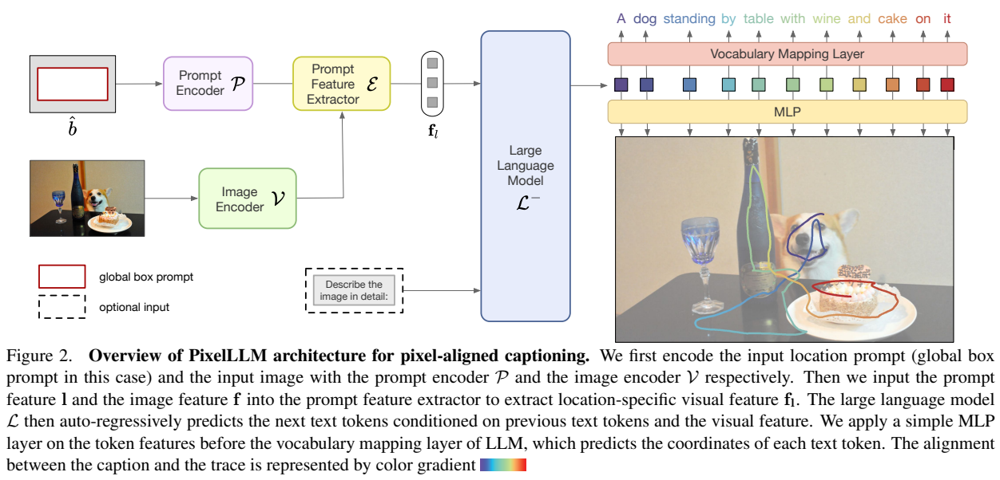
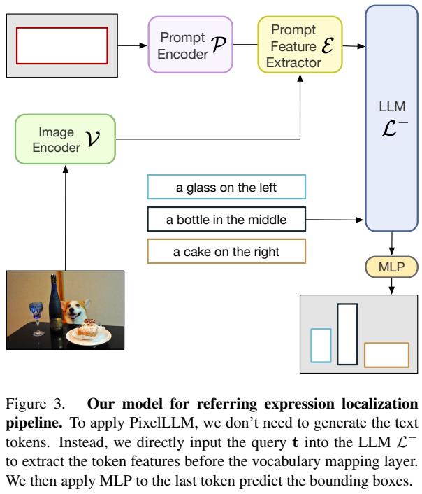
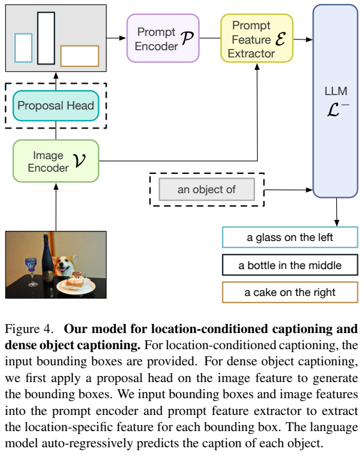
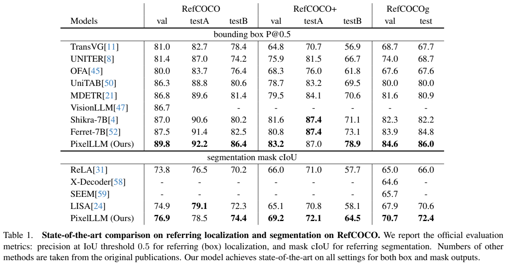
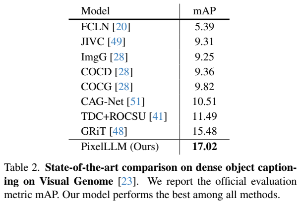
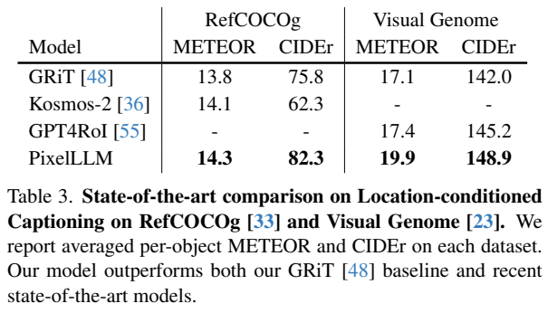
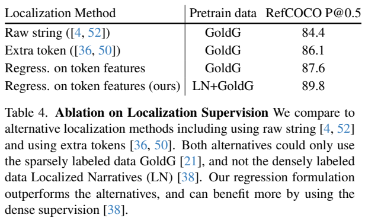
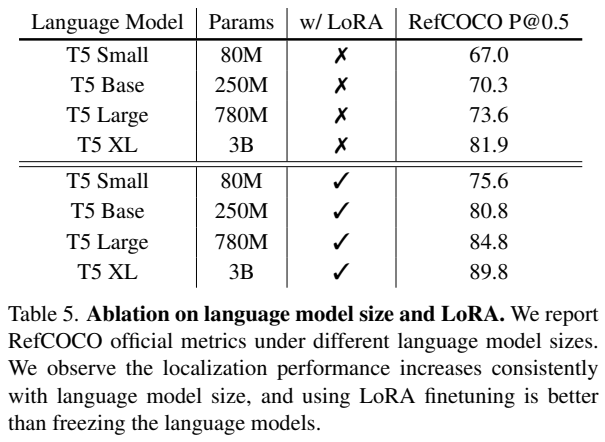

<!-- article-header:start -->
[项目首页](../../../README.md) › [模型系列](../../../reports/model-family-index.md) › [Pixel Aligned Language Models](../README.md)
<!-- article-header:end -->

# PixelLLM：把语言模型的每个词对齐到图像位置

<!-- article-toc:start -->
<a id="article-toc"></a>

**本篇目录** · [论文定位](#paper-info) · [快速概览](#overview) · [整体架构](#architecture) · [核心原理](#principles) · [数据构建](#data) · [训练流程](#training) · [实验结果](#experiments)
<!-- article-toc:end -->

<a id="paper-info"></a>

## 1. 论文信息与模型定位

| 项目 | 内容 |
|---|---|
| 原论文 | **Pixel Aligned Language Models** |
| 作者与机构 | Jiarui Xu、Xingyi Zhou、Shen Yan、Xiuye Gu、Anurag Arnab、Chen Sun、Xiaolong Wang、Cordelia Schmid；Google Research、UC San Diego |
| 版本 | 2023-12-14，arXiv:2312.09237v1，13 页 |
| 原文 | [固定版本 PDF](https://arxiv.org/pdf/2312.09237v1) |
| 模型定位 | 约 4B 参数的视觉语言定位系统，语言骨干为 3B 的 T5-XL；主要研究逐词定位、指代表达定位与分割、区域描述和密集描述 |

论文关注“生成一句描述时，每个词对应图像哪里”。PixelLLM 在词表预测头旁增加连续坐标回归头，而不是把所有坐标都拼成生成文本。下游定位实验经过对应任务微调，不能作为通用聊天模型零样本能力来理解。

<a id="overview"></a>

## 2. 快速概览

输入可以是图像、文本以及可选的点或框提示。没有位置提示时，用覆盖全图的框；输出可以是带逐词轨迹的描述，或通过任务适配输出目标框、分割掩码与区域描述。

主要设计有三点：用可学习的提示特征提取器从全图中读出指定区域信息；在语言隐藏状态上并行回归位置；用人类讲述图像时同步记录的鼠标轨迹训练密集词语—位置对齐。其价值在于把语言生成与视觉定位接到同一表示上，而不是要求模型先学会更长的坐标字符串。

“词对应像素”不意味着每个词都有精确目标分割标注。训练轨迹带有噪声，关系词和非视觉词也被纳入监督。指代定位还要进一步训练 EOS 位置的预测头，才能得到评测所需的紧致目标框。

<a id="architecture"></a>

## 3. 整体架构



**读图：** 左侧图像编码与框提示编码相遇于 Prompt Feature Extractor；中间语言模型的隐藏状态向上预测词，向下经 MLP 预测位置。上下两条输出共享语言特征，但坐标不作为下一步文本生成的输入。

视觉编码器并行使用 SAM 初始化的 ViT-H 与 EVA02 初始化的 ViT-L，沿通道拼接两种特征。SAM 分支提供定位特征并保持冻结，另一分支可以学习语义特征。点、框提示经 SAM 风格的正弦余弦位置编码和线性层映射。

两层双向 Transformer 在图像特征和“位置提示＋32 个可学习 token”之间交替注意，输出位置条件视觉表示。它读取整张图像的特征，不等同于把框内图像裁出来。语言端采用指令微调的 T5-XL 编码器—解码器，通过 PrefixLM 方式将视觉表示和文本前缀放入编码器，由解码器生成后缀。T5 自注意力的 Q、V 投影加入 rank 32 的 LoRA；其余基础权重冻结。





**读图：** Figure 3 先输入完整指代句，再用末尾 EOS 隐藏状态回归目标框，无须重新生成这句话。Figure 4 的密集描述额外加入候选框头，再对每个候选框生成描述。候选检测并非基础模型自动具备的功能：作者加入 Simple Feature Pyramid 与 CenterNet，并联合微调检测和描述目标。分割则将预测框送入 SAM 掩码解码器，附加可学习嵌入作任务适配。

<a id="principles"></a>

## 4. 核心创新与数学原理

设图像为 $`I`$，位置提示为 $`b`$，图像编码器、提示编码器和特征提取器分别为 $`V,P,E`$。原文式 (1) 给出：

```math
f_l=E(V(I),P(b)).
```

设 $`h_i=L^{-}(f_l,w_{\lt i})`$ 是去掉词表映射层后的语言隐藏状态。词表头预测下一个词，位置头独立作用于相同状态：

```math
w_i=\mathrm{argmax}(Wh_i),\qquad p_i=\mathrm{MLP}(h_i).
```

这里对应原文式 (2)–(3)。正文为说明而写二维点；脚注明确实际输出包围每个词轨迹的两个点。它们是轨迹边界，不能直接视为准确物体框。把坐标作为连续量回归，也不需要为每一个词额外生成四个坐标 token。

原文式 (4) 联合文本与位置监督：

```math
\mathcal L=\frac1n\sum_{i=1}^{n}\left[\mathrm{CE}(L(f_l,w_{<i}),w_i)+\lambda\lVert\hat p_i-p_i\rVert_1\right],\qquad\lambda=0.1.
```

文本交叉熵使用 0.1 标签平滑。位置头与词表头并行，坐标不反馈到文本自回归链。作者称附加开销小，但报告没有提供系统性的延迟或吞吐数字。

对指代句，仅取轨迹整体边界会产生不紧致的框。因此下游训练用目标框监督 EOS 的同一个回归 MLP。这个适配步骤解释了为何逐词轨迹预训练有帮助，却不等于无需微调就完成标准目标定位。

<a id="data"></a>

## 5. 数据构建与处理

预训练先使用 WebLI 图文数据学习描述，再引入 **Localized Narratives（LN）**。LN 让标注者一边讲述图像，一边用鼠标指出正在描述的区域；语音叙述与鼠标时间对齐后形成词级轨迹。这是真人同步行为标注，仍会出现游移、含糊和非视觉词定位噪声。本文使用 COCO 子集：134,272 张训练图像、8,573 张验证图像；其中 5,000 张图像有五组描述和轨迹，其余一组。训练将叙述按句点切成逐句目标。

指代任务使用 RefCOCO 系列与 GoldG。GoldG 来自 COCO、Visual Genome、Flickr30k；过滤 RefCOCO/+/g 的验证与测试图像后，共 160,280 张训练图像。每个框的多条指代表达均用于训练。密集描述使用 GRiT 所采用的 Visual Genome 划分：77,396 张训练图像、5,000 张测试图像。报告没有公开本文所用 WebLI 的精确子集规模，不能拿原始 WebLI 总规模替代。

<a id="training"></a>

## 6. 训练流程与目标

第一阶段只训练图像描述，WebLI 上 10 epochs、输入 224×224。仿照 BLIP-2 随机将描述分成前缀和后缀：前缀与视觉特征进入 T5 编码器，后缀为解码器目标，用于初始化提示特征提取能力。

第二阶段在 LN 上训练 5 epochs、384×384 输入，联合优化描述与轨迹。第三阶段按下游任务微调：指代定位训练 EOS 框回归；分割接 SAM；密集描述联合检测与语言损失。区域描述直接采用已微调的密集描述模型并去掉候选框头。

原文称提示编码器、SAM、掩码解码器、T5-XL 参数在各阶段冻结；应结合 LoRA 描述理解为基础参数冻结，新增 LoRA 和任务模块仍参与学习，不能说语言端完全没有训练。论文未给出足以完整复现实验的优化器、学习率、批大小和全部下游训练时长。

<a id="experiments"></a>

## 7. 实验设置与主要结果





**读表：** Table 1 上半部分是框 P@0.5，下半部分是掩码 cIoU；同一列不同指标不能混用。框定位以预测框 IoU 达到 0.5 为成功。各对比模型的骨干与预训练数据不同，属于系统比较。

| 任务与划分 | PixelLLM | 解释 |
|---|---:|---|
| RefCOCO 框 val / testA / testB | 89.8 / 92.2 / 86.4 | 表内各列领先 |
| RefCOCO+ 框 val / testA / testB | 83.2 / 87.0 / 78.9 | testA 低于 Shikra、Ferret 的 87.4 |
| RefCOCOg 框 val / test | 84.6 / 86.0 | 表内领先 |
| RefCOCO 掩码 val / testA / testB | 76.9 / 78.5 / 74.4 | testA 低于 LISA 的 79.1 |
| Visual Genome 密集描述 mAP | 17.02 | GRiT 为 15.48；含任务微调和额外候选框头 |

因此 Table 1 图注“所有设置最优”的表述不能逐字照搬。LN 验证集的受控轨迹生成 LBM（越低越好）为 0.153，MITR 为 0.163；它衡量轨迹匹配，不是通用问答准确率或物体框 IoU。







**读表：** Table 3 给定真实框生成描述。RefCOCOg 的 METEOR/CIDEr 为 **14.3/82.3**，Visual Genome 为 **19.9/148.9**。原文引言把 19.9 的指标名称写成 CIDEr，与原表冲突；本文依表记录为 METEOR。区域描述复用了任务微调模型，不能把与 KOSMOS-2 的比较说成相同的零样本设置。

Table 4 的定位表示消融，在 GoldG 条件下，坐标字符串为 84.4、额外位置 token 为 86.1、隐藏状态回归为 87.6；加入 LN 后为 89.8。前者支持回归表示有效，后者包含新增数据收益，不能将全部差距归因于单一结构。Table 5 中 T5-XL 无 LoRA 为 81.9、有 LoRA 为 89.8，差距是 7.9 个百分点。

这些结果支持密集词语定位监督与连续回归对于区域任务的价值。论文没有评估通用视觉对话、长视频或开放领域知识问答；本文也未运行模型复现实验。

<!-- article-footer:start -->
---

[← 上一篇：CogAgent](../../cogvlm/arxiv-2312.08914/README.md) · [按发表时间浏览](../../../reports/paper-reading-guide.md#year-2023) · [下一篇：Osprey →](../../osprey/arxiv-2312.10032/README.md)

[返回本篇目录](#article-toc) · [返回模型系列](../README.md)
<!-- article-footer:end -->
