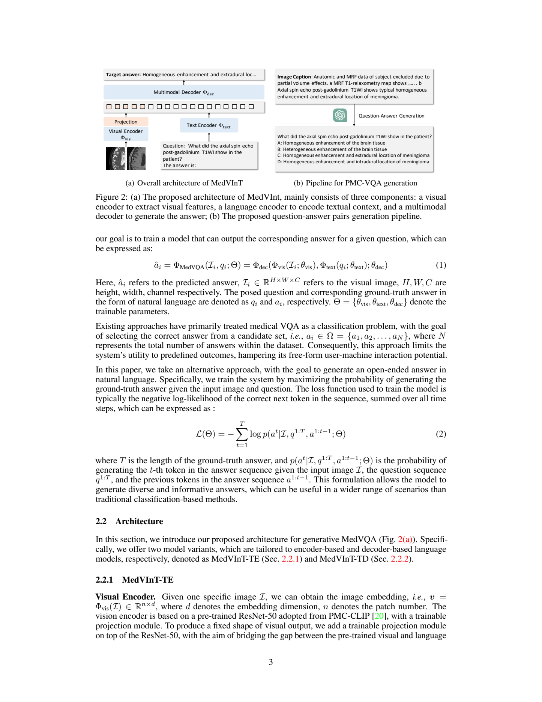
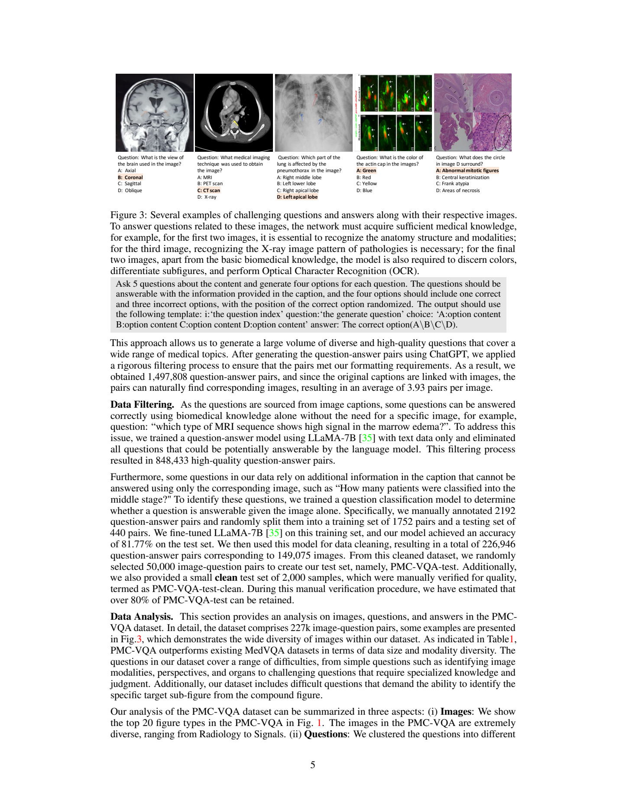
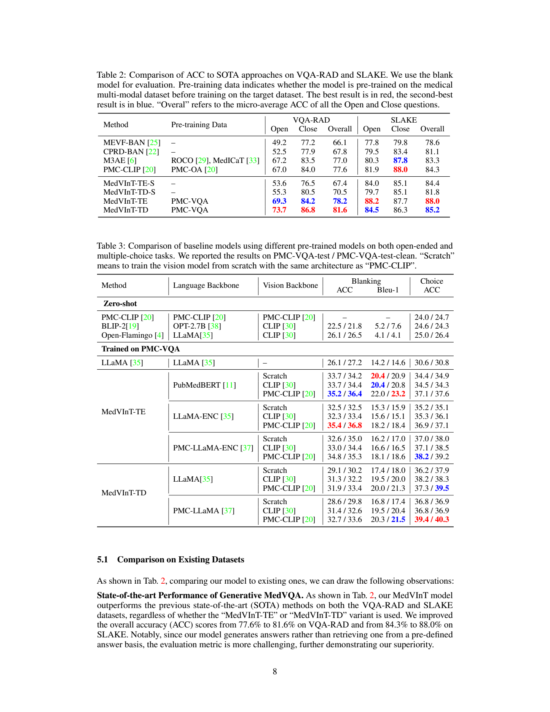
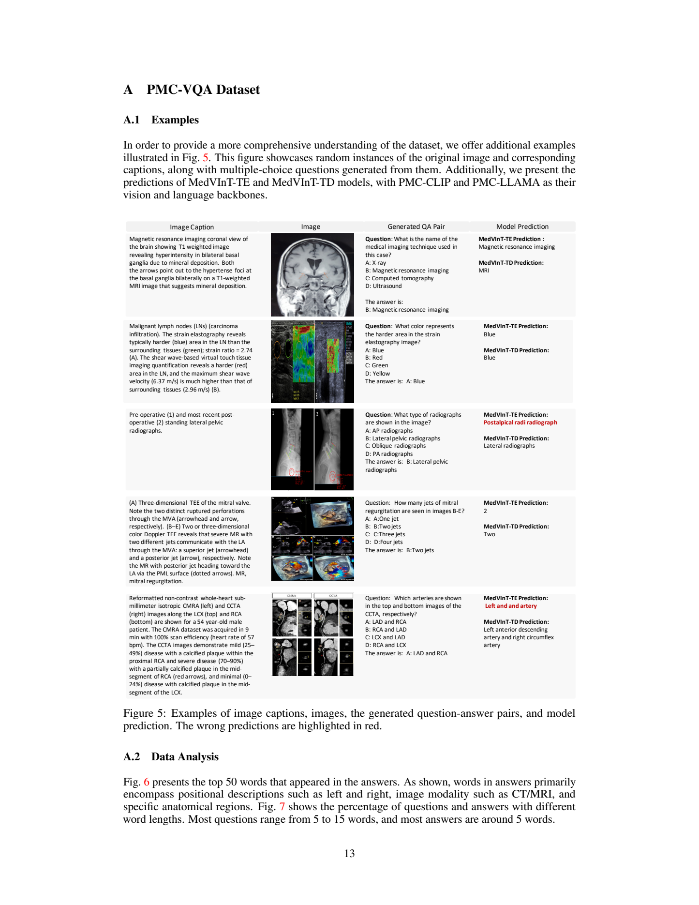

# PMC-VQA：从医学论文图注构建视觉问答数据，并训练 MedVInT

## 1. 论文信息与模型定位

| 项目 | 信息 |
|---|---|
| 原文 | [PMC-VQA: Visual Instruction Tuning for Medical Visual Question Answering](https://arxiv.org/abs/2305.10415v1) |
| 本文依据版本 | arXiv:2305.10415v1，2023 年 5 月 17 日，15 页；封面标注 NeurIPS 2023 |
| 作者与机构 | Xiaoman Zhang、Chaoyi Wu、Ziheng Zhao、Weixiong Lin、Ya Zhang、Yanfeng Wang、Weidi Xie；上海交通大学、上海人工智能实验室 |
| 研究产物 | PMC-VQA 数据集，以及 MedVInT-TE、MedVInT-TD 两种医学视觉指令调优模型 |
| 输入与输出 | 医学生物图像与文本问题；输出自由文本答案，或四选一答案标号 |
| 研究定位 | 扩大医学视觉问答训练数据，比较医学预训练骨干与生成式问答方案 |

论文的模型建立在既有视觉、语言骨干之上，重点是如何构建视觉相关的医学问答监督，以及如何将这些监督用于生成模型。PMC-VQA 不只包含放射影像，也覆盖病理、显微图、信号和一般生物医学示意图。论文没有开展前瞻性临床试验，本文讨论的性能均是公开数据集实验。

## 2. 快速概览

作者首先面对一个数据问题：VQA-RAD 只有 315 张图像，SLAKE 只有 642 张图像，这类规模限制了生成式视觉问答训练。论文从开放获取的生物医学论文中取得图像和图注，让 ChatGPT 根据图注产生问题、正确答案与干扰选项，再用语言模型排除两种不理想的题目：只靠文字知识就能作答的题目，以及答案依赖图注中额外信息、无法由图像支持的题目。

最终数据包含 **226,946 个问答对、149,075 张图像**，通常四舍五入写作 227K 与 149K。作者随机抽取 50K 图像问题对作为测试集，并提供 2K 人工核验的 clean 测试集。模型分别采用“编码器语言骨干加新解码器”和“直接使用因果语言解码器”的结构，研究医学视觉与语言预训练能否改善表现。

结果需要分开看：迁移到 VQA-RAD、SLAKE 后，最优整体准确率分别达到 **81.6% 和 88.0%**；在新建 PMC-VQA 上，最优四选一准确率仅为 **39.4% / 40.3%**，对应普通测试集与 clean 测试集。新数据的作用既是训练资源，也是揭示现有模型不足的更大规模评测。

## 3. 整体架构

**读图：** Figure 2 左侧将视觉编码、投影、文本编码和答案生成串联起来；右侧的 ChatGPT 接收的是图注文本。图中的问答生成流程不代表 ChatGPT 直接读取原始医学图像，图像与生成题目的对应关系来自原有图注配对。

| 模块 | MedVInT-TE | MedVInT-TD |
|---|---|---|
| 视觉骨干 | 默认采用 PMC-CLIP 的 ResNet-50 | 同左 |
| 视觉投影 | 池化后通过两层 MLP，输出一个视觉向量 | 12 层 Transformer 解码器，以可学习查询读取视觉特征，输出固定长度视觉序列 |
| 文本侧 | 预训练语言编码器产生上下文表征 | 使用预训练语言模型的词嵌入层 |
| 多模态解码 | 从头初始化的 4 层 Transformer | 由预训练的因果语言解码器初始化 |
| 答案训练形式 | 增加若干 `[MASK]` 槽位，训练掩码预测 | 逐词自回归生成 |

TE 的视觉池化把图像表示压缩为形状为 \(1\times d\) 的向量。文本编码器输出问题序列的 \(l\times d\) 表征，两者拼接后送入多模态解码器。这是较强的视觉压缩：空间细节是否保留，取决于视觉骨干和训练所得的表示，论文没有显式区域定位模块。

TE 可以使用 PubMedBERT，也可以把 LLaMA-7B、PMC-LLaMA-7B 改成编码器模式，采用完整注意力掩码，称为 LLaMA-ENC、PMC-LLaMA-ENC。完整注意力掩码使词表征能利用双向上下文，因此 TE 不能直接等同于标准的因果 LLaMA 答案生成。正文明确采用掩码语言建模形式处理答案槽位，但没有详细披露多槽位解码次序和迭代策略。

TD 保留因果语言模型的生成能力，通过可学习查询将可变数量视觉特征转成固定数量视觉输出。论文没有给出查询数量，不能补写成 BLIP-2 常用的 32 个查询。为降低视觉表征与语言嵌入空间的不匹配，TD 先在 PMC-OA 上进行图像描述预训练，再进行医学视觉问答训练。

问题提示中加入答案引导文字；选择题再加入四个候选答案，监督输出 A/B/C/D。不提供选项时称为 blank 模式，要求生成答案内容。两个模式具有不同输入条件，成绩应分别比较。

## 4. 核心创新与数学原理

**把封闭答案集合扩展成生成问题。** 传统分类式问答通常在预设答案集 \(\Omega\) 中选择结果。生成式模型则建模图像和问题条件下的文本序列分布。原文公式（1）可写成：

\[
\hat a=\Phi_{\rm dec}\bigl(\Phi_{\rm vis}(I),\Phi_{\rm text}(q)\bigr).
\]

它表达视觉与问题表征共同决定答案，没有额外说明各阶段一定冻结或更新哪些参数。不能从这一抽象公式推断实际训练的冻结配置。

**条件生成目标。** 以下是对原文公式（2）的符号整理：用 \(L_a\) 表示答案长度，\(q\) 表示完整问题，避免原文同时把 \(T\) 用于答案长度和问题下标所造成的歧义。

\[
\mathcal L_{\rm AR}=-\sum_{t=1}^{L_a}
\log p_\theta(a_t\mid I,q,a_{<t}).
\]

训练提高正确答案 token 的条件概率，而推理只能依赖已经生成的答案前缀。它适用于 TD 的因果生成机制。TE 使用掩码槽位，机制可用标准掩码预测交叉熵解释：\(-\sum_{j\in M}\log p_\theta(a_j\mid I,q,\text{masked slots})\)。后一个表达式是本文帮助理解的写法，原文没有给出相同编号公式，也没有完整披露 TE 的掩码采样规则。

**用固定查询读取视觉特征。** TD 投影的直觉可由标准注意力说明：\(\operatorname{softmax}(QK^\top/\sqrt{d_k})V\)，其中查询来自可学习向量，键和值来自视觉骨干。查询数固定时，输出长度不随输入视觉特征数变化；但读取输入的计算仍依赖视觉特征数，不能据此声称整个网络具有恒定计算量。论文采用 12 层投影模块，未报告具体计算量或复杂度实验。

**数据筛选的两个方向。** 仅靠文本可回答的问题缺少视觉监督需求；依赖图注附加内容的问题又可能超出图像可见信息。作者试图让保留问题落在二者之间。这是一个基于模型和少量人工标签的近似筛选，不能保证每个保留样本都具有唯一且充分的视觉依据。

## 5. 数据构建与处理

PMC-OA 的完整资源有约 1.6M 图文对，来自 PMC 开放获取子集、涉及约 2.4M 篇论文。PMC-VQA 实际选用的是采集第一阶段的 **381K 图像图注对**，保留复合图，没有使用最终自动分割并对齐子图、子图注的版本。保留复合图增加了子图辨识和 OCR 的需求，也增加了图注与局部图像对应的困难。

| 步骤 | 操作与实际规模 |
|---|---|
| 图注生成问答 | 提示 ChatGPT 每段图注生成 5 道四选一题，1 个正确、3 个错误选项，并随机放置正确选项 |
| 格式过滤 | 保留 1,497,808 个问答对，平均每幅初始图约 3.93 对 |
| 排除文本捷径 | 用纯文本 LLaMA-7B 问答模型排除其可回答的问题，剩余 848,433 对 |
| 排除图像不能支持的问题 | 人工标注 2,192 个问答对，1,752 训练、440 测试；微调 LLaMA-7B 问题分类器，测试准确率 81.77% |
| 最终保留 | 226,946 对，对应 149,075 幅图像 |
| 评测划分 | 随机选择 50,000 图像问题对作为 test；另提供 2,000 个人工核验 clean 样本 |

**读图：** 前几例需要辨识影像视角、成像方式和病变相关图像模式；后几例还需要读取颜色、区分子图和定位圈出的内容。这说明数据覆盖不只是“看图识别器官”。图中的答案是数据标签，不是本文重新作出的医学判断。

作者估计人工核验时普通测试集超过 80% 样本可保留。这个比例是核验中的估计，不能等同于整个自动数据集已逐条人工确认。清洗分类器也不是百分之百准确，其误判会传递到数据质量。

尽管生成提示要求选项位置随机，实际 A/B/C/D 比例为 **24.07% / 30.87% / 29.09% / 15.97%**，并不均匀。总选 B 的多数类基线约为 30.87%，因此单纯超过均匀随机的 25% 不足以说明模型读取了图像。论文按图像问题对随机划分，没有报告按图像或论文来源严格隔离；本文不将其描述为经过图像级去重的无泄漏测试。

## 6. 训练流程与目标

TD 先用 PMC-OA 图像描述进行跨模态对齐，正文称预训练整个网络；随后模型在 PMC-VQA 上进行视觉问答训练。下游 VQA-RAD、SLAKE 实验再对各自训练集微调，并采用官方划分。SLAKE 只使用英语部分。论文同时提供不经过 PMC-VQA 预训练的 TE-S、TD-S 对照，用于观察这批问答数据的价值。

医学语言骨干默认是 PMC-LLaMA 或 PMC-LLaMA-ENC，前者来自 LLaMA-7B 在 4.8M 生物医学论文上的自回归微调。视觉侧默认是 PMC-CLIP；另比较自然图像 CLIP、相同视觉架构从头训练，以及不同语言骨干。这些是骨干选择实验，不能把各组的性能差异全部归结为参数规模。

附录 B 披露 AdamW、学习率 **2×10⁻⁵**、最大上下文 **512**、批大小 **128**，使用 DeepSpeed、自动混合精度、梯度检查点，在 80GB NVIDIA A100 上训练。没有给出完整的各阶段步数、epoch、GPU 数、投影查询数量、权重衰减以及详尽冻结表；这些缺项限制了仅依据论文进行精确复现。

自回归答案训练的目标是答案 token 的负对数似然，TE 则按其掩码任务形式训练。原文没有加入偏好优化、强化学习或医学诊断一致性损失，不能借后来的通用多模态训练流程补全本工作的方案。

## 7. 实验设置与主要结果

**读表：** Table 2 是迁移到既有医学问答集的结果，Overall 为 open/close 问题的微平均准确率；Table 3 是 PMC-VQA 评测，斜杠前后分别为 test 与 test-clean。Table 2 的高分与 Table 3 的低分来自不同数据和协议，不能并成一个总分。

| Table 2 模型 | VQA-RAD Overall | SLAKE Overall |
|---|---:|---:|
| PMC-CLIP | 77.6 | 84.3 |
| MedVInT-TE-S | 67.4 | 84.4 |
| MedVInT-TD-S | 70.5 | 81.8 |
| MedVInT-TE | 78.2 | **88.0** |
| MedVInT-TD | **81.6** | 85.2 |

TE 在 VQA-RAD 的增幅为 10.8 个百分点，在 SLAKE 为 3.6；TD 的对应增幅为 11.1 和 3.4。这支持 PMC-VQA 预训练在两组实验中的作用。TD 在 VQA-RAD 更好，TE 在 SLAKE 更好，不能宣布一个架构全面胜出。相对 PMC-CLIP 的最优增幅为 VQA-RAD 4.0、SLAKE 3.7 个百分点。

生成式评测并不直接采用严格文本完全匹配：作者用 `difflib.SequenceMatcher` 将生成答案与候选答案比较，选择字符串最相似的选项计算 ACC。PMC-VQA 的 blank 模式不提供输入选项，另报告 BLEU-1，但其 ACC 仍沿用上述相似度思路。选项匹配降低了同义表述的不一致，也可能掩盖语句残缺和语义错误，因此不能视为专家对每个自由答案正确性的评分。

| Table 3 配置 | Blank ACC：test/clean | BLEU-1：test/clean | Choice ACC：test/clean |
|---|---:|---:|---:|
| BLIP-2，零样本 | 22.5 / 21.8 | 5.2 / 7.6 | 24.6 / 24.3 |
| Open-Flamingo，零样本 | 26.1 / 26.5 | 4.1 / 4.1 | 25.0 / 26.4 |
| 纯文本 LLaMA，训练于 PMC-VQA | 26.1 / 27.2 | 14.2 / 14.6 | 30.6 / 30.8 |
| TE，PubMedBERT + PMC-CLIP | 35.2 / 36.4 | **22.0 / 23.2** | 37.1 / 37.6 |
| TE，PMC-LLaMA-ENC + PMC-CLIP | 34.8 / 35.3 | 18.1 / 18.6 | 38.2 / 39.2 |
| TD，PMC-LLaMA + PMC-CLIP | 32.7 / 33.6 | 20.3 / 21.5 | **39.4 / 40.3** |

纯文本选择题成绩接近选项分布所产生的多数类水平。医学视觉骨干通常有帮助，例如 TD 的 PMC-LLaMA 配置从自然 CLIP 的 36.8/36.9 提升到 PMC-CLIP 的 39.4/40.3。但更大的语言骨干并非所有指标更好：TE 的最佳 BLEU-1 是 PubMedBERT 配置，而不是 PMC-LLaMA-ENC。这些指标反映答案匹配和词汇重合的不同方面。

**读图：** 第三例 TE 输出可读性差，展示了字符串指标难以完整反映句子质量。最后一例中，原图注写的是 LCX/RCA，而生成题目的标签写成 LAD/RCA，说明仅靠自动流程仍可能出现图注与标注的文本不一致；本文保留原图，不将该例当作正确医学知识示范。模型流畅输出也不能解决错误标签和证据不足的问题。

这篇论文的主要证据是：自动构建更大、更多样的医学视觉问答数据能够改善既有基准上的模型训练；新基准上的低分则表明复合图理解和医学视觉知识仍是瓶颈。数据偏差、自动标注误差、划分粒度未充分披露和字符串评测的局限，均需要在使用结果时一并考虑。
