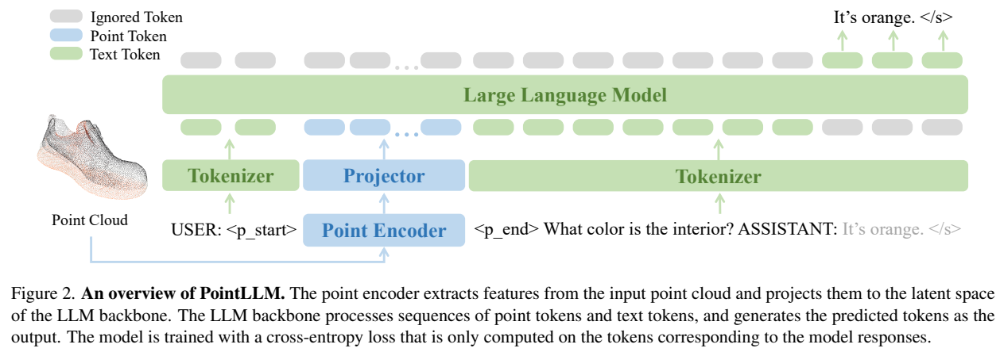
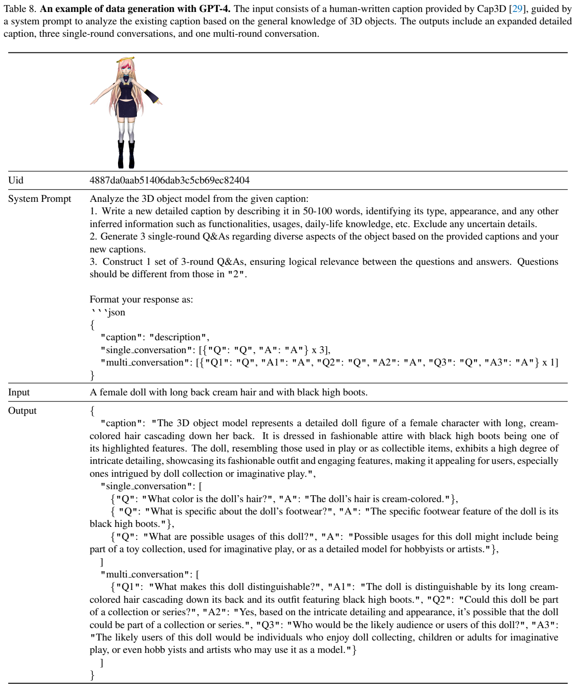
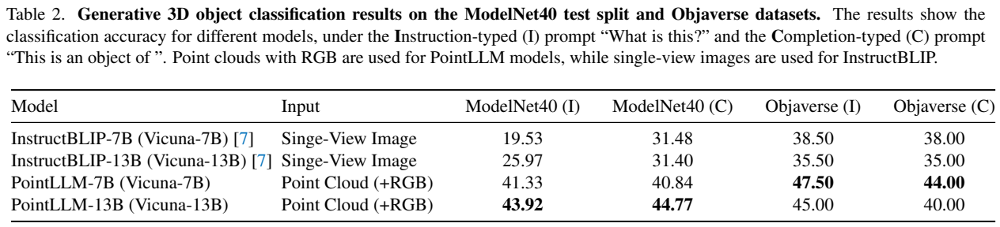
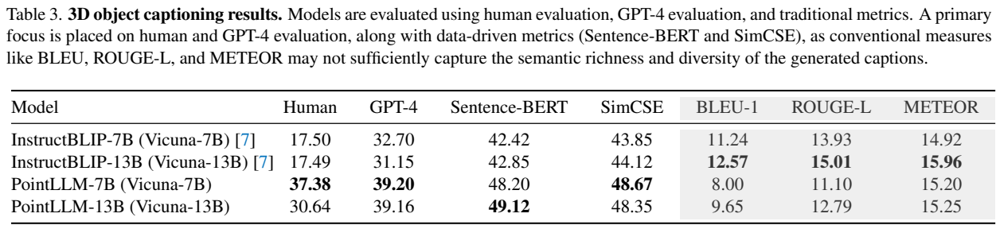
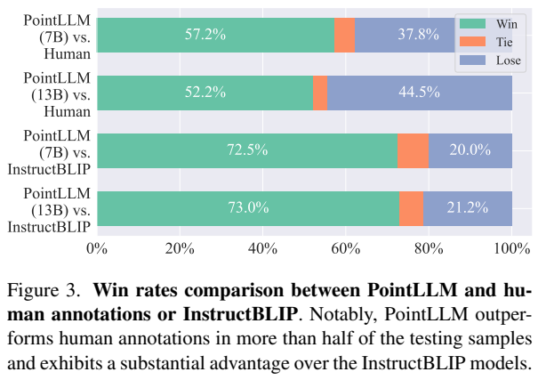
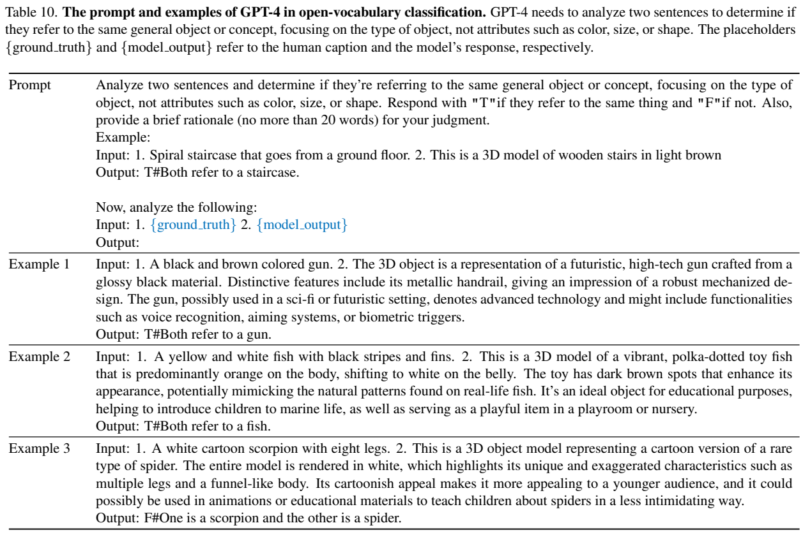

<!-- article-header:start -->
[项目首页](../../../README.md) › [模型系列](../../../reports/model-family-index.md) › [PointLLM](../README.md)
<!-- article-header:end -->

# PointLLM：让语言模型直接理解带颜色的三维物体点云

<!-- article-toc:start -->

**本篇目录** · [论文定位](#paper-info) · [快速概览](#overview) · [整体架构](#architecture) · [核心原理](#principles) · [数据构建](#data) · [训练流程](#training) · [实验结果](#experiments)
<!-- article-toc:end -->

## 1. 论文信息与模型定位

《PointLLM: Empowering Large Language Models to Understand Point Clouds》由 Runsen Xu、Xiaolong Wang、Tai Wang、Yilun Chen、Jiangmiao Pang、Dahua Lin 提出，来自香港中文大学、上海人工智能实验室及浙江大学。本文依据 [arXiv 2308.16911v1](https://arxiv.org/pdf/2308.16911v1)（2023 年 8 月 31 日）；官方项目为 [OpenRobotLab/PointLLM](https://github.com/OpenRobotLab/PointLLM)。

PointLLM 输入一个三维物体的带颜色点云及文字指令，生成类别、描述或对话回答。它用 Point-BERT 提取点云特征，再连接 Vicuna 7B/13B。相对于单张渲染图，点云可以提供完整物体几何及不同方向的表面信息；但研究对象主要是物体模型，不能据此认定已解决真实扫描缺失、复杂场景理解或机器人动作控制。三维生成在报告中仍是未来方向。

## 2. 快速概览

| 环节 | 原文设计 |
| --- | --- |
| 点云输入 | 8192 个点，每点 xyz 和 RGB 六维信息 |
| 点云编码 | 采用 ULIP-2 路径重新预训练带颜色输入的 Point-BERT |
| 模态连接 | 513 个点云特征经线性层映射到语言嵌入维度 |
| 对齐数据 | 约 660K 简短描述指令 |
| 指令微调 | 15K 物体上的约 70K 复杂指令 |
| 评价 | 生成式分类和物体描述，结合人工、GPT 与文本指标 |

结果主要说明直接点云输入在该评测中优于单视角 InstructBLIP。更大语言模型并非稳定更好：13B 的 ModelNet40 分类较高，而 7B 的 Objaverse 分类和人工描述评分较高。数据与表示可能比简单增加语言参数更关键。

## 3. 整体架构

Figure 2 蓝色路径从点云编码器进入 projector，绿色路径是文字 token。`<p_start>`、`<p_end>` 标记点云嵌入区域，后接用户问题；语言模型预测回答。上方灰色位置代表不计入损失的 token，只有回答与结束标记接受监督。因此它不是要求模型重建全部点坐标，而是学习根据点云与对话上下文预测文字。

Point-BERT 按 ULIP-2 的思路把点云表示与 CLIP 相关空间对齐。原 ULIP-2 实现处理 xyz，作者重新训练支持 xyzrgb 的编码器，使用 OpenCLIP ViT-L/14 和 Cap3D 物体来源。之后才进入 PointLLM 的两阶段语言连接训练，不能将这一视觉预训练与语言指令训练混成同一步。

点云编码器输出 513 个、各 1152 维的特征，经线性投影变为语言模型嵌入。第 6 页将 7B 与 13B 的输出宽度均写成 5120，未解释此处与两个骨干配置的关系；本文只确认“与各语言模型嵌入空间匹配”的架构要求，不把该数字当作两种模型的已验证实现配置。ModelNet40 没有 RGB，实验给这些点统一黑色。[PDF 第 4、6 页](https://arxiv.org/pdf/2308.16911v1#page=6)

## 4. 核心创新与数学原理

模型将点集合 $`P\in\mathbb R^{n\times6}`$ 编成特征 $`X=f_{pe}(P)\in\mathbb R^{m\times c}`$，再投影为 $`Y=f_{proj}(X)\in\mathbb R^{m\times c'}`$。投影不改变这里的特征位置数 m，主要改变通道，使连续点云特征能够作为语言模型的输入嵌入。

原文式（1）写作 $`\hat z_i=f_{llm}(Z_{<i})`$，式（2）再经词表映射选择概率最大的文字 token。点云、指令、历史回答共享因果上下文，但输出仍限定在文字词表。点云输入不是把每个 xyz 直接打印成一串数字，也不是先渲染图像后以图像 token 作为主输入。

对原文第 5 页的负对数似然描述，可用下式明确监督掩码：

$$\mathcal L=-\sum_{t\in\mathcal R}\log p_\theta(w_t\mid P,\text{instruction},w_{<t}),$$

其中 $`\mathcal R`$ 只包含助理回答和 `</s>`。这是对原文训练文字的解释式，论文没有把它列为新编号损失。用户指令、点云占位嵌入不计入文字预测损失。第一阶段通过固定语言模型来学习投影器，第二阶段开放语言模型，以适应复杂问答。

另一项重要贡献是把分类改成生成任务：模型可回答“杯子”“咖啡杯”等不同表达，不要求输出固定类别编号。评价再判断语义是否一致，这更接近交互使用，但引入了另一个语言模型作为后处理或评判器。最终分类准确率包含该评判过程，不能直接当成固定分类头的独立准确率。

## 5. 数据构建与处理

简短描述使用 Cap3D 的模型生成 caption 分支，约 660K 个 Objaverse 物体，每个搭配 30 种简短请求中随机一种。Cap3D 另有约 40K 人工描述物体，复杂指令从其中选择 15K 个、caption 超过五个词的物体。正文明确简短描述主要用模型生成分支，附录 Table 6 表注却写 human-written caption，存在口径差异；这里采用方法正文的说明，避免把 660K 全部称为人工标注。

Table 8 中间是 GPT-4 的生成要求，下方对比简短输入与扩展输出。输入只描述娃娃的头发和靴子，输出补充用途、受众等信息。生成器获得的是已有文字 caption，并没有在这个步骤直接读取点云；用途类回答因而来自文字推断与常识，不能都看作可见几何的准确标注。

每个物体要求生成一个 50–100 词详细描述、三个单轮问答、一个三轮对话，经过错误输出过滤后得到约 70K 样本：15K 详细描述、40K 单轮对话、15K 多轮对话。详细描述也从 30 种请求中随机搭配。报告没有给出完整错误过滤规则、逐项事实核验率和重复样本阈值。

作者从 660K 来源中预留 3000 个物体，不参与点云编码器预训练和后续 PointLLM 训练；用于 Objaverse 分类与描述评测的 200 个物体取自这组保留对象。这是该协议下的对象隔离，不等于所有公开预训练语言资料与测试描述都已做完全重合检查。[PDF 第 3–4、6 页](https://arxiv.org/pdf/2308.16911v1#page=3)

## 6. 训练流程与目标

| 阶段 | 可训练模块 | 数据 | epoch | batch | 学习率 |
| --- | --- | --- | ---: | ---: | ---: |
| 特征对齐 | 线性投影器及新边界 token 嵌入 | 简短描述 | 3 | 128 | 2e−3 |
| 指令微调 | 投影器与语言模型 | 复杂指令 | 3 | 32 | 2e−5 |

点云编码器在这两个阶段始终冻结；第一阶段语言模型冻结，第二阶段联合训练语言模型，而非报告中的 LoRA 设置。第一阶段同时调整新增点云边界标记的嵌入，不能说除线性层外所有参数绝对不变。

训练使用 8 张 A100 80GB、BF16、FlashAttention、AdamW 和余弦学习率。13B 两阶段分别约 20 与 5 小时；这不是 7B 的明确耗时。原文未披露完整权重衰减、warm-up、语言上下文长度以及对应优化步骤数，不从三轮数据推算出看似精确的步数。[PDF 第 5–7 页](https://arxiv.org/pdf/2308.16911v1#page=7)

数据量上 660K 与 70K 对应来源和样本的概略规模，保留对象及多轮结构会影响实际训练实例。训练目标都围绕回答的 next-token prediction，没有另外训练物体坐标回归、奖励模型或点云生成 decoder。

## 7. 实验设置与主要结果

Table 2 分为 ModelNet40 与 Objaverse，每项又区分 instruction 型问题和 completion 型前缀。PointLLM 使用点云，InstructBLIP 使用单张渲染图，输入信息覆盖不同，不能将其视为同一视觉输入下仅换语言模型的受控实验。

| 模型 | ModelNet40 问句 | ModelNet40 前缀 | Objaverse 问句 | Objaverse 前缀 |
| --- | ---: | ---: | ---: | ---: |
| InstructBLIP-7B | 19.53 | 31.48 | 38.50 | 38.00 |
| InstructBLIP-13B | 25.97 | 31.40 | 35.50 | 35.00 |
| PointLLM-7B | 41.33 | 40.84 | 47.50 | 44.00 |
| PointLLM-13B | 43.92 | 44.77 | 45.00 | 40.00 |

ModelNet40 是未见该数据集的闭集零样本识别，但语言回答先由 ChatGPT 映射到 40 类。若返回无法推断，附录规定随机选一类；候选列表不是主比较中直接交给模型的输入。Objaverse 则由 GPT-4 判断回答与人工 caption 的对象类别是否一致。

Table 10 明确关注对象类型，忽略颜色、大小、形状等属性。第二个示例的颜色和花纹与参考不同，仍因都称“鱼”判为正确。该分类分数不能证明所有描述细节正确。第一作者人工检查 50 个分类判断，与 GPT-4 达到一致；这是小样本检查，并非所有复杂描述评判的独立盲审。

描述评价使用同一 200 个物体。两名人工评判者查看三维对象、按正确信息打分并比较同组 caption；报告人工分数乘 10。7B/13B 人工分为 37.38/30.64，GPT-4 分为 39.20/39.16。InstructBLIP-7B 人工为 17.50、GPT-4 为 32.70。GPT 描述分主要计算参考信息的覆盖比例，不能自动发现参考之外所有新增事实的真伪。

PointLLM-7B 的 BLEU-1、ROUGE-L 是 8.00、11.10，低于 InstructBLIP-7B 的 11.24、13.93；语义嵌入相似度和人工评分则更高。论文的飞机示例说明严格词面重合会漏掉近义表达，但这不意味着传统指标可一律忽略。

Figure 3 显示 7B/13B 对人工参考 caption 的胜率约 57.2%/52.2%，正文给更精确值 57.25%/52.25%。它是在 200 个对象、两名评判者及特定信息评分下胜过简短参考描述，不是普遍超越人的三维理解。没有报告多视角视觉大模型、真实稀疏扫描和场景级任务的全面比较。本文核验的是论文及原表，不声称运行或复现模型。

<!-- article-footer:start -->
---

[← 上一篇：Qwen-VL](../../qwen/arxiv-2308.12966/README.md) · [按发表时间浏览](../../../reports/paper-reading-guide.md#year-2023) · [下一篇：CM3Leon →](../../cm3leon/arxiv-2309.02591/README.md)

[返回本篇目录](#article-toc) · [返回模型系列](../README.md)
<!-- article-footer:end -->
