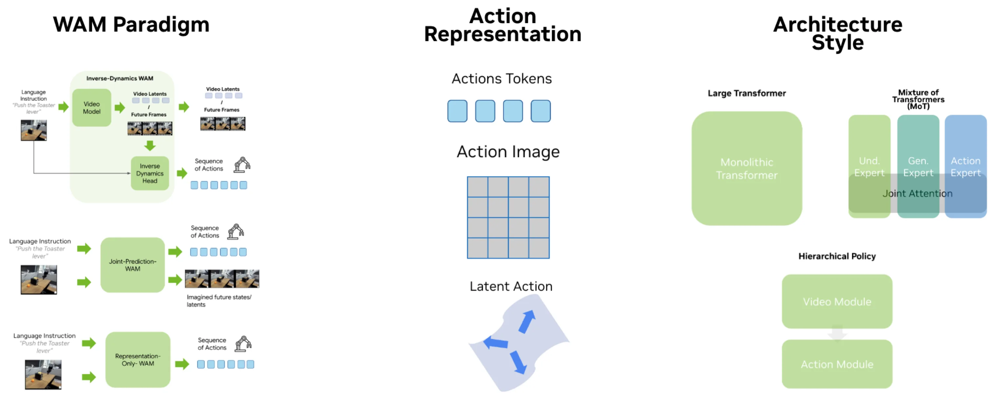
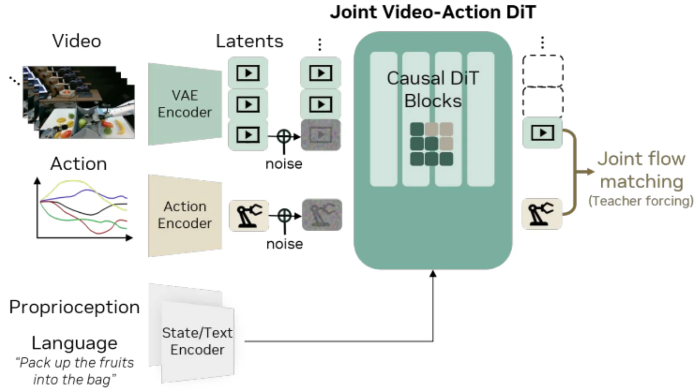
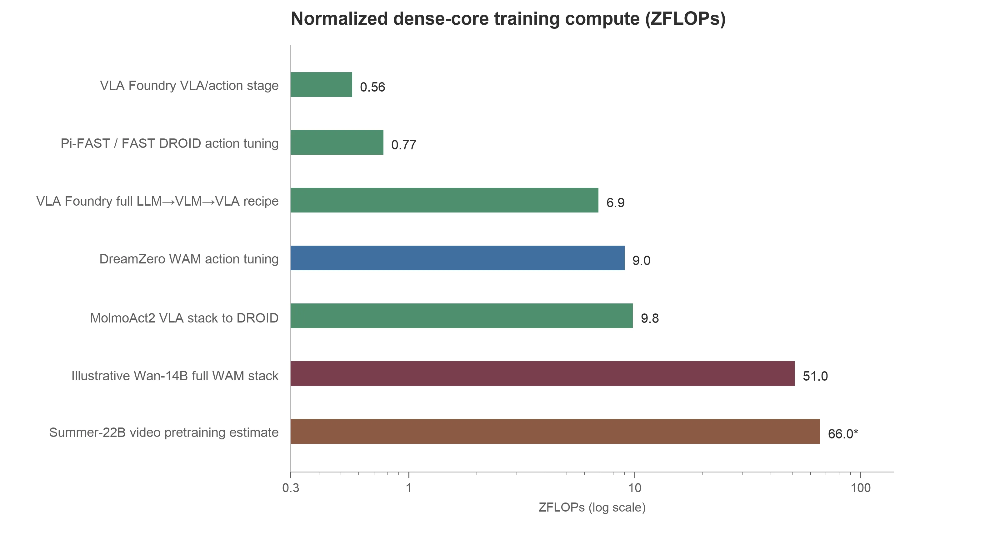
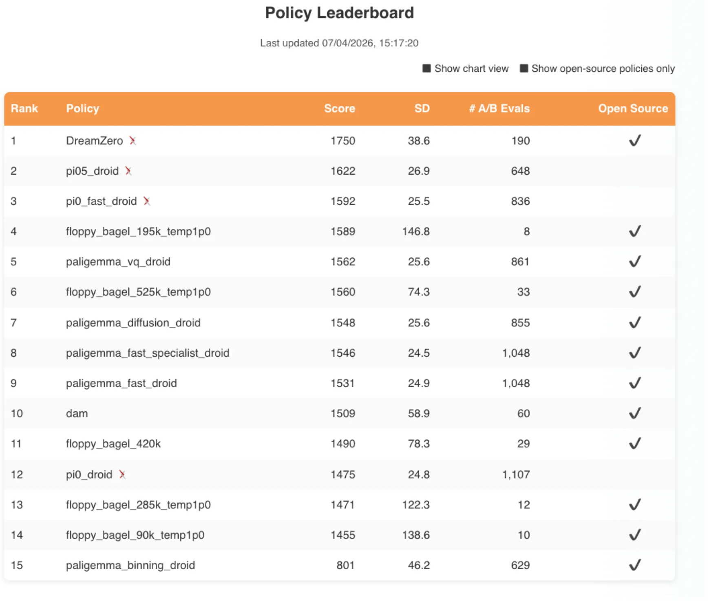

<!-- article-header:start -->
[项目首页](../../../README.md) › [模型系列](../../../reports/model-family-index.md) › [Pretrained to Imagine, Fine-Tuned to Act: The Rise of World-Action Models](../README.md)
<!-- article-header:end -->

# 世界动作模型：从视频预训练到机器人控制的设计空间

<!-- article-toc:start -->

**本篇目录** · [论文定位](#paper-info) · [快速概览](#overview) · [整体架构](#architecture) · [核心原理](#principles) · [数据构建](#data) · [训练流程](#training) · [实验结果](#experiments)
<!-- article-toc:end -->

## 1. 论文信息与模型定位

本文对应 NVIDIA Technical Blog 的 [Pretrained to Imagine, Fine-Tuned to Act: The Rise of World-Action Models](https://developer.nvidia.com/blog/pretrained-to-imagine-fine-tuned-to-act-the-rise-of-world-action-models/)，作者 Moritz Reuss，发表于 2026 年 6 月 15 日。本介绍依据 2026 年 10 月 8 日保存的官方网页版本。原文是一篇有技术细节、参考文献和成本推导的研究综述博客，没有提出一个叫“World-Action Models”的单独模型，也没有统一的自研训练数据或实验表。

文章讨论的 World-Action Model，简称 WAM，是把视频或世界模型的表征、预测能力用于输出机器人动作的策略系统。普通世界模型能够预测场景如何变化，却未必知道机械臂每个关节该怎么运动。只有把未来预测与真实可执行动作连接起来，才进入这里讨论的机器人策略范围。文章特别区分了 Genie 一类模型的潜在动作与真实机器人控制指令：前者能够控制生成世界里的变化，不等于已获得现实硬件控制接口。

其研究问题是：以理解图像和语言为起点的 VLA，与以预测未来视觉状态为起点的 WAM，各自提供什么先验，怎样接入动作，训练和推理成本是什么，两条路线是否会汇合。文章中的行业展望属于作者观点；模型的具体结论仍应回到被引用论文的协议与数据范围理解。

## 2. 快速概览

| 阅读问题 | 原文的主要回答 |
|---|---|
| 为什么尝试视频主干？ | 未来状态变化可能帮助解释动作，视频预训练可能改善语言与物理状态的联系，也可能缓解机器人数据有限的问题；这三个动机首先是待检验假设。 |
| 策略如何利用视频？ | 先预测未来再做逆动力学、同时预测视频和动作、只保留学到的表示而不在推理时生成视频。 |
| 动作怎样进入系统？ | 独立动作 token、把动作编码成图像或伪视频帧、通过潜在计划连接未来观测与动作。 |
| 网络如何组织？ | 分层管线、共享主干的整体 Transformer、专用权重与共享注意力结合的 Mixture of Transformers。 |
| 主要代价是什么？ | 视频 token 长、视频预训练昂贵，生成未来视频还会增加控制延迟。 |
| 是否证明 WAM 全面优于 VLA？ | 没有。原文认为数据、模型规模、评测环境和成本口径尚不足以给出统一赢家。 |

文章的价值在于提供一套阅读不同论文的方法。比较模型时，应先问未来信息怎样影响动作，再问动作表示，最后问权重与注意力如何共享；把这三个问题混为一个分类，会掩盖真正的技术差异。[来源：原文 “Three design axes”“Closing thoughts”]

## 3. 整体架构

**原文 Figure 8 的读法。** 左列从预测范式入手：上方由视频预测和逆动力学头组成；中间同时输出动作与未来视觉状态；下方在推理阶段直接输出动作。中列描述动作的表示形式，右列描述网络组织。横向三列可以交叉组合，不能把某一行简单理解成一种固定模型。图中 MoT 各模块通过 Joint Attention 交换信息，但具有各自的权重；它与靠门控选择少量专家的稀疏 MoE 并不是同一个设计概念。

分层逆动力学路线可以先产生期望未来，再由控制器根据当前与未来状态推断动作。早期 UniPi 用视频扩散模型生成未来帧，再通过逆动力学 CNN 得到动作；现代路线可以直接使用视频潜变量，不必每次解码完整 RGB 视频。视频模块提供“将会怎样”，动作模块负责“该怎样做到”，两者之间的接口决定是否能保持时序和执行一致性。

联合预测路线让未来视频与动作参与同一次生成。DreamZero 使用 Wan 2.1 图生视频 14B 主干，把观测编码成 VAE 潜变量，把动作编码成另一组 token，以语言与自身状态为条件，在共享 DiT 中对视频与动作联合去噪。这里视频既是训练目标，也能在推理时约束动作。LingBot-VA 则采用 Wan 2.2-5B 与 MoT 组织，视频专家和动作专家拥有专用参数，通过注意力交换信息，原文将其列在逆动力学范式中。[来源：原文 DreamZero、LingBot-VA 及 Table 4]

**原文 Figure 15 的读法。** 上路的视频经 VAE 编码，中路动作经 Action Encoder 编码，两路加噪后进入 Causal DiT Blocks；下路语言和 proprioception 提供条件。右侧同时监督视频与动作的流匹配目标。图强调共同建模的接口，不应据此推断所有 WAM 都必须共享全部参数，或者必须以同样的噪声时序训练。

还有两条更轻的路线。Fast-WAM 在训练时利用视频辅助目标，部署时省去未来视频生成，尝试保留表示收益并降低延迟。Being-H0.7 用未来观测的 V-JEPA 表征训练后验潜在计划，再让先验仅根据可获得的信息预测该计划，动作策略以计划为条件。推理时移除需要真实未来的后验分支，因而不需要先生成未来 RGB 视频。后者的“潜在计划”具有片段或目标层面的含义，不能一律当作已经对应某个电机动作的潜在动作码。

## 4. 核心创新与数学原理

文章的核心贡献是组织已有方法，而不是给出一套新的、完整推导的统一损失。为帮助理解，下面用统一符号重新表达三种范式；这些式子是本介绍的解释性抽象，不是原文逐字公式。令当前观测为 $`o_t`$，语言为 $`\ell`$，未来视觉状态为 $`v_{t+1:t+H}`$，动作片段为 $`a_{t:t+H-1}`$。

逆动力学可写成两个接口：

$$
\hat v\sim p_\phi(v\mid o_t,\ell),\qquad
\hat a\sim p_\theta(a\mid o_t,\hat v,\ell).
$$

视频分布确定希望达到的变化，逆动力学分布把变化转成控制。困难在于同一视觉结果可能由多种动作实现，生成的未来还可能违反机器人可达性，因此“画面像真的”不足以证明动作可执行。联合预测则把两个输出置于同一分布 $`p_\theta(v,a\mid o_t,\ell)`$，利用视频与动作的相关性共同学习；表示路线只要求动作策略使用视频预训练特征，部署时可以没有视频采样环节。

潜在计划的关键是训练与推理的信息不对称。训练时后验 $`q(z\mid o_t,v,\ell)`$ 能看到真实未来，先验 $`p(z\mid o_t,\ell)`$ 只能看到当前条件；通过匹配两者，使部署时的先验近似提供后验学到的未来意图。原文解释 Being-H0.7 的先验与后验桥接机制，没有为本文所有方法提供一个共同的 KL 或匹配损失，所以这里也不指定某个统一损失权重。

作者另一个明确写出的数学工具是算力估算：

$$
C_{\mathrm{train}}\approx6N_{\mathrm{train}}T,
\qquad1\ \mathrm{ZFLOP}=10^{21}\ \mathrm{FLOPs}.
$$

$`N_{\mathrm{train}}`$ 是训练的密集参数数，$`T`$ 是处理 token 总量。系数 6 是密集 Transformer 核心前向与反向的粗略合计，不能直接套到卷积视频网络，也不包括全部系统成本。序列增长一方面增加这个近似中的 token 项，另一方面还会增加注意力、显存和通信开销。视频先验减少机器人样本需求，仍可能增加总计算需求，两种“效率”应分别判断。[来源：原文 “Practical considerations” 与 Footnote 1]

## 5. 数据构建与处理

本文没有统一的数据集，其比较横跨网页视频预训练、机器人示范、人类第一视角视频和模拟器数据。文章举例 LingBot-VA 使用约 1.6 万小时机器人数据；Being-H0.7 使用约 20 万小时人类第一视角数据与 1.5 万小时机器人数据，并借助未来视觉表征连接两个来源。小时数描述视频时长，不等于有效独立任务数量，也不能直接与图文对数或机器人动作 token 数相除比较。

作者认为视频主干之所以现在成为可行起点，既与 DiT、时间压缩 VAE 和流匹配进展有关，也与强视频模型开放有关。开发者可以继承已训练的视频先验，但依然需要过滤、标注、解码、潜变量预处理和分布式 I/O。原文强调视频质量可能影响下游策略能力，不过这不是一个对所有模型都已验证的普遍因果定律。

动作表示也决定数据处理方式。独立 token 需要把机器人控制量映射到动作编码；GENIMA 把关节目标画成图像，再由控制器解释；Cosmos Policy 把动作、自身状态及价值信息作为伪 VAE 帧接入视频接口，并从空间布局中解码。表面上都使用视频主干，实际监督结构可能完全不同，不能把它们的数据管线写成一套通用预处理。

文章还提及 Generalist 的 GEN-1 以约 50 万小时 UMI 风格可穿戴数据为机器人优先预训练路线的例子。这是所引用行业工作的数据规模，不是本博客自己收集并验证的数据。作者据此讨论大规模真实交互数据的获取门槛，而没有发布可供本文复现的数据清单、过滤阈值或统一去重规则。

## 6. 训练流程与目标

文章比较两类初始化：VLA 通常继承图文语言模型，再学习动作；WAM 通常继承视频模型，再让未来状态预测与动作控制结合。早期 GR-1 以视频预训练后的视频和动作联合学习为例，DreamZero 的现代联合 DiT 使用流匹配，Fast-WAM 以视频辅助目标训练但在推理阶段删去视频生成路径。这些是不同论文的流程，不能组合成本文提出的一条“三阶段标准训练法”。

作者同时讨论 VLA 的保留能力问题：离散语言下一 token 预测与连续动作去噪的优化形式不同，直接接入动作损失可能破坏已学图文能力。现代策略通过 FAST 等离散动作表示、继续混合图文数据，以及隔离流匹配动作头对主干的梯度，缓解这种冲突。推理时又可以走连续动作头，省去慢速自回归动作 token 路径。这里强调的是优化接口和保留能力，不是声称每个模型都采用相同冻结配置。

**原文 Figure 24 的读法。** 横轴为对数坐标，不能按条形长度作线性倍数比较。绿色、蓝色及其他颜色的条目覆盖不同成本范围：Foundry 的最终动作训练约 0.56 ZFLOPs，完整小型 LLM→VLM→VLA 配方约 6.9；DreamZero 的动作适配约 9.0，未计 Wan 预训练；MolmoAct2 的约 9.8 是将报告的 9,216 H100 小时转成的等价估算，还继承了上游模型；Summer-22B 的约 66 由 500B token 的尺度估算。图中的 51 是用 Summer 的 token 预算作为 Wan-14B 视频预训练代理再加动作适配的示意值，不是 DreamZero 官方公布的全流程算力。

原文脚注以约 30% 的 H100 密集 BF16 利用率，将 1 ZFLOP 对应到约 936 H100 小时；这是直觉换算，没有包含编码器、VAE、优化器、数据加载、额外注意力项与通信。因此不能把这些条目转换成精确租赁价格，或用其直接宣称某模型的端到端成本低于另一个。本文也没有统一公开的 GPU 配置、学习率、训练步数或冻结方案供所有 WAM 复现。

## 7. 实验设置与主要结果

**原文 Figure 16 的读法。** 表中 Score 是榜单的 Elo 风格评分，并非任务成功率。DreamZero 为 1750，Pi-0.5-DROID 为 1622，Pi-FAST-DROID 为 1592，Pi-0-DROID 为 1475；旁边列出的 SD 与 A/B 评测数也重要，因为条目试验数量并不一致。这是原文引用的 2026 年 4 月历史快照，不能表述为当前排行榜。DreamZero 在该设置中的优势提供了视频先验值得研究的信号，但模型规模、预训练来源、优化方式不同，不能从这张表单独识别“视频主干”带来的净因果收益。

文章引用的另一类证据是受扰动模拟评测：LingBot-VA、Cosmos Policy 和 Pi-0.5 在 LIBERO-Plus、RoboTwin 2.0-Plus 的比较表明某些 WAM 能获得较强鲁棒性。不过实验主要位于模拟环境，不能直接推导真实世界跨机器人泛化结论。原文援引 Fast-WAM 的代表性延迟，含测试时视频生成的策略约 590–800 ms 每动作片段，Pi-0.5 约 190 ms；硬件、去噪步数和动作长度影响结果，这不是本文统一硬件重新测量的数据。

作者自己做的 Veo 3.1 小实验则是定性观察：给定一张烤面包机附近的机械臂画面，要求按压拨杆后拿起橙子，单次提示、没有优化。生成片段看似连贯，却可能没有按到底、反向提拉，或者让夹爪变成额外手指。它说明视觉流畅不能替代机器人运动学与任务完成检查，未形成真实机器人成功率实验；训练集中是否存在类似场景也没有核实。

最终，文章主张用更可靠的泛化评测判断 WAM、VLA 与混合策略。Pi-0.7 的视觉子目标、Being-H0.7 的潜在计划和 Motus 一类多专家体系显示两条路线正在互相借鉴，但“未来必然由混合路线主导”仍是作者判断。读者可以用本篇的三轴框架组织后续论文，真正选型时则应继续核对真实控制成绩、数据覆盖、部署延迟和成本边界。[来源：原文 “Why the modern VLA baseline still matters”“Are the two representation roads actually one?”“Closing thoughts”]

<!-- article-footer:start -->
---

[← 上一篇：Cosmos 3](../../cosmos/arxiv-2606.02800/README.md) · [按发表时间浏览](../../../reports/paper-reading-guide.md#year-2026) · [下一篇：Qwen-RobotWorld →](../../qwen/arxiv-2606.17030/README.md)

[返回本篇目录](#article-toc) · [返回模型系列](../README.md)
<!-- article-footer:end -->
