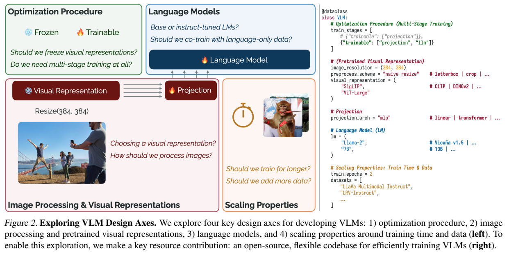
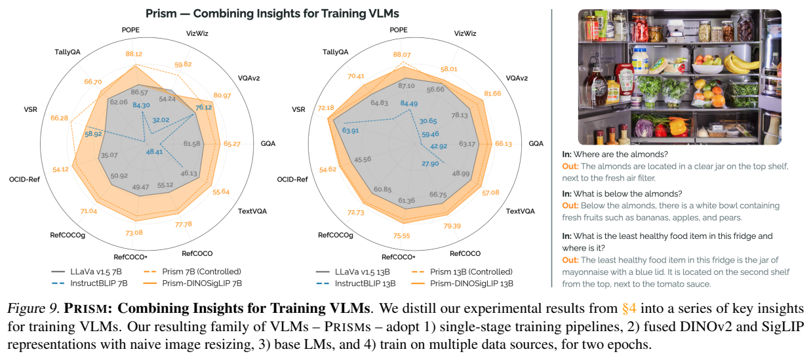
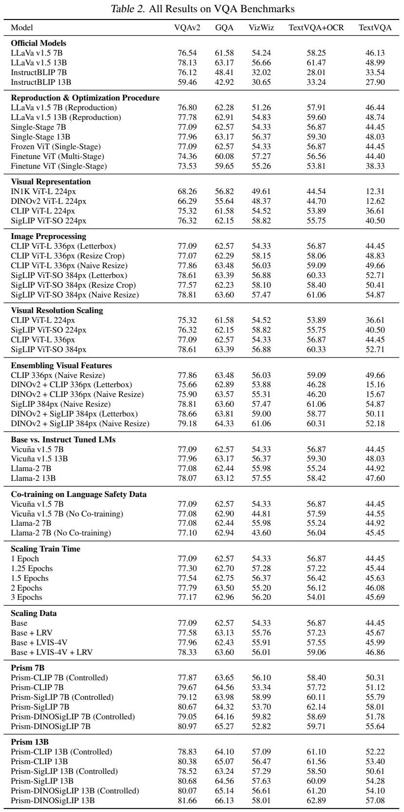
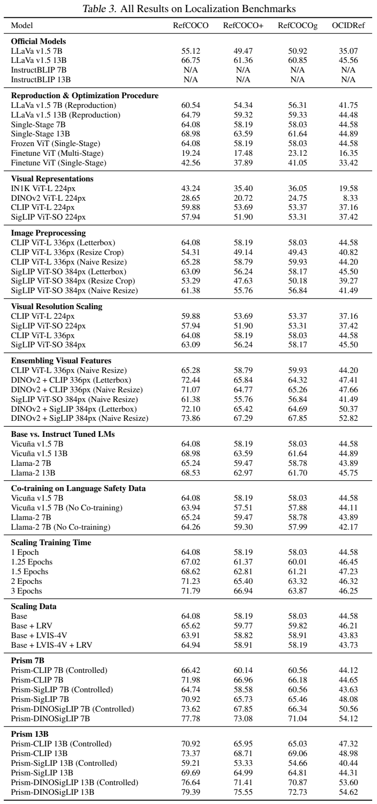

<!-- article-header:start -->
[项目首页](../../../README.md) › [模型系列](../../../reports/model-family-index.md) › [Prismatic](../README.md)
<!-- article-header:end -->

# Prismatic VLMs：用控制变量实验探索视觉语言模型的设计空间

<!-- article-toc:start -->

**本篇目录** · [论文定位](#paper-info) · [快速概览](#overview) · [整体架构](#architecture) · [核心原理](#principles) · [数据构建](#data) · [训练流程](#training) · [实验结果](#experiments)
<!-- article-toc:end -->

## 1. 论文信息与模型定位

| 项目 | 内容 |
|---|---|
| 原论文 | **Prismatic VLMs: Investigating the Design Space of Visually-Conditioned Language Models** |
| 作者与机构 | Siddharth Karamcheti、Suraj Nair、Ashwin Balakrishna、Percy Liang、Thomas Kollar、Dorsa Sadigh；Stanford、Toyota Research Institute |
| 版本 | 2024-02-12，arXiv:2402.07865v1，22 页 |
| 来源 | [固定版本原文](https://arxiv.org/pdf/2402.07865v1)；[训练仓库](https://github.com/TRI-ML/prismatic-vlms)；[评测仓库](https://github.com/TRI-ML/vlm-evaluation) |
| 定位 | 视觉编码器＋投影器＋自回归语言模型的系统研究，并发布 7B/13B 语言骨干规模的 PRISM 系列 |

Prismatic 主要回答“哪些设计选择真正影响 VLM 表现”，而非提出一种全新的注意力机制。作者先复现 LLaVA-1.5，再逐项改变训练、视觉输入与语言骨干，最后将实验结论整合为 PRISM。以下内容固定于 v1，不能把后续仓库加入的骨干或模型规模当成本报告实验。

## 2. 快速概览

论文提供统一训练代码、客观指标评测套件和模型检查点。主体评测覆盖 11 个任务：四个视觉问答、四个指代定位、三个空间关系/计数/幻觉挑战集。

在研究所用数据规模和架构内，单阶段训练可以省去单独的投影器对齐；冻结视觉骨干优于直接全量微调；DINOv2 与 SigLIP 融合有利于定位；基础语言模型不必先进行聊天微调；多训练一个 epoch 和增加多样化图像数据能够改善部分任务。它们都是有实验条件的结论，不能解释为所有 VLM 都应冻结视觉端或采用同样配方。

## 3. 整体架构

**读图：** 图像经过视觉表示和投影后作为语言模型的输入前缀。四个彩色区域对应优化流程、视觉输入、语言骨干和训练规模；右侧代码示例强调组件可以替换。

基础系统采用 ViT 倒数第二层的 patch 特征。两层 GELU MLP 独立投影每个 patch，投影后的序列放在文本提示左侧，自回归语言模型生成答案，也能以文本输出归一化框坐标。它没有专门的目标检测头，也没有 PixelLLM 式的并行坐标回归头。

PRISM 的主要融合版本采用 DINOv2＋SigLIP、384px 输入和直接缩放到正方形的处理，语言骨干采用 Llama-2 基础模型。融合是在对应 patch 的**通道维**拼接：投影器输入维度增加，但送入语言模型的视觉 token 数不加倍。两个视觉骨干仍有各自的参数和计算成本，不能把“投影器增加参数很少”说成整个融合系统不增加成本。

## 4. 核心创新与数学原理

论文的形式化模型为：

$$
p_{\rm img}=V_\omega(x_{\rm img}),\qquad e_{\rm img}=F_\psi(p_{\rm img}),\qquad u_{\rm gen}=LM_\theta([e_{\rm img};\operatorname{embed}(u_{\rm prompt})]).
$$

给定图像、提示与目标回答，优化条件负对数似然：

$$
\mathcal L=-\log p(\hat u_{\rm gen}\mid x_{\rm img},u_{\rm prompt}).
$$

本文没有新造“融合对比损失”。两种视觉表示直接拼接后交给同一 MLP，学习信号仍来自答案生成。DINOv2 更偏空间结构、SigLIP 更偏图文语义互补，是作者对结果的解释，未被单独证明为唯一因果机制。

作者先确认复现实现，再进行单步修改；单阶段训练被验证后成为后续实验共同基线。不同任务的原始分数量纲不一致，作者按模型集合的均值和标准差转换为 Z-score，再对比较差值进行单侧检验。附录显著性阈值为 **p<0.01**：单阶段 p=0.007、融合 DINOv2＋SigLIP p=0.00162，达到该阈值；直接缩放 p=0.0148、增加数据 p=0.0138 未达到该阈值，不能一律称“统计显著”。雷达图坐标包含归一化处理，不能拿多边形面积作原始平均准确率。

## 5. 数据构建与处理

主要控制实验使用 LLaVA-1.5 数据。两阶段基线的首阶段有 558K 图文对，来自 LAION、Conceptual Captions、SBU，并使用 BLIP 生成描述；第二阶段有约 665K 指令样本，分项为：158K LLaVA 合成对话/描述/问答，224K 标准 VQA，50K A-OKVQA 选择题，22K TextCaps，116K 指代和区域描述，40K ShareGPT 纯文本对话。这些数量是原文四舍五入的统计。

单阶段跳过首阶段及其 558K 数据，直接训练指令混合。进一步扩大数据时加入 GPT-4V 基于 LVIS 图像生成的 LVIS-Instruct-4V，以及强调图像种类多样性的 LRV-Instruct。Controlled 版本与 LLaVA-1.5 使用相同数据和训练预算；完整 PRISM 使用更多数据并训练两个 epochs，两类配置必须分开比较。

图像预处理比较中心裁剪、等比例补边和直接拉伸为正方形。裁剪可能丢失全场景对象，补边增加无信息像素；拉伸仍会改变形状，本文的优势只是这些基准下的观察。纯语言 ShareGPT 同时带有拒绝不当请求的示例，作者的定性探测表明移除它会削弱基础模型的输出约束；报告并没有系统性的安全成功率。

## 6. 训练流程与目标

两阶段基线先冻结视觉端与语言端，只训练投影器；再冻结视觉端，联合训练投影器和语言模型。单阶段从随机初始化投影器开始，直接执行后一个流程。作者报告省去对齐阶段节约约 20%–25% 训练成本；同硬件实现对比中 FSDP 的步时比参考实现快约 20%。这是两种不同比较，不能简单相加。

实现采用 PyTorch FSDP、BF16 混合精度，并固定初始化和批次顺序。附录 Table 1：单阶段 batch 128，AdamW，学习率 2×10^-5，weight decay 0.1，梯度范数上限 1.0，warmup 比例 0.03，再余弦衰减。两阶段首阶段改为 batch 256、学习率 10^-3。完整 PRISM 训练两个 epochs；研究中超过两轮的收益总体趋缓，但并非每个任务同时达到峰值。

视觉端全量微调在所用数据下使定位结果明显恶化，例如 RefCOCO 从单阶段冻结视觉端的 64.08 降至 42.56。作者提出数据规模、目标与表示退化等可能原因，没有将这一观察提升为无条件的冻结规则。

## 7. 实验设置与主要结果

**读图：** 虚线 Controlled 和完整 PRISM 不能混作同一配置。Figure 9 的 7B 雷达图一些标签来自 Controlled、一些来自完整模型；精确数值以下以附录对应模型行为准。

评测使用贪心解码和各模型适配的触发提示。VQA 使用官方准确率；RefCOCO/+/g 用框 IoU≥0.5，OCID-Ref 用 IoU≥0.25。POPE 在本文为选择题准确率，不是其他论文常见的 F1。主体 TextVQA 不输入外部 OCR，附录额外列出 TextVQA+OCR。

| 指标 | LLaVA-1.5 7B | PRISM-DINOSigLIP 7B Controlled | 完整 7B | 完整 13B |
|---|---:|---:|---:|---:|
| VQAv2 | 76.54 | 79.05 | 80.97 | 81.66 |
| GQA | 61.58 | 64.16 | 65.27 | 66.13 |
| VizWiz | 54.24 | 59.82 | 52.82 | 58.01 |
| TextVQA，无外部 OCR | 46.13 | 51.78 | 55.64 | 57.08 |
| TextVQA+OCR | 58.25 | 58.69 | 59.71 | 62.89 |

完整 7B 在 VizWiz 低于 LLaVA-1.5 7B；完整版本也低于 Controlled。视觉融合并非每列都提升：DINOv2＋CLIP 的 TextVQA 无 OCR 仅 15.67，低于对应单 CLIP 的 49.66。

PRISM-DINOSigLIP 完整 7B 的 RefCOCO/+/g/OCID-Ref 为 **77.78/73.08/71.04/54.12**，Controlled 7B 为 **73.62/67.85/66.34/50.56**；LLaVA-1.5 7B 为 **55.12/49.47/50.92/35.07**。附录 Table 4 中完整 13B 的 VSR/POPE/TallyQA 为 **72.18/88.07/70.41**，LLaVA-1.5 13B 为 **69.07/87.10/64.83**。

这些结果支持所研究范围内的配方改进，不能照搬“所有模型、所有指标严格超越”。论文没有检验 70B 规模，也未研究 Flamingo/IDEFICS 式交错图文与 Perceiver 架构，评测不能覆盖长期开放式对话。本文仅核对原报告，未执行训练或复现模型。

<!-- article-footer:start -->
---

[← 上一篇：MobileVLM V2](../../mobilevlm/arxiv-2402.03766/README.md) · [按发表时间浏览](../../../reports/paper-reading-guide.md#year-2024) · [下一篇：Gemini 1.5 →](../../gemini/document-1855460a9712/README.md)

[返回本篇目录](#article-toc) · [返回模型系列](../README.md)
<!-- article-footer:end -->
