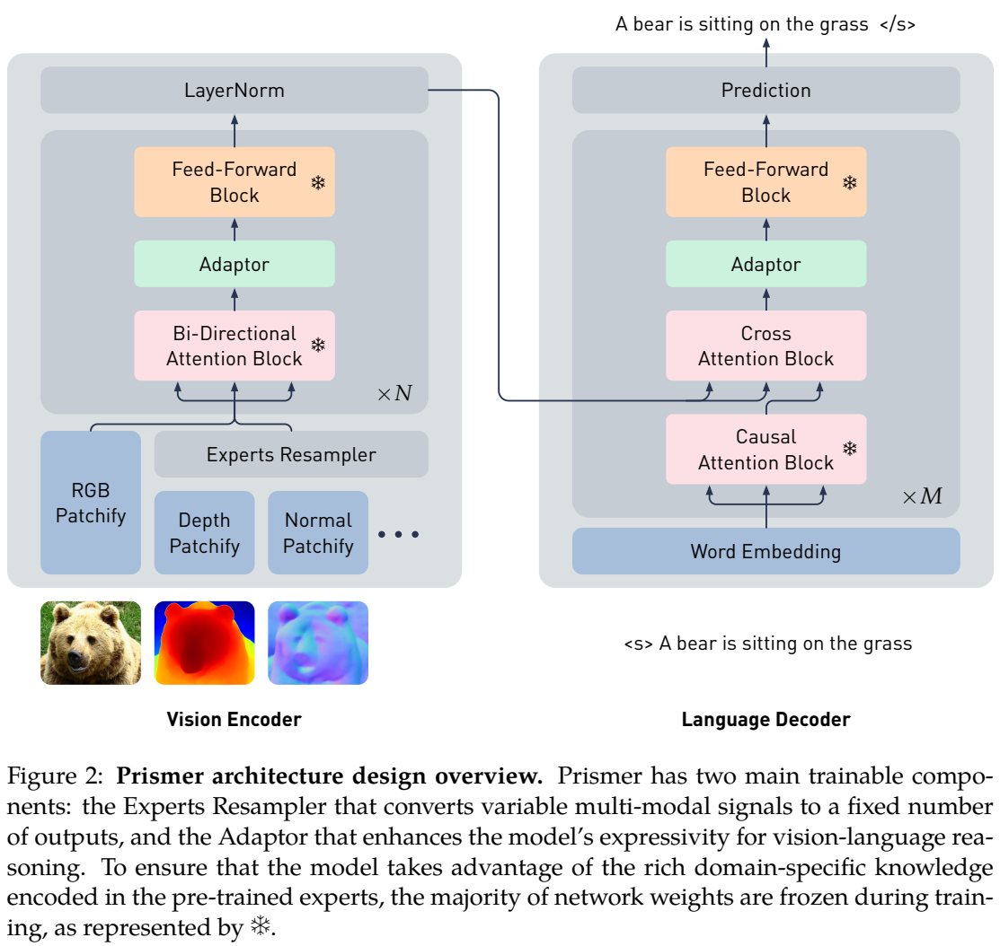
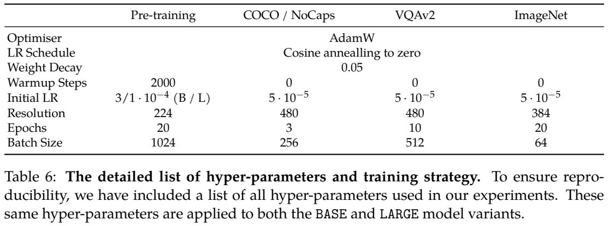
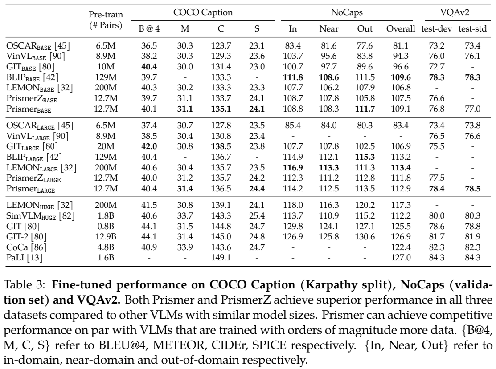
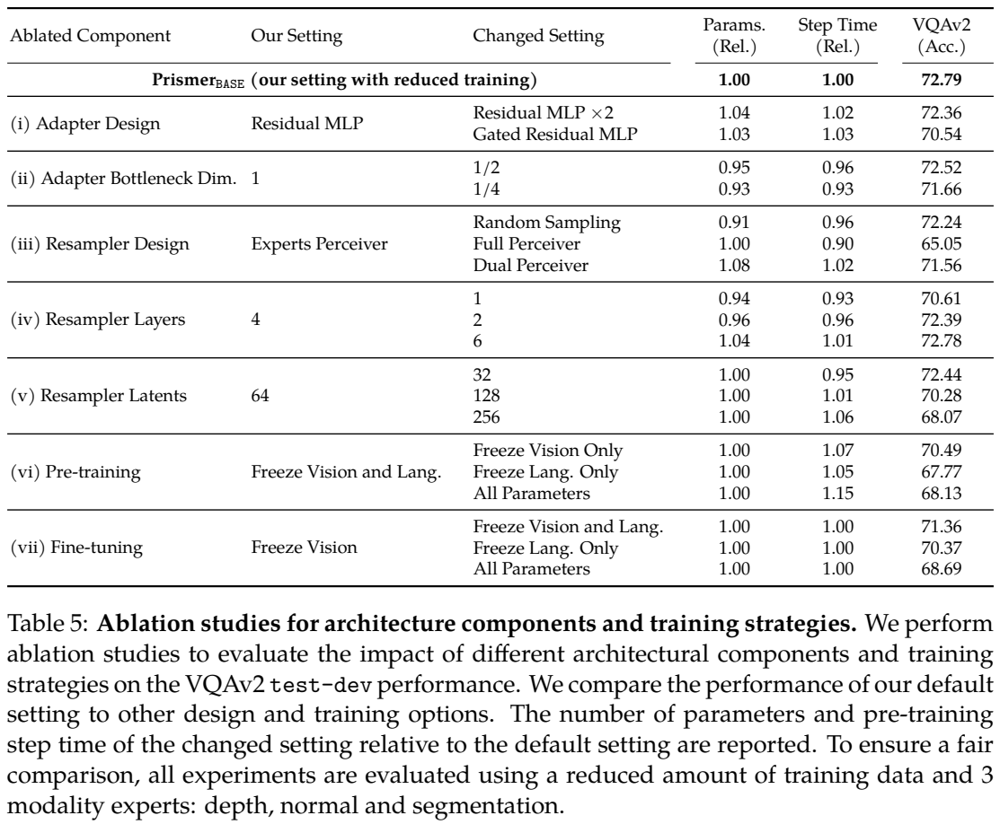

# Prismer：利用独立视觉专家的输出构建视觉语言模型

## 1. 论文信息与模型定位

| 项目 | 内容 |
|---|---|
| 论文 | [Prismer: A Vision-Language Model with An Ensemble of Experts](https://arxiv.org/abs/2303.02506) |
| 作者 | Shikun Liu、Linxi Fan、Edward Johns、Zhiding Yu、Chaowei Xiao、Anima Anandkumar |
| 机构 | Imperial College London、NVIDIA、ASU、Caltech |
| 本文版本 | arXiv **2303.02506v1**，2023 年 3 月 4 日，25 页 |
| 定位 | 参数和数据效率研究；图像描述、视觉问答、图像分类 |
| 项目 | [NVlabs/prismer](https://github.com/NVlabs/prismer) |

Prismer 将深度估计、法向、边缘、分割、物体检测和文字识别模型视作独立专家，先让它们对图像产生辅助信号，再训练统一视觉语言网络使用这些信号。它不是在语言模型前馈层插入门控路由的稀疏 MoE，也不是让语言代理依次调用工具并阅读工具的自然语言回答。其专家是事先训练好的模型，知识通过输出预测进入统一网络。

## 2. 快速概览

关键思想是重用已有的视觉与语言骨干，以及六种视觉专家，而不是在这次图文训练中重新学会所有感知技能。Prismer 采用 CLIP 预训练 ViT 作为视觉骨干，RoBERTa 改成自回归解码器，新增模态输入 stem、Experts Resampler、Adaptor 和跨模态连接组件。预训练冻结原骨干及辅助专家，主要优化连接与适配组件。

本次图文预训练使用 **12.7M 图文对、约 11M 独立图片**。Prismer 的 BASE／LARGE 推理相关总参数约 **980M／1.6B**，其中可训练参数约 **160M／360M**。总量**包含六个辅助专家合计 654M 参数**，不能将 360M 当作完整系统规模。对应没有辅助专家的 PrismerZ 仅接收 RGB，省去专家输出和 Resampler，提供较简洁的比较基线。

模型的收益主要体现在用较少的新增图文训练数据得到有竞争力的描述和问答性能；这不代表全部知识只来自 12.7M 图文对。CLIP、RoBERTa 及各专家已经使用过自己的预训练数据与算力，作者比较的是这次图文组合训练的成本。

## 3. 整体架构

**读图：**RGB 图像有单独 patch 输入路径，深度、法向等辅助信号经过 Experts Resampler 后，与 RGB 特征共同进入视觉 Transformer。语言侧的自注意力是因果形式，通过新跨注意力读取视觉特征。雪花标记原来的冻结模块；绿色 Adaptor 及没有雪花的新连接组件参与训练。图中保留 RGB 路径很关键，模型不需要完全依赖可能错误的专家标签。

| 变体 | 视觉骨干 | 语言骨干 | 可训练／总参数 |
|---|---|---|---:|
| Prismer BASE | ViT-B/16，12 层、宽 768 | RoBERTa BASE，12 层、宽 768 | 160M／980M |
| Prismer LARGE | ViT-L/14，24 层、宽 1024 | RoBERTa LARGE，24 层、宽 1024 | 360M／1.6B |
| PrismerZ BASE | 同 BASE | 同 BASE | 105M／275M |
| PrismerZ LARGE | 同 LARGE | 同 LARGE | 270M／870M |

Table 2 将 Resampler 列为四层；BASE 宽 768，LARGE 宽 1024，默认采用 **64 个可学习 latent**。辅助专家输出经过各自五层 3×3 卷积 stem 映射到相同特征空间；RGB 则沿用视觉骨干原来的 stem。所有特征加入预训练位置嵌入，模态特征经压缩后才与 RGB 拼接。每个视觉和语言 Transformer 层还插入残差 MLP Adaptor。

六种辅助专家具体为：Mask2Former 分割 **215M**、UniDet 检测 **120M**、CharNet 文字检测／识别信号 **89M**、DPT 深度 **123M**、NLL-AngMF 法向 **72M**、DexiNed 边缘 **35M**。它们的架构不必一致，因为统一网络读取的是后处理后的预测，而不是要求这些模型共享内部层。

## 4. 核心创新与数学原理

第一项机制是将知识转为对齐的空间张量。低层信号如深度和边缘归一化到 \([-1,1]\)，法向为三个通道；语义分割、检测和文字标签则用 CLIP 文本表示填充相应像素区域，经 PCA 压到 **64 个通道**。这给统一编码器提供图像空间中的语义线索，而非只给它一份类别清单。

第二项机制是**固定长度重采样**。设拼接后的辅助特征为 \(X\in\mathbb R^{N\times d}\)，latent 为 \(Q\in\mathbb R^{M\times d}\)，默认 \(M=64\)。下式为 Figure 3 的标准注意力解释，**不是原文编号公式**：

\[
Z=\mathrm{softmax}\!\left(
\frac{(QW_Q)([X;Q]W_K)^\top}{\sqrt{d_k}}
\right)([X;Q]W_V).
\]

Query 来自 latent，key／value 来自**辅助特征与 latent 的拼接**，随后还有前馈更新。输出长度为 \(M\)，不随辅助专家数量增长。设 RGB patch 数为 \(P\)，视觉骨干的自注意力长度因此保持约 \(P+M\)，复杂度约 \(O((P+M)^2d)\)。但 Resampler 的注意力仍涉及 \(M(N+M)\)，原始专家推理及输入 stem 也随输入增加，所以“下游注意力长度固定”不能改写成“全部推理成本与专家数无关”。

第三项是残差适配。可将 Adaptor 解释为 \(h'=h+W_u\phi(W_dh)\)，其中 \(\phi(x)=\mathrm{ReLU}(x)^2\)，初始化接近零使它起初近似恒等映射。原骨干冻结并不阻止梯度经过这些层传播到新模块。正文称瓶颈投影到较小维度，但 Table 5 默认相对维度列为 **1**，另外比较 1/2 和 1/4；因此本文不将默认配置擅写成普遍的四倍压缩 Adapter。它也不是低秩权重更新 LoRA。

训练只使用**自回归下一 token 预测**。第 3.4 节直接给出无编号目标：

\[
\mathcal L=-\sum_{t=1}^{T}\log p(y_t\mid y_{<t},z).
\]

这里 \(z\) 是融合后的视觉表示。深度、分割等预测只作为条件输入，统一网络并没有通过额外深度或分割损失重新训练这些专家。描述任务生成文本；问答及分类可对候选答案的每 token 对数似然排序，所以“生成式训练”不等于所有评测都采取完全自由回答。

## 5. 数据构建与处理

图文数据来自 COCO、Visual Genome 两个域内来源，以及 Conceptual Captions、SBU、Conceptual 12M 三个网络来源。网络数据经过预训练描述模型过滤和重新描述。下载后的实际规模约 11M 图片、12.7M 图文对，理论上可下载约 14M 独立图片，但部分 URL 当时失效。本文没有披露每个来源最终比例、所有过滤阈值或完整跨来源去重结果，因此不能仅相加数据集名称对应的标称规模。

训练前一次性生成并缓存辅助专家标签，能够并行处理。检测或分割的语义标签、OCR 文字被转为空间特征；高级语义信号还将分辨率**降低四倍**节省内存。检测框重叠区域利用深度预测确定对应标签。不同物体实例另加入可训练的实例嵌入，正文将 128 与最大实例数对应，本文不将其误解成每个实例嵌入都固定为 128 维。

基础专家的来源数据各不相同，例如 Mask2Former 使用 COCO-Stuff，UniDet 覆盖 COCO、Objects365、OpenImages、Mapillary，DPT 使用 MIX-6，法向专家使用 ScanNet，边缘专家使用 BIPED。数据效率需要在重用这些专家的条件下解释：辅助标签不是人工真实标签，它们可能遗漏、误识别或继承训练域偏差。

在下游，描述模型在 COCO Karpathy 划分上微调，并评测 COCO 测试集与 NoCaps 验证集；VQAv2 微调加入 Visual Genome 问答实例。ImageNet 的少样本分类则为每类构造描述模板，通过微调学习分类，不是仅把少数示例放入提示的 in-context learning。

## 6. 训练流程与目标

预训练冻结视觉和语言原骨干，以及所有辅助专家；训练新增卷积输入、Resampler、Adaptor、跨注意力等适配连接。下游默认策略变为**冻结视觉骨干，允许语言侧适应任务**，同时保留新模块可训练，不能把“全部阶段永远冻结语言模型”作为本方法结论。

| 配置 | 图文预训练 | 描述微调 | VQAv2 微调 | ImageNet 少样本微调 |
|---|---:|---:|---:|---:|
| 分辨率 | 224×224 | 480×480 | 480×480 | 384×384 |
| epoch | 20 | 3 | 10 | 20 |
| batch size | 1024 | 256 | 512 | 64 |
| 初始学习率 | BASE \(3\times10^{-4}\)，LARGE \(10^{-4}\) | \(5\times10^{-5}\) | \(5\times10^{-5}\) | \(5\times10^{-5}\) |
| warmup | 2,000 步 | 0 | 0 | 0 |

共同使用 **AdamW、weight decay 0.05、余弦衰减到零**，应用自动数据增强与 FP16 AMP。高分辨率微调阶段使用 ZeRO Stage 2 分片优化器状态和梯度。本文未补入原文没有公开的 AdamW beta、梯度累积或裁剪值。

描述推理使用 **beam size 3**，微调描述任务加上简短图片前缀；问答和分类对预设候选列表排序。COCO 描述只使用交叉熵，没有 CIDEr 专门优化。LARGE 本次训练报告为 **32 张 V100、8 天**；Table 7 给出 BASE／LARGE **0.66／1.9 PFlops-days** 的近似训练成本。成本表有多个外部模型的估算值，不是统一硬件上的实测，并且没有覆盖所有骨干、辅助专家最初的预训练成本，也不能等同推理延迟。

## 7. 实验设置与主要结果

| 模型 | COCO CIDEr | NoCaps 整体 CIDEr | NoCaps 域外 CIDEr | VQAv2 test-dev |
|---|---:|---:|---:|---:|
| PrismerZ BASE | 133.7 | 107.5 | 105.8 | 76.6 |
| Prismer BASE | 135.1 | 109.1 | 111.7 | 76.8 |
| PrismerZ LARGE | 135.7 | 111.8 | 112.8 | 77.5 |
| Prismer LARGE | 136.5 | 112.9 | 113.5 | 78.4 |

**读表：**六种辅助专家为 BASE 域外描述带来 **5.9 CIDEr** 的提升，LARGE 的 VQAv2 test-dev 增加 **0.9 个百分点**。但 RGB 基线本来就有较强表现，专家收益不是所有能力的全部来源。LARGE 的 VQAv2 test-std 为 **78.5**，与表中 GIT 的 78.8 接近，但低于 PaLI 的 84.3；NoCaps 整体 112.9 也低于 PaLI 127.0。结果支持效率与竞争力，不能表述为全面超过更大规模模型。

直接使用图文预训练模型，Figure 4 报告 BASE／LARGE 在 COCO 的零样本 CIDEr 为 **122.6／129.7**，NoCaps 为 **87.5／107.9**。这里零样本表示不做对应下游微调，COCO 本身却属于图文预训练来源，因此不意味着 COCO 图像完全没见过。与 SimVLM 的少数据倍数在正文和图注分别写约 140 与 160；按表内 1.8B／12.7M 约为 142，本文只使用实际规模，不混用倍数宣传。

**读表：**这些实验在 BASE、约 3M 的 Conceptual Captions+SBU、224 分辨率下进行，主要结构消融仅用深度、法向、分割三个专家，默认 VQAv2 为 **72.79**，不是主实验的 76.8。将包括 RGB 的全部输入都经过 Full Perceiver 降到 **65.05**，说明保存原 RGB 通路有实质作用。latent 从 64 增到 128／256，反而降到 **70.28／68.07**；更多压缩 token 不自动带来更强性能。四层 Resampler 为 72.79，六层为 72.78，收益并不继续增长。

预训练取消骨干冻结也降低表现：仅冻结视觉为 **70.49**、仅冻结语言为 **67.77**、全量训练为 **68.13**，均低于默认。这是在较小组合数据上的证据，并不证明任意规模数据都应冻结。在微调阶段把视觉与语言都冻结为 71.36，而默认只冻结视觉为 72.79，支持按阶段调整训练范围。

Figure 5 的专家数量实验由 RGB 的 **72.17** 升到两、四、六专家的 **72.64、72.79、72.82**，增益趋缓。将深度部分替换均匀噪声，25%／10% 噪声对应 72.44／72.52，无噪声为 72.59；深度加噪声专家为 72.58，与仅深度 72.59 接近。但报告未给出多次重复的方差，不能将 0.01 差值解释成确证的无损鲁棒性。

作者也明确发现：推理时删去已训练的专家，或换成训练域不同的分割专家，性能会明显下降。所以它能在训练时整合不同专家，并不表示部署时可任意热插拔。其小规模语言骨干也没有按设计提供少样本上下文提示能力。本文核对了固定版本的架构、原图与结果，未重新训练、运行专家或测量系统吞吐。
