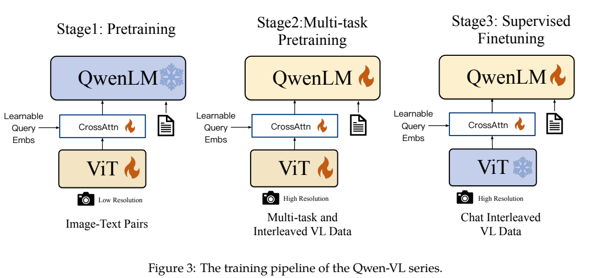
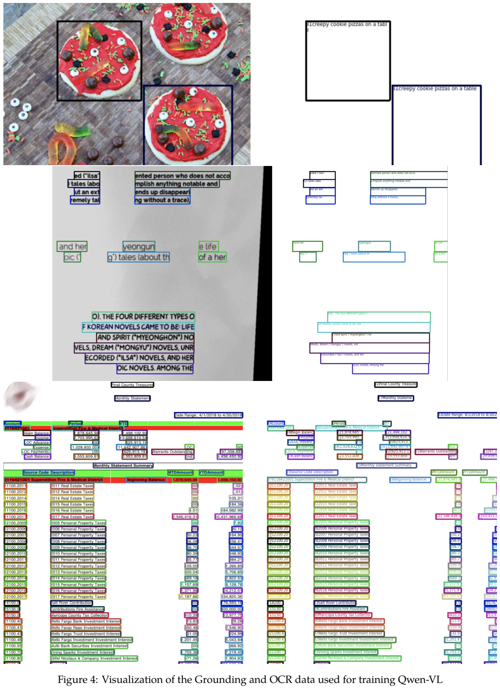
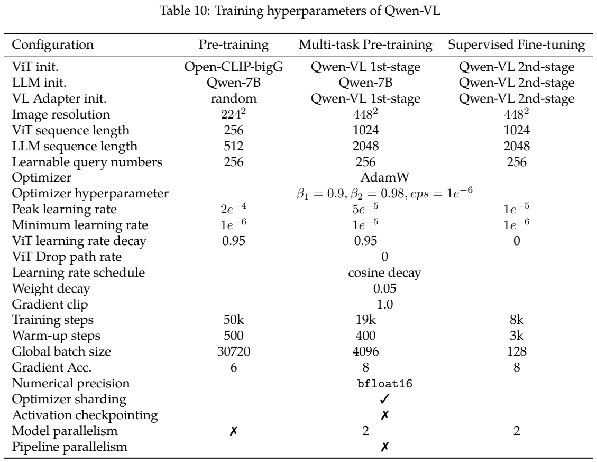
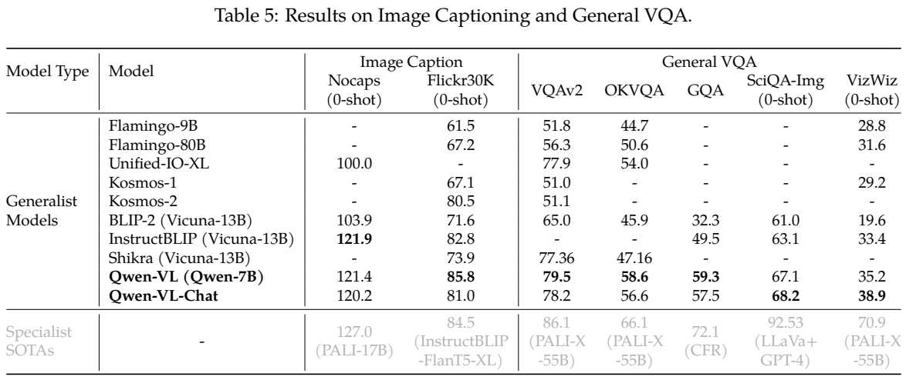
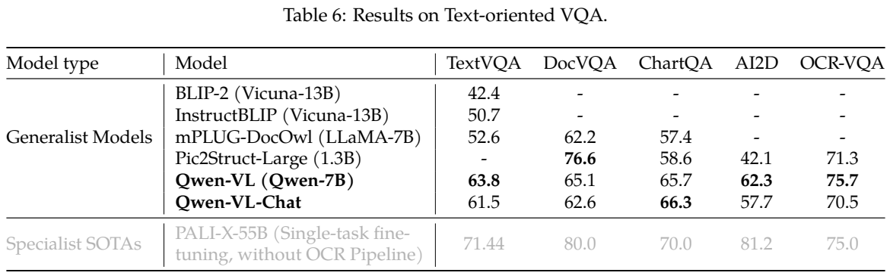
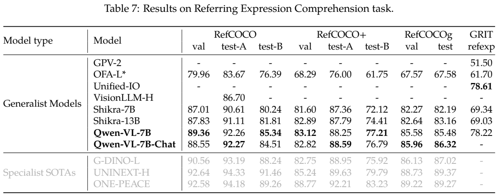
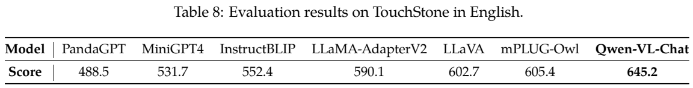

<!-- article-header:start -->
[项目首页](../../../README.md) › [模型系列](../../../reports/model-family-index.md) › [Qwen](../README.md)
<!-- article-header:end -->

# Qwen-VL：位置感知视觉压缩与三阶段中英多模态训练

<!-- article-toc:start -->

**本篇目录** · [论文定位](#paper-info) · [快速概览](#overview) · [整体架构](#architecture) · [核心原理](#principles) · [数据构建](#data) · [训练流程](#training) · [实验结果](#experiments)
<!-- article-toc:end -->

## 1. 论文信息与模型定位

**论文：** *Qwen-VL: A Frontier Large Vision-Language Model with Versatile Abilities*。作者 Jinze Bai、Shuai Bai、Shusheng Yang、Shijie Wang、Sinan Tan、Peng Wang、Junyang Lin、Chang Zhou、Jingren Zhou，来自阿里巴巴。本篇固定依据 [arXiv 2308.12966v1](https://arxiv.org/abs/2308.12966v1)，2023 年 8 月 24 日提交，共 20 页，官方仓库为 [QwenLM/Qwen-VL](https://github.com/QwenLM/Qwen-VL)。

首代 Qwen-VL 将 Qwen-7B 扩展为可接收图像的视觉语言模型，覆盖图像描述、视觉问答、OCR、文档与图表理解、区域定位。基础版 Qwen-VL 完成前两阶段训练，第三阶段得到面向多轮对话与多图交互的 Qwen-VL-Chat。名称中的 7B 指语言骨干规模，Table 1 的整套系统约 **9.6B** 参数，包括视觉 1.9B、adapter 0.08B、LLM 7.7B；各项是舍入值。

它是图像和文字输入、文字及坐标字符串输出的模型。报告将音频、视频与高保真图像生成列为后续方向，不能把后来 Qwen 系列的动态分辨率、视频和语音能力归入此版。[原文 §1–2、§6，PDF 第 2–3、10 页](https://arxiv.org/pdf/2308.12966v1#page=3)

## 2. 快速概览

| 重点 | 具体实现 |
|---|---|
| 视觉骨干 | OpenCLIP ViT-bigG 初始化，patch stride 14 |
| 视觉压缩 | 单层位置感知 cross-attention，256 个可学习查询 |
| 图像分辨率 | 第一阶段 224×224，第二和第三阶段 448×448 |
| 空间输出 | 对象框转为范围 [0,1000) 的坐标文本，配合 box/ref 标记 |
| 第一阶段数据 | 约 5B 候选图文对清洗为 1.4B，英文 77.3%、中文 22.7% |
| 多任务训练 | 描述、VQA、grounding、双向区域任务、OCR、纯文字生成 |
| 对话训练 | 350K 多模态及纯文字对话，支持多图编号和 ChatML |

首代设计的取舍很明确：448 分辨率给视觉编码器更多细节，adapter 又把 1024 个 patch 特征压成 256 个输入 LLM 的视觉 token。视觉信息量与语言序列开销因此不是同一个概念。

## 3. 整体架构

模型由三部分构成：Qwen-7B 语言模型、ViT-bigG 视觉编码器，以及随机初始化的单层视觉语言 adapter。图像固定缩放后按 14 像素划分 patch，ViT 生成上下文视觉特征；224 分辨率有 256 个 patch，448 分辨率有 1024 个。

Adapter 使用 **256 个可学习向量**作为查询，视觉特征作为 key/value，做一次 cross-attention，输出固定 256 项视觉序列。为保留细粒度位置，在 query/key 对中加入 **二维绝对位置编码**。它不属于用户问题引导的视觉查询，也不是 Ovis 的概率视觉词表；图像压缩查询本身是可学习参数。

**原图：Figure 3，PDF 第 4 页。** 三列分别对应两次预训练和监督微调，雪花表示冻结、火焰表示训练。第一列固定语言模型，第二列全部训练，第三列固定视觉编码器。每列的 CrossAttn 与 Learnable Query Embs 是同一类视觉输入接口，低分辨率切换为高分辨率并没有增加查询数量。

图像序列由 `` 和 `</img>` 包围，区分文字与图像输入。多图对话还在图像前写 `Picture id:`，按出现顺序标号，使用户能够提问、比较或描述某张图片。框坐标也走普通文字 tokenizer，不引入数千个专用位置词表项。[原文 §2，PDF 第 3–4 页](https://arxiv.org/pdf/2308.12966v1#page=3)

## 4. 核心创新与数学原理

**在压缩中保留空间信息。** 用 $X$ 表示 ViT 特征、$Q$ 表示可学习查询，普通 cross-attention 可解释为 $\operatorname{softmax}(QK^\top/\sqrt d)V$。本报告强调给 query/key 加二维位置编码，避免压缩只保留语义而丢掉空间线索。该式是解释 attention 的通常写法，原文没有列出 adapter 的完整矩阵方程或位置编码张量的全部实现细节，不能据此补造层数、头数及维度。

256 个查询既限制 LLM 输入长度，也要求一条输出 token 能汇聚多个 patch。448 输入相对 224 在视觉侧 patch 数增为四倍，而 adapter 输出不变。这种固定压缩不能保证无损保留每个字符，但能把高分辨率骨干与较短语言输入结合。论文没有用受控消融单独证明每个位置编码设计的贡献。

**把定位变成文本生成。** 对图像宽高 $W,H$，坐标可按比例映射到约千格的离散文本表达；例如可以用 $1000x/W,1000y/H$ 理解其归一化尺度。这是本文解释，原文仅规定范围与字符串格式，没有详细说明取整或边界钳制规则。框表示为左上角和右下角，外有 `<box>...</box>`，相关名词或短语外有 `<ref>...</ref>`。

通过不同指令，模型既能由描述输出框，也能由框描述区域，并在 caption 中对名词定位。OCR 数据还使用 `<quad>` 表达文字四边形。它们都以序列 token 预测训练，不是单独检测头回归坐标；框的几何准确性取决于视觉特征与这些文本监督。

**多任务用同一生成目标。** 第一和第二阶段都最小化文本 token 的交叉熵，可概括为 $-\sum_t\log p_\theta(y_t\mid I,q,y_{<t})$。第三阶段仅监督答案与相关特殊 token，不监督角色名和用户问题。这个式子是本文对原文训练描述的整理，原文没有另设对比损失、框 L1/IoU 损失、DPO 或 RLHF 目标。[原文 §2.2、§3、附录 B，PDF 第 4–6、18 页](https://arxiv.org/pdf/2308.12966v1#page=4)

## 5. 数据构建与处理

第一阶段是网络图文数据的清洗。Table 2 约 **5B → 1.4B**：LAION-en 2B→280M、LAION-COCO 600M→300M、DataComp 1.4B→300M、Coyo 700M→200M、CC12M 12M→8M，另有 CC3M、SBU、COCO caption。中文 LAION-zh 108M→105M，内部数据 220M。报告明确内部数据不来自阿里巴巴产品或服务；各规模为表中约数。

附录 A.1 过滤极端宽高比、过小图片、按来源设定的低 CLIP 分数、非中英字符、emoji、过长/过短文本；清除 HTML 标签及异常模式。学术 caption 数据删除特殊标记，同图多文本选最长一条。论文没有逐项给出阈值或全面跨来源去重与测试污染审计，不能把“清洗”理解成所有标签和内容完全可靠。

第二阶段七类任务规模分别为：caption **19.7M**、VQA **3.6M**、grounding **3.5M**、referring grounding **8.7M**、grounded caption **8.7M**、OCR **24.8M**、文字生成 **7.8M**。表列任务样本名义相加为 77.8M；这是按任务条目统计，不是去重后的独立图像数。Caption 不再用 LAION-COCO，VQA 来自 GQA、VGQA、VQAv2、DVQA、OCR-VQA、DocVQA 等，定位数据来自 GRIT、Visual Genome 与 RefCOCO 系列。

**原图：Figure 4，PDF 第 20 页。** 左列是带图像内容的训练样本，右列突出坐标与文字标注；第一行是短语与对象框，第二行是自然背景上的合成文字，第三行是文档页面。颜色区分标注区域，不代表模型推理置信度。图说明空间监督来源，不是最终模型输出案例。

合成 OCR 用 SynthDoG：COCO train2017 与 unlabeled2017 作为背景，选择 **41 种英文字体、11 种中文字体**，记录文字四边形位置。真实数字文档从 Common Crawl PDF/HTML 构造，PyMuPDF 提取 PDF 文字/框并渲染页面，Puppeteer 渲染网页获取标注；过滤过小页面、字符太多/太少、特定扩展拉丁及私用区字符。它们不是全部经过 OCR 识别后才标注，也不是手工重画的文档布局。

同一任务数据打包成长度 **2048** 的图文交错序列，以训练多图输入。第三阶段 **350K** 由人工、模型生成与策略拼接组成的对话混合，增加多图理解与定位，并混入纯文字对话。报告没有逐项公开这 350K 的来源占比和事实核验率。[原文 Table 2–3、§3.3、附录 A，PDF 第 5–6、16–17 页](https://arxiv.org/pdf/2308.12966v1#page=5)

## 6. 训练流程与目标

**原表：Table 10，PDF 第 19 页。** 三列对应图文预训练、多任务预训练和监督微调。ViT 序列长度随分辨率改变，但 learnable query number 始终 256；LLM sequence length 是语言侧总序列配置。表中 optimizer sharding 等勾号是实现设置，并不提供 GPU 总数。

| 参数 | 阶段 1 | 阶段 2 | 阶段 3 |
|---|---:|---:|---:|
| 可训练模块 | ViT + adapter，LLM 固定 | 整个模型 | adapter + LLM，ViT 固定 |
| 分辨率 / ViT token | 224 / 256 | 448 / 1024 | 448 / 1024 |
| LLM 序列长度 | 512 | 2048 | 2048 |
| 全局 batch | 30720 | 4096 | 128 |
| 训练 steps | 50,000 | 19,000 | 8,000 |
| 峰值 LR | $2\times10^{-4}$ | $5\times10^{-5}$ | $10^{-5}$ |
| 最小 LR | $10^{-6}$ | $10^{-5}$ | $10^{-6}$ |
| warm-up steps | 500 | 400 | 3000 |
| 梯度累积 | 6 | 8 | 8 |

三阶段 AdamW 使用 $\beta_1=0.9,\beta_2=0.98,\epsilon=10^{-6}$，cosine schedule、weight decay 0.05、梯度裁剪 1.0、BF16。前两阶段视觉层学习率 decay factor 0.95；第三阶段视觉固定。使用 optimizer sharding，不使用 activation checkpointing 与 pipeline parallelism；第二、三阶段 model parallelism 为 2。

第一阶段消耗约 **1.5B 图文样本、500B image-text tokens**。这里后者包含视觉文本序列，不是 500B 纯文字 token，也不能与 1.4B 清洗数据规模混为一谈：数据集规模和训练读取量是不同量。第二阶段全部参数更新，兼顾 OCR、位置、图文交错与纯文字能力。第三阶段 ChatML 对话形式下，仅监督答案和特殊结束等标记。

350K 是第三阶段数据规模，8K steps 与 batch128 是训练日程，不能直接写成只遍历数据一次。报告披露的参数较齐全，但未给 GPU 总数、硬件型号和阶段耗时，本文不推断计算成本。也未证明所有英文/中文任务都有同样采样比例。[原文 §3、Table 10，PDF 第 5–6、19 页](https://arxiv.org/pdf/2308.12966v1#page=19)

## 7. 实验设置与主要结果

**原表：Table 5、6、7、8，PDF 第 9 页。** Caption 是 CIDEr，DocVQA 是 ANLS，ChartQA 是 relaxed EM，其余依 Table 4 使用 VQA score、EM 或准确率。不同列不可简单相加；下方 TouchStone 是 GPT-4 评分。灰色 specialist 行单列强专用模型，粗体也不意味着压过每个 specialist。

| 基准 | Qwen-VL | Qwen-VL-Chat | 指标 / 解读 |
|---|---:|---:|---|
| Nocaps / Flickr30K | 121.4 / 85.8 | 120.2 / 81.0 | 零样本 caption CIDEr |
| VQAv2 / OKVQA / GQA | 79.5 / 58.6 / 59.3 | 78.2 / 56.6 / 57.5 | 这三类有对应监督来源，不能全部称零样本 |
| ScienceQA-Image / VizWiz | 67.1 / 35.2 | 68.2 / 38.9 | 表中标注零样本 |
| TextVQA / DocVQA | 63.8 / 65.1 | 61.5 / 62.6 | VQA score / ANLS |
| ChartQA / AI2D / OCR-VQA | 65.7 / 62.3 / 75.7 | 66.3 / 57.7 / 70.5 | relaxed EM / EM / EM |

基础版在 Flickr30K 明显高于表中 Flamingo-80B 的 67.2，文字理解也优于多种当时通用模型；但 DocVQA 的 65.1 低于 Pic2Struct-Large 的 76.6，Nocaps 的 121.4 低于 InstructBLIP 的 121.9。Chat 版在多个传统基准低于基础版，尤其 OCR-VQA 75.7→70.5、AI2D 62.3→57.7；对话对齐不应被写为通用分数全面提升。

Caption 与开放问答采用 greedy decoding；ScienceQA 从可选答案中取最高置信选项，因此与开放生成的采样策略不同。论文为定位给出准确率，但此版没有在正文完整列出评估 IoU 阈值等全部实现，不应补造。[原文 §4、Table 4–6，PDF 第 7–9 页](https://arxiv.org/pdf/2308.12966v1#page=7)

定位任务中，基础版 RefCOCO val/testA/testB 为 **89.36/92.26/85.34**，RefCOCO+ 为 **83.12/88.25/77.21**，RefCOCOg val/test 为 **85.58/85.48**；Chat 的 RefCOCOg 为 85.96/86.32。它们优于表中 Shikra 多项成绩，但 GRIT 78.22 低于 Unified-IO 的 78.61，且 UNINEXT/ONE-PEACE 等专用模型多项更高。区域定位能力得到量化支持，仍不是完整检测或分割系统的替代。[原文 Table 7，PDF 第 9 页](https://arxiv.org/pdf/2308.12966v1#page=9)

TouchStone 英文 GPT-4 score 为 **645.2**，对比 mPLUG-Owl 605.4、LLaVA 602.7；中文为 **401.2**，VisualGLM 为 247.1。这个中文表仅比较两项，不能扩成与所有模型的全面中文对照。TouchStone 是外部评委分数，报告没有在此给出全部题数、重复评估方差和模型版本控制细节；它支持对话表现较好，不是百分制正确率。[原文 Table 8–9，PDF 第 9–10 页](https://arxiv.org/pdf/2308.12966v1#page=9)

本报告强项是结合大规模中英图文训练、带位置的任务监督与可复查的阶段配置。缺少位置 adapter、分辨率、各数据来源的全面受控消融，无法严格拆分每个因素贡献。固定 448 分辨率、固定 256 视觉 token、含噪网页监督也意味着小字和复杂文档仍有损失风险；多图和多语言示例不能代替大规模跨语言/多图量化基准。

<!-- article-footer:start -->
---

[← 上一篇：VisCPM](../../viscpm/arxiv-2308.12038/README.md) · [按发表时间浏览](../../../reports/paper-reading-guide.md#year-2023) · [下一篇：PointLLM →](../../pointllm/arxiv-2308.16911/README.md)

[返回本篇目录](#article-toc) · [返回模型系列](../README.md)
<!-- article-footer:end -->
