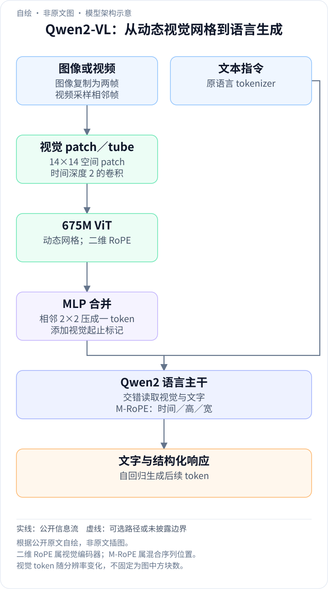
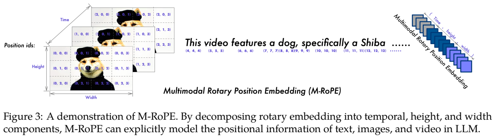
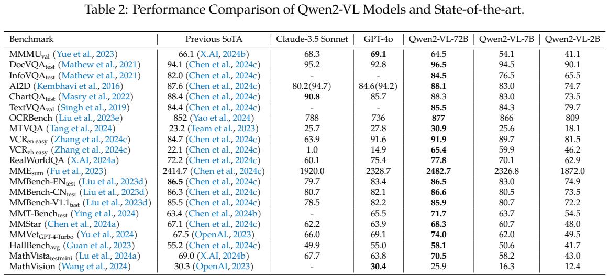
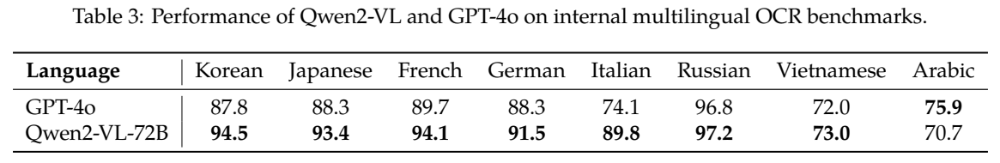
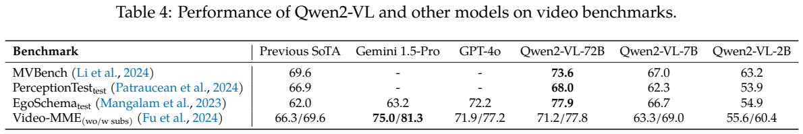
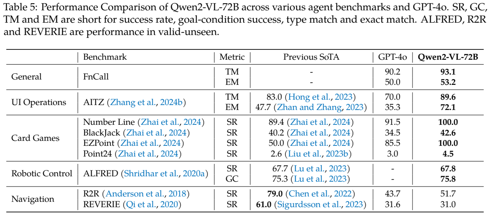
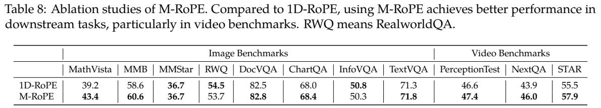
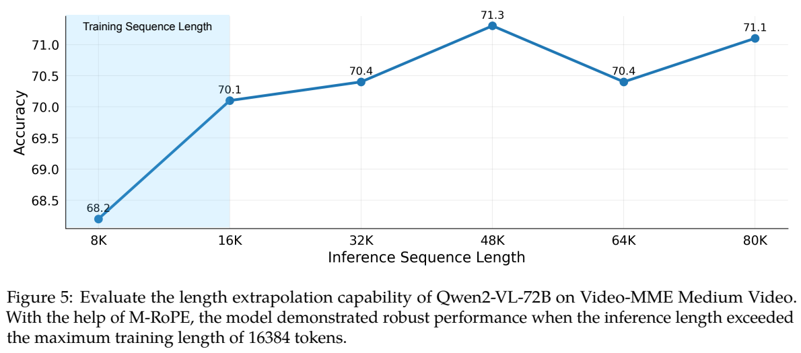

<!-- article-header:start -->
[项目首页](../../../README.md) › [模型系列](../../../reports/model-family-index.md) › [Qwen](../README.md)
<!-- article-header:end -->

# Qwen2-VL：动态分辨率与多模态旋转位置编码

<!-- article-toc:start -->
<a id="article-toc"></a>

**本篇目录** · [论文定位](#paper-info) · [快速概览](#overview) · [整体架构](#architecture) · [核心原理](#principles) · [数据构建](#data) · [训练流程](#training) · [实验结果](#experiments)
<!-- article-toc:end -->

<a id="paper-info"></a>

## 1. 论文信息与模型定位

| 项目 | 内容 |
|---|---|
| 原论文 | **Qwen2-VL: Enhancing Vision-Language Model’s Perception of the World at Any Resolution** |
| 作者与机构 | Peng Wang、Shuai Bai、Sinan Tan、Shijie Wang、Zhihao Fan、Jinze Bai 等；Alibaba Group Qwen Team |
| 版本 | 2024-09-18，arXiv:2409.12191v1，51 页 |
| 来源 | [固定版本原文](https://arxiv.org/pdf/2409.12191v1)；[官方仓库](https://github.com/QwenLM/Qwen2-VL) |
| 定位 | 接受图像、视频与文本，生成文本、区域坐标或工具调用的通用视觉语言模型 |

系列正式名称是 **Qwen2-VL-2B/7B/72B**。Table 1 的语言骨干分别约 1.5B/7.6B/72B，视觉编码器均约 675M；报告部分段落按粗略总规模写“2B/8B/72B”，不能将 8B 再当作独立版本。本文讨论该报告，不把 Qwen2.5-VL 的时间编码、窗口注意力等后续设计提前归入本代。

<a id="overview"></a>

## 2. 快速概览

Qwen2-VL 的两个关键变化是 **Naive Dynamic Resolution** 与 **M-RoPE**。前者让不同尺寸图像对应不同数量的视觉 token，避免全部图像挤入一个固定分辨率；后者在语言模型内部区分时间、高度、宽度的位置，统一表示文字、图像和视频。

模型沿用视觉编码器→连接模块→Qwen2 语言模型的框架。它不生成像素图像，也不是音频输入输出模型。文档、OCR、图表和视频理解是主要能力，视觉智能体则依赖预先定义的动作集合、外部工具和交互环境。

“任意分辨率”表示架构可处理变化的尺寸与长宽比，实际仍要设置像素、token 和显存预算；它不意味着无限分辨率、无限视频长度或全部细节都被保留。

<a id="architecture"></a>

## 3. 整体架构

<!-- derived-architecture:start -->


*自绘模型架构示意（非原文图）。依据下述公开资料归纳；方框表示功能组件，不代表逐层实现。*

依据：[§2.1；PDF 第3–5页](https://arxiv.org/pdf/2409.12191v1)。
<!-- derived-architecture:end -->

675M ViT 由 DFN 视觉权重初始化，把原有绝对位置嵌入换为二维 RoPE。图像以 14×14 patch 编码；ViT 后的 MLP 将相邻 2×2 视觉 token 合并为一个，再由视觉起止标记包围，送入 Qwen2。

对于视频，按每秒两帧采样，以时间深度为 2 的 3D 卷积处理相邻帧的 tube。静态图像复制为两张相同帧，从而共用视频输入结构。训练动态调整帧分辨率，使单个视频最多使用 16,384 个视觉 token；这是预算约束，长视频可能以较低空间细节换取更多时间覆盖。



**读图：** 视频 token 的位置由时间、高、宽三元组描述。文字的三项位置 ID 相同，静态图像的时间 ID 不变、空间 ID 随 patch 改变；视频时间 ID 随帧递增。后续模态的位置从前一段最大 ID 加一开始。

两种 RoPE 的作用位置不同：**二维 RoPE 在 ViT 内**表达图像 patch 的高、宽；**M-RoPE 在 Qwen2 的混合输入序列中**给文字、图像和视频位置建立统一规则。一次图像请求先把可变大小网格编码、2×2 合并，再将视觉序列放回文字提示的位置，由 Qwen2 自回归回答。例如 224×224 输入按公开结构产生 64 个视觉内容 token，加视觉起止标记共 66 个；增加分辨率会相应增加输入长度，而非始终输出固定数量查询。（§2.1，PDF 第4–5页）

| 模块 | 输入与输出 | 公开机制 |
|---|---|---|
| 动态图像/视频预处理 | 原图或2fps视频 → 可变patch网格/双帧tube | 图片复制为相同双帧，视频动态调整分辨率控制视觉预算 |
| 675M ViT | 14×14空间patch或时空tube → 视觉特征 | DFN权重初始化，以2D-RoPE替代绝对位置嵌入 |
| 2×2合并与MLP | 相邻四个视觉特征 → 一个语言侧视觉token | 输入尺寸决定内容token数，视觉起止标记划分模态边界 |
| M-RoPE与Qwen2 | 时间/高/宽位置及图文序列 → 回答 | 在语言主干中按三轴旋转位置，文本三轴相同；条件自回归生成 |

<a id="principles"></a>

## 4. 核心创新与数学原理

### 4.1 原生动态分辨率：让视觉预算随图像内容尺寸变化

动态分辨率改变的不是视觉 token 的语义格式，而是其数量。对于宽高可被 28 整除的图像，按 patch 14 和空间 2×2 合并，视觉内容 token 数可解释为：

```math
N_{\rm visual}=\frac{H}{28}\frac{W}{28}.
```

这是依据结构的计算说明，不是论文额外提出的训练公式。224×224 对应 64 个内容 token，加两个视觉边界标记后为报告所述的 66。增加分辨率提高细节也增加注意力与缓存成本；不能把动态尺寸说成固定 256 token 的压缩器。

视觉端2D-RoPE为网格位置提供相对空间参照，减少固定绝对位置表对输入尺寸的约束；合并器随后降低语言侧长度。可变分辨率仍受打包长度与显存限制，因此“任意分辨率”描述的是处理方式的灵活性，并非没有上限地保留原始像素。[§2.1，PDF第4页](https://arxiv.org/pdf/2409.12191v1#page=4)。

### 4.2 M-RoPE：在语言主干保留时空坐标

M-RoPE 将旋转嵌入通道分成时间、高度、宽度三部分，并分别用相应位置 ID 旋转。文字上三项相同，退化为原有一维位置编码；视觉上则显式保持时空结构，且空间网格的坐标数值通常小于展平后的序列索引，帮助位置外推。本文不捏造报告没有列出的旋转频率分配参数。

把展平序列恢复为时间、高、宽坐标后，同行或同列位置可以共享对应轴的索引，避免把二维邻接完全交给一维顺序学习。Qwen2-VL的视频时间轴依据帧序递增；后续Qwen2.5-VL才进一步对齐真实时间，不能将后代的绝对时间机制倒写进本代。[§2.1、Figure3，PDF第4–5页](https://arxiv.org/pdf/2409.12191v1#page=5)。

### 4.3 图像与视频统一：以视觉上下文监督文本预测

训练的基本目标是文本 next-token prediction：虽然总预算计入图像和文本 token，**只有文本 token 接受监督**。可用条件负对数似然理解其目标：

```math
\mathcal L_{\rm text}=-\sum_{i\in\mathcal T}\log p_\theta(y_i\mid y_{\lt i},\text{visual inputs}),
```

其中 $`\mathcal T`$ 为受监督文本位置。这是对原文训练说明的数学表达，报告未另列视觉重建、图像生成或 M-RoPE 专用损失。

双帧tube把相邻时间观察共同编码，静态图像复制双帧则复用同一输入接口。统一的是表示路径与混合训练方式，不代表图片自身存在运动监督。视觉token虽不被当作文字目标预测，其表示仍参与条件概率计算，并在解冻阶段接收文本误差传回的梯度。[§2.1–2.2，PDF第5页](https://arxiv.org/pdf/2409.12191v1#page=5)。

<a id="data"></a>

## 5. 数据构建与处理

来源包括清洗后的网页、开源数据和合成数据，覆盖图文对、OCR、交错图文文章、VQA、视频对话和图像知识。报告称数据知识截止时间为 2023 年 6 月，但未披露各来源的精确样本量、占比与完整清洗阈值。

指令数据使用 ChatML，涵盖纯文本对话、图像问答、文档解析、多图比较、视频理解、视频流对话及智能体交互。助手回答为监督内容；视觉起止和对话边界标记区分输入段。

定位框将坐标归一化到 [0,1000)，用两个角点表示；框标记和对象引用标记关联描述与坐标。它是文本化框表示，不是分割掩码。智能体数据则明确列出允许动作和参数，例如 Tap、Home；模型结合截图选择动作，外部执行结果形成下一次观察。

报告所称 1.4T token 是两个预训练阶段的累计视觉＋文本 token，不能解释成 1.4T 张图像或纯文本训练量。没有充分信息可自行补出各尺寸模型的数据分配与独立训练费用。

<a id="training"></a>

## 6. 训练流程与目标

| 阶段 | 报告披露的训练状态与数据 |
|---|---|
| 初始预训练 | 约 600B token，聚焦训练 ViT，语言端用 Qwen2 初始化；图文关系、OCR、分类等 |
| 第二阶段 | 追加约 800B token，解冻全部参数；增加交错图文、VQA、多任务和纯文本内容 |
| 指令微调 | 冻结 ViT，微调语言端；ChatML 多模态和纯文本指令数据 |

报告没有完整列出每阶段的学习率、批大小、训练步数和所有连接模块的独立冻结细节，不能照搬其他 Qwen 报告的超参数。

基础设施采用数据、张量、流水线三维并行，ZeRO-1、序列并行和选择性激活检查点；72B 使用标准 1F1B 流水线。动态序列长度先广播再传递激活；视频解码成为瓶颈后采用缓存解码。视觉文件置于 OSS、文本和检查点使用 CPFS，配合 FlashAttention 和通信计算重叠。这些措施解释可变视觉序列的大规模训练实现，不构成新增模型能力的独立实验。

<a id="experiments"></a>

## 7. 实验设置与主要结果





**读表：** Table 2 的模型列依次包括闭源基线和 Qwen2-VL-72B/7B/2B。不同基准的满分不同，OCRBench 原始分数不能当作百分比；MME sum 也不是单一准确率。

| 指标与划分 | 2B | 7B | 72B | GPT-4o，原报告列 |
|---|---:|---:|---:|---:|
| MMMU val | 41.1 | 54.1 | 64.5 | 69.1 |
| MathVista testmini | 43.0 | 58.2 | 70.5 | 63.8 |
| DocVQA test | 90.1 | 94.5 | 96.5 | 92.8 |
| ChartQA test | 73.5 | 83.0 | 88.3 | 85.7 |
| OCRBench | 809 | 866 | 877 | 736 |
| MMBench-EN test | 74.9 | 83.0 | 86.5 | 83.4 |
| MMBench-CN test | 73.5 | 80.5 | 86.6 | 82.1 |

72B 在文档/OCR 上突出，但 MMMU 低于 GPT-4o；MathVision 25.9 低于 GPT-4o 30.4；ChartQA 88.3 低于 Claude-3.5 Sonnet 90.8。Table 3 的内部多语言 OCR 也有例外：阿拉伯语 70.7 低于 GPT-4o 75.9，其余列的优势不能外推为所有语言表现。





视频 72B 的 MVBench 为 73.6、PerceptionTest test 为 68.0、EgoSchema test 为 77.9。Video-MME **无字幕/带字幕**为 71.2/77.8，7B 为 63.3/69.0，2B 为 55.6/60.4；评测最多提取 **768 帧**。72B 无字幕略低于 GPT-4o 71.9，两种设置均低于 Gemini-1.5-Pro 的 75.0/81.3。帧预算和字幕条件不能省略。

智能体结果依赖框架和动作接口。AITZ 的类型匹配/精确匹配为 89.6/72.1；ALFRED valid-unseen 成功率 67.8 是仿真环境结果。R2R/REVERIE 成功率为 51.7/31.0，低于表中专门导航模型的 79.0/61.0，REVERIE 也略低于 GPT-4o 31.6。Point24 成功率仅 4.5，两个简单游戏达到 100 不代表普遍规划能力。





**读图表：** Table 8 使用 Qwen2-1.5B＋ViT-L 的预训练模型，不是 72B 指令版。M-RoPE 让 NextQA 43.9→46.0、STAR 55.5→57.9，但 RealWorldQA 54.5→53.7、InfoVQA 50.8→50.3，不能写成每项提升。Figure 5 的 72B 中等时长 Video-MME 外推至 80K，71.1 分；它不等于所有任务正式支持 80K，上下文历史交互部分另述 32K。

Table 7 动态分辨率平均 1,924 图像 token，OCRBench 866，高于固定 3,136 token 的 786；但 InfoVQA 75.89 低于该固定设置的 77.27。证据支持细节与成本的折中，而不是越大越好。本文未运行模型或独立复现实验。

<!-- article-footer:start -->
---

[← 上一篇：Pixtral 12B](../../mistral-pixtral/document-3ebe839c6607/README.md) · [按发表时间浏览](../../../reports/paper-reading-guide.md#year-2024) · [下一篇：Llama 3.2 →](../../llama/document-0c6cca94a384/README.md)

[返回本篇目录](#article-toc) · [返回模型系列](../README.md)
<!-- article-footer:end -->
