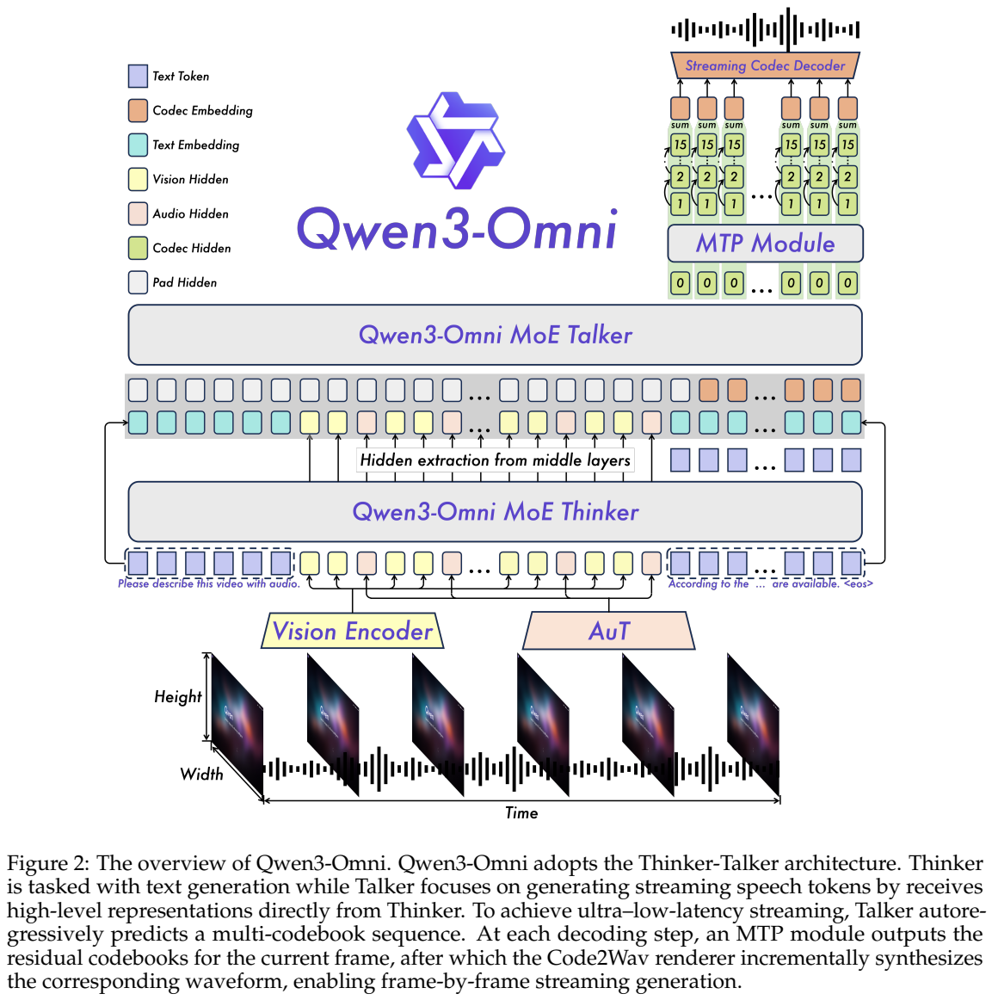
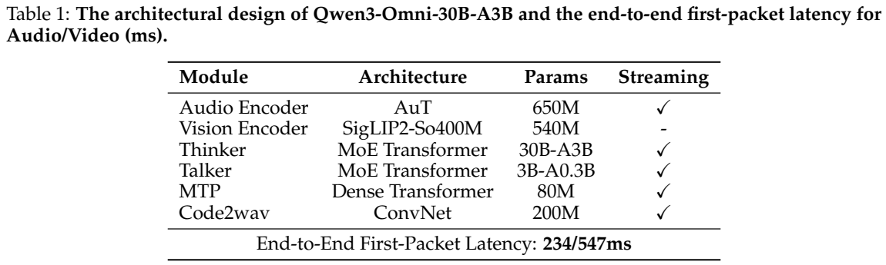
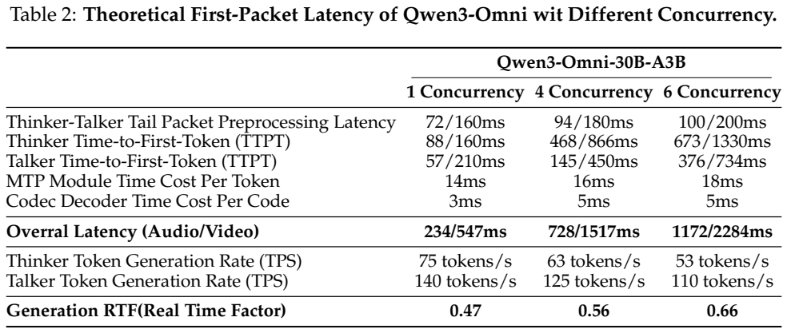
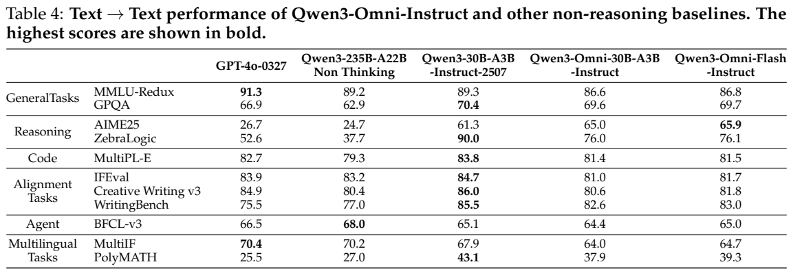
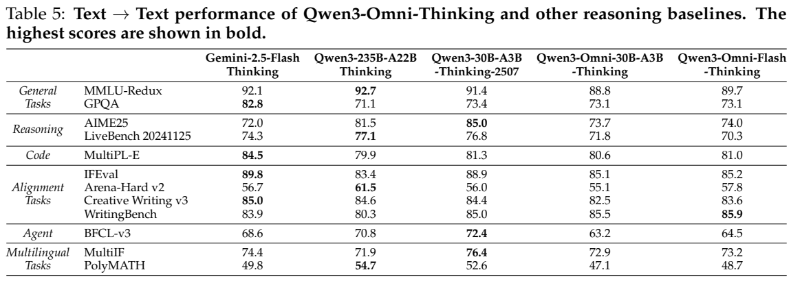
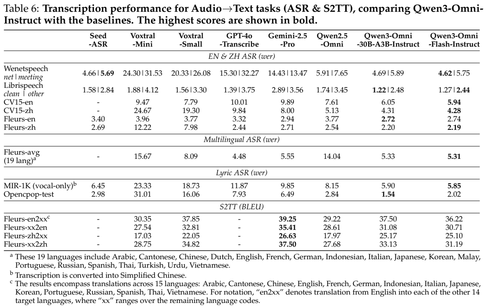
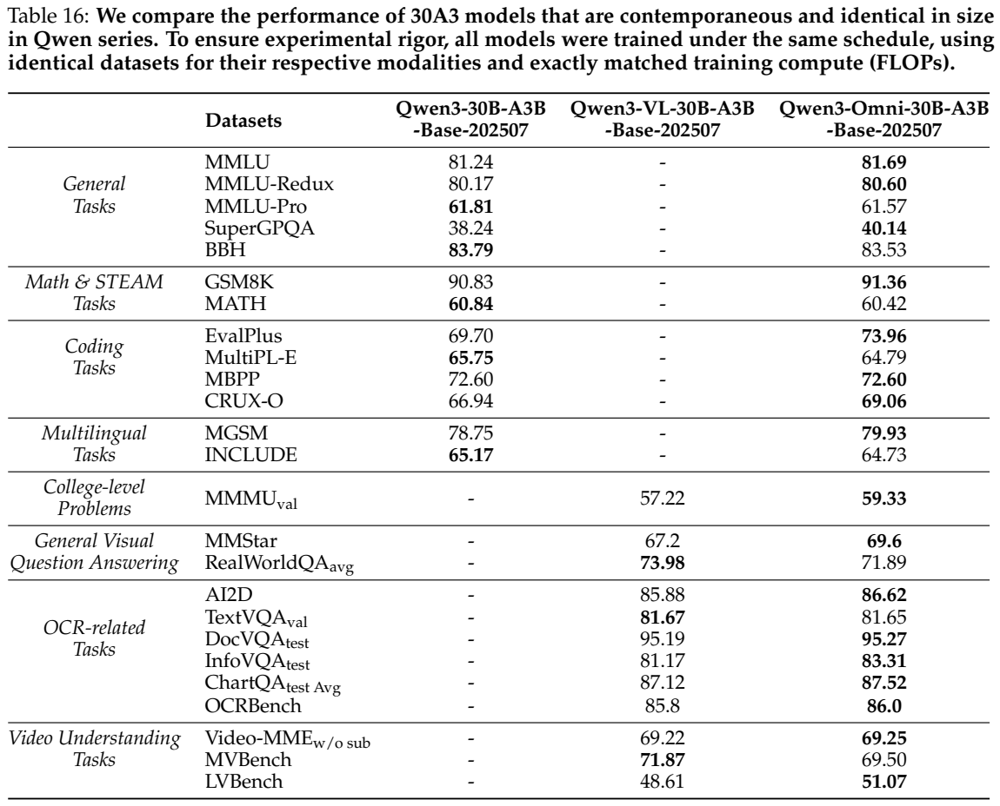

<!-- article-header:start -->
[项目首页](../../../README.md) › [模型系列](../../../reports/model-family-index.md) › [Qwen](../README.md)
<!-- article-header:end -->

# Qwen3-Omni：双 MoE、时间对齐与逐帧流式语音

<!-- article-toc:start -->

**本篇目录** · [论文定位](#paper-info) · [快速概览](#overview) · [整体架构](#architecture) · [核心原理](#principles) · [数据构建](#data) · [训练流程](#training) · [实验结果](#experiments)
<!-- article-toc:end -->

## 1. 论文信息与模型定位

**Qwen3-Omni Technical Report** 由 Qwen Team 发布，本文固定使用 [arXiv:2509.17765v1](https://arxiv.org/pdf/2509.17765v1)。arXiv 首版提交日期为 2025-09-22，PDF 首页标注 2025-09-23。报告介绍同时接收文本、图像、音频和视频、输出文本与语音的统一模型；它并非只在视觉语言模型后面接一个独立 TTS 服务。官方发布 30B-A3B、Thinking 和音频 Captioner 版本，报告还评测内部 Flash 变体，不能把 Flash 的最优成绩直接归给公开的 30B-A3B。

核心任务是让全模态训练保留原有语言、视觉能力，同时实现自然的实时语音交互。语言主干、语音生成主干、音频编码器和波形解码器各有独立职责。名称中的 30B-A3B 指 Thinker 总参数与激活规模，整套系统还包括 Talker 和其他模块。[PDF 第 1–3 页](https://arxiv.org/pdf/2509.17765v1#page=1)

## 2. 快速概览

报告的主要变化是：Thinker 和 Talker 均改为 MoE；Whisper 编码器由自训练的 AuT 替代；语音表示采用多码本残差量化；Talker 每一步生成一帧、MTP 补齐该帧残余码本；波形合成由块式扩散改为轻量因果 ConvNet。输入和输出音频 token 率均为 12.5 Hz，每个时间步对应 80 ms。

| 能力/配置 | 原文披露 | 应如何理解 |
|---|---|---|
| 文本语言 | 119 种 | 不等于所有语言均有同等评测覆盖 |
| 语音理解/生成 | 19 / 10 种 | 输入覆盖大于输出覆盖 |
| 长音频 | 单次可达约 40 分钟 | 不意味着所有长视频任务均表现最佳 |
| 冷启动理论首包延迟 | 音频 234 ms、视频 547 ms | 原文组件级实验条件，含并发影响 |
| Thinker/Talker | 30B-A3B / 3B-A0.3B | 不要将 Thinker 名称当成整套参数量 |

摘要称在 36 个音频和视听基准中取得 32 项开源最优、22 项整体最优，这是报告按其所列系统与变体作出的汇总；后面的表格仍应逐模型、逐任务阅读。对纯感知任务，Thinking 反而可能更差。[PDF 第 2、6–8、17 页](https://arxiv.org/pdf/2509.17765v1#page=6)

## 3. 整体架构

Figure 2 位于 PDF 第 3 页。自下而上阅读：视觉编码器和 AuT 将帧与音频变为表征；Thinker 处理多模态序列并生成文本；Talker 使用文本 token 与来自 Thinker 的音视频高维特征形成语音；顶端 MTP 在同一帧内生成残余码本，再送入流式 codec 解码器。颜色区分文本 embedding、视觉/音频 hidden 和 codec hidden，而不是不同训练阶段。

正文明确，Talker 不再消费 Thinker 的高层**文本 hidden representation**，文本可通过离散 token/embedding 输入；它仍接收 Thinker 的多模态高维特征与完整对话历史。这样文本回复可以经 RAG、函数调用或安全过滤后再合成语音，Thinker 的回答风格与 Talker 的声音风格也可由不同 system prompt 控制。Figure 2 图注对“高层表征”的措辞较概括，应以正文的文本/多模态区分理解，不能说两模块完全脱离。

表 1 列出 AuT 650M、视觉编码器 540M、Thinker 30B-A3B、Talker 3B-A0.3B、MTP 80M、Code2Wav 200M。正文对 AuT 约写 0.6B、视觉编码器约 543M，属于精度不同的表述，本文保留表 1 的口径。视觉编码器来自 Qwen3-VL，初始化于 SigLIP2-So400m；报告没有给出完整 MoE 专家结构和所有层数。

输入音频重采样到 16 kHz，以 25 ms 窗、10 ms hop 提取 128 通道 mel 频谱，经 Conv2D 下采样 8 倍，得到 12.5 Hz 表征。AuT 使用 1–8 秒动态窗口注意力以兼顾实时缓存与离线理解。视频采用动态抽帧；没有给出一种可推广至所有视频的固定 FPS。[PDF 第 3–6 页](https://arxiv.org/pdf/2509.17765v1#page=3)

## 4. 核心创新与数学原理

**时间对齐的 TM-RoPE。** 位置编码分为时间、高度和宽度三轴，分别交错分配 24、20、20 个旋转角。文本三轴 position ID 相同，退化为一维 RoPE；静态图像时间 ID 恒定，空间 ID 随行列变化；音频时间 ID 每 80 ms 前进，视频按实际 timestamp 映射到相同时间尺度。后续模态从前一段最大 position ID 加 1 开始，避免不同段冲突。与固定 2 秒音视频块相比，按绝对时间对齐允许流长度更灵活。

对一个二维旋转子空间，可用 $`R(p\omega)(q_1,q_2)^\top`$ 理解位置注入，注意力内积因此包含相对相位。这里是 RoPE 的解释性数学表达；报告具体公开的是三轴角分配和时间 ID 规则，并未在本篇推导完整旋转矩阵或长序列误差界。时间编码改善对齐不等于无限上下文，作者也明确承认长视频外推有限。

**多码本的逐帧预测。** 设一帧的残差量化代码为 $`c_{t,0},\ldots,c_{t,K-1}`$。按照正文的层级生成，可以示意为

$$
p(c_t\mid C_{<t},X)=p(c_{t,0}\mid C_{<t},X)\prod_{k=1}^{K-1}p(c_{t,k}\mid c_{t,<k},C_{<t},X).
$$

Talker 主干预测第零码本，轻量 MTP 自回归生成其余码本；因果 ConvNet 仅访问左侧上下文，将完整当前帧转为波形。本式是对 Figure 2 与正文的因子分解解释，不是原文编号公式，也没有补写未披露的损失权重。丰富码本提供声学容量，让生成器避免等待未来块上下文才能开始发声。

**异步预填充。** Thinker 完成当前输入块后，Talker 可立即预填充该块，同时 Thinker 处理下一块。首包路径仍有串行依赖，可写成组件延迟之和：预处理 + Thinker 首 token + Talker 首 token + MTP + codec。单并发音频为 $`72+88+57+14+3=234`$ ms。它是报告表 2 的具体分解，不包含未公布的公网、客户端或整段输入等待条件。

PDF 第 6 页原表中，斜线左/右分别为音频/视频。并发 1、4、6 时音频首包延迟为 234、728、1172 ms，视频为 547、1517、2284 ms。RTF 为 0.47、0.56、0.66，越低越快，且均小于 1。这也说明“并发时基本不受影响”的正文概括不能替代实际数值：延迟随并发确实上升。报告使用 vLLM，MTP 与 decoder 采用 `torch.compile`、CUDA Graph 优化，但没有公开足以复现的硬件型号和数量。[PDF 第 5–7 页](https://arxiv.org/pdf/2509.17765v1#page=5)

## 5. 数据构建与处理

AuT 从头训练于 **2000 万小时监督音频**，其中 80% 是中英文伪标注 ASR，10% 是其他语言 ASR，10% 是音频理解。这里“监督”包含伪标签，不能写成人工逐小时转录。任务兼顾识别与一般音频理解，编码器因而不只保留语音文字内容。

统一预训练含纯文本、图文、视频文本、音频文本、视频音频以及视频音频文本。自然语言任务提示有多种表达，以改善泛化与指令遵循。S2 叙述为约 2T token，同时列出文本 0.57T、音频 0.77T、图像 0.82T、视频 0.05T、视频音频 0.05T；**分项相加为 2.26T**，本文照录各项而不擅自改数或将其解释成精确 2T。不同模态的 token 是模型表示单位，不等价于相同小时数、图片数或文字词数。

后训练使用 ChatML，覆盖纯文本、视觉、音频及混合对话。Talker 第一阶段使用数亿语音数据及多模态上下文，原文没有明确每条样本时长或总小时数。后续高质量 CPT 减少噪声引起的幻觉，偏好对覆盖多语言，speaker fine-tuning 定制声音。Captioner 由大量详细音频描述微调而成，但未披露样本总数、标签生成和过滤配方。附录 9.2 的三例展示表达性语音、复杂音效与混合音景，其详细输出是定性案例，不能代替幻觉率测量。[PDF 第 4、7–8、17–20 页](https://arxiv.org/pdf/2509.17765v1#page=7)

## 6. 训练流程与目标

预训练分三阶段。S1 固定 LLM，分别对视觉与音频通路先训练 adapter、再训练 encoder，LLM 初始化自 Qwen3，视觉来自 Qwen3-VL，音频来自 AuT。原文同时概括“固定 LLM、训练编码器”，并特别说明避免旧方案在固定 LLM 时一开始联合训练 encoder 与 adapter，使编码器过度补偿语言模型局限。S2 解冻全部参数，以大规模多模态数据共同训练。S3 将最大长度从 8192 提高到 32768，增加长音频和长视频占比。

Thinker 后训练依次是轻量 SFT、强到弱蒸馏、GSPO。蒸馏先使用教师生成的离策略回答，再让学生自行生成轨迹，将学生与 Qwen3-32B 或 Qwen3-235B-A22B 教师的 logits 通过 KL 散度对齐。为理解这一目标，可写 $`D_{\rm KL}(p_T\Vert p_S)=\sum_v p_T(v)\log[p_T(v)/p_S(v)]`$，但本报告没有明确 KL 的方向、温度和系数；式子仅展示一种 KL 定义，不能认定就是具体代码实现。

GSPO 奖励分可验证规则与模型判分两类。数学、代码、指令遵循可由规则检查；一般任务使用 Qwen3，视觉相关任务使用 Qwen2.5-VL 评判，适用时提供真值或参考答案。模型裁判仍可能有偏差，报告没有披露完整奖励函数与人工校准。Talker 则依次进行大规模训练、高质量和长上下文 CPT、多语言 DPO、speaker fine-tuning。DPO 使用偏好对改善稳定性；没有公开 beta、参考模型、各阶段冻结、学习率、batch、步数或训练 GPU。AuT 的先行训练数据量也不应与 S2 token 数相加成统一预算。[PDF 第 7–8 页](https://arxiv.org/pdf/2509.17765v1#page=7)

## 7. 实验设置与主要结果

原文 PDF 第 10 页的 Table 4、5 分别比较 Instruct 和 Thinking 的文本任务，Table 6 比较 ASR 与语音翻译。WER 越低越好，BLEU 越高越好，应分别按指标方向解读加粗结果。30B-A3B-Instruct 的 LibriSpeech clean/other WER 为 **1.22/2.48**，Qwen2.5-Omni 为 1.74/3.45；19 语言 Fleurs 平均为 **5.33**，GPT-4o-Transcribe 为 4.48，表明多语言识别并非全面最佳。Fleurs en2xx BLEU 为 37.50，低于 Gemini-2.5-Pro 的 39.25。表 17 中 Thinking 对应 LibriSpeech 为 2.22/4.38，作者认为感知任务思考未必有益，甚至可能增加幻觉。

视听任务上，公开 Instruct 的 WorldSense 为 54.0，相较 Qwen2.5-Omni 的 45.4 有提升；Thinking 的 DailyOmni 为 75.8，VideoHolmes 为 57.3。图像方面 Instruct MathVision 为 56.3，Thinking 为 62.9；但无字幕 Video-MME 从 70.5 到 69.7，LVBench 从 50.2 到 49.0，并非思考都提升。报告指出长视频受位置外推和上下文限制。音乐多标签任务使用 micro-F1，原因是生成模型输出离散标签，缺少用于 AP/AUROC 的校准概率；这限定了与音乐专用模型的比较方式。

语音生成主要用给定文本的 TTS 式测试：SEED 内容一致性 WER 中文/英文为 **1.07/1.39**，CosyVoice 3 为 0.71/1.45；中文不及对照、英文略优。多语言和跨语言实验还评估 speaker similarity，但相似度高不等于内容一定正确，TTS 基准也不能完全反映完整音视频对话中的情绪控制和出错恢复。[PDF 第 10–14、17 页](https://arxiv.org/pdf/2509.17765v1#page=10)

PDF 第 15 页 Table 16 是论文最关键的控制实验：同为 30B-A3B，同模态使用相同语料、对齐训练 schedule、batch、有效 epochs，表注称匹配 FLOPs；Omni 额外加入音频与视听数据。文本 MMLU 为 81.69，对照 81.24；视觉 MMMU 为 59.33，对照 57.22，InfoVQA 为 83.31，对照 81.17。但 MMLU-Pro 为 61.57，低于 61.81；RealWorldQA 为 71.89，低于 73.98；MVBench 为 69.50，低于 71.87。因而“非退化”应理解为多数能力总体接近或改善的实验结论，**不是每个指标均不下降的定理**。作者也没有进行所有尺度的完整扫描。报告未给出完整超参数、逐测试推理预算和置信区间，本文记录其结果及局限，没有运行模型或独立复现实验。

<!-- article-footer:start -->
---

[← 上一篇：InternVL 3.5](../../internvl/arxiv-2508.18265/README.md) · [按发表时间浏览](../../../reports/paper-reading-guide.md#year-2025) · [下一篇：LLaVA-OneVision-1.5 →](../../llava/arxiv-2509.23661/README.md)

[返回本篇目录](#article-toc) · [返回模型系列](../README.md)
<!-- article-footer:end -->
