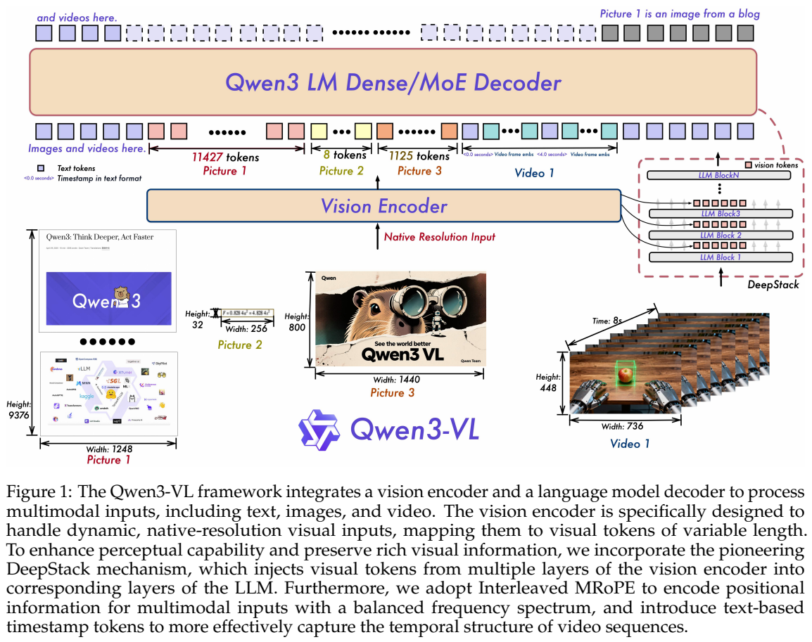
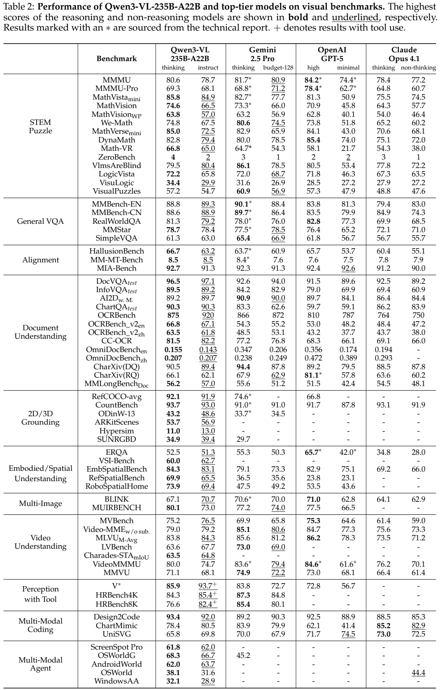
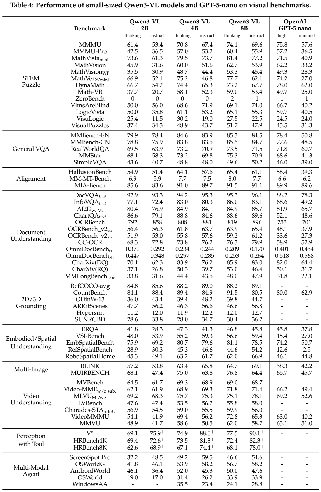
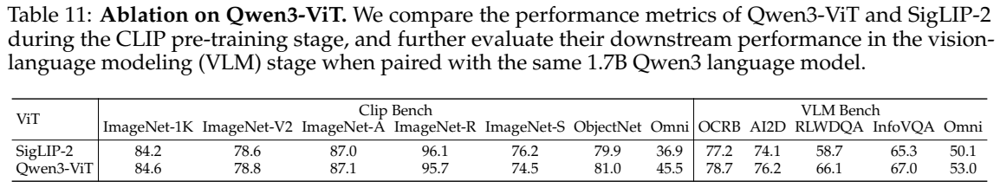
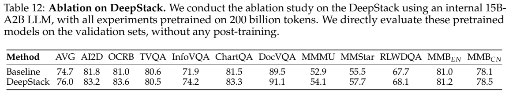

# Qwen3-VL：DeepStack、交错位置编码与原生 256K 多模态上下文

## 1. 论文信息与模型定位

| 项目 | 内容 |
|---|---|
| 原论文 | **Qwen3-VL Technical Report** |
| 作者与机构 | Qwen Team，Alibaba；具体贡献名单见 PDF 第 26 页 |
| 版本 | arXiv:2511.21631v1，提交日期 2025-11-26；封面日期 11-27；42 页 |
| 来源 | [固定版本 PDF](https://arxiv.org/pdf/2511.21631v1)；[官方仓库](https://github.com/QwenLM/Qwen3-VL) |
| 模型 | Dense：2B/4B/8B/32B；MoE：30B-A3B/235B-A22B，各有 Thinking 与 Instruct |
| 定位 | 图像、视频与文本交错输入，输出文字、代码、坐标、工具调用的视觉语言基础模型 |

A3B/A22B 表示每 token 激活规模，不等于总参数或加载显存。旗舰 MoE 总计 235B、每 token 激活 22B。模型提供原生 256K 上下文；1M 是特定位置外推实验。报告将统一视觉生成列为未来方向，当前的 SVG/HTML 代码输出不能当作像素图像生成。

## 2. 快速概览

三项架构升级分别处理不同问题：**Interleaved MRoPE** 平衡时间、宽、高的旋转频率分布；**DeepStack** 把 ViT 中间层特征注入语言模型前几层；**文字时间戳**明确标记视频帧组时间，替代仅靠时间位置 ID 对齐的方式。

能力提升也依赖大规模数据重构与后训练：多语言 OCR、长文档、空间与 3D 定位、视觉代码、视频时序标注、GUI 轨迹、长推理链，以及文本蒸馏和强化学习。不能将整代收益只归因于 DeepStack。

Thinking 不保证每个任务更准确。复杂数学推理常受益于更长推理，OCR、框定位和一些视频任务的 Instruct 反而更好；部署时应结合任务与输出预算比较，不能合并两者的最佳数值当成单个模型结果。

## 3. 整体架构

**读图：**不同图像产生不同长度视觉序列，视频帧组前插入文字时间戳；右侧 DeepStack 在前几个语言层添加额外视觉特征，未把三组中间特征都扩成新的上下文位置。

视觉端采用动态分辨率继续训练的 SigLIP-2，默认 SO-400M；2B/4B 使用 Large-300M。位置编码同时采用二维 RoPE 与按输入尺寸插值的绝对位置嵌入。两层 MLP merger 将空间 2×2 特征合为一个语言维度视觉 token。

DeepStack 从视觉编码器三个层级取特征，各经专门 merger 投影，直接加到语言模型**前三层对应视觉位置的隐藏状态**上。它借鉴已有 DeepStack，但使用同一 ViT 的不同深度特征，而非原方法的多尺度输入堆叠。文本和视觉 token 共同由 Qwen3 Dense 或 MoE 解码器处理。

视频的每个时间 patch 前加入格式化文字，如“3.0 seconds”；训练同时使用秒数与时分秒格式。额外时间文本占用一些上下文，换取直接可读的时间条件。

## 4. 核心创新与数学原理

旧式 MRoPE 把时间、高、宽维度分为连续块，容易让不同轴占据不同频段。本代交错分配三个轴，使各轴覆盖高、低频。它改变位置旋转的频率分配，不能理解成新增视觉 token 或训练一个时间预测网络。

DeepStack 的残差注入可用下面的说明性表达理解：

$$
\tilde h^{(l)}_{\rm visual}=h^{(l)}_{\rm visual}+M_l(z^{(k_l)}),\qquad l=1,2,3.
$$

$z^{(k_l)}$ 是相应 ViT 层特征，$M_l$ 是专门 merger。该式是对结构文字的解释，原文未将它编号为训练公式。相同视觉序列位置在多个语言层被增强，从而保留低层细节及高层语义，不增加三个特征序列的上下文长度。

训练采用平方根归一化的 token 级损失重加权，以平衡纯文本和多模态数据。报告说明从逐样本损失改为这一方式，但未公开足够详细的公式、归一化范围和各模态系数，本文不自行补一个加权损失当成官方定义。

小模型蒸馏先使用教师输出作 off-policy 监督，再在学生自己生成的序列上对齐教师与学生 logits，最小化 KL 散度。这里 KL 衡量同一上下文下预测分布差异；报告未给出方向、温度和各损失权重，不能据此提供精确蒸馏配方。推理 RL 使用 SAPO，但本报告未展开其完整数学推导。

## 5. 数据构建与处理

图像描述由专门微调的 Qwen2.5-VL-32B 结合原始网页文字重新生成；对重描述文本做语义去重，再通过视觉嵌入聚类补充稀疏概念。交错网页用领域分类器去除广告等低价值内容；书籍由 Qwen2.5-VL-7B 解析并按页拼接，超长样本保留自然页序并约束图文比例。

OCR 有约 30M 内部样本，使用专门 OCR 模型与 Qwen2.5-VL 自动修正，没有人工标注；另有约 30M 合成多语言 OCR 样本和超过 1M 内部真实多语言图像。语言覆盖在此前 10 种非中英语种上再加 29 种。文档来自 3M Common Crawl PDF 和 4M 内部文档：布局模型预测顺序与框，Qwen2.5-VL-72B 识别区域，重组为 QwenVL-HTML 或 Markdown；长文档训练还合并多页并构造跨页问答。

定位融合公开 COCO/Objects365/OpenImages/RefCOCO 系列、Grounding DINO 与模型合成标注；点定位包含 PixMo 和专门细粒度合成。坐标采用 [0,1000] 归一化体系。3D 数据以单视图图像和指代句对应 9-DoF 框，统一虚拟相机坐标并过滤严重遮挡和错误标签；它不是由单图可靠测出任意物体真实距离的证明。

STEM 视觉数据包括 1M 点定位、2M 细节问答、6M 图表描述；推理题超过 60M，另有超过 12M 图像长 CoT 样本，经历规则和模型校验。代码数据覆盖截图转 HTML/CSS、图像转 SVG、图表与公式转代码。视频采用短到长的描述合成、时空定位与按上下文预算调整抽帧；GUI 轨迹经自演化生成和人工抽查。普通工具调用轨迹可模拟函数响应，因此不能把全部合成轨迹称为真实环境执行记录。

## 6. 训练流程与目标

| 预训练阶段，Table 1 | 训练参数 | token 预算 | 序列长度 |
|---|---|---:|---:|
| S0 对齐 | 仅 merger | 67B | 8,192 |
| S1 多模态预训练 | 全部 | 约 1T | 8,192 |
| S2 长上下文 | 全部 | 约 1T | 32,768 |
| S3 超长适配 | 全部 | 100B | 262,144 |

这些预算属于报告训练配方，未说明每个模型变体的完整独立用量，不应逐版本自行相加估算总成本。视觉编码器此前还做动态分辨率继续训练。

后训练先 SFT：约 1.2M 样本，1/3 纯文本、2/3 图文与视频；先在 32K 训练一轮，再在 256K 训练一轮并混入 32K 样本。Thinking 冷启动长 CoT 数据的图文与文本比例约 1:1，与上述 SFT 总体比例是不同数据集。视觉数学题过滤掉 Qwen3-30B-nothink 无图即可答对的题，强化视觉必要性。

随后进行**仅用文本数据**的强到弱蒸馏，再进行推理与通用 RL。推理 RL 约 30K 查询，先采 16 个回答过滤全错题，训练中再过滤正确率超过 90% 的简单题，使用规则或代码校验及语言混用惩罚。通用 RL 结合规则和 Qwen2.5-VL-72B/Qwen3 评判，优化指令、开放回答及特定错误先验。

视觉工具训练先用约 10K 样本训练 Qwen2.5-VL-32B 教师，再生成约 120K 多轮交互用于 Qwen3-VL；奖励考虑答案、反馈理解和调用次数，针对“一律只调一次工具”的奖励利用问题增加调用奖励。报告没有公开全部学习率、优化步数、奖励权重和每个变体后训练成本。

## 7. 实验设置与主要结果

**读表：**每个模型有不同思考预算列；星号来自相应技术报告，＋表示工具增强。OmniDocBench 为误差指标、越低越好，OCRBench 为原始分数。以下只取相同旗舰的两个明确配置。

| 指标 | 235B-A22B Thinking | Instruct |
|---|---:|---:|
| MMMU | 80.6 | 78.7 |
| MathVista mini | 85.8 | 84.9 |
| MathVision | 74.6 | 66.5 |
| DocVQA test | 96.5 | 97.1 |
| OCRBench | 875 | 920 |
| ChartQA test | 90.3 | 90.3 |
| MMBench-EN / CN | 88.8 / 88.6 | 89.3 / 88.9 |
| Video-MME，无字幕 | 79.0 | 79.2 |

Thinking 的 MathVision 高于表内 Gemini-2.5-Pro Thinking 73.3 和 GPT-5 high 70.9，但 MMMU 低于 GPT-5 high 84.2；Video-MME 低于 Gemini Thinking 85.1 与 GPT-5 high 84.7。工具增强 Instruct 的 V* 为 93.7，与未调用工具的 Thinking 85.9 不同；HRBench-4K/8K 的 **85.4/82.4**依原表，正文另外出现 85.3/82.3，不混用。

视频统一设最多 2,048 帧、总视觉 token 不超过 224K；VideoMMMU/MMVU 每帧最多 768 token，其余 640；Charades-STA 4fps，其余 2fps。资源限制使 Gemini-2.5-Pro/GPT-5/Claude-Opus-4.1 分别最多 512/256/100 帧，作者明确承认不能保证完全公平。VideoMMMU 使用模型评判，不是全部规则匹配。

2B/4B/8B Thinking 的 MMMU 为 61.4/70.8/74.1，MathVista 为 73.6/79.5/81.4；Instruct OCRBench 为 858/881/896。8B 并非小模型每项最强：4B Thinking 的 DynaMath 74.4 高于 8B 73.2。旗舰文字能力也未全面保持：Table 6 的 GPQA 77.1、LiveCodeBench v6 70.1，低于对应 Qwen3 文本 Thinking 的 81.1/74.1。

**读表：**DeepStack 使用内部 15B-A2B、200B token 预训练、无后训练，并非旗舰消融。平均分 74.7→76.0，InfoVQA 71.9→74.2、DocVQA 89.5→91.1，但 TextVQA 80.6→80.5。Table 11 的视觉端比较使用相同 1.7B Qwen3、1.5T token，不能拿它的数字代替最终 2B。

Figure 3 的视频插针实验在 1fps 和动态帧分辨率下，30 分钟/256K 为 100%；用 YaRN 外推至约 1M/两小时为 99.5%。这是显著目标帧检索，不代表原生 1M、完整长视频叙事都正确。本文未运行模型或独立复现训练。
