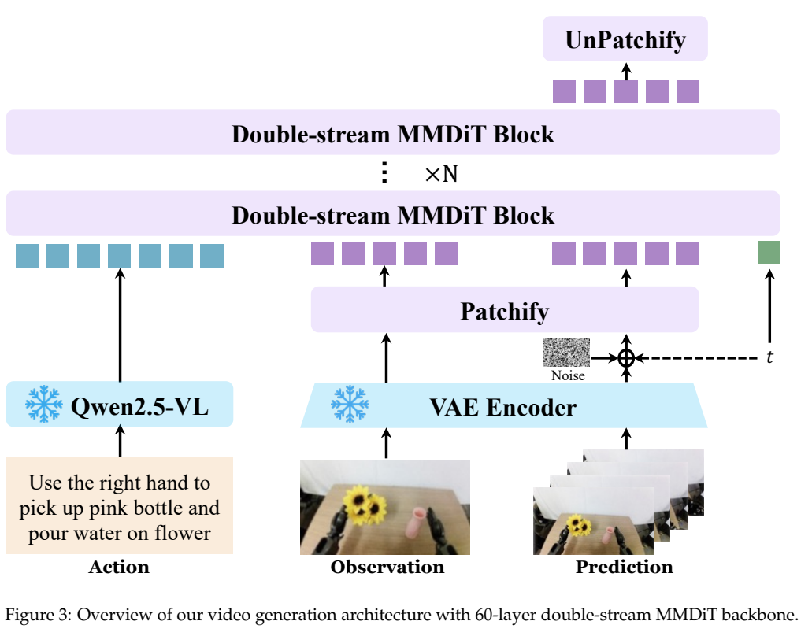
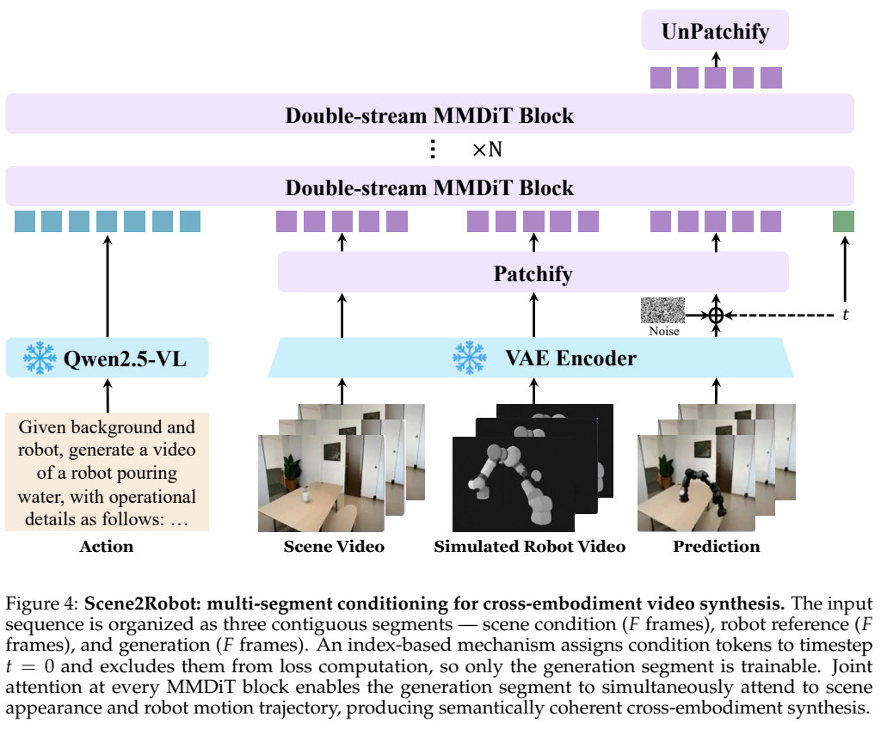
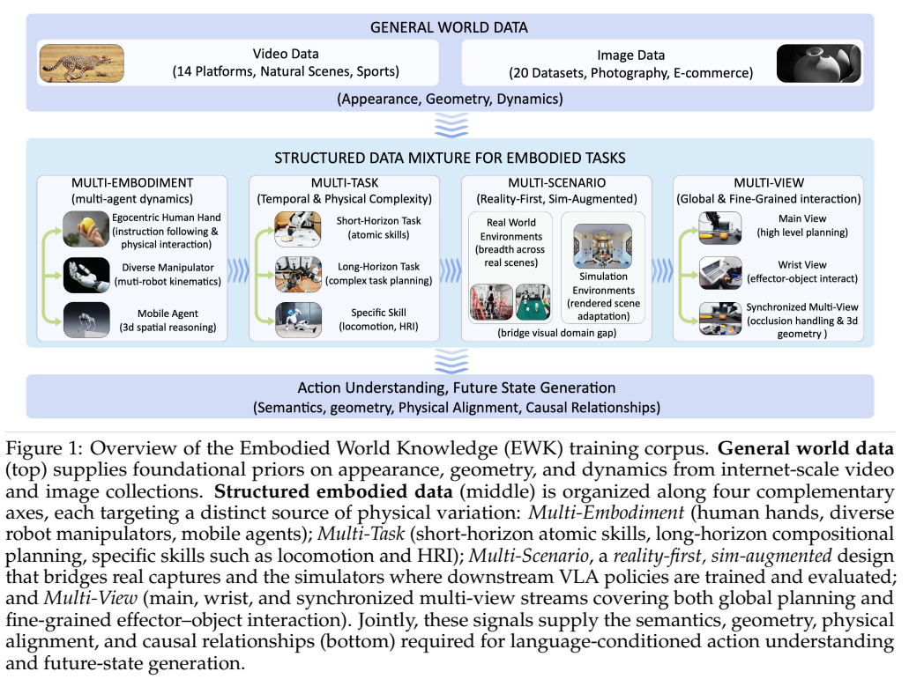
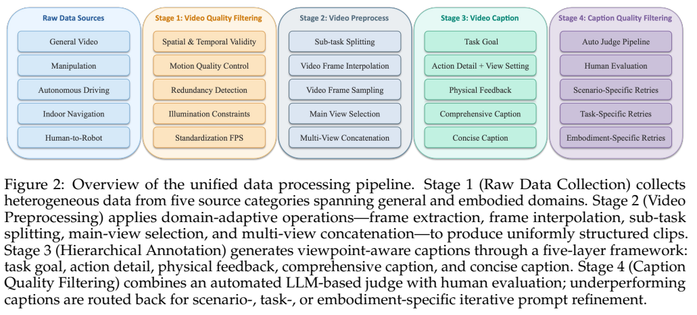
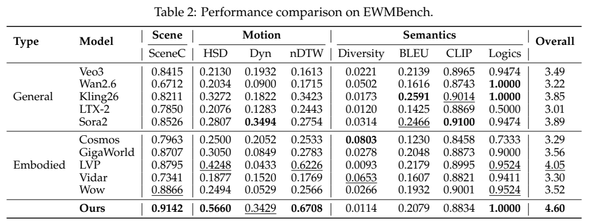
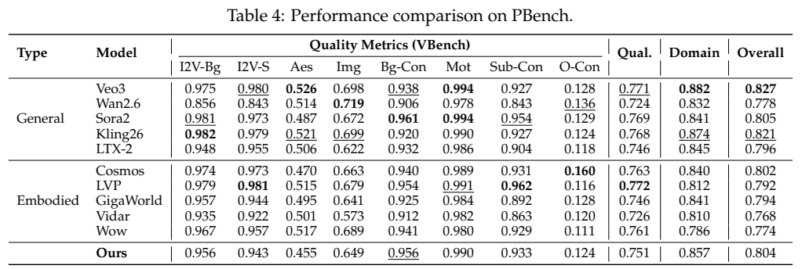
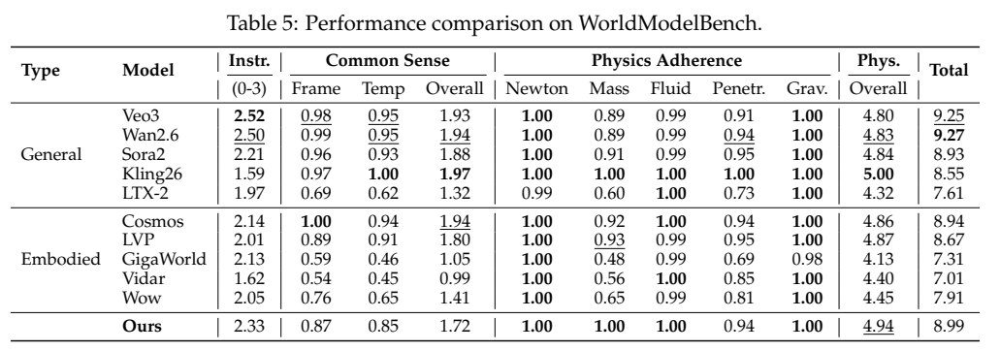
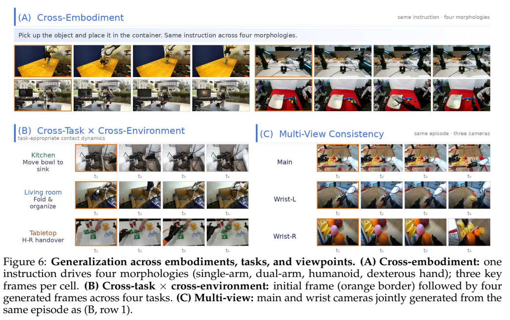

<!-- article-header:start -->
[项目首页](../../../README.md) › [模型系列](../../../reports/model-family-index.md) › [Qwen](../README.md)
<!-- article-header:end -->

# Qwen-RobotWorld：用语言条件视频生成统一具身世界建模

<!-- article-toc:start -->

**本篇目录** · [论文定位](#paper-info) · [快速概览](#overview) · [整体架构](#architecture) · [核心原理](#principles) · [数据构建](#data) · [训练流程](#training) · [实验结果](#experiments)
<!-- article-toc:end -->

## 1. 论文信息与模型定位

| 项目 | 内容 |
|---|---|
| 报告 | *Qwen-RobotWorld Technical Report: Unifying Embodied World Modeling through Language-Conditioned Video Generation* |
| 团队 | Qwen Team；Jie Zhang、Xiaoyue Chen 等，通讯作者 Xiong-Hui Chen、Chenfei Wu |
| 版本 | [arXiv 2606.17030v1](https://arxiv.org/abs/2606.17030v1)，提交 2026-06-15；PDF 首页日期为 06-16，共 25 页 |
| 系列与定位 | Qwen 系列的语言条件视频世界模型，覆盖机器人操作、驾驶、室内导航和人到机器人转换 |
| 官方发布 | [团队介绍](https://pre.qwen.ai/blog?id=qwen-robotworld) |
| 范围 | 世界模型报告，保留在范围待审查集合；主要输出未来视频，不直接输出机器人关节控制 |

它把当前视觉观察与自然语言动作指令映射成未来视觉轨迹。报告提出合成训练数据、虚拟评估环境和语言规划三种用途；这些是需下游适配的应用方向，不能等同于已经验证了完整机器人控制、碰撞检测或策略训练收益。

## 2. 快速概览

| 核心组成 | 报告披露 |
|---|---|
| 语义条件 | 冻结 Qwen2.5-VL-7B，读取文本末层隐藏状态 |
| 视频表示 | Wan-VAE，127M 参数 |
| 生成主干 | 20B、60 层双流 MMDiT；逐层联合注意力 |
| 具身语料 | EWK 约 8.6M 视频文本对，含约 70% 具身、30% 通用数据 |
| 训练 | 通用图像/视频联合预训练，再渐进引入具身数据 |
| 结果重心 | 语言动作匹配、操作视频物理合理性、跨视角一致性 |

报告的状态转移类比是 $`s_{t+1}=f(s_t,a_t)`$，但实现是随机条件视频生成。自然语言动作隐藏了低层轨迹和动力学细节，同一指令可能对应多个可行未来；“视频看起来合理”不能证明真实动力学或低层控制已经正确。

## 3. 整体架构

*原论文 Figure 3，PDF 第 10 页。冻结语义编码器提供动作条件，视频潜变量经过带噪生成流。*

理解流接收 Qwen2.5-VL 的文本隐藏表示，经可训练 connector 进入主干；生成流接收 VAE 编码的观察与带噪潜变量。两个流在每一层联合注意力中交互。MMDiT 使用 24 个注意力头、每头 128 维，总隐藏维度 3072，patch 为 2×2，最大支持 48,360 视频 token。7B 条件编码器与 20B 生成主干是不同模块，不能把模型写成 7B 视频生成器；VAE 还含 54M 编码器与 73M 解码器。

*原论文 Figure 4，PDF 第 11 页。背景场景、模拟机器人参考和生成目标分成三个 F 帧片段。*

常规 TI2V 把首帧视作干净条件。Scene2Robot 则将去除人手的场景视频、MuJoCo 模拟机器人视频、待生成视频沿时间组织成三段。前两段给出背景和运动形态，最后一段生成更逼真的执行画面。模型仍依赖输入的模拟轨迹，不能把转换案例说成只看自然人类示范就自动解决所有运动重定向。

## 4. 核心创新与数学原理

文本条件为 $`h=\phi(S)`$，视频状态为 $`z=E(x)`$，生成结果通过 VAE 解码。下面是说明双流联合注意力的示意式，原报告未逐项写出注意力公式：

$$
\mathrm{Attention}(Q,K,V)=\mathrm{softmax}\!\left(\frac{QK^\top}{\sqrt{128}}\right)V.
$$

两个流的 token 能共同参与 K/V 的条件交互，让生成过程持续读取语言语义。冻结语义模型中的世界知识是一种学习先验，不是刚体长度、接触或守恒方程的硬约束。

3D RoPE 将每头 128 维分给时间、高度、宽度，分别 16、56、56 维，并结合 Scalable RoPE 适应分辨率和时长。多视角数据水平拼接成单张布局，沿空间和时间共同生成；模型未据此加入显式相机标定、三维重建或物理求解器。

报告采用 flow matching。为解释目标，可用常见线性插值形式表示，而不是将此当作作者完整实现公式：

$$
z_\tau=(1-\tau)z_0+\tau\epsilon,\qquad
\mathcal L_{\mathrm{FM}}=\mathbb E\left[\Vert v_\theta(z_\tau,\tau,h)-(\epsilon-z_0)\Vert _2^2\right].
$$

这里 $`\epsilon\sim\mathcal N(0,I)`$，τ 是噪声时间；报告说明时间采样采用 log-normal 配置，并随视频序列长度进行自适应偏移，但没有披露完整参数化。生成目标的时间从噪声走向干净视频，观察首帧或 Scene2Robot 条件段固定在干净的 τ=0，并排除对应去噪损失。排除条件 token 的直接损失不等于它们不能通过注意力影响生成或参数梯度。

## 5. 数据构建与处理

*原论文 Figure 1，PDF 第 4 页。通用视觉先验与具身形态、任务、场景、视角四类变化共同覆盖。*

最终 EWK 约 8.6M 对、200M+ 观察帧；约 6M 具身样本中，单视角操作约 4.3M、多视角拼接约 1.6M，导航与驾驶约 200K。20+ 形态、500+ 动作类别与 1300+ skills 是不同统计口径，不能混作唯一任务数。Driving 部分列出的 1,744,405 原始 clip 与最终混合中的约 200K 也不相同，报告没有逐条列出保留率。

*原论文 Figure 2，PDF 第 8 页。图中还单列 Video Quality Filtering；图注和正文用四阶段概括，阶段拆分口径并不完全一致。*

通用视频标准化到 24FPS，支持多宽高比；具身数据按动作语义分段，必要时插帧，单视角选择主要相机，多视角同步拼接 2–4 路。不能把所有源数据原生帧率都写成 24FPS，例如导航源是 10FPS、256²。

五层标注依次描述任务目标、动作细节、物理反馈、50–100 词完整 caption、15–30 词简短 caption，要求明确视角，只描述可观察结果。训练对两种 caption 各采样 50%。LLM judge 检查事实、具体性、指令清晰度和视角，边缘或少数域样本人工复核，失败类别重新设计提示再标注。未给出人工样本比例和标注器逐域误差率。

人到机器人数据通过 MANO 重建、运动重定向、去手修补、MuJoCo 逆运动学及 14 种机器人渲染生成配对；另有约 80K episode 的简化渲染—Isaac Sim 真实感渲染对。通用数据排除 AI 合成内容的原则不适用于全部具身配对，后者明确包含模拟与修补图像。预训练所称 200M+ observation samples 与 EWK 的 200M+ 帧没有明确等价关系，本文分别保留。

## 6. 训练流程与目标

| 阶段 | 课程安排与目的 |
|---|---|
| 通用预训练 | 联合 T2I、T2V、TI2V，逐步从图像任务扩到全部任务；加入人手操作先验及同步视角 |
| 具身 SFT | 单视角操作→更多腕部/外部视角→同步多视角拼接→复杂操作、长步骤与跨域任务 |

SFT 每批保持约 70% 具身、30% 通用；在具身部分，操作约占 90% 采样权重，多视角拼接与导航/驾驶各约 5%。这是训练采样安排，不能与数据原始数量比例混用。T2I 的作用是锚定对象形态，视频任务学习动态；报告没有提供各课程元素的独立消融来量化收益。

Qwen2.5-VL 冻结，通过 connector 与 MMDiT 学习条件生成；架构图也标示冻结 VAE。训练使用 Megatron-LM 混合并行与部分双流块的选择性激活重计算。报告未充分披露 GPU 数量、总时长、batch、优化器、学习率、迭代数、推理采样步数及固定输出配置，因此不能从 20B 或 48K token 容量推算复现成本。这里的 SFT 仍训练视频流匹配目标，不是语言问答 token 的普通交叉熵微调。

## 7. 实验设置与主要结果

*原论文 Table 2，PDF 第 14 页。场景、运动、语义多个指标合成 Overall。*

EWMBench 只有 7 个任务、21 个样本，Overall=4.60，对照 LVP=4.05；HSD 为 0.5660 对 0.4248，约相对提升 33.2%。这是有限基准的运动指标收益，不能扩展为真实机器人成功率提升 33%。Dyn=0.3429 仍低于 Sora2 的 0.3494，BLEU/CLIP 也并非最优。

DreamGen 的六项分数相加得到 Total=4.952，对照 LVP=4.758。三个子集都来自 GR1 机器人，分别测试环境、对象、行为；并非三个不同机器人形态。行为 IF=0.832 低于 LVP=0.889，对象 IF=0.878 较强。IF 由 Qwen2.5-VL 评判，与条件编码器属于同一家族，需考虑评估器偏好。

*原论文 Table 4，PDF 第 15 页。Overall 是 Quality 与 Domain 两项平均值。*

PBench Quality=0.751、Domain=0.857，平均为 0.804；低于 Veo3 的 0.827 和 Kling26 的 0.821，也略低于 Sora2 的 0.805。美学与画面质量分别 0.455、0.649，不支持所有视觉质量全面领先的结论。作者以较低输出分辨率解释差距，但没有等分辨率反事实实验。

*原论文 Table 5，PDF 第 15 页。物理项有五类，穿透分数不是满分。*

WorldModelBench 覆盖 350 个实例、7 个域、56 个子域，总分 8.99，低于 Wan2.6 的 9.27、Veo3 的 9.25。牛顿定律、质量、流体、重力四项均为 1.00，穿透是 0.94；总物理 4.94 也低于 Kling26 的 5.00，不能写成“五项物理完全正确”。报告关于“开源模型第一”的说法依其对照选择与版本口径，本文不另行推导这些模型的许可状态。

*原论文 Figure 6，PDF 第 17 页；选取的生成案例不是覆盖全部失败率的统计。*

RoboTwin-IF 被描述为新任务零样本测试，但当前 v1 只给出对比案例，没有明确量化表、样本数和评分协议；训练也用了少量原 RoboTwin 数据，不能说整个模拟器域未见过。驾驶、导航和人到机器人转换主要是定性展示。报告缺少系统失败案例、重复采样方差、统一生成预算及真实策略训练/控制验证；这些限制决定了它更适合作为具身视频生成与研究工具的依据。

<!-- article-footer:start -->
---

[← 上一篇：世界动作模型](../../pretrained-to-imagine-fine-tuned-to-act-the-rise-of-wor-28acd80eab47/document-28acd80eab47/README.md) · [按发表时间浏览](../../../reports/paper-reading-guide.md#year-2026) · [下一篇：Seed2.0 →](../../seed/arxiv-2607.00248/README.md)

[返回本篇目录](#article-toc) · [返回模型系列](../README.md)
<!-- article-footer:end -->
