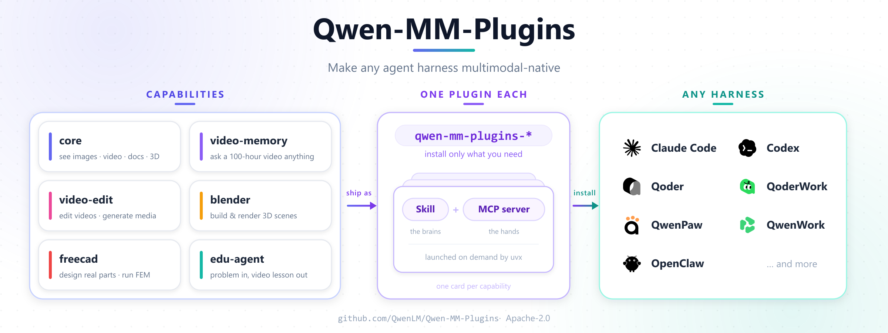

<!-- article-header:start -->
[项目首页](../../../README.md) › [模型系列](../../../reports/model-family-index.md) › [Qwen](../README.md)
<!-- article-header:end -->

# Qwen-MM-Plugins：面向多模态代理的技能与工具插件

<!-- article-toc:start -->

**本篇目录** · [论文定位](#paper-info) · [快速概览](#overview) · [整体架构](#architecture) · [核心原理](#principles) · [数据构建](#data) · [训练流程](#training) · [实验结果](#experiments)
<!-- article-toc:end -->

## 1. 论文信息与模型定位

- **原始来源**：[QwenLM/Qwen-MM-Plugins 官方仓库](https://github.com/QwenLM/Qwen-MM-Plugins)，直接依据 2026-10-08 获取的官方英文 README 快照。
- **署名与许可**：Qwen Team，README 给出的引用年份为 2026，工程采用 Apache-2.0。
- **真实定位**：把图片、视频、文档、三维文件及相关工作流接入代理运行环境的插件集合。它没有发布新的基础模型权重，亦不是 Qwen 多模态模型的训练技术报告。

原始上游目录将它作为一个条目列出。本仓库保留该条目，但明确其性质，避免让“Qwen 家族”归类被误解为又一个参数规模或模型版本。以下七部分沿用统一介绍结构，对没有模型训练信息的部分据实说明。

## 2. 快速概览

该项目解决的是“主模型具备多模态能力，代理运行环境却无法把媒体正确交给它”的接入问题。每项能力独立安装，形式为一个 **Skill 加可选 MCP server**：Skill 告诉代理怎样组织工作流，工具服务器负责读取、转换、渲染或调用外部服务。

`core` 让多模态主模型直接读取本地图像、视频帧和文件；`api` 调用视觉、音频、分割等模型服务；`search` 提供网页或反向图片检索。进一步的插件覆盖视频记忆与编辑、音视频笔记、从演示视频创建技能，以及 Blender、FreeCAD 和真实硬件。

“原生多模态”在这里指输入通道与工作流的连接方式，不意味着每个插件都训练了原生多模态网络。README 还说明多数代理环境暂不能向主模型原生传入音频，音频目前通过 API 处理。这个限制是理解项目能力边界的重要条件。

## 3. 整体架构

原文[未编号架构图](figures/official-architecture.svg)展示插件如何连接能力与代理运行环境。

**读图**：左列是能力，中央把每项能力封装为独立插件，右列是接收插件的运行环境。中间的 Skill/MCP server 分别承担工作流指导和工具执行。图中 `video-memory` 的“100-hour”是能力宣传示意，README 没有相应控制实验，不能当作已独立核验的视频时长上限。

部署由三个层次组成：代理环境使用已有的主模型；技能组织任务并选择工具；工具处理媒体或对接特定应用及服务。并非所有插件都有 MCP 服务，部分如 `edu-agent` 是 skill-only。工具依赖 `uvx` 按需启动和安装 Python 依赖，各能力可独立版本化、安装或回滚。

原生路径和服务路径需分开理解：`core` 默认不需要 API key，让现有多模态模型自己看图；`api` 将理解任务交给 DashScope 或兼容自托管服务，并按模型家族配置。视频编辑等生成工作流还要使用对应生成服务，项目不是一个统一的“所有媒体本地模型”。

| 模块 | 输入与输出 | 公开机制 |
|---|---|---|
| 插件能力包 | 任务需求 → 可加载能力 | 独立版本插件，按能力组合安装和运行 |
| Skill 工作流 | 任务指令 → 操作步骤与工具选择 | 描述如何完成任务；edu-agent 为 skill-only |
| MCP / 媒体工具 | 媒体及参数 → 页图、帧、裁剪、标注等结果 | 工具提供可执行函数，主模型继续观察与判断 |
| 模型调用路径 | 原始媒体或处理结果 → 多模态理解 | 核心路径由主模型直接看媒体，API 路径可调用外部模型 |
| 几何与执行环境 | 模型感知结果 → 确定性计算或媒体处理 | video-spatio 采用无状态几何工具；运行依赖按插件区分 |

## 4. 核心创新与数学原理

### 4.1 Skill 与工具：流程知识和执行接口分层

这里的贡献是工程接口和可组合工作流。独立插件让代理按任务加载能力，减少不同运行环境为每种媒体各写一套处理脚本的需要；技能与工具拆分则把“如何完成任务”的流程知识和“执行一次媒体操作”的函数接口区分开。

工作流规定何时抽帧、何时裁剪和何时核对结果；工具负责执行一次具体操作。分层后可以替换某个工具实现而继续复用任务步骤，也可以只提供技能而不附带新服务。插件安装关系和版本关系属于软件组织，不等同于一个统一训练的多模态网络。[依据：官方 README 的 Architecture / Capabilities](https://github.com/QwenLM/Qwen-MM-Plugins)。

### 4.2 保留媒体证据的直接观察路径

对多模态输入，重要的是保留可供主模型观察的媒体：例如导出文档页、视频帧、裁剪图像或带框标注，再交给模型判断。它与先让另一个视觉模型生成一句描述、再把描述交给文本主模型的路径不同。README 提供了两种路径的配置选择，但没有比较两者效果的消融。

文字摘要通常会压缩掉字号、布局、颜色或局部细节；保留页图和裁剪结果可让主模型针对当前问题再次检查证据。另一方面，直接媒体路径仍受模型输入格式和上下文预算限制；README 中的 API 选项是兼容不同运行环境的接口选择，并非已经验证直接观察在所有任务上更优。

### 4.3 感知、几何计算与运行时分工

`video-spatio` 的说明明确分工为模型做感知、无状态几何工具做计算。这有助于把视觉估计和几何运算分开，不过 README 没有披露统一坐标标定、几何误差模型或新的数学推导。因此本文不编写三维重建损失或坐标公式。

项目没有提出新注意力模块、视觉 tokenizer 或模型训练目标。Skill、MCP 与代理之间的信息流属于程序组合原理，不能改写成未披露的神经网络训练创新。

无状态工具只依赖本次显式输入，便于重现单次计算；它不会自动修正模型给出的错误检测或未标定坐标。媒体处理的 Node、ffmpeg 等依赖由宿主提供，失败反馈要返回代理处理。这些约束解释了为何完整任务质量既取决于感知，也取决于工具输入与执行环境。

## 5. 数据构建与处理

项目处理的是用户在任务中提供的文件及工具输出。`core` 覆盖媒体元数据、裁剪、边界框标注、页/帧导出及文档、代码、数据、三维模型的可视化；读取采用动态分辨率，通常不需用户预先手工缩放。README 没有给出这种动态分辨率的完整选择公式或性能对比。

长视频能力有两条表述：`video-memory` 构建分层记忆后基于记忆回答；`omni-memory` 联合处理视频及音轨，记住人物、说话内容、说话方式、声音和事件。后者需要 Omni 服务和 ffmpeg。记忆的精确索引结构、抽帧配方、存储规模和检索质量并未在此 README 完整披露。

`nifti` 读取 NIfTI 头信息并渲染体数据切片，默认在 source axis 2 选择三个内部切片，使用体级共享的 P1–P99 强度范围。这是显示归一化规则，不能当作医学诊断模型或训练数据增强。用户可以直接请求渲染，不以先运行检查作为强制前提。

README 没有提供新模型训练语料、数据集规模、标注质量、去重及基准划分。示例中的 PDF、会议视频、教程视频和图片是使用方式说明，不是经公开审计的训练集。

## 6. 训练流程与目标

该工程不报告预训练、监督微调或强化学习流程，也没有损失函数、学习率和冻结策略。安装插件改变代理可访问的工具和技能，不等于微调主模型。原文提到的模型服务保持各自的训练来源，不能把它们的模型 recipe 合并成这个项目的训练流程。

配置共享于 `~/.qwen-mm-plugins/config`。指导安装支持多种代理环境，其他环境另有手动设置说明；能力使用独立且不可变的发布标签。核心本地默认路径不需要凭证，文本描述 fallback、云服务和检索路径需要对应供应商凭证。

依赖随任务变化：`uv` 提供 `uvx`；视频经常依赖 ffmpeg/ffprobe；生成或交互式解释部分还需 Node；Blender、FreeCAD 必须具备对应本地应用。硬件 `mhs` 由硬件拥有者运行适配器，README 指明主机侧安全限位和急停。本文仅整理这些公开机制，没有安装插件、连接硬件或测试这些能力。

## 7. 实验设置与主要结果

官方 README 没有定量实验表。它提供能力列表和 cookbook 链接，以下为该固定版本可确认的功能声明：

| 能力组 | 公开说明 | 必要限定 |
|---|---|---|
| 本地媒体 `core` | 图像、视频帧、文档、三维文件的读取和可视化 | 默认原生图像模式免 key；依赖主模型及环境支持 |
| 服务 `api` | VL 问答/OCR/定位，Omni 转录/分说话人/事件理解，ASR、SAM3 | 需要已配置的服务，不是插件自行训练这些模型 |
| 视频记忆 | 长视频分层记忆及音视频记忆查询 | README 未报告检索准确率或统一长视频基准 |
| 创作与软件操作 | 媒体编辑、图文 PDF 笔记、技能提取、Blender、FreeCAD | 需要相关服务或本地应用，示例不等于成功率 |
| 空间与硬件 | 感知配合几何工具、标准适配器操作硬件 | 未披露统一精度或真实环境成功率 |

README 的自然语言例子，如“提取 PDF 第三页表格”“为两小时课程列时间戳要点”，说明预期入口和工作流，没有形成带样本数、参考答案及评价函数的评测。图中的能力标题同样不能转换成模型排行榜指标。

因此，适合从该条目学习的是媒体输入通道、技能组织、工具服务和跨环境封装。它如何影响代理完成率、时间成本、记忆检索错误率及与无插件系统的差异，原始 README 尚未提供定量证据；这些内容不在本介绍中虚构补齐。

<!-- article-footer:start -->
---

[← 上一篇：Kimi K3](../../kimi/document-eb106a710a29/README.md) · [按发表时间浏览](../../../reports/paper-reading-guide.md#year-2026) · [下一篇：DeepSeek Harness 来源核验 →](../../deepseek/document-ddf539694eca/README.md)

[返回本篇目录](#article-toc) · [返回模型系列](../README.md)
<!-- article-footer:end -->
