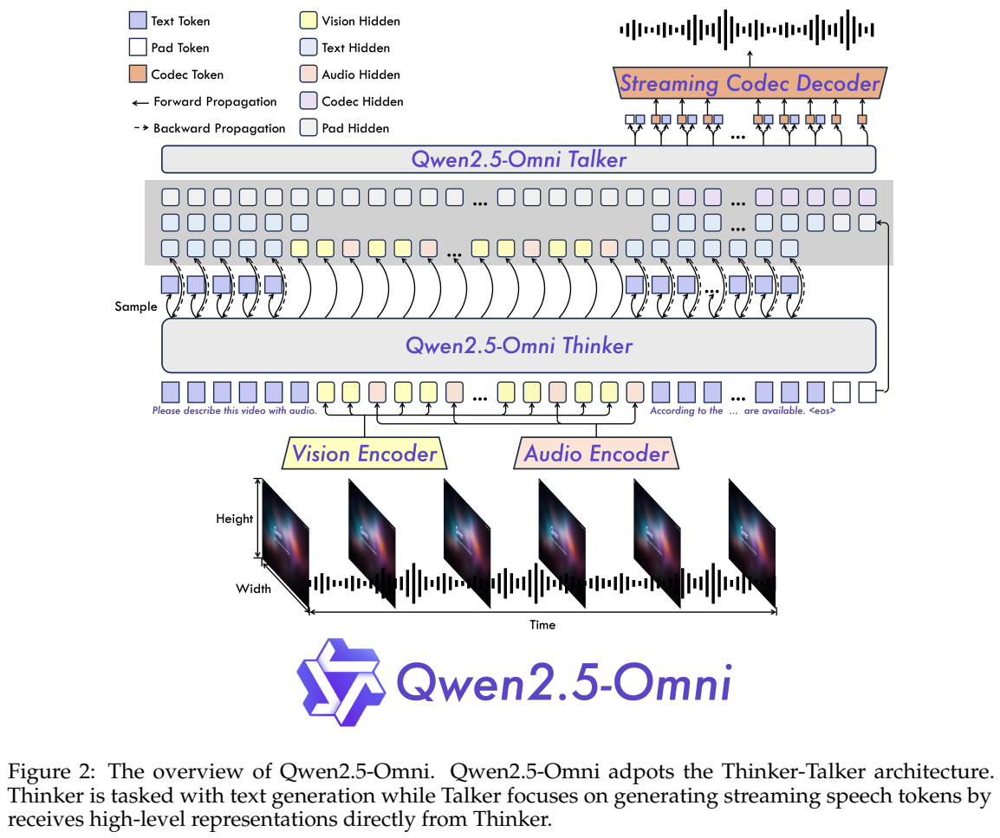
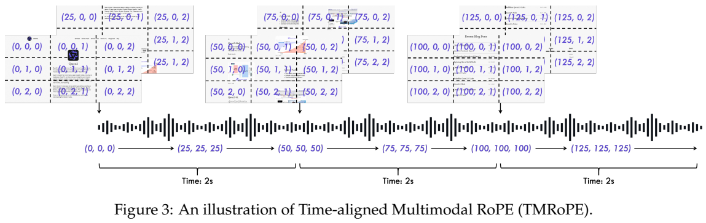
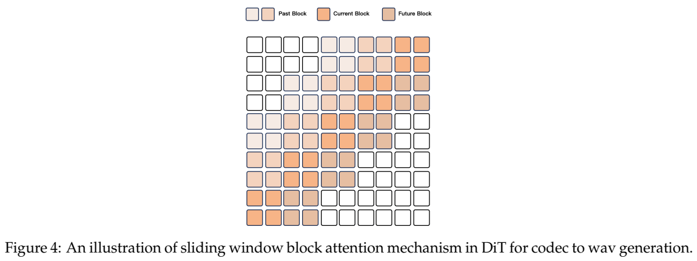
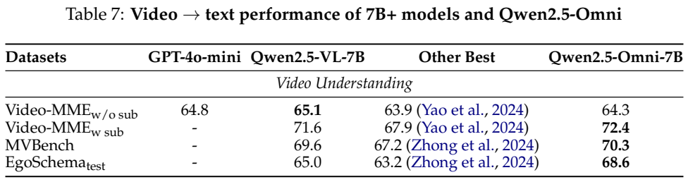
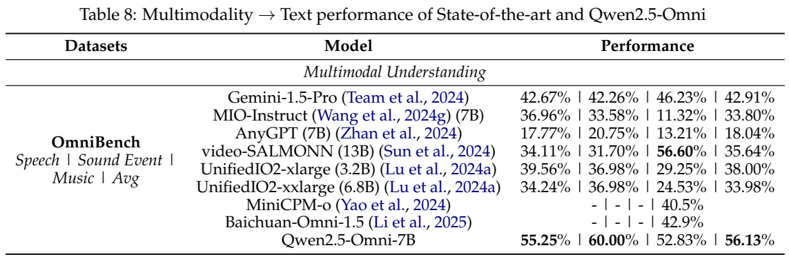
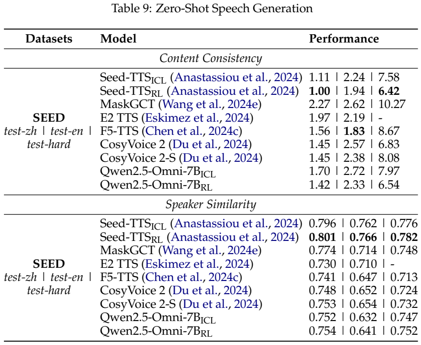
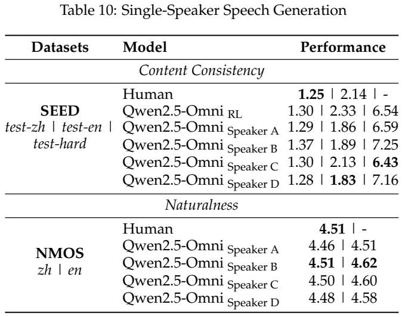

<!-- article-header:start -->
[项目首页](../../../README.md) › [模型系列](../../../reports/model-family-index.md) › [Qwen](../README.md)
<!-- article-header:end -->

# Qwen2.5-Omni：Thinker-Talker、音视频时间对齐与流式语音生成

> 本文解读 **Qwen2.5-Omni Technical Report**，采用原清单链接的官方 20 页 PDF 快照，报告首页日期为 2025-03-26。来源文件哈希与图表页码保存在单篇元数据中。本文围绕报告的 7B 评测型号展开，不混入后续模型配置。

<!-- article-toc:start -->

**本篇目录** · [论文定位](#paper-info) · [快速概览](#overview) · [整体架构](#architecture) · [核心原理](#principles) · [数据构建](#data) · [训练流程](#training) · [实验结果](#experiments)
<!-- article-toc:end -->

## 1. 论文信息与模型定位

| 项目 | 内容 |
|---|---|
| 题名与发布主体 | Qwen2.5-Omni Technical Report；Qwen Team |
| 发布与材料 | 2025-03-26；官方技术报告，本文采用固定下载快照 |
| 所属家族 | Qwen 的 Omni 分支，在同一系统中联合感知多种模态并产生文本和语音 |
| 输入与输出 | 文本、图像、音频、视频输入；文本及自然语音输出 |
| 型号与组件口径 | 实验型号为 Qwen2.5-Omni-7B；报告另说明视觉编码器约 675M 参数，不能将 7B 简单视为全部组件精确合计 |
| 核心定位 | 音视频联合理解、语音指令、图文问答和流式语音对话 |
| 官方资源 | [官方报告原链接](https://github.com/QwenLM/Qwen2.5-Omni/blob/main/assets/Qwen2.5_Omni.pdf) · [直接 PDF](https://raw.githubusercontent.com/QwenLM/Qwen2.5-Omni/main/assets/Qwen2.5_Omni.pdf) · [代码](https://github.com/QwenLM/Qwen2.5-Omni) |

这篇报告解决的是“看、听、说”之间的协作。模型既需要从视频画面和声音中提取关联信息，也需要在文本尚未全部生成时开始组织语音。它的输出模态是文本和语音；图像、视频和音乐的生成被列为后续方向，不应根据 Omni 名称扩大其现有输出范围。[原文摘要、§2、§6，PDF 第 1、3、12–13 页](https://raw.githubusercontent.com/QwenLM/Qwen2.5-Omni/main/assets/Qwen2.5_Omni.pdf#page=3)

## 2. 快速概览

Qwen2.5-Omni 将整体系统分成 Thinker 与 Talker。Thinker 负责理解文本、图像、音频和视频，生成语义表示和文字；Talker 接收这些高维表示以及已采样的文字 Token，产生语音 Token，再通过语音解码链路得到波形。两者共享上下文并支持端到端训练，避免将语音输出完全降为等待整段文字完成之后的独立 TTS 调用。

输入端的关键是时间对齐：TMRoPE 给音频和视频使用共同的时间尺度，按两秒块交错组织视听特征。输出端的关键是分块处理：音频编码器采用块内注意力，语音解码的 DiT 使用有限的历史和未来块，使系统能够逐块产生声音。

训练侧，报告给出三阶段预训练和 Thinker、Talker 不同的后训练路径。Talker 使用语音续接、DPO 和说话人微调，分别增强基础生成、稳定性以及声音的自然度与可控性。结果展示了联合多模态和语音理解的优势，也保留了部分视觉和纯文本任务的权衡。本文会将架构上的流式设计与实际延迟测量分开：报告解释了降低延迟的机制，但没有提供完整的统一硬件延迟曲线。[原文 §1–5](https://raw.githubusercontent.com/QwenLM/Qwen2.5-Omni/main/assets/Qwen2.5_Omni.pdf#page=2)

## 3. 整体架构

> 来源：原文 **Figure 2**，PDF 第 **3** 页。此处保留架构图区域及必要图注；[原页](https://raw.githubusercontent.com/QwenLM/Qwen2.5-Omni/main/assets/Qwen2.5_Omni.pdf#page=3)。

沿输入到输出读图：文本经过 Tokenizer，音频和视觉信号经各自编码器变成特征；Thinker 将这些信息结合成上下文并生成文字。Talker 接收 Thinker 的隐藏表示与文字嵌入，生成离散语音码，随后由码到 Mel、Mel 到波形的链路输出声音。输入的跨模态理解和输出的语音表达因此分配给不同模块，同时保留共同上下文。

| 模块 | 输入与输出 | 公开机制 |
|---|---|---|
| 文本 Tokenizer | 文本 → 离散 Token | Byte-level BPE，151,643 个普通 Token |
| 音频编码器 | 16kHz 音频的 Mel 特征 → 音频表示 | 128 通道 Mel，25ms 窗、10ms 步长；每个输出表示约对应 40ms 音频 |
| 视觉编码器 | 图像或视频帧 → 视觉表示 | 沿用 Qwen2.5-VL 的 ViT；Patch 为 14，相邻 2×2 特征压成一个视觉 Token |
| Thinker | 多模态上下文 → 高层表示和文本 | Transformer Decoder；处理理解与文字生成 |
| Talker | 隐藏表示和文字 Token → 语音码 | 双轨自回归 Transformer；随文字推进产生声音表达 |
| 语音解码 | 离散语音码 → Mel → 波形 | Flow-Matching DiT 和修改后的 BigVGAN，支持分块输出 |

单张图像被当作两张相同帧处理，视频则动态抽帧。这里的视觉时间组织与音频表示的 40ms 粒度是不同概念；模型用时间编码把它们映射到可关联的位置，而不是要求每个视频帧都拥有一个一一对应的音频 Token。[原文 §2.2–2.4，PDF 第 4–5 页](https://raw.githubusercontent.com/QwenLM/Qwen2.5-Omni/main/assets/Qwen2.5_Omni.pdf#page=4)

## 4. 核心创新与数学原理

### 4.1 TMRoPE：把画面与声音放到共同时间轴

> 来源：原文 **Figure 3**，PDF 第 **4** 页；[原页](https://raw.githubusercontent.com/QwenLM/Qwen2.5-Omni/main/assets/Qwen2.5_Omni.pdf#page=4)。图中位置编号与不同模态的块组织需一起阅读。

TMRoPE 将位置分解为时间、高度和宽度。文字的三个位置分量相同，图像的时间分量固定而空间分量变化；音频按 40ms 一档表达时间。对于非固定帧率的视频，视频帧的时间 ID 随其实际时间间隔调整，使一档仍对应 40ms。以时间戳 $`\tau`$ 表示秒数时，可将其尺度关系概括为 $`p_t\propto\tau/0.04`$；这是阅读辅助，完整编号还包括序列偏移及离散处理，报告未给出一个通用的取整公式。

序列结构还承担对齐任务。带声音的视频按实际时间切成两秒块，每块先排列视觉表示，再排列音频表示，随后进入下一块。这样，相近时刻的画面和声音在序列上也处于相关的局部范围。位置尺度与交错结构共同帮助模型连接“此时看见什么”和“此时听到什么”；不能仅依据位置编码就断言模型能恢复未采样的画面或未出现的声音。

### 4.2 Thinker-Talker：语义与发音共同驱动流式表达

Talker 同时读取高维语义表示和实际采样出的文字。隐藏表示有助于提前表达语气与态度，但语义相近的词可能发音不同；明确的文字 Token 则约束说出的内容。两类信息解决不同问题，不能用其中一类替代另一类。

语音生成不要求训练数据具备词级和时间戳级的逐一文本对齐。Talker 使用双轨自回归方式组织语音码与文字相关序列，在历史上下文中逐步输出。其目标是保持内容一致性并开始流式发声；报告没有给出每个 Thinker Token 与语音帧之间固定一对一的对应关系。[原文 §2.3，PDF 第 5 页](https://raw.githubusercontent.com/QwenLM/Qwen2.5-Omni/main/assets/Qwen2.5_Omni.pdf#page=5)

### 4.3 滑动窗口DiT：在连续性与首包等待之间折中

> 来源：原文 **Figure 4**，PDF 第 **5** 页；[原页](https://raw.githubusercontent.com/QwenLM/Qwen2.5-Omni/main/assets/Qwen2.5_Omni.pdf#page=5)。注意图中的历史、当前与前瞻块。

语音码先分块，DiT 的可见范围限制为四块：两个历史块、当前块和一个未来块。有限历史提供语音连续性，有限前瞻提供衔接信息，生成时无需等待整段语音码全部到齐。随后 BigVGAN 也利用固定感受野分块重建波形。

因此，该设计包含一块前瞻，不能称为完全不等待未来内容的严格因果解码。它降低的是相对于全序列处理的等待需求，真实首包时间还受输入编码、Thinker 到首个语音码、语音解码和硬件计算影响。对于长音频，原文把音频编码器的注意力改成两秒块处理，输入和输出两端共同适配流式流程。

## 5. 数据构建与处理

预训练覆盖图文、视频文本、带声音的视频、音频文本和纯文本语料。作者将层次式任务标签替换成自然语言提示，以增强不同任务表述之间的泛化。报告具体给出了第二阶段加入的数据 Token 量，但没有公开所有阶段的完整样本总量和最终数据比例。[原文 §3，PDF 第 6 页](https://raw.githubusercontent.com/QwenLM/Qwen2.5-Omni/main/assets/Qwen2.5_Omni.pdf#page=6)

| 数据用途 | 公开规模与单位 | 处理或监督方式 |
|---|---|---|
| 第二阶段图像与视频相关数据 | 800B Token | 加入更广泛的视觉任务 |
| 第二阶段音频相关数据 | 300B Token | 覆盖不同音频理解与交互任务 |
| 第二阶段带音频的视频数据 | 100B Token | 支持视听联合建模 |
| Thinker 指令数据 | 规模未披露 | ChatML；纯文本、视觉、音频和混合模态对话 |
| Talker 基础学习数据 | 规模未披露 | 带多模态上下文及语音回复的对话、语音续接 |
| Talker 偏好数据 | 规模未披露 | 输入及回复文本配参考语音，依据内容及停顿错误形成好/差语音序列 |

800B、300B、100B 合计为第二阶段额外引入的 1.2T Token，不能把它当作所有阶段的预训练总量，也不能理解为样本条数。纯文本还用于维持语言能力，但其配比没有随这组数字完整列出。语音数据中可能存在标注与发音噪声，Talker 的偏好训练就是针对这种稳定性问题；报告没有披露可直接复制的全量去重阈值和混合采样配方。

音频统一重采样和 Mel 变换，视频动态帧率采样，带声音的视频按时间交错打包。预处理决定了模型所见的时间粒度及序列长度；高分辨率和更多帧会增加视觉序列成本，音频时长也会增加输入表示。它们属于不同模态的预算来源，不能只用文件字节数判断推理负担。

## 6. 训练流程与目标

| 阶段 | 原文训练安排 | 主要目的 |
|---|---|---|
| 第一阶段预训练 | 冻结 LLM；音频和视觉分支先训练各自 Adapter，再训练编码器 | 建立视觉—文本、音频—文本关联 |
| 第二阶段预训练 | 解冻全部参数，加入更广泛的混合模态数据 | 学习跨模态及多任务能力 |
| 长序列预训练 | 前面阶段最大 8,192 Token，随后扩展至 32,768 Token | 处理长音频、长视频等上下文 |
| Thinker 后训练 | 使用 ChatML 格式的多类指令对话微调 | 形成统一任务响应方式 |
| Talker 三阶段训练 | 续接学习 → DPO → 多说话人指令微调 | 基础语音生成、稳定性、自然度和声音可控性 |

语言部分由 Qwen2.5 初始化，视觉编码器沿用 Qwen2.5-VL，音频编码器的训练初始化在 §3 明确写为 Whisper-large-v3。§2.2 从模块来源角度称其采用 Qwen2-Audio 音频编码器，阅读时应保留这两个不同层面的描述，不能把原文简化成一个完全无关的新编码器。

Talker 的续接训练使用 next-token prediction，并学习语义表示与语音之间的单调映射。作者还使用音色解耦，减少某个声音与不常见文本模式之间的偶然绑定。DPO 阶段则比较同一输入下较好和较差的语音生成结果。原文 Equation **(1)** 可按好/差样本符号转写为：

$$
\mathcal L_{\mathrm{DPO}}=-\mathbb E_{(x,y^+,y^-)\sim D}\log\sigma\left[\beta\left(\log\frac{P_\theta(y^+\mid x)}{P_{\mathrm{ref}}(y^+\mid x)}-\log\frac{P_\theta(y^-\mid x)}{P_{\mathrm{ref}}(y^-\mid x)}\right)\right].
$$

$`x`$ 包含输入及回复文字，$`y^+`$、$`y^-`$ 是偏好不同的生成语音序列；$`P_\theta`$ 为更新模型，$`P_{\mathrm{ref}}`$ 为参考模型。奖励排序涉及 WER 和标点停顿错误率，因而此阶段主要约束语音内容及稳定性。随后说话人微调强化目标声音的韵律和自然度。报告没有披露 $`\beta`$、全部优化超参和训练硬件成本，不能由标准 DPO 名称补全这些配置。[原文 §3–4、Eq. (1)，PDF 第 6–7 页](https://raw.githubusercontent.com/QwenLM/Qwen2.5-Omni/main/assets/Qwen2.5_Omni.pdf#page=7)

## 7. 实验设置与主要结果

评测按 **X→Text** 理解任务和 **X→Speech** 语音生成任务划分。理解覆盖纯文本、音频、图像、视频和混合模态，生成主要以类似 TTS 的内容一致性、声音相似度和自然度评价。WER 越低越好，SIM 与 NMOS 则是不同口径，不能把它们混成单一生成质量分。

> 来源：原文 **Table 7、Table 8**，PDF 第 **12** 页；[原页](https://raw.githubusercontent.com/QwenLM/Qwen2.5-Omni/main/assets/Qwen2.5_Omni.pdf#page=12)。

| 基准 | Qwen2.5-Omni-7B | 原表对照 | 解读 |
|---|---:|---|---|
| OmniBench 平均 | 56.13% | Gemini 1.5 Pro 42.91%；MiniCPM-o 40.5% | 联合视听理解是主要优势之一 |
| MMAU 平均 | 65.60 | Qwen2-Audio 49.20 | 来自音频推理表，包含声音、音乐和语音子集 |
| VoiceBench 平均 | 74.12 | MiniCPM-o 71.69 | 语音交互综合任务表现较好 |
| Video-MME，无字幕 | 64.3 | Qwen2.5-VL-7B 65.1 | 并非全部视频条件都超过视觉专用型号 |
| Video-MME，有字幕 | 72.4 | Qwen2.5-VL-7B 71.6 | 字幕条件下略高，须与上一行分开比较 |
| MMMU val | 59.2 | Qwen2.5-VL-7B 58.6 | 图像理解中的一项接近或略高结果 |
| ChartQA test Avg. | 85.3 | Qwen2.5-VL-7B 87.3 | 联合模型在该视觉指标上存在差距 |

MMAU、VoiceBench 取自 Table 3（第 10 页），视觉结果取自 Table 5（第 11 页）。从这组比较看，Omni 能在同一系统中保留较强视觉能力，同时提高听觉和视听联合任务表现，但其“统一”并不意味着每个单模态基准都获益。纯文本 Table 1 也显示 MMLU-Pro 为 47.0，低于 Qwen2.5-7B 的 56.3；GSM8K 为 88.7，低于 91.6。将额外模态加入模型后，能力保留仍需逐项检验。[原文 Table 1、3、5，PDF 第 8、10、11 页](https://raw.githubusercontent.com/QwenLM/Qwen2.5-Omni/main/assets/Qwen2.5_Omni.pdf#page=8)

> 来源：原文 **Table 9、Table 10**，PDF 第 **13** 页；[原页](https://raw.githubusercontent.com/QwenLM/Qwen2.5-Omni/main/assets/Qwen2.5_Omni.pdf#page=13)。

SEED 的 test-zh、test-en、test-hard 上，Omni 的 ICL 基础模型 WER 为 1.70、2.72、7.97，偏好优化后的 RL 行为 1.42、2.33、6.54。困难集减少 1.43 个分数点，相应声音相似度从 0.747 提升至 0.752；这两种指标分别反映内容错误和声音特征。虽然优化后优于表中的部分 TTS 系统，Seed-TTS RL 的困难集 WER 为 6.42，仍略低于 Omni 的 6.54，不能称全部指标最优。

说话人微调后，中文 NMOS 的四个声音分别为 4.46、4.51、4.50、4.48，原表人类中文参考为 4.51。它显示该主观评测中接近人类参考的自然度，但不代表任意声音、语言和真实长对话都具有同样分数；部分声音的困难集 WER 也高于基础 RL 模型。

报告用语音化的文本指令检验端到端交互，约保留适合转成语音的 90% 指令。Omni 在这套 GSM8K 子集上为 85.4，Qwen2-Audio 为 18.4，使用文本输入的 Qwen2-7B 为 82.3。比较反映了语音指令能力的显著进步，但子集与输入模态已变化，不能把这些分数替代 Table 1 的完整纯文本结果。[原文 Table 4，PDF 第 10 页](https://raw.githubusercontent.com/QwenLM/Qwen2.5-Omni/main/assets/Qwen2.5_Omni.pdf#page=10)

最终，实验证据支持 Thinker-Talker 系统具备较强的联合理解和流式语音生成能力，偏好训练增强了语音稳定性。原文没有提供逐一移除 TMRoPE、时间交错或滑动窗口的完整控制消融，因此各机制的独立贡献和统一硬件下的实际首包延迟仍需要额外实验确认。

<!-- article-footer:start -->
---

[← 上一篇：GPT-4o 原生图像生成附录](../../gpt/document-0b8790d1de58/README.md) · [按发表时间浏览](../../../reports/paper-reading-guide.md#year-2025) · [下一篇：Llama 4 →](../../llama/document-4003084812b3/README.md)

[返回本篇目录](#article-toc) · [返回模型系列](../README.md)
<!-- article-footer:end -->
