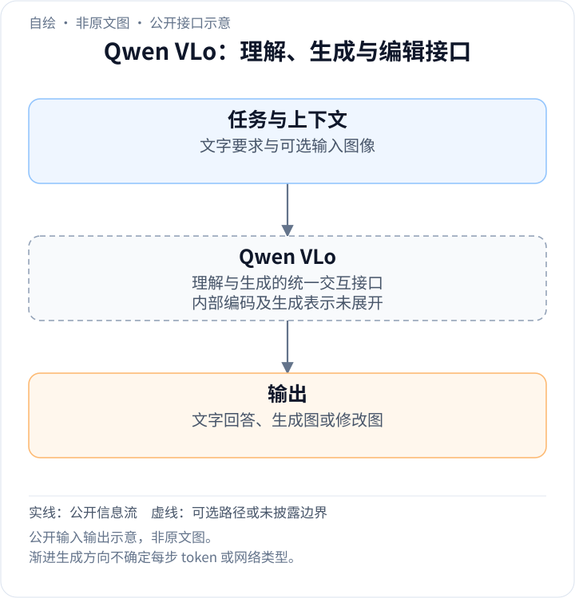
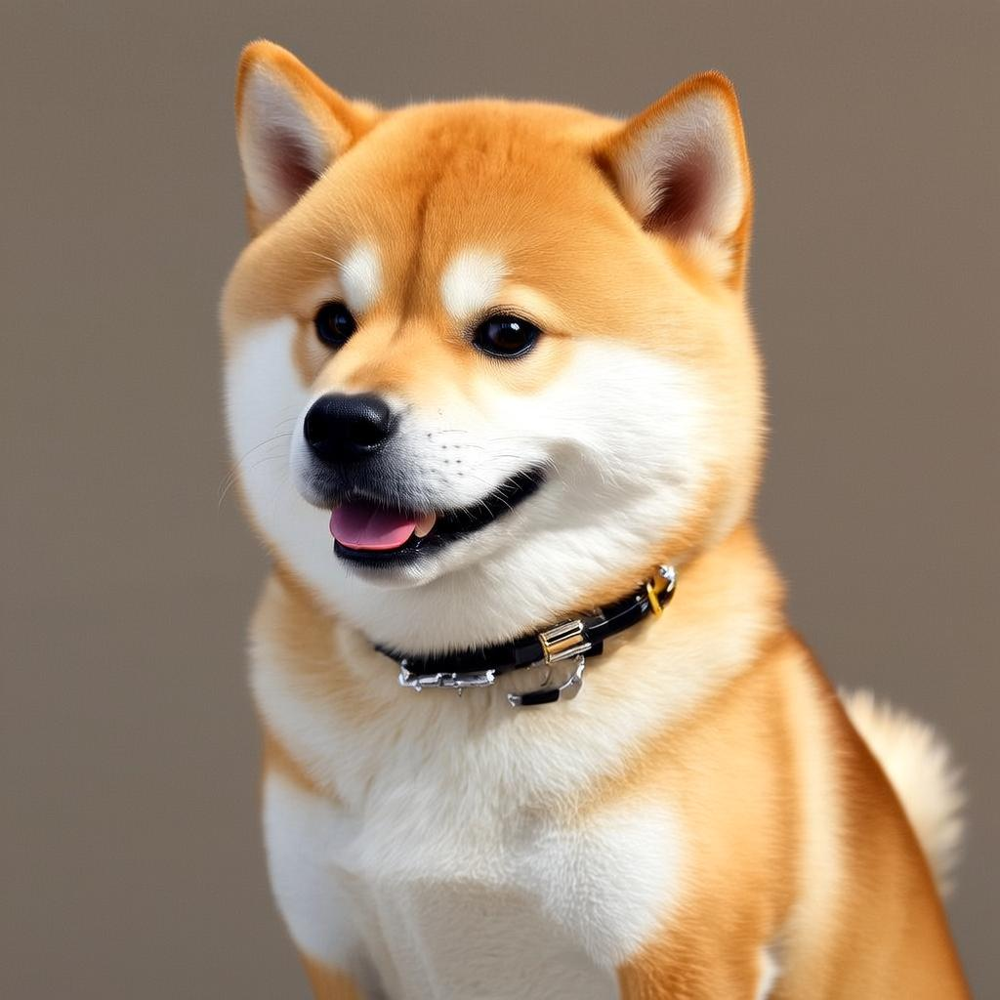
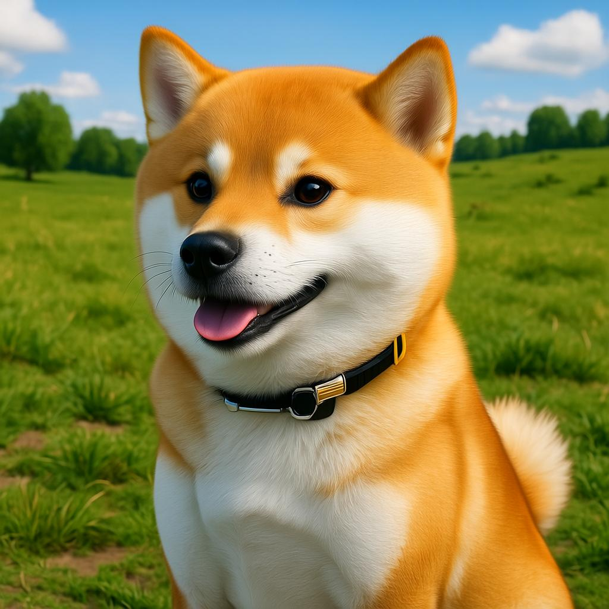
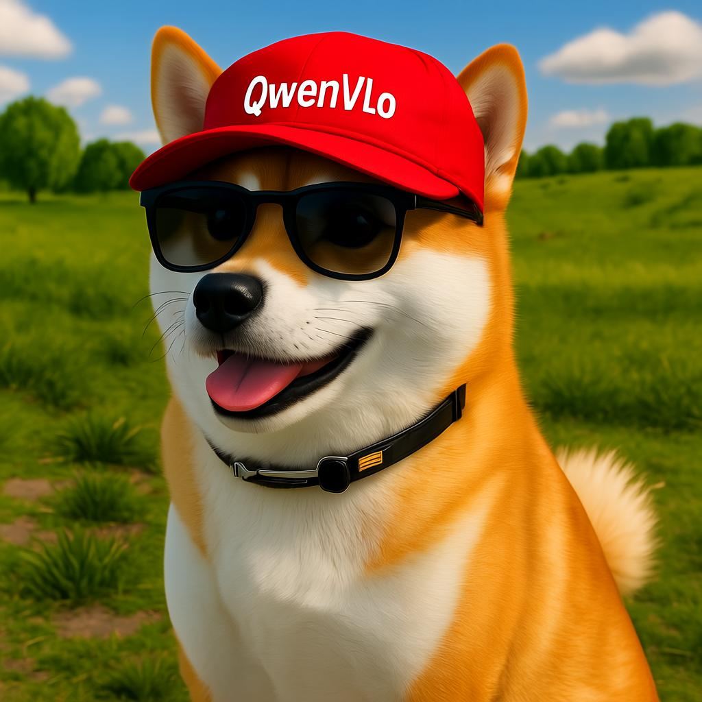
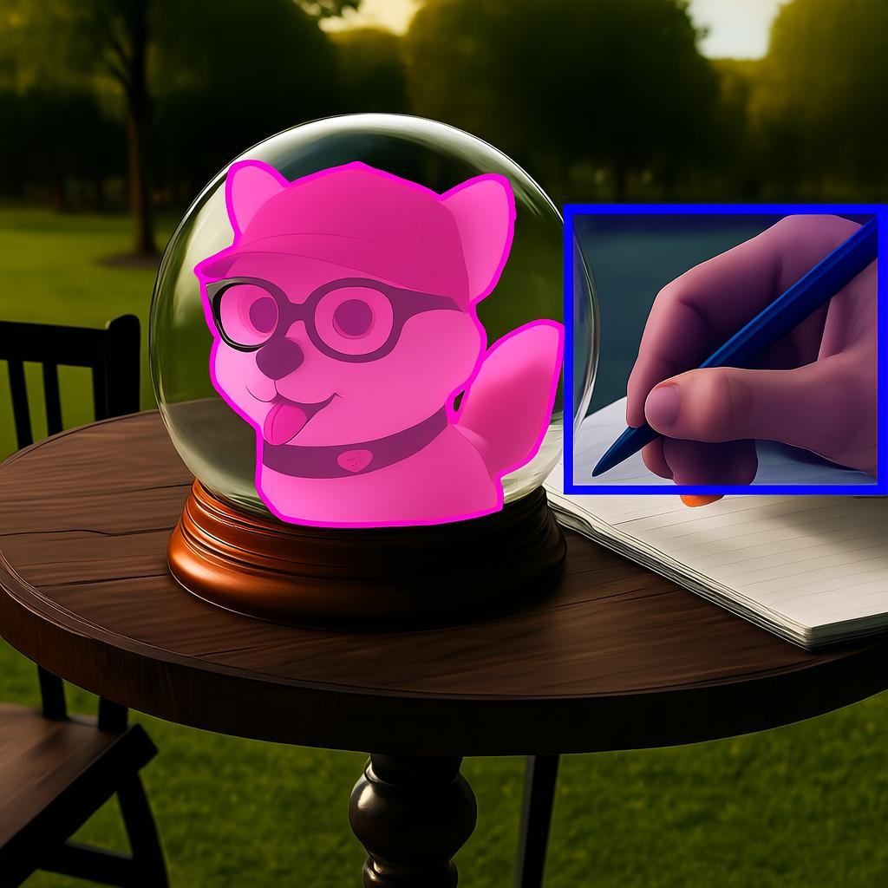

<!-- article-header:start -->
[项目首页](../../../README.md) › [模型系列](../../../reports/model-family-index.md) › [Qwen](../README.md)
<!-- article-header:end -->

# Qwen VLo：统一视觉理解、图像生成与指令编辑

<!-- article-toc:start -->

**本篇目录** · [论文定位](#paper-info) · [快速概览](#overview) · [整体架构](#architecture) · [核心原理](#principles) · [数据构建](#data) · [训练流程](#training) · [实验结果](#experiments)
<!-- article-toc:end -->

## 1. 论文信息与模型定位

| 项目 | 信息 |
|---|---|
| 原文 | Qwen VLo: From “Understanding” the World to “Depicting” It |
| 发布方与时间 | Qwen Team，2025 年 6 月 26 日 |
| 材料 | [官方发布博客](https://qwenlm.github.io/blog/qwen-vlo/)，本目录保存 2026-10-08 快照 |
| 发布状态 | 原文介绍的是预览版，在 Qwen Chat 使用；本文不以旧文推断当前开放范围 |
| 模型定位 | 统一多模态理解与生成：文字生图、图像编辑、生成内容再理解、视觉标注 |
| 未披露项 | 参数规模、语言主干版本、视觉 tokenizer、生成解码器、完整数据与训练配方 |

Qwen VLo 的关键变化是输出能力：不仅用文字解释图像，还能根据理解修改和生成图像。它与 Qwen2.5-VL 的视觉问答定位有关联，但这篇博客没有确认二者共享完全相同的模型内部结构。VLo 也不等于一个已经披露 diffusion、VQ tokenizer 或 next-token 细节的技术报告。

## 2. 快速概览

公开能力包括保持对象语义的编辑、背景替换、添加物体、风格转换、编辑文字、中英文指令，以及生成检测框、分割或边缘图。它还展示复杂指令中的多项修改及同一图像的连续交互编辑。

原文称采用 **渐进式生成**，从左至右、从上至下逐步形成图像，并采用动态分辨率训练以支持不同分辨率与宽高比。这个公开描述没有说明最小生成单位是像素、patch 还是离散视觉 token，也没有给出因果 mask 或采样步数，不能仅凭生成方向把它断言成某种已知自回归架构。

两项展示能力在发布时尚未正式上线：**多图输入**及 **4:1、1:3 等极端宽高比生成**。介绍模型能力时必须保留预览与未上线边界。示例提示词里的“8K”是用户要求或风格描述，不证明服务输出分辨率达到 8K；本目录选取的案例原图实际为 1024×1024。

## 3. 整体架构

<!-- derived-architecture:start -->

*自绘公开接口示意（非原文图）。依据下述公开资料归纳；方框表示功能组件，不代表逐层实现。*

依据：[official-source-snapshot-2026-10-08; The Creative Process / Understanding to Creation](https://qwenlm.github.io/blog/qwen-vlo/)。
<!-- derived-architecture:end -->

原文没有内部网络结构图，可确认的是统一的用户交互路径：文字可以直接请求图像；已有图像配合指令可以产生修改图；模型还能再读取生成图并回答有关内容的问题。感知任务也可通过图像输出表达，例如画框或着色蒙版，而不是只输出坐标文字。

这是博客 case1 的第一张原图，来自“生成可爱的柴犬”一类文本需求。它提供后续编辑的对象基础，展示的是一张生成结果，没有输入实拍真值。不能据此计算重建误差或识别准确率。

第二张对应将背景改为草地。对象仍具有橙白毛色、耳形和项圈等语义特征，但毛发、嘴部、项圈与姿态细节也发生变化。这个对照适合说明“主体语义保持与场景改变”，不宜称为主体所有像素或几何完全不变的精确抠图编辑。

模型怎样在理解表示与生成表示间转换、是否用独立图像编码器或生成头、是否共享全部参数，博客都没有提供。即使输入输出都属于图像，也不能由案例反推中间特征布局或冻结模块。

博客另公开了生成顺序：图像按从左到右、从上到下的方向逐步构建。它说明用户可见的渐进生成过程，但没有交代每步的预测单位、离散或连续表示、注意力掩码或图像解码器，因而不足以据此重建自回归或扩散网络的内部计算图。原文 The Creative Process。

## 4. 核心创新与数学原理

博客的核心思想是把语义理解用于可控视觉生成，并让生成结果成为进一步理解和交互的对象。这里的创新是公开能力与交互机制层面的描述，原文没有提出编号公式或可复现的训练算法。

为了说明统一任务，可把文字生图表示为 $`p_\theta(I'\mid u)`$，把指令编辑表示为 $`p_\theta(I'\mid I,u)`$，再理解表示为 $`p_\theta(y\mid I',q)`$。这些是本文的任务概率定义，说明各任务的条件与输出不同；它们并不证明所有条件分布由同一参数集或单一损失训练。

渐进生成若按某种顺序输出区域 $`z_1,\ldots,z_K`$，可用链式法则写成 $`p(z_{1:K}\mid c)=\prod_kp(z_k\mid z_{\lt k},c)`$。这是概率分解的标准解释，不是原文公布的视觉 token 自回归目标。实际系统是否用这一形式、各区域怎样划分、是否允许回修前面区域，博客均未说明。因而本文不补造视觉词表、位置编码、VQ 码本或 flow-matching 方程。

编辑任务的难点是同时满足修改指令和保持不相关内容。例如“加红帽并写字”既要定位头部、安排帽子遮挡，还要将文字放到正确区域。输出可以体现语义组合，但博客没有给出身份保持、文本准确率或区域外变化的量化指标，不能只凭一张漂亮案例证明这些约束都被严格满足。

第三张确实呈现红帽、深色墨镜和帽上的 QwenVLo 字样，说明该示例完成了多项组合要求。原提示还要求“黑色透明墨镜”，图中镜片较暗，不能声称各属性均无误。它仍是官方选择的单个示例，并非批量文字渲染成功率。

## 5. 数据构建与处理

公开材料确认 **动态分辨率训练**，但没有公开训练图像数、文本图像配比、编辑数据来源、蒙版构建方法、合成数据比例、分辨率分桶、去重和质量过滤。动态分辨率意味着训练可覆盖不同图像形状，不能直接推导“任意分辨率都不受显存与 token 预算限制”。

博客展示多种自然语言指令，含中文和英文，但没有提供统一的双语测试集或其他语言成绩。示例覆盖风格转化、海报、主体替换、局部删除、多对象组合及感知标注，反映应用覆盖面；它们不能自动作为全部训练任务的清单，更不能证明这些测试图与训练数据完全无重叠。

原文未来展望提到用分割、检测等生成中间结果来检验理解、改善模型。这是后续探索方向，不能改写成已实施的训练数据闭环或已经验证的自监督奖励。对生成图片再提问的案例，则只证明一次交互形式存在，不代表推理具有独立视觉真值认证。

## 6. 训练流程与目标

博客没有披露预训练、对齐、SFT、偏好优化或 RL 的阶段安排，也没有给出 loss、学习率、batch size、训练步数、冻结策略与硬件。唯一明确的训练描述是动态分辨率训练，所以不能按通用“先对齐 projector 再训练 LLM”流程填充这一节。

推理的渐进显示是输出机制，与优化目标是不同层面。它可以使用户逐步观察创作过程，但原文未提供真正的局部修改接口协议、中途交互成功率、生成耗时或复杂度。官方称该机制适合需要细致控制的长文字与漫画场景，这属于方法动机与应用说明，不能据此报告未提供的吞吐提升百分比。

预览版的局限被原文明确列出：生成可能不准确、与原图不一致、不遵循指令，或对生成内容的意图理解不稳定。介绍训练效果时应与这些限制一起理解，不能把未来迭代目标写成已有稳定能力。

## 7. 实验设置与主要结果

这篇发布博客没有定量基准、对照模型表、受控消融或评测样本数。主要证据是官方案例，适合逐图解释能够观察到的变化，不能虚构 GenEval、DPG、FID、IoU 或 AP 成绩。

最后一张来自 case1 的第九张原图：同一系列先经过风格转换、置入水晶球、加入公园桌面与绘画场景，再要求画蓝框和粉色蒙版。图中蓝框包住画笔及手部较大的区域，粉色蒙版覆盖球内的狗形对象。这说明生成式标注的可见表达方式，也暴露出框的范围不是笔的严格紧致框；没有人工标注真值，不能计算定位或分割正确率。

| 原文示例类型 | 可观察能力 | 不能由示例单独证明的内容 |
|---|---|---|
| 柴犬连续编辑 | 文字生图、改背景、加配饰与文字、风格和场景转换 | 多轮身份完全不漂移、所有细节精准保留 |
| 检测、分割、边缘图 | 可用图像输出表达感知标注 | 标准检测 AP、分割 IoU 或真实深度精度 |
| 海报与复杂场景 | 组合多个对象、风格和文字排版要求 | 量化文字准确率、复杂指令整体成功率 |
| 多图用品放入篮子 | 官方展示多图理解与生成方向 | 发布时已开放该功能；原文明确尚未正式上线 |
| 极端比例横幅 | 展示 4:1 或 1:3 方向的动态比例能力 | 当时服务已上线全部极端比例 |
| 生成后问品种 | 能再分析自己生成的图像 | 品种事实一定正确；原答中将 tabby 当成品种的表述也需谨慎 |

材料展示了统一视觉理解与生成的交互方向，但无法量化结构创新、训练数据或渐进生成各自带来的收益。原始示例含美观的成功展示，也保留了明确的不稳定性声明；本文据真实原图解释结果，没有实际调用模型或把展示案例当作独立评测。

<!-- article-footer:start -->
---

[← 上一篇：MMSearch-R1](../../mmsearch-r1/arxiv-2506.20670/README.md) · [按发表时间浏览](../../../reports/paper-reading-guide.md#year-2025) · [下一篇：DenseWorld-1M →](../../denseworld-1m/arxiv-2506.24102/README.md)

[返回本篇目录](#article-toc) · [返回模型系列](../README.md)
<!-- article-footer:end -->
