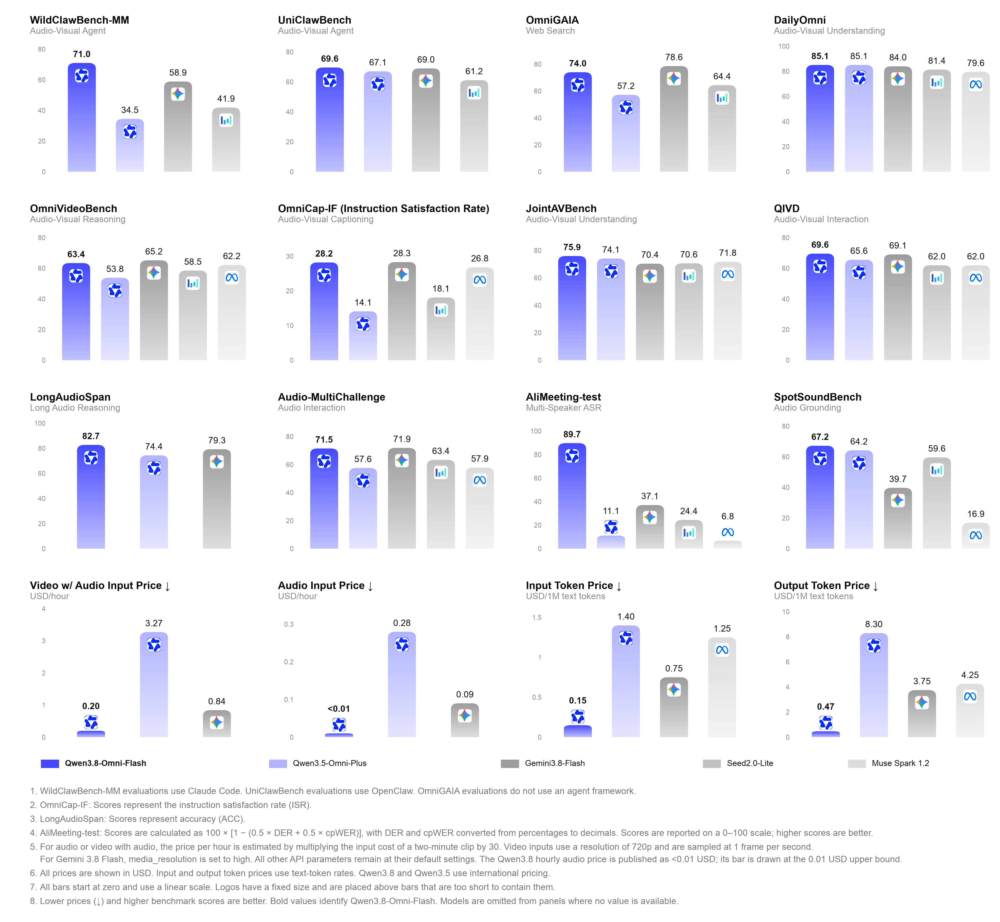

<!-- article-header:start -->
[项目首页](../../../README.md) › [模型系列](../../../reports/model-family-index.md) › [Qwen](../README.md)
<!-- article-header:end -->

# Qwen3.8-Omni-Flash：从视听理解到工具执行与实时交互

<!-- article-toc:start -->

**本篇目录** · [论文定位](#paper-info) · [快速概览](#overview) · [整体架构](#architecture) · [核心原理](#principles) · [数据构建](#data) · [训练流程](#training) · [实验结果](#experiments)
<!-- article-toc:end -->

## 1. 论文信息与模型定位

本条目是 Qwen Team 的官方发布文章 **Qwen3.8-Omni-Flash: Omni Senses. Agentic Delivery.**，不是 arXiv 技术论文。原目录链接为 [Qwen 官网](https://qwen.ai/blog?id=qwen3.8-omni-flash)，恢复正文来自官网公开文章接口，对应 [官方静态博客](https://qwenlm.github.io/blog/qwen3.8-omni-flash/)。本文固定使用 2026-10-08 来源快照；页面显示 2026-09-14，并保留 `[draft]` 标记。下面介绍的是这份可获取的官方材料，不能据此推定另有完整训练报告。

模型面向文本、图像、音频和视频输入，提供百万 token 上下文，强调视听智能体的计划、工具调用与成品交付。文章区分 **Qwen3.8-Omni-Flash** 的完整内容理解/创作，以及 **Qwen3.8-Omni-Flash-Realtime** 的连续低延迟交互。Qwen-MM-Plugins 和 Qwen-Live Harness 是配套工具与运行框架，不能把工具执行出的所有能力都归因于单个神经网络。

## 2. 快速概览

Figure 1 左侧展示模型及所选成绩，中部把记忆、剪辑、描述、技能提取和笔记工具接入主智能体，右侧展示电影解说、模型优化、短剧翻译与音乐 MV 流程。沿箭头可读出“感知 → 计划 → 调工具 → 检查 → 重试/提交”的闭环。它是一张系统应用概览图，未公开各神经模块的层数、参数或训练损失。

文章可核验的重点包括：原生百万上下文、最高一小时音视频输入、多说话人识别、按用户要求生成视听描述，以及粗到细检索证据。语音识别覆盖 74 种语言和 39 种中国方言，语音生成覆盖 29 种语言和 7 种方言；覆盖声明与实际评测样本数不是同一概念，FLEURS 表项只覆盖列出的 60 种语言。

文章称相对 Qwen3.5-Omni-Plus，在其选定 29 项评测上平均提升超过 25%，音频与视听输入 API 成本分别降逾 98% 和 93%。这些是发布时特定聚合与计价口径，不是当前报价，也没有提供可独立重算所有指标归一化的完整过程。

## 3. 整体架构

Figure 2 位于实时框架介绍部分。图底部是持续音视频流，经 Qwen-VASD、Qwen-VAED 前端进入 Vision Encoder 与 Spatial AuT；中部 Thinker/Talker/Decoder 形成主智能体；左侧管理历史、提示与压缩，右侧含工作记忆、长短期记忆与外部音视频记忆。顶部连接后台子智能体、主动交互监控和搜索/代码/检索工具。实线与虚线显示更新、查询与委托的不同路径，说明持续对话需要模型之外的上下文和任务管理。

原图给出了 Spatial AuT、Thinker、Talker 等模块名称，但文章没有解释 Spatial AuT 的具体空间编码、麦克风阵列、距离估计公式，也没有披露 MoE 专家数、激活参数、codec、帧率和 patch 合并。不能从 Qwen3-Omni 的报告移植 30B-A3B、12.5 Hz、650M AuT 或 234 ms 理论延迟到本版本。

离线生产使用 Qwen-MM-Plugins：`core` 读取各种文件，`api` 提供 OCR、定位、转录、分离和事件分析；`omni-chatcut` 处理创作与翻译；`omni-video2note` 生成含关键帧的 PDF 笔记；`omni-skill-creator` 从演示提炼 SOP；`omni-memory` 为长视频建立人物、对白、声音和事件记忆。模型作计划并根据执行结果修正，实际剪辑、渲染或代码运行由工具完成。发布示例是能力展示，没有给出全部案例的失败率和成本分布。

## 4. 核心创新与数学原理

**按问题选择证据。** 静态模式直接读取完整输入，智能体模式则从问题出发，选择时间段、多轮观察并保持上下文，在较粗范围找到线索后继续细看。其思想可用解释性优化表示：在预算 $`B`$ 内选择证据集合 $`S`$，最大化回答质量 $`Q(S,q)`$，满足 $`\sum_{s\in S}c(s)\le B`$。这只是理解“把预算集中到相关片段”的抽象，原文没有定义可训练的 $`Q`$、选择策略损失或最优求解算法。

官方 OmniVideoBench 对照中，静态正确率 63.4、平均每问 145736 token，智能体正确率 67.8、79117 token。由原数可算相对 token 降幅 $`1-79117/145736\approx45.7\%`$，正确率提高 **4.4 个百分点**。百分点与相对百分比应分开；这项实验支持该框架下的效率收益，不能推出所有视频都能省去相同比例的观察。

**可控描述与时间结构。** 用户可指定主体、时段、细节及格式。官方建议分别组织故事线、画面文字、说话人与逐字转录，保留时间戳，并用 JSON Schema 限定字段和区间。要求事件落在父场景内、结束不早于开始，可以提高下游可解析性；它属于提示与输出约束，不能等同于训练中硬性保证无幻觉。音画同时出现也不自动构成因果关系，来源的示例提示明确要求避免这种推断。

**状态与执行闭环。** Live Harness 将对话历史、记忆、工具结果与后台任务组织成持续状态，允许模型一边交互一边委托较长任务。原文展示调用、观察、重试和审核，而没有公开状态转移概率或奖励方程。空间听觉定位是官方能力声明，但文章没有提供单独定位误差、传感器条件和消融，不能从展示推定机器人导航的安全可靠性。

## 5. 数据构建与处理

文章提到扩展数据、上下文与智能体环境，但**未披露模型本身的预训练 token 数、音频小时数、视频时长、标注方法、合成比例、去重和过滤规则**。支持语言数量是功能覆盖，不能拿来替代训练语料构成。配套 Video2Note 与技能生成所抽取的关键帧、SOP 和记忆资产属于使用时加工，不应写成模型训练数据集。

发布文章另有“小模型优化”案例：给智能体 12 小时改善 Qwen2.5-Omni-3B 的四川方言识别，模型选择 WenetSpeech-Chuan 评测并固定标准，经过四轮实验构建 **3413** 条训练样本；同一评测集的 CER 从 **25.79% 降到 15.30%**，相对下降约 40.7%。这些样本是该案例中为小模型构建的数据，不是 Qwen3.8-Omni-Flash 的训练规模。它展示诊断、构造样本、训练、评测与回滚的工作流，来源没有提供足以复现全部样本和优化细节的材料。

成本比较将两分钟素材输入成本乘 30 来估计每小时，视听条件为 720p、1 FPS，不同 API 有各自分辨率设置。这个采样率用于计价对照及某些使用示例，不能反推全模型训练视频均为 1 FPS。官方代码示例的麦克风 16 kHz 输入、24 kHz 播放也是 API 配置，不是音频编码器训练架构披露。

## 6. 训练流程与目标

发布文章没有列出可复现的预训练、SFT、偏好优化或强化学习阶段，也没有明确参数冻结、优化器、学习率、batch、步数、GPU 和奖励定义。Figure 1 中的“Train”属于代理帮助优化小模型的应用流程，不能将其误当成该大模型自身的训练流程。正文没有提供数学训练损失，因而这里不补写 CE、DPO 或 GRPO 为本版本的确切目标。

文章披露的是推理控制：`reasoning_effort` 支持默认 `xhigh`、`medium`、`low`，`preserve_thinking` 默认开启；API 支持 Chat Completions、Responses，以及实时 WebSocket/WebRTC。较大推理预算或跨轮保留思考可以影响性能与开销，但不是训练超参数。Skills 用于注入身份、业务知识和交互规则，是运行时知识与行为设置，并不意味着一定更新模型权重。

## 7. 实验设置与主要结果

图的紫色柱表示 Qwen3.8-Omni-Flash，浅紫是 Qwen3.5-Omni-Plus。多数能力图越高越好，底行成本图越低越好。**AliMeeting 图并非直接画 DER 或 cpWER**，图注采用 $`100[1-(0.5\,DER+0.5\,cpWER)]`$，先将两项百分数换成小数；89.7 是这个组合转换分数，不能抄成说话人分离准确率。图中价格用 USD，正文还有 CNY 换算说明，只应作为这份快照的历史计价展示。

| 原文任务 | Qwen3.5-Omni-Plus | Qwen3.8-Omni-Flash | 限制 |
|---|---:|---:|---|
| WildClawBench-MM | 34.5 | 71.0 | 仅多模态子集，Claude Code 框架 |
| UniClawBench | 67.1 | 69.6 | OpenClaw 框架 |
| AgenticVBench | 14.5 | 36.8 | Gemini 3.8 Flash 为 45.0，更高 |
| OmniGAIA | 57.2 | 74.0 | 无 harness，Gemini 为 78.6 |
| OmniVideoBench，静态 | 53.8 | 63.4 | Qwen Code 模式另为 67.8 |
| LongAudioSpan Accuracy | 74.4 | 82.7 | Chain 分数 48.2 低于 Gemini 的 64.6 |
| FLEURS-ASR WER↓ | 7.2 | 9.3 | 本项退步，60 种语言 |
| VoiceBench | 92.9 | 91.6 | 本项也未改善 |

AliMeeting 的表格保留错误指标 **3.4/17.2（DER/cpWER）**，正文写更精确的 3.35/17.18，相对旧版 88.11/89.61 大幅降低。DailyOmni 两版均为 85.1；MMAU 81.8 略低于 81.9、OmniCloze 63.2 低于 64.2，因此不能将平均提升解释成所有任务上升。

视听智能体对照使用 Qwen Code：Video-MME-v2 静态/代理为 65.0/71.3，LVOmniBench 为 63.3/73.6；Gemini 对应后者均为 70.7，收益因模型和任务而异。MathVision **without/with CI 为 91.8/96.2**，必须保留代码解释器条件；来源还修正少量真值，并对部分对照采用不同格式提示的较高成绩。SWE-bench Pro 使用修订后的任务与重测基线，DeepSWE 取两种 harness 中更高值；这些都影响与原排行榜的直接可比性。

Realtime API 是生产观测而非 Qwen3-Omni 的理论组件和：6 秒音频首文本 token **591.26 ms**、首音频包 **978.36 ms**、文本 84.87 token/s、RTF 0.1538；20 秒音视频对应 **981.01 ms / 1350.49 ms**、83.00 token/s、RTF 0.1528。来源没有公开测量硬件、网络分位数和并发分布，不能将均值或示例值承诺为任意用户延迟。本文只整理官方快照，不调用 API，也没有执行插件、摄像头、训练或独立评测。

<!-- article-footer:start -->
---

[← 上一篇：GPT-6 Astra](../../gpt/document-0d9109ba3678/README.md) · [按发表时间浏览](../../../reports/paper-reading-guide.md#year-2026) · [下一篇：Gemini 4 Argon →](../../gemini/document-a07676c13763/README.md)

[返回本篇目录](#article-toc) · [返回模型系列](../README.md)
<!-- article-footer:end -->
