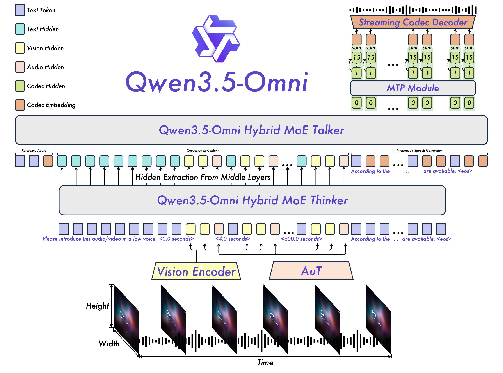
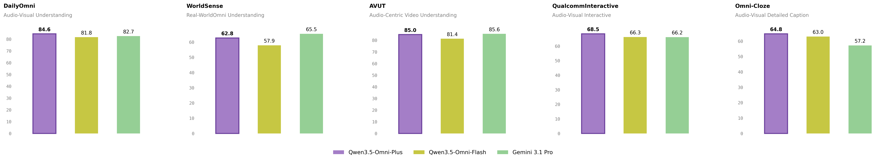
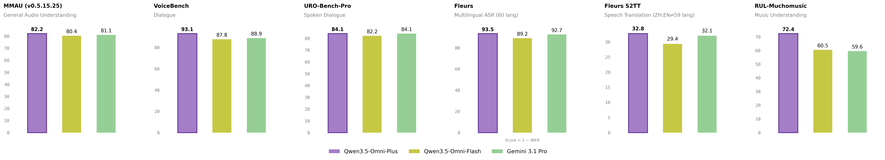
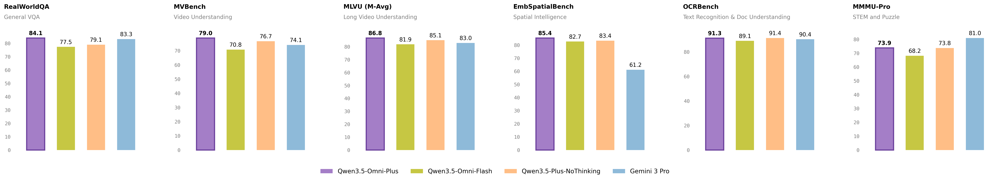

<!-- article-header:start -->
[项目首页](../../../README.md) › [模型系列](../../../reports/model-family-index.md) › [Qwen](../README.md)
<!-- article-header:end -->

# Qwen3.5-Omni：Hybrid MoE、ARIA 与实时音视频交互

<!-- article-toc:start -->

**本篇目录** · [论文定位](#paper-info) · [快速概览](#overview) · [整体架构](#architecture) · [核心原理](#principles) · [数据构建](#data) · [训练流程](#training) · [实验结果](#experiments)
<!-- article-toc:end -->

## 1. 论文信息与模型定位

| 项目 | 内容 |
|---|---|
| 原标题 | **Qwen3.5-Omni: Scaling Up, Toward Native Omni-Modal AGI** |
| 作者 | Qwen Team |
| 材料类型 | 官方发布长文，**不是提供完整训练配方的学术技术报告** |
| 固定来源 | [官方发布页](https://qwen.ai/blog?id=qwen3.5-omni)；[官方静态博客](https://qwenlm.github.io/blog/qwen3.5-omni/)；2026-10-08 原始快照 |
| 产品系列 | Plus、Flash、Light，Instruct 系列，256K 输入；本文评测主要为 Plus/Flash |
| 输入与输出 | 文本、图像、音频、音视频输入；文本与语音输出，支持 Offline 和 Realtime 接口 |

目录记录为 2026 年 3 月发布；原页面的引用块也写 March 2026，但页头出现 January 7, 2026，存在日期不一致。因此本文固定观察版本，不把页头日期当作精确发布日。页面没有披露三种规格的总参数、激活参数和完整专家配置。

## 2. 快速概览

模型延续 Thinker–Talker 分工，但两者均改为 Hybrid-Attention MoE。Thinker 整合音视频并输出文本，Talker 结合多模态上下文生成语音。本代加入 **ARIA**，使文本与语音单元按可变节奏交错，针对漏读、读错和数字发音问题提高流式合成稳定性。

公开能力还包括音视频分镜描述、语音风格与音量控制、参考声音克隆、语义打断、搜索与函数调用，以及根据音视频演示编写代码。演示不等于统一基准验证：产品展示中的生成程序和分析文本，不能直接视为可靠执行率。

页面宣称支持超过十小时音频输入，以及 1fps、720P 条件下超过 400 秒音视频。时长上限与采样率、分辨率、输出细度有关；推荐用法又给出了较低分辨率长视频与高细节短片的不同配置，不能把所有最高设置拼成一个能力承诺。

## 3. 整体架构

**读图：** 最下方视觉编码器和 AuT 分别产生视觉、音频表示，交错送入 Thinker。中间层隐藏表示传到 Talker；右上方 MTP 模块和流式 codec decoder 将语音码转成波形。不同颜色表示文本 token、隐藏状态、视觉/音频状态和语音码，不是不同模型独立输出。

Thinker 使用 TMRoPE 编码交错音视频位置并生成文本。Talker 接收上下文的多模态隐藏表示以及 Thinker 的文本输出，结合参考音频生成上下文相关的声音。它不是仅拿最终文字交给外部通用 TTS 的流水线。

语音用 RVQ 表示，沿用 Qwen3-Omni 的码生成思路，替代较重的 DiT 操作。图中展示首层语音码与后续码级预测、求和和解码，但页面没有给出完整码本规格、码率、每块时长和 MTP 计算细节。输入分块流式处理与 Talker 的流式生成共同支持交互。

| 模块 | 输入与输出 | 公开机制 |
|---|---|---|
| 视觉编码器与 AuT | 图像、视频、音频 → 模态表示 | 分块输入；视觉与音频表示交错进入 Thinker |
| Thinker | 多模态序列 → 文本及隐藏表示 | Hybrid-Attention MoE；TMRoPE 组织音视频位置 |
| ARIA 与 Talker | 文字、上下文、参考语音 → 语音码 | 动态文本/语音对齐与交错；生成上下文相关声音 |
| 码级预测与流式解码 | 多级 RVQ 码 → 波形块 | 图示 MTP 与 codec decoder；完整码本和码率未披露 |
| 话轮及工具交互 | 用户意图、外部结果 → 后续回复 | 语义打断、Web Search、Function Call |

## 4. 核心创新与数学原理

### 4.1 ARIA：处理文字与语音的不等速对齐

文字 token 和语音码的编码效率不同：同一数字、缩写或语言片段可能对应不同数量文字 token 和不同发音长度。固定 1:1 组织可能让语音过早前进或遗漏需要表达的文字。ARIA 动态对齐文本与语音单元后交错，取代前代的双轨输入组织。

可以将其理解为每段文字对应可变长度的语音段，而非强制“一文字 token 对一个语音单元”。这是机制说明；页面没有公开对齐器计算、阈值、监督标签或目标函数，本文不编造 ARIA 的公式和损失。

例如一个数字串可以只占少量文字 token，却需要多个音节才能读完。动态对齐的关键是让语音推进与尚未表达的文本内容协调，而不是简单提高播报速度；它针对漏读、错读的组织问题。对齐管理与声学码压缩属于不同层次，不能由 ARIA 的名称反推出 RVQ 码本大小。[依据：Architecture / ARIA](https://qwen.ai/blog?id=qwen3.5-omni)。

### 4.2 RVQ：逐级表达声学残差

残差向量量化按多层码本逐步表达尚未被前层解释的声学残差；架构图中的多个码级表示最终组合后交给 codec 解码。这是理解离散语音表示的通用原理，不表示该发布页给出了可复现的量化训练方法。

第一层码表达较粗的声学结构，后续码继续补充残差，组合后的表示再解码为波形。把重型生成操作替换为离散码预测，使流式输出的依赖路径改变；但总延迟仍包括输入分块、Thinker、Talker 和解码，发布页没有给出可据此分解的统一延迟测量。

### 4.3 语义话轮与外部信息闭环

模型判断用户发声是否表达接管话轮的意图，以避免附和音、背景噪声被误作打断；搜索与函数调用使对话能取得外部事实和反馈。页面没有公开话轮预测公式、打断延迟、检测精确率和工具策略训练细节，因此不能把“支持”改写成稳定的定量承诺。

话轮决策需要区分“用户在附和”与“用户要求模型停止并回应”；工具决策则需要判断是否调用搜索或函数，并将结果纳入下一次生成。前者控制什么时候说，后者控制用什么信息说。二者是持续交互的组成部分，接口支持并不能替代噪声、重叠讲话及工具失败条件下的评测。

## 5. 数据构建与处理

官方称模型原生全模态预训练使用大量文本、视觉数据及**超过 100M 小时音视频数据**。这是厂商披露的训练规模，来源没有提供可核对的数据清单、去重方法、授权分类、采样权重或唯一时长统计口径，不能将它改写成 100M 小时不重复人工标注视频。

语音识别范围按官方分类为 74 种多语言语言项＋39 种中文方言，共 113 项；这些语言和方言分类可能相邻或重叠，不能当作 113 个互不相关的语言。语音合成列出 29 种语言＋7 种方言，共 36 项。广泛支持也不意味着各语言等质量。

音视频描述演示按时间顺序融合场景、屏幕文字和说话人转录，还描述口音、情绪、背景声音。页面建议一般细节分析控制在约四分钟内，最高细节约两分钟内，较长内容分段；低成本配置可处理更长视频。这些是推理使用建议，不是训练数据的切分配方。

FLEURS 的 ASR 与翻译评测覆盖子集不同：ASR top60；S2TT top59 因没有相应翻译测试而排除 Afrikaans。中文 MIR-1K 转录先转简体。没有信息支持自行补写音频采样率、特征帧移和训练声学标注流程。

## 6. 训练流程与目标

发布页明确“原生全模态预训练”，但没有列出预训练阶段数、冻结/解冻状态、token 预算、优化器、学习率、批大小与训练硬件；也没有公开后训练中 SFT、蒸馏或 RL 的具体组合。本文不把 Qwen3-Omni 或 Qwen3.5 的配方直接移植到本代。

可确认的结构目标是：Thinker 理解输入并产生文本，Talker 在相同上下文下生成可流式播放的语音，ARIA 组织两类单元的对齐。图片中的架构组件不足以推导正式的总损失权重，也不能据此确定哪个模块在何时被冻结。

Offline 示例使用音视频内容并流式返回文本；Realtime 示例持续发送麦克风音频，接收音频及转录事件，并可启用搜索。示例中的客户端输入 16kHz、播放 24kHz 是接口示例配置，不能当作全部训练采样率。本仓库仅介绍发布材料，未调用收费 API、训练模型或执行演示。

## 7. 实验设置与主要结果

**读图：** 紫色 Plus、黄绿色 Flash、绿色 Gemini-3.1-Pro。图仅选取五项，完整网页表还包含 VideoMME 和 OmniGAIA。各项不能相加为统一准确率。

| 音视频指标 | Plus | Flash | Gemini-3.1-Pro |
|---|---:|---:|---:|
| DailyOmni | 84.6 | 81.8 | 82.7 |
| WorldSense | 62.8 | 57.9 | 65.5 |
| AVUT | 85.0 | 81.4 | 85.6 |
| QualcommInteractive | 68.5 | 66.3 | 66.2 |
| Omni-Cloze | 64.8 | 63.0 | 57.2 |
| VideoMME，启用音频 | 83.7 | 79.3 | 89.0 |
| OmniGAIA，工具增强 | 57.2 | 33.9 | 68.9 |

VideoMME 设 use_audio_in_video=True，不能与另一个视觉表的“无字幕 81.9”当作同一输入条件。OmniGAIA 无 thinking 提示和 answer 格式，使用 deepseek-v3.2-thinking 评判。WorldSense、AVUT、VideoMME、OmniGAIA 仍落后于该基线；页面“215 项领先”含许多按语言拆分的子任务，不等于 215 个完全独立综合基准，也不意味着每个图表都领先。

**读图：** FLEURS 图使用 **Score=1−WER**，约 93.5 是高分表示，原表则使用错误率。URO 图显示综合数，原表又列理解、推理、口语三维，不能对错列。

Plus 的 MMAU 为 82.2（Gemini 81.1）、VoiceBench 93.1（88.9）、音乐 RUL-MuchoMusic 72.4（59.6）。但 MMAR 为 80.0，低于 Gemini 83.7；WildSpeech 75.4 低于 76.3。FLEURS top60 WER/CER 为 **6.55**，Flash 10.75、Gemini 7.32，越低越好；Wenetspeech meeting 5.84 又略高于 Flash 5.51。S2TT 中英文综合表为 32.8/29.4/32.1，不能将它解释为错误率。

**读图：** 该图还包含 Gemini-3-Pro，和上两图的 Gemini-3.1-Pro 不是相同版本。网页主表的主要对比是 Qwen3.5-Plus-NoThinking，全部采用无思考设置。

Plus 的 MMMU 为 80.1、MathVista mini 为 86.1、OCRBench 为 **91.3**、无字幕 VideoMME 为 81.9、MLVU M-Avg 为 86.8。这里 OCRBench 使用网页的百分尺度，不与 Qwen3-VL 原始 920 分直接相减。对应 Qwen3.5-Plus-NoThinking 为 81.0/86.9/91.4/81.0/85.1：音视频扩展并没有让所有视觉指标上升。文本 GPQA 83.9 也低于纯基线 85.9。

语音生成原网页另列稳定性 WER：自定义声音 Seed-hard 为 6.24，20 语言公开集 2.06，9 语言内部集 5.82；声音克隆公开集 WER 1.87、余弦相似度 0.79。对比 API 明确在 2026 年 3 月测试且使用指定音色，不能视为所有音色、所有调用时刻结果；Seed-en 1.35 也高于 GPT-Audio 的 1.16。

公开材料支持跨模态整合与流式语音机制的改进，但没有 ARIA 独立消融、同算力训练对照或完整实时延迟结果。本文对原文数字和原图做核验，未作独立复现。

<!-- article-footer:start -->
---

[← 上一篇：MiMo-V2-Omni](../../mimo/document-1ccf04ffaeaa/README.md) · [按发表时间浏览](../../../reports/paper-reading-guide.md#year-2026) · [下一篇：Gemma 4 →](../../gemma/document-92d16b8c59c9/README.md)

[返回本篇目录](#article-toc) · [返回模型系列](../README.md)
<!-- article-footer:end -->
