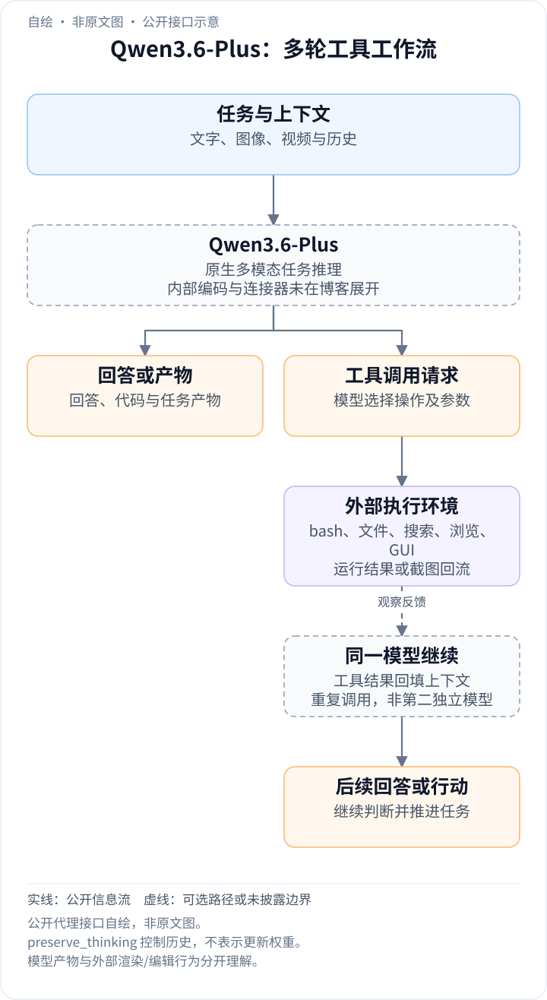
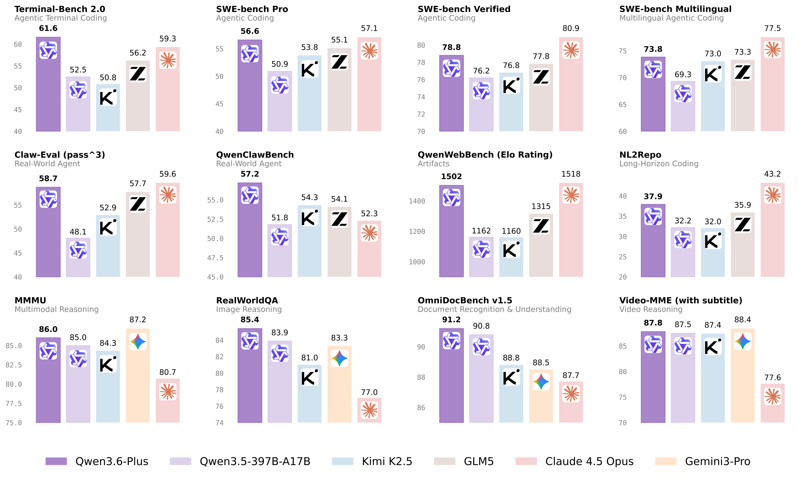
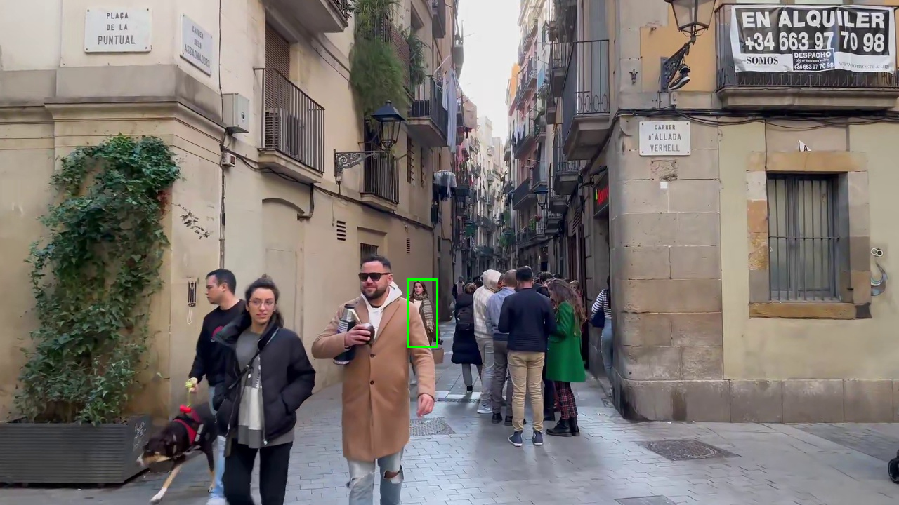

<!-- article-header:start -->
[项目首页](../../../README.md) › [模型系列](../../../reports/model-family-index.md) › [Qwen](../README.md)
<!-- article-header:end -->

# Qwen3.6-Plus：面向真实工作流的多模态 Agent 升级

<!-- article-toc:start -->

**本篇目录** · [论文定位](#paper-info) · [快速概览](#overview) · [整体架构](#architecture) · [核心原理](#principles) · [数据构建](#data) · [训练流程](#training) · [实验结果](#experiments)
<!-- article-toc:end -->

## 1. 论文信息与模型定位

| 项目 | 信息 |
|---|---|
| 原文 | Qwen3.6-Plus: Towards Real World Agents |
| 发布方与日期 | Qwen Team，2026 年 4 月 2 日 |
| 材料 | [官方发布博客](https://qwen.ai/blog?id=qwen3.6)，2026-10-08 保存版本，包含完整基准表、脚注与大量演示 |
| 发布定位 | Alibaba Cloud Model Studio 托管模型，默认 1M 上下文，重点增强代码 Agent、工具执行与多模态感知推理 |
| 参数与内部结构 | 本文原文未披露 Plus 的参数规模、专家数、视觉编码器及训练阶段 |

这一发布是 Qwen3.5 系列之后的托管服务升级。性能表中的 Qwen3.5-397B-A17B 是一个**对照模型的名称**，不是 Qwen3.6-Plus 的已公开参数声明；因此不能把 397B/17B 或旧版本结构复制到 Plus。

原文还表示后续将开放较小档位，不等于这篇发布已提供 Plus 权重。本介绍依据该版本的历史发布材料，不根据“即将”判断当前权重状态。

## 2. 快速概览

模型把视觉感知、定位、OCR、推理、代码和工具调用组织进任务工作流。默认的 1M 上下文可承载较大任务历史，但具体评测仍使用不同预算：SWE 系列为 200K，Terminal-Bench 为 256K，部分搜索任务又在 256K 内进行历史压缩。服务最大窗口和基准实际使用窗口不能混为一谈。

相对 Qwen3.5-397B-A17B，Terminal-Bench 2.0 从 52.5 提高到 **61.6**，SWE-bench Pro 从 50.9 到 **56.6**，内部 QwenWebBench Elo 从 1162.3 到 **1501.7**。多模态方面，OmniDocBench 1.5 从 90.8 到 **91.2**，RealWorldQA 从 83.9 到 **85.4**，RefCOCO 平均从 92.3 到 **93.5**。

提升并非全方位：MMMU-Pro 从 79.0 到 78.8、MathVision 从 88.6 到 88.0、ERQA 从 67.5 到 65.7、VideoMMMU 从 84.7 到 84.0；LongBench v2 也由 63.2 降到 62.0。介绍模型定位时，应把长工作流和感知改善作为具体观察，而不是笼统声称所有指标刷新纪录。

## 3. 整体架构

<!-- derived-architecture:start -->

*自绘公开接口示意（非原文图）。依据下述公开资料归纳；方框表示功能组件，不代表逐层实现。*

依据：[official-source-snapshot-2026-10-08; Agent capabilities / API preserve_thinking](https://qwen.ai/blog?id=qwen3.6)。
<!-- derived-architecture:end -->

博客没有内部网络架构图，可确认的系统层次是：模型接受文字、图像或视频，生成推理与任务输出；外部 Agent harness 调用 bash、文件编辑、搜索、浏览、GUI 或代码解释工具；执行结果再作为模型下一步的输入。网页开发、视频剪辑和视觉内容转换中的可见产物，往往由代码和工具产生，不能统称为模型原生生成视频或音频。

API 的 `preserve_thinking` 选项保留先前轮次的思考内容，推荐用于 Agent 多步骤任务，以减少重复推理并保持决策连贯。**该发布默认 false**，不保留以往轮次思考；它与 `enable_thinking` 是不同开关。保留历史是一项上下文管理功能，没有证明系统在推理时继续更新模型权重。

两个原图对应博客的定位演示：从场景里找到与参考图视觉特征一致的目标，并输出 JSON 框。该案例反映多图比对、细节检查及 grounding 的组合，而不是“从照片判断人物真实身份”的证据，也不是独立的身份识别基准。

模型自身的推理文本会描述衣着、位置和框坐标；这些是示例输出，不能把其中自称“完全正确”的措辞当成人工真值。内部编码器、切图规则、坐标缩放与时间位置编码未在博客说明。

| 模块 | 输入与输出 | 公开机制 |
|---|---|---|
| 多模态输入与模型 | 文字、图像、视频 → 推理和任务输出 | 内部视觉编码器与主干细节未在博客披露 |
| 思考历史管理 | 先前思考与当前消息 → 本轮上下文 | preserve_thinking 默认 false，与 enable_thinking 分开 |
| Agent harness | 模型动作 → bash、文件、搜索、GUI 等工具调用 | 工具由宿主执行；生成媒体产物可能来自代码或外部程序 |
| 观察与上下文整理 | 工具响应、截图 → 后续推理输入 | 评测采用旧响应裁剪或 context-folding，具体预算依任务而定 |

## 4. 核心创新与数学原理

原文没有编号公式，也没有可以归因到具体层或损失的新算法。其主要价值在于工作流能力与 API 机制。下面用标准定义解释公开评测口径，避免把展示成绩误读成训练公式。

### 4.1 工具闭环：把执行结果变成下一步条件

对含工具交互的任务，可用状态—动作闭环理解：$`a_t\sim\pi_\theta(\cdot\mid h_t)`$，工具产生观察 $`o_{t+1}`$，历史更新为 $`h_{t+1}=U(h_t,a_t,o_{t+1})`$。这是本文对 Agent 执行的抽象，原文没有给出 $`U`$ 的统一实现。历史思考保留、旧工具响应裁剪以及 GUI 截图反馈，都属于历史内容的构建方式，不能凭此证明使用了某种记忆网络或在线学习算法。

当模型编辑文件后，编译错误或页面截图提供了可检验的反馈，下一步动作可以针对观察到的问题修改。这里策略的输入是经过宿主组织的历史，而非只有最初用户问题；因此代码智能体的成绩同时依赖模型、工具权限、回合预算与观察格式。[依据：Agent capabilities / evaluation notes](https://qwen.ai/blog?id=qwen3.6)。

### 4.2 历史保留与有限上下文预算

评测中搜索历史管理有明确阈值：WideSearch 在已使用内容超过 **208,896 token** 时，裁去至少 **49,152 个工具 token**；HLE 带工具采用 context-folding，超过阈值后删除较旧工具回应。因此“长上下文任务”并不一定在每一步都保存全部原始工具文本。

保留思考可以减少跨回合重复规划，但会占用窗口；裁剪旧工具结果能释放预算，却可能丢失后续所需的原始证据。两个操作分别作用于推理记录和环境观察，不能把 preserve_thinking 理解为无限记忆。给定阈值说明的是该评测 harness 的策略，不是公开的网络层参数。

### 4.3 相对偏好与多次运行的评测原理

内部网页评测使用 Bradley–Terry / Elo 评级体系。标准 Bradley–Terry 概率可写成 $`P(i\succ j)=\exp(s_i)/(\exp(s_i)+\exp(s_j))`$，说明相对评分由成对偏好估计；这一式是指标解释，作者没有公开所有拟合、标定与评审细节。Elo 1501.7 不能写成 1501.7% 准确率，也不能与 SWE 百分比分数直接平均。

图示的部分任务使用多次运行平均，平均成绩与“至少一次通过”是不同指标。博客 Claw-Eval 同时列出 Avg 和 Pass^3，但没有在该页完整展开后者定义，本介绍保留原始标记，不自行将它替换成其他论文的 pass@k 或每次成功率。

成对偏好估计比较的是两个产物被选中的概率，其分数随对手集合和评审协议变化；多次运行平均则反映重复执行的总体水平。阅读结果时需保留二者的定义与单位，不能用同一排名数字代替任务完成率或稳定性。

## 5. 数据构建与处理

发布说明没有公布预训练 token、模态配比、SFT 规模、合成数据、去重方法或视觉分辨率训练方案。官方表示根据 Qwen3.5-Plus 部署中的开发者反馈提高稳定性，不能据此推断所有用户数据都进入训练或恢复具体数据管线。

能核对的是**评测数据处理**：SWE-bench Pro 公共集合的部分问题经修正，所有基线在修正后的集合重评；MathVision 为本模型固定提示，其他模型取有无 boxed 输出格式的较高结果。它们会影响可比性，不能直接把表值与未经修正、不同提示的其他报告对接。

内部 QwenClawBench 面向真实用户分布的 Claw Agent 任务；QwenWebBench 覆盖中英双语与七类前端产物，包括网页设计、应用、游戏、SVG、数据可视化、动画和 3D。代码及渲染视觉正确性由多模态评审检查。原文没有公开这些内部任务的完整清单、数量、标注一致性或训练污染审计。

SkillsBench 也有明显数据范围差异：Opus 4.5 使用官方 87 任务榜单，其余模型使用 OpenCode 在 78 个自包含任务上评测，排除依赖 API 的任务。因此不能把同一行当成所有模型运行同一个完全相同集合的严格受控比较。

## 6. 训练流程与目标

正文没有披露训练阶段、损失、视觉冻结策略、RL 奖励、优化器、学习率或训练成本。本介绍不以通用 SFT/DPO/GRPO 公式填补。代码 Agent 成绩提高也不能单独证明收益来自更大参数、特定 RL 算法或新增视觉数据。

可复核的配置来自**推理评测**：SWE 系列内部 harness 包含 bash 与文件编辑，temperature=1.0、top_p=0.95、200K 窗口；Terminal-Bench 采用 Harbor/Terminus-2、3 小时超时、32 CPU/48GB RAM、temperature=1.0、top_p=0.95、top_k=20、max_tokens=80K、256K 窗口，五次运行平均。这些数字是评测资源与生成设置，不是训练 batch 或训练超参数。

其他工具评测有不同环境：TAU3 使用官方 GPT-5.2 low 用户模型及默认 BM25 检索；VITA 使用 Claude 4 Sonnet 作为评审，因为原评审版本不可用；MCPMark 的 GitHub MCP 版本为 v0.30.3，Playwright 回应截断为 32K token。工具和评审配置共同影响最终分数，不能将差异完全归因于模型主干。

## 7. 实验设置与主要结果

[下载完整官方原图](figures/official-2.png)。原 PNG 为 17457×10428，预览仅等比例缩小，没有改动数值或重绘；全部图标题、柱顶数字和底部图例保留。柱状图多用截断纵轴，优势应按数字差值解读，不能按柱高倍数计算。它只展示选出的指标，完整表中的下降项目仍需一起查看。

| Agent / 语言基准 | Qwen3.6-Plus | Qwen3.5-397B-A17B | 重要条件或对照 |
|---|---:|---:|---|
| SWE Verified / Multilingual / Pro | 78.8 / 73.8 / 56.6 | 76.2 / 69.3 / 50.9 | Pro 修正题集；Opus 4.5 对应 80.9 / 77.5 / 57.1 |
| Terminal-Bench 2.0 | 61.6 | 52.5 | 同表高于 Opus 59.3，但依赖指定 harness 与预算 |
| Claw-Eval Avg / Pass^3 | 74.8 / 58.7 | 70.7 / 48.1 | 两类指标分开，不当作同一次准确率 |
| QwenClawBench | 57.2 | 51.8 | 内部评测 |
| NL2Repo | 37.9 | 32.2 | 低于 Opus 官方榜单 43.2；评测来源不同 |
| QwenWebBench Elo | 1501.7 | 1162.3 | 接近但低于 Opus 1517.9 |
| DeepPlanning | 41.5 | 37.6 | 高于表中其他对照 |
| MCPMark / MCP-Atlas | 48.2 / 74.1 | 46.1 / 74.2 | Atlas 略降，不能称所有工具任务提高 |
| GPQA / HLE | 90.4 / 28.8 | 88.4 / 28.7 | HLE 无工具变化很小，带工具另为 50.6 |
| LongBench v2 / AA-LCR | 62.0 / 68.3 | 63.2 / 68.7 | 两项均略降 |
| LiveCodeBench v6 | 87.1 | 83.6 | 算法编码能力提高 |

| 多模态基准 | Qwen3.6-Plus | Qwen3.5-397B-A17B | 观察 |
|---|---:|---:|---|
| MMMU / MMMU-Pro | 86.0 / 78.8 | 85.0 / 79.0 | 普通 MMMU 提高，Pro 略降 |
| MathVision / We-Math | 88.0 / 89.0 | 88.6 / 87.9 | 两项变化方向不同 |
| RealWorldQA / MMStar | 85.4 / 83.3 | 83.9 / 83.8 | 不能合并成统一视觉提升 |
| OmniDocBench 1.5 / CC-OCR | 91.2 / 83.4 | 90.8 / 82.0 | 文档与OCR改善 |
| RefCOCO avg / ODinW13 | 93.5 / 51.8 | 92.3 / 47.0 | grounding与检测改善 |
| ERQA | 65.7 | 67.5 | 具身推理基准略降 |
| VideoMME，有字幕 / 无字幕 | 87.8 / 84.2 | 87.5 / 83.7 | 保留字幕条件 |
| VideoMMMU / MLVU M-Avg | 84.0 / 86.7 | 84.7 / 86.7 | 前者略降，后者不变 |
| ScreenSpot Pro / OSWorld-Verified | 68.2 / 62.5 | 65.6 / 62.2 | GUI定位与操作改善，但低于部分外部对照 |

V* 和 TIR-Bench 在原文按 **with CI / without CI** 报告两个配置，不能把斜杠误读为置信区间：V* 为 96.9/90.5，上一代 95.8/91.1；TIR 为 61.6/43.7，上一代 62.5/42.3。本文保留原简称与次序，分别比较，避免掩盖一升一降。空白“--”表示未报告或不适用。

覆盖图把目标用绿色框标出，框位于前景行人后方。博客 JSON 输出是 `[451,553,486,735]`，但其坐标尺度没有在该案例中明示，原图渲染框底边也不能直接等同于这串数的像素值。这个展示不附人工真值或 IoU，本文只说明其可见定位结果，不给出独立正确率。更多示例包括网页构建、视频转笔记及视觉搜索，但演示中的模型自述不作为独立验证事实。

总体证据支持托管模型在终端操作、部分仓库工程和视觉 grounding 上的进步，同时保留数学、长上下文和部分视频项目的差异。因训练细节未公开，无法从本博客分离各项机制的贡献；本文没有调用模型或复现任务。

<!-- article-footer:start -->
---

[← 上一篇：Gemma 4](../../gemma/document-92d16b8c59c9/README.md) · [按发表时间浏览](../../../reports/paper-reading-guide.md#year-2026) · [下一篇：VITA-QinYu →](../../vita/document-3a7f77dffb3b/README.md)

[返回本篇目录](#article-toc) · [返回模型系列](../README.md)
<!-- article-footer:end -->
