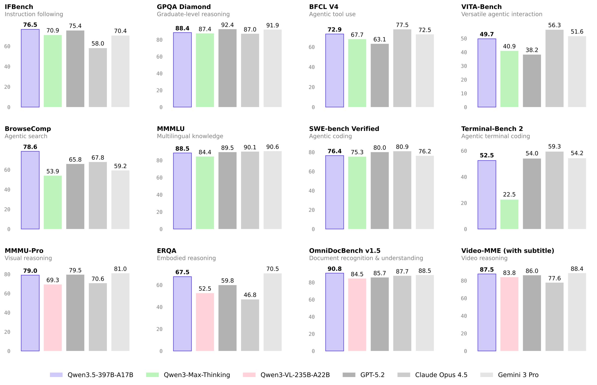
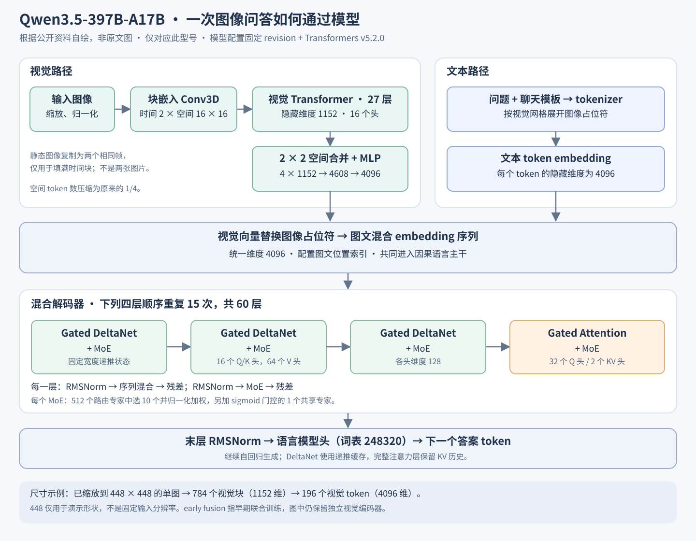
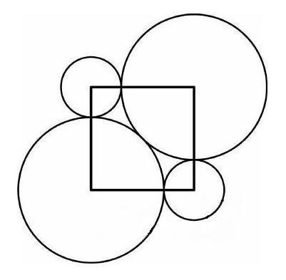

<!-- article-header:start -->
[项目首页](../../../README.md) › [模型系列](../../../reports/model-family-index.md) › [Qwen](../README.md)
<!-- article-header:end -->

# Qwen3.5：原生多模态、线性注意力与稀疏专家

<!-- article-toc:start -->
<a id="article-toc"></a>

**本篇目录** · [论文定位](#paper-info) · [快速概览](#overview) · [整体架构](#architecture) · [核心原理](#principles) · [数据构建](#data) · [训练流程](#training) · [实验结果](#experiments)
<!-- article-toc:end -->

<a id="paper-info"></a>

## 1. 论文信息与模型定位

目录收录的标题是 **Qwen3.5: Towards Native Multimodal Agents**，原链接为 [Qwen 官方发布博客](https://qwen.ai/blog?id=qwen3.5)。本条目前恢复并逐段核验的材料是 [Qwen3.5-397B-A17B 官方模型卡](https://huggingface.co/Qwen/Qwen3.5-397B-A17B/blob/main/README.md)，缓存版本为 2026-10-08 的官方来源快照。原始介绍以该模型卡快照为依据；2026-10-11 另按固定模型 revision 的配置和 Transformers v5.2.0 实现补充核验第三、四节架构细节。模型卡中的引用将工作记为 Qwen Team、2026 年 2 月。它没有给出完整论文式实验协议，也不能把这一张模型卡等同于家族全部型号的技术报告。

介绍对象是经过预训练和后训练的 **397B 总参数、17B 激活参数**版本。它将视觉编码器接入因果语言模型，支持图像、视频与文本任务，强调原生多模态融合、工具使用以及可切换的思考模式。397B 是权重规模，17B 是单个 token 激活的参数规模；后者不能用来估算完整模型的权重存储成本。托管的 Qwen3.5-Plus 与开放权重模型也有不同的服务配置，应分开理解。

<a id="overview"></a>

## 2. 快速概览

模型卡公开的主要信息可以归纳为四点：视觉与语言在早期共同训练；45 个 Gated DeltaNet 层和 15 个完整注意力层交替组成 60 层网络；每层使用稀疏 MoE；长上下文与多 token 预测服务于推理效率。模型卡同时声称覆盖 201 种语言和方言，并使用大规模智能体强化学习环境。这里的环境规模和多模态训练效率是官方描述，材料没有提供足以复算吞吐量、训练成本或环境独立性的统计口径。



上图来自模型卡未编号的基准汇总图，[完整原图](figures/official-benchmark.png)保留在同一目录。每个子图对应一个任务，紫色柱表示 Qwen3.5-397B-A17B，其他颜色代表所列对照模型。读图应比较同一个子图内的数值，不能跨任务将 80 分理解为同一种能力。BrowseComp 的 78.6 对应特定上下文管理策略，Video-MME 的 87.5 使用字幕；这些条件会影响结果解释。

<a id="architecture"></a>

## 3. 整体架构

本节区分三层依据：模型卡说明设计意图；[固定 revision 的官方配置](https://huggingface.co/Qwen/Qwen3.5-397B-A17B/blob/8472618112abcbd45acbcdc58436aff4233c23f7/config.json)给出模块规模；[Transformers v5.2.0 实现](https://github.com/huggingface/transformers/blob/v5.2.0/src/transformers/models/qwen3_5_moe/modeling_qwen3_5_moe.py)说明张量如何流动。以下结构仅对应 **Qwen3.5-397B-A17B**，不是家族全部型号的通用规格，也不是对训练代码的完整复现。



**从像素到视觉 token。** 公开配置中的视觉编码器为 27 层 Transformer，隐藏维度 1152、16 个注意力头、MLP 中间维度 4304。块嵌入使用时间跨度 2、空间大小 16×16 的 Conv3D。按该版[图像处理器](https://github.com/huggingface/transformers/blob/v5.2.0/src/transformers/models/qwen2_vl/image_processing_qwen2_vl_fast.py)，静态单图会复制相同帧以填满时间块，形成一个时间网格；这不会将它当成两张独立图片。视觉主干先在块序列上建模，使用插值的学习位置嵌入及二维旋转位置编码，随后 merger 将相邻 2×2 个空间特征拼为 4608 维，经过 MLP 映射到语言主干的 4096 维。空间 token 数由此减少至四分之一，压缩发生在视觉编码之后。

**图文如何融合。** [Qwen3VLProcessor 的固定版本实现](https://github.com/huggingface/transformers/blob/v5.2.0/src/transformers/models/qwen3_vl/processing_qwen3_vl.py)按视觉网格展开图像占位符，数量为 $`N_v=T_gH_gW_g/4`$。模型用 merger 输出逐一替换这些占位符的 embedding，再与问题文字、聊天模板和视觉边界标记组成同一条 4096 维序列；数量不匹配会报错。视觉不是先被转成一段文字描述，也不是经额外的独立问答模型再交给语言模型。模型卡所说的 **early fusion** 是视觉和语言在早期共同训练的设计，不能解释为“取消视觉编码器、直接把原始像素送入语言主干”。

**3:1 的混合语言主干。** 60 层按“三个 Gated DeltaNet 层、一个 Gated Attention 层”重复 15 次，即 45 个递推层和 15 个完整注意力层；**每一层后面都有 MoE**。每层依次进行 RMSNorm、序列混合、残差相加，再进行 RMSNorm、MoE、残差相加。DeltaNet 分支先对 Q/K/V 做核大小为 4 的因果深度卷积，16 个 Q/K 头共享给 64 个 value 头，头维度均为 128，再以门控增量更新状态。完整注意力分支采用 32 个 query 头、2 个 key/value 头，头维度为 256，并在注意力结果上施加 sigmoid 输出门；旋转位置编码只覆盖每头 64 维。多数层维护固定宽度的递推状态，间隔的完整注意力层保留对历史位置的直接访问，因此不能把整个模型描述为完全不需要 KV 历史的线性模型。

**专家如何选择。** 对一个 4096 维 token，路由器计算 512 个专家分数，先做 softmax，再选最高的 10 个，并将这 10 个权重重新归一化后加权求和。同时执行一个共享专家，其输出乘以独立的 sigmoid 标量门，再加到路由结果上。路由专家及共享专家的中间维度均为 1024，采用门控 MLP。这里的“512 选 10”是每个 token、每层的选择，不是整张图片只选一次；视觉与文本 token 都进入同一主干处理。模型卡的 397B 总参数和 17B 激活参数不意味着存储时只需保留 17B 权重。

**一次单图问答的形状示例。** 假定处理器输出的单张静态图已缩放至 448×448，这只是有效尺寸示例：块网格为 $`1\times28\times28`$，块嵌入及视觉主干的特征形状为 $`784\times1152`$；2×2 merger 后变为 $`196\times4096`$。若文字与模板标记共 $`L_t`$ 个 token，替换后的批量大小为 1 的主干输入为 $`1\times(L_t+196)\times4096`$。经过 60 层和末层 RMSNorm，语言模型头将所需位置映射到 248320 维词表 logits，选出下一个答案 token；后续逐 token 生成复用递推状态和完整注意力 KV 缓存。实际视觉 token 数随处理尺寸变化，448 不是固定训练或推理分辨率。

原生上下文配置为 **262144**；模型卡另给出通过 YaRN 扩展至约 1010000 的配置示例，factor 为 4、RoPE theta 为 10000000，并使用交错 M-RoPE 和部分旋转编码。扩展示例、原生配置和托管服务默认长度应分别理解。本轮配置与实现补充解决了视觉层数、patch 合并和路由方式的公开性问题，但仍不能据此还原训练分辨率分布、视觉参数量的官方统计口径或完整训练配方。

<a id="principles"></a>

## 4. 核心创新与数学原理

**混合注意力与门控递推。** 完整注意力以因果掩码 $`M`$ 计算 $`\mathrm{softmax}(QK^\top/\sqrt d+M)V`$；所核对实现还对输出乘以从输入投影得到的 sigmoid 门，再映射回 4096 维。Gated DeltaNet 则以有限宽度状态保存历史关联。原模型卡没有展开其公式，下面根据 **Transformers v5.2.0 的 `torch_recurrent_gated_delta_rule` 和 `Qwen3_5MoeGatedDeltaNet`** 整理，属于本轮实现核验补充。

省略批次、层和头索引，令 $`k_t`$ 为卷积后经 L2 归一化的 key，$`q_t`$ 为归一化并乘以 $`1/\sqrt{128}`$ 的 query，$`v_t`$ 为 value，单头状态 $`S_t\in\mathbb R^{128\times128}`$。递推为：

```math
\begin{aligned}
\bar S_t &= \exp(g_t)S_{t-1},\\
\delta_t &= \beta_t\bigl(v_t-\bar S_t^\top k_t\bigr),\\
S_t &= \bar S_t+k_t\delta_t^\top,\\
o_t &= S_t^\top q_t.
\end{aligned}
```

实现令 $`\beta_t=\sigma(b_t)`$、$`g_t=-\exp(A_{\log})\mathrm{softplus}(a_t+d_{\rm bias})`$，其中 $`a_t,b_t`$ 是当前隐藏状态的线性投影，$`A_{\log},d_{\rm bias}`$ 是学习参数。衰减门控制遗忘，增量项修正“当前 value 与已有状态预测”之间的差，而不是简单叠加所有历史 key-value 外积。递推输出再经过带 SiLU 门的 RMSNorm 和输出投影。预填充采用分块计算，缓存后的单 token 解码可按递推式更新；两者是计算实现方式，不是两个不同的训练目标。固定宽度状态减少这些层随序列增长的历史存储，但另外 15 个完整注意力层仍有 KV 缓存。

**归一化稀疏路由与共享专家门。** 对 MoE 输入 $`h`$，设 $`p=\mathrm{softmax}(W_rh)`$，$`I=\mathrm{Top10}(p)`$，所核对实现为：

```math
\tilde p_i=\frac{p_i}{\sum_{j\in I}p_j},\qquad
m(h)=\sum_{i\in I}\tilde p_i E_i(h)+\sigma(w_s^\top h)E_{\rm shared}(h).
```

这里 $`m(h)`$ 是前馈分支输出，随后还要与残差相加；共享专家并非恒以系数 1 加入。单个专家采用 $`E(h)=W_d[\mathrm{SiLU}(W_gh)\odot W_uh]`$，中间宽度为 1024。路由压缩的是当前 token 的计算量，未被选择的专家权重仍属于模型。配置还给出 `router_aux_loss_coef=0.001`，实现包含负载均衡辅助损失；这能说明已发布代码中的选项，不能证明完整预训练中所有阶段都以相同方式启用该损失。

**多 token 预测。** 模型卡说明采用 multi-token prediction，可为推测解码提供后续 token 草稿；公开配置列出 `mtp_num_hidden_layers=1`。该值是 MTP 层数，不等于训练预测位置数。各位置损失权重、草稿接受率和完整训练设置仍未由模型卡给出。示例中的 vLLM 两个推测 token，以及 SGLang 的 NEXTN 配置，是推理引擎选项，不能反推训练目标。草稿仍须由目标模型验证，实际收益取决于接受率和服务负载。

**原生多模态与智能体后训练。** 早期融合让视觉向量与文字进入同一主干并联合学习；工具调用使模型能够采取外部动作。上述公开前向实现并不补齐训练数据配方或强化学习算法，不能把“智能体 RL”自动写成使用 GRPO、PPO 或特定奖励函数。

<a id="data"></a>

## 5. 数据构建与处理

模型卡宣称覆盖 201 种语言和方言、采用原生多模态训练，并扩展智能体强化学习环境。它没有列出预训练 token 总数、图像或视频样本数、各模态比例、公开数据集混合比例、合成样本比例、去重规则和污染审计。因此本材料可说明训练方向，不能支持复现训练数据流水线。



这张未编号的原图是模型卡图像推理代码的输入：几何图中圆、正方形和标注关系要求模型识别结构后推理。它帮助读者理解图像问答的输入形式，**不是模型输出截图或额外实验结果**。官方卡没有在该图旁给出完整答案、正确率或训练样本归属。


第二张未编号原图用于非思考模式调用，画面包含城市、雕像与环境线索。它示范自然图像可以和文本问题一同输入，同样不能据此声称模型识别出了某个地点。视频代码示例设置了 2 FPS，这是该推理示例的抽帧参数；来源没有说所有训练视频均采用这一采样率。长视频示例还设置处理器预算，也不能将其当成模型训练分辨率。

<a id="training"></a>

## 6. 训练流程与目标

模型卡明确这不是仅预训练的基础模型，而是经过 **pretraining 与 post-training** 的版本，具备默认思考模式及非思考模式。思考模式默认开启，可通过聊天模板中的 `enable_thinking=False` 关闭；卡片说明不支持旧式软切换 `/think`、`/no_think`。这些是使用行为和模板约定，不是损失函数。

对因果语言模型而言，可用条件生成交叉熵理解基本学习问题：$`\mathcal L_{\rm CE}=-\sum_t\log p_\theta(y_t\mid y_{\lt t},x)`$，其中 $`x`$ 可包含图像、视频和文本上下文。这个式子仅解释生成训练的通常形式；材料没有披露本版本如何对视觉 token、思考过程或工具轨迹设置损失掩码，也没有公开 MTP 与主损失的组合权重。

后训练描述涉及思考、非思考及智能体强化学习，但没有提供 SFT 样本数、偏好对数量、优化算法、奖励定义和冻结策略。学习率、batch size、训练步数、GPU 型号与数量同样未披露。模型卡中的 temperature、top-p、top-k、最大输出长度以及推测解码参数均是推理设置，不能填入训练超参数表。

<a id="experiments"></a>

## 7. 实验设置与主要结果

下面选取模型卡的实际数据，视觉任务对照列为 Qwen3-VL-235B-A22B；分数照录来源，未重新运行模型。

| 任务 | Qwen3-VL-235B-A22B | Qwen3.5-397B-A17B | 阅读限制 |
|---|---:|---:|---|
| MMMU | 80.6 | 85.0 | GPT-5.2 为 86.7、Gemini-3 Pro 为 87.2 |
| MathVision | 74.6 | 88.6 | 提示格式选择有模型间差异 |
| OmniDocBench 1.5 | 84.5 | 90.8 | 模型卡没有完整解释分数聚合定义 |
| OCRBench | 87.5 | 93.1 | OCR 基准分数，不等于实际文档全流程成功率 |
| Video-MME，含字幕 | 83.8 | 87.5 | Gemini-3 Pro 为 88.4 |
| Video-MME，无字幕 | 79.0 | 83.7 | GPT-5.2 为 85.8、Gemini-3 Pro 为 87.7 |
| OSWorld | 38.1 | 62.2 | Claude-4.5 Opus 为 66.3、Kimi-K2.5 为 63.3 |

提升并非所有对照上的全面领先。例如 MMMU、无字幕 Video-MME 和 OSWorld 仍有更高对照结果。工具条件尤其重要：BabyVision 记为 **52.3（with CI）/43.3（without CI）**，V* 记为 **95.8（with CI）/91.1（without CI）**；CI 指代码解释器条件，两者不能合并成一个无需工具的成绩。

搜索任务 BrowseComp 为 **69.0（simple fold）/78.6（discard all）**，对应不同上下文管理策略。模型卡说明搜索智能体在 256K 阈值后处理早期工具响应；这种策略参与了整套系统的成绩。表头没有授权把更高值解释成纯模型闭卷能力。MathVision 使用要求 boxed 答案的提示，而部分对照采用有无格式要求中的较高值，也影响严格公平比较。

语言任务中，GPQA 为 88.4、IFBench 为 76.5、BFCL-V4 为 72.9、SWE-bench Verified 为 76.4。这些展示语言推理、指令遵循、工具与代码能力，却不直接证明视觉架构某一模块的因果贡献。官方“Best Practices”建议多数任务最大输出 32768，数学和编程可使用 81920，但没有给出所有表项逐一一致的预算、重复试验方差或完整提示。本文因此将成绩视为官方报告结果，而不把发布模型卡当成足以独立复现训练与评测的完整技术论文。

<!-- article-footer:start -->
---

[← 上一篇：MiniCPM-o 4.5](../../minicpm/document-9be303a31d11/README.md) · [按发表时间浏览](../../../reports/paper-reading-guide.md#year-2026) · [下一篇：Gemini 3.1 Pro →](../../gemini/document-7cca3ca5d4d3/README.md)

[返回本篇目录](#article-toc) · [返回模型系列](../README.md)
<!-- article-footer:end -->
