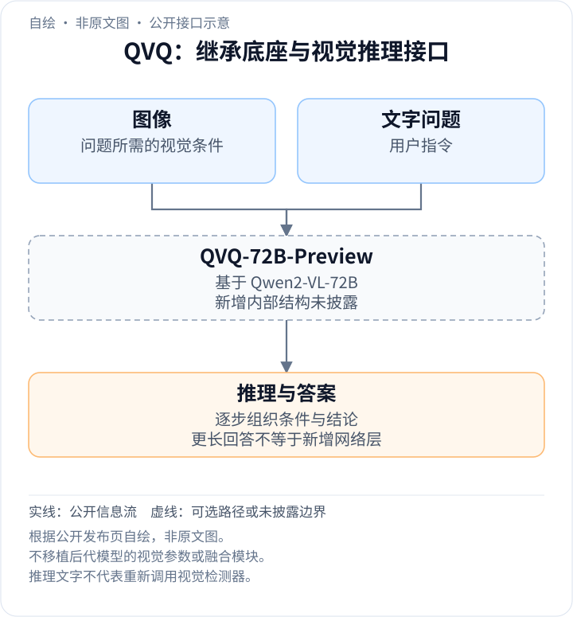
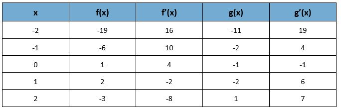
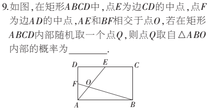
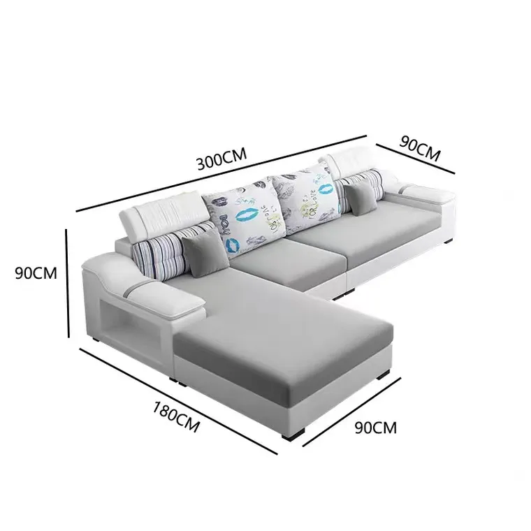
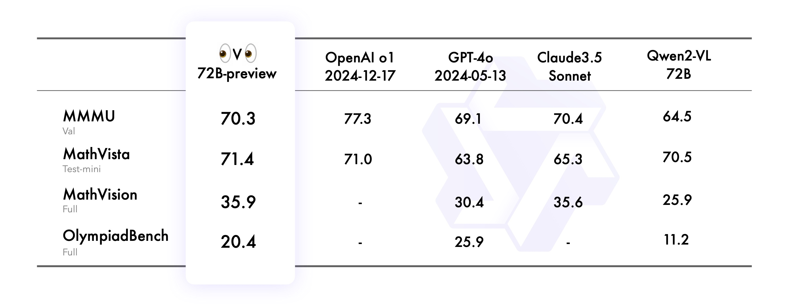

<!-- article-header:start -->
[项目首页](../../../README.md) › [模型系列](../../../reports/model-family-index.md) › [Qwen](../README.md)
<!-- article-header:end -->

# QVQ-72B-Preview：以长程推理增强视觉解题

<!-- article-toc:start -->

**本篇目录** · [论文定位](#paper-info) · [快速概览](#overview) · [整体架构](#architecture) · [核心原理](#principles) · [数据构建](#data) · [训练流程](#training) · [实验结果](#experiments)
<!-- article-toc:end -->

## 1. 论文信息与模型定位

- **原始来源**：[QVQ: To See the World with Wisdom](https://qwenlm.github.io/blog/qvq-72b-preview/)，Qwen Team，**2024-12-25**。
- **模型**：QVQ-72B-Preview，基于 **Qwen2-VL-72B** 构建的开放权重多模态推理实验模型。
- **本文范围**：依据 2026-10-08 保存的官方发布页与原始图片。它不是完整技术论文，没有详细披露架构增量、训练数据和优化 recipe。

它的重点是从视觉信息出发进行多步解题，尤其是数学与科学推理。官方明确提醒它不能全面替代 Qwen2-VL-72B-Instruct；推理过程可能语言混杂、循环和逐渐脱离图像。Preview 的实验性质需要与成绩一起阅读。

## 2. 快速概览

QVQ 展示的模式是先读取图片中的条件，再建立计算或逻辑关系，推导答案并反复核查。这种过程能把图片里的表格、几何标记、流程图和遗传图变成明确的约束，而不只是给出一句图像描述。

与 Qwen2-VL-72B 相比，原图中 MMMU **64.5→70.3**、MathVision **25.9→35.9**、OlympiadBench **11.2→20.4**；MathVista 则仅 **70.5→71.4**。提升随任务而异。QVQ 在 MMMU 低于表中 o1 和 Claude 3.5 Sonnet，OlympiadBench 也低于 GPT-4o，不能把数学推理定位写成全面领先。

发布页大量篇幅是六个演示的完整生成轨迹。这些轨迹有解释价值，也包含冗余、自我怀疑和未验证的中间说法。最终答案正确不等于每个推理句子都正确。

## 3. 整体架构

<!-- derived-architecture:start -->

*自绘公开接口示意（非原文图）。依据下述公开资料归纳；方框表示功能组件，不代表逐层实现。*

依据：[official-source-snapshot-2026-10-08; Introduction / Limitations](https://qwenlm.github.io/blog/qvq-72b-preview/)。
<!-- derived-architecture:end -->

该发布页明确模型建立在 Qwen2-VL-72B 上，但未展开新增的视觉编码器、注意力层、参数分配或视觉 token 配方。本文不从同家族其他报告补造 QVQ 的具体结构，也不将可见的长回答当作新增网络层的证明。

任务信息流可以分成三个观察步骤：视觉读取获得符号和位置条件；语言推理把条件组织成问题模型；生成最终结论。演示中没有显式外部计算器、检索或图像裁剪工具调用，所以不能把模型文字中的“再检查”写成它实际重新运行了一次视觉检测器。

长生成可以保存更多中间结论，却也可能让最初的视觉条件在叙述中漂移。发布页明确把多步推理逐渐失去对图像内容的关注列为限制，没有提供每一步重新对齐图像的专门机制或消融。

## 4. 核心创新与数学原理

**读图**：应读取 $`x=2`$ 的整行：$`f=-3`$、$`f'=-8`$、$`g=1`$、$`g'=7`$。这里依靠表头区分函数值与导数值，不能只读同一行的四个数字。

乘积求导示例体现视觉读取与数学规则的衔接：

$$
h'(2)=f'(2)g(2)+f(2)g'(2)=(-8)(1)+(-3)(7)=-29.
$$

模型得出结果后多次重复检查相同数值。这展示了可读的推理过程，但对这道题，确定表格和应用一次规则已经足够；更长的轨迹没有必然增加有效信息。该公式是题目的数学，不是 QVQ 的训练目标。

**读图**：E 是 CD 中点、F 是 AD 中点，O 为 AE 与 BF 交点。随机点落在三角形 ABO 内的概率，取决于面积比。设 $`A=(0,0)`$、$`B=(2a,0)`$、$`C=(2a,2b)`$、$`D=(0,2b)`$，可得 $`O=(2a/5,4b/5)`$，故

$$
P=\frac{\tfrac12(2a)(4b/5)}{(2a)(2b)}=\frac15.
$$

这是对演示答案的独立代数核查。模型轨迹虽然最后同为 1/5，过程中仍将面积单位和比例混淆后反复自纠。读者应检查约束和推导，而非把“反思”措辞本身当作正确性证明。

发布页未披露强化学习更新、奖励模型、过程监督或偏好目标，因此本文不编写 QVQ 特有的 RL 或长推理训练公式。

## 5. 数据构建与处理

官方没有披露训练图文对数量、数学推理样本量、合成轨迹比例、标注来源、筛选规则或数据去重。演示输入包括表格、半圆图、沙发尺寸、化学流程、遗传示意和矩形题，但这些展示例不能被称为完整训练数据集。

公开评测采用四项任务：MMMU 是多学科大学级视觉理解，MathVista 侧重视觉数学，MathVision 来自数学竞赛类多模态题，OlympiadBench 涵盖中英双语数学与物理竞赛问题。发布页介绍后者总体包含 **8,476** 道题，但未展开这里所报成绩的完整子集和筛选协议；不把 8,476 自动当成本次所有模型使用的样本数。

**读图**：图片标注 300、180 和 90 cm，模型把 L 形拆成矩形体，并减去重合块。它最终计算：

$$
(300\times90+180\times90-90\times90)\times90=3,159,000\ \mathrm{cm}^3
$$

这个结果依赖把外形近似为等高、实心的 L 形柱体，不是实物材料体积或精确排水体积；真实沙发的靠背、空隙和坐垫形状没有纳入计算。

这类演示说明，即便识别了尺寸，任务仍需明确几何建模假设。模型将多个不同体积分解反复尝试，不能代替用户条件不足时对假设的说明。

## 6. 训练流程与目标

本来源只说明从 Qwen2-VL-72B 增强视觉推理，没有公开训练阶段、冻结范围、学习率、批大小、采样温度、最大生成长度或训练硬件，也没有证明采用某一种 SFT/RL 组合。本文不根据同家族纯文本推理模型推测这些步骤。

可以观察到模型在输出侧产生详细的逐步分析和自检查，因而实际使用要考虑长生成的时间与 token 成本。发布页没有在统一推理预算下报告速度、成本及精度曲线，也没有证明无限增加输出长度持续提高成绩。

官方后续计划增加更多模态并统一模型。这是未来方向，不表示 QVQ-72B-Preview 已经支持音频生成或任意模态输入输出。模型实际定位仍是公开资料所述的视觉语言推理。

## 7. 实验设置与主要结果

**读表**：左侧为 QVQ-72B-Preview，依次比较 o1（2024-12-17）、GPT-4o（2024-05-13）、Claude 3.5 Sonnet、Qwen2-VL 72B。每一行的数据划分写在任务名下，横杠表示未报告，不能按零分处理。

| 评测划分 | QVQ-72B-Preview | o1 | GPT-4o | Claude 3.5 Sonnet | Qwen2-VL 72B |
|---|---:|---:|---:|---:|---:|
| MMMU val | 70.3 | 77.3 | 69.1 | 70.4 | 64.5 |
| MathVista test-mini | 71.4 | 71.0 | 63.8 | 65.3 | 70.5 |
| MathVision full | 35.9 | 未报告 | 30.4 | 35.6 | 25.9 |
| OlympiadBench full | 20.4 | 未报告 | 25.9 | 未报告 | 11.2 |

相对基础模型，四项都提高；MathVista 只有 0.9，而 MathVision 提高 10.0。QVQ 的 MMMU 比 o1 低 7.0，比 Sonnet 低 0.1；MathVista 比 o1 高 0.4，但图中没有 o1 的 MathVision 与 OlympiadBench，所以无法证明在三项数学任务上都追平或超越 o1。

该发布页没有详细给出每个模型的提示、工具、生成预算、采样次数、评分器、置信区间或训练污染核验，不能将汇总图解释为严格统一控制下的架构比较。它也没有给出一般 OCR、文档、视频、界面操作及视觉幻觉的完整结果。

演示显示把视觉条件转成符号推导的能力，同时也存在反复计算、语言混杂和中间错误。官方明确承认循环推理与脱离图像导致幻觉。可信结论是：在所报四项视觉推理评测中，相对 Qwen2-VL-72B 有改进；更广泛的通用多模态能力、效率和每步推理正确性没有在本材料得到同等证明。

<!-- article-footer:start -->
---

[← 上一篇：DeepSeek-VL2](../../deepseek/arxiv-2412.10302/README.md) · [按发表时间浏览](../../../reports/paper-reading-guide.md#year-2024) · [下一篇：VITA-1.5 →](../../vita/arxiv-2501.01957/README.md)

[返回本篇目录](#article-toc) · [返回模型系列](../README.md)
<!-- article-footer:end -->
