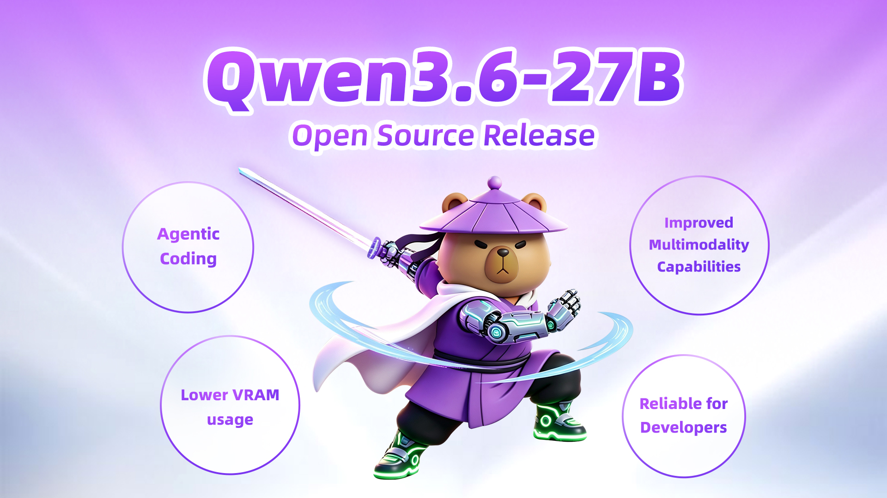
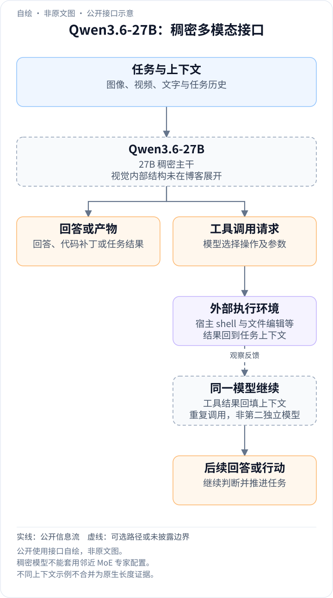
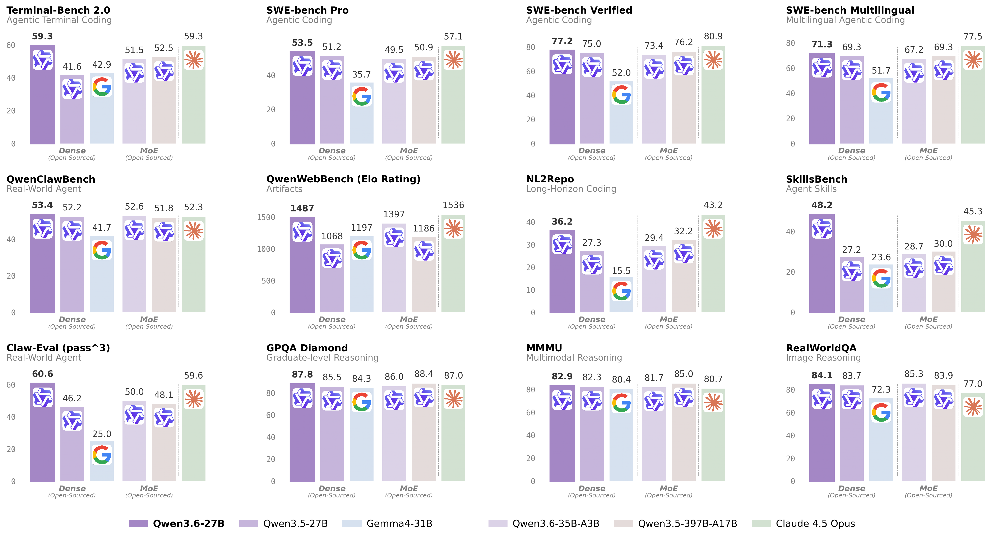

<!-- article-header:start -->
[项目首页](../../../README.md) › [模型系列](../../../reports/model-family-index.md) › [Qwen](../README.md)
<!-- article-header:end -->

# Qwen3.6-27B：面向代码智能体的 27B 稠密多模态模型

<!-- article-toc:start -->

**本篇目录** · [论文定位](#paper-info) · [快速概览](#overview) · [整体架构](#architecture) · [核心原理](#principles) · [数据构建](#data) · [训练流程](#training) · [实验结果](#experiments)
<!-- article-toc:end -->

## 1. 论文信息与模型定位

**资料**：Qwen Team 于 2026 年 4 月 22 日发布的 [*Qwen3.6-27B: Flagship-Level Coding in a 27B Dense Model*](https://qwen.ai/blog?id=qwen3.6-27b)，[官方静态页面](https://qwenlm.github.io/blog/qwen3.6-27b/)；[开放权重](https://huggingface.co/Qwen/Qwen3.6-27B)。本文依据 2026-10-08 保存的官方原文快照。这是一篇发布博客，技术披露程度不同于完整论文。

模型是 27B 稠密多模态模型，同一个检查点支持视觉语言 thinking 与 non-thinking 模式，处理文字、图像和视频。发布重点是代码智能体：修复软件仓库、在终端完成任务，以及利用外部工具执行长流程。不能因为标题强调 coding，就把它归成纯文字代码模型；也不能把 Qwen3.6-35B-A3B 的 MoE 参数配置移植到它。

*发布页原图没有 Figure 编号。它概括 Agentic Coding、Multimodality 与部署诉求，是产品定位图，不是网络结构或显存实验图。“Lower VRAM”不能替代具体量化格式、上下文与并发条件下的显存测量。*

## 2. 快速概览

| 维度 | 官方披露 |
|---|---|
| 参数结构 | 27B 稠密模型 |
| 输入 | 文字、图像、视频 |
| 推理模式 | 单一检查点内支持思考与非思考模式 |
| 主要用途 | 代码智能体、多模态推理、文档理解、视觉问答 |
| 代表代码成绩 | SWE-bench Verified 77.2、Pro 53.5、Terminal-Bench 2.0 59.3 |
| 代表视觉成绩 | MMMU 82.9、RealWorldQA 84.1、带字幕 VideoMME 87.7 |
| 数据与训练细节 | 本博客未披露训练语料规模、阶段或优化超参数 |

官方把它与 Qwen3.5-397B-A17B 对比，强调更小总参数规模下的代码成绩。前者是稠密，后者总参数 397B、激活约 17B；这组比较支持性能与权重规模的观察，但不能自动转化为“计算成本低十五倍”。（原文 Introduction、Performance）

## 3. 整体架构

<!-- derived-architecture:start -->

*自绘公开接口示意（非原文图）。依据下述公开资料归纳；方框表示功能组件，不代表逐层实现。*

依据：[official-source-snapshot-2026-10-08; Vision Language / agent scaffold / API Usage](https://qwen.ai/blog?id=qwen3.6-27b)。
<!-- derived-architecture:end -->

博客明确给出“dense 27B”和原生多模态，但没有公布层数、隐藏维度、注意力结构、视觉编码器、连接器、视觉 token 压缩方式或视频时序编码。它也没有架构图，因此本文不根据相邻 Qwen 版本猜测这些实现。

从使用接口可确认，模型接收图文/视频上下文并生成回复；在代码智能体中，宿主软件提供 shell、文件编辑等工具，模型与工具结果反复交互。SWE-bench 成绩来自带 bash 与文件编辑工具的内部 agent scaffold，不能视为只生成一次补丁、没有工具反馈的成绩。（原文 Vision Language、Language 表下注）

接口提供 preserve_thinking，用于保留前序回合的思考内容，官方推荐用于智能体任务。它说明如何组织多轮推理上下文，不等于模型新增一个记忆数据库或公开了跨轮训练机制。博客的 OpenClaw 配置写 contextWindow=131072，评测脚注却使用 200K/256K 窗口；这些分别是示例配置和评测设置，不能合并为一个确定的模型原生最大长度。（原文 API Usage、OpenClaw）

## 4. 核心创新与数学原理

本资料的可核验重点是：在稠密 27B 规模上取得较强代码智能体结果，同时保持视觉语言输入与两种推理模式。它没有描述导致这些改进的独立算法、新损失或数学推导。正文因此不引入未经披露的 RL、蒸馏、MoE 路由或视觉压缩公式。

稠密与 MoE 的对比需要分开看总参数和实际参与计算的参数。稠密模型无需专家路由，部署结构通常更直接；MoE 则可能用更大的总权重提供容量，同时只激活其中一部分。官方表列 Qwen3.5-397B-A17B 的激活参数小于 27B，因此仅从总参数之比无法判断每 token FLOPs、延迟或训练效率。博客没有提供统一硬件测速来解决这些问题。

思考模式与非思考模式也不是两套公开架构。原文说它们存在于同一检查点中，但未说明训练时如何分配样本、约束思考长度或切换目标。可以介绍其能力与接口，不能推导未公开的训练机制。（原文 Introduction、Vision Language）

## 5. 数据构建与处理

博客未列预训练数据来源、token 总量、图像/视频规模、代码数据清洗、去重或 SFT/RL 样本构造方法。不能依据代码成绩推断用了特定软件仓库或证明没有测试污染，也不能把评测题目数当作训练数据量。

公开的**评测构建**则较具体。SWE-bench Pro 中部分问题被作者修正，并在修正版本上评价全部基线；SkillsBench 使用排除 API 依赖任务后的 78 个自包含任务子集；QwenWebBench 是内部前端生成基准，覆盖中英文与网页、应用、游戏、SVG、可视化、动画、3D 七类，自动渲染后用多模态裁判评分，再用 BT/Elo 汇总。这些信息用于解释结果口径，不是数据训练流程。（原文 Language 表下注）

## 6. 训练流程与目标

原文没有披露预训练、指令微调、偏好对齐或强化学习阶段；学习率、batch、训练步数、冻结配置、GPU 和损失函数均未给出。因此本节不能形成可复现的训练配方，也不把其他 Qwen 报告的设置当成本模型事实。

可核验的推理设置包括：SWE-bench 系列 temperature=1.0、top_p=0.95、200K 上下文；Terminal-Bench 2.0 使用 Harbor/Terminus-2、三小时超时、32 CPU/48GB 内存、最多 80K 输出 token、256K 上下文，五次运行取平均。这里的 CPU/RAM 是工具任务环境，不是训练或模型服务器硬件。SkillsBench 同样五次取平均；NL2Repo 对其他模型使用 Claude Code，故跨系统比较仍应关注宿主差异。（原文 Language 表下注）

## 7. 实验设置与主要结果

*发布页性能图没有 Figure 编号。紫色深柱为本模型，底部图例区分同规模稠密模型、MoE 和 Claude。每个小图的指标不同：QwenWebBench 是 Elo，其他多为任务成绩，不能把全部纵轴当百分比或跨图直接平均。*

| 代码任务 | Qwen3.5-397B-A17B | Qwen3.6-27B |
|---|---:|---:|
| SWE-bench Verified | 76.2 | 77.2 |
| SWE-bench Pro | 50.9 | 53.5 |
| SWE-bench Multilingual | 69.3 | 71.3 |
| Terminal-Bench 2.0 | 52.5 | 59.3 |
| SkillsBench | 30.0 | 48.2 |

该对比在代码任务上有明确增益，但不能写成超过所有闭源基线：Claude 4.5 Opus 的 Verified 80.9、Pro 57.1、Multilingual 77.5 仍更高；Terminal-Bench 则同为 59.3。QwenWebBench 1,487 是内部 Elo，不是 1,487 道题全部答对。（原文 Language）

视觉结果包括 MMMU 82.9、MMMU-Pro 75.8、MathVista mini 87.4、RealWorldQA 84.1、CC-OCR 81.2、OCRBench 89.4、RefCOCO 平均 92.5、VideoMME 带字幕 87.7、AndroidWorld 70.3。与 Qwen3.5-27B 比较并非全部提高：MathVista mini 从 87.8 到 87.4，CharXiv RQ 从 79.5 到 78.4。视频结果明确含字幕；OCRBench 表列口径为 89.4，不能与其他论文常用千分制原始分数直接混用。（原文 Vision Language）

资料展示的是官方评测和发布能力，尚缺公开方法消融、完整训练配方及统一成本实验。本文逐项核对官方图表，未下载模型、执行代码任务或调用线上 API。

<!-- article-footer:start -->
---

[← 上一篇：Xiaomi MiMo-V2.5](../../mimo/document-bc763cf700ef/README.md) · [按发表时间浏览](../../../reports/paper-reading-guide.md#year-2026) · [下一篇：DeepSeek-V4 →](../../deepseek/document-08e9e69bb6bb/README.md)

[返回本篇目录](#article-toc) · [返回模型系列](../README.md)
<!-- article-footer:end -->
