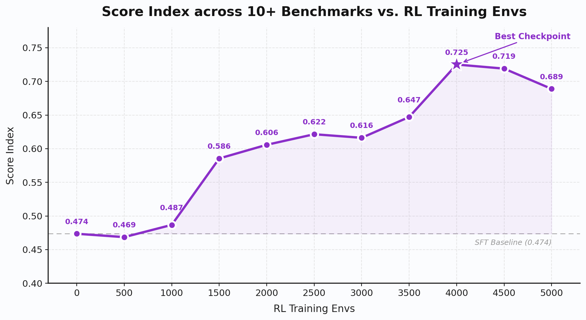
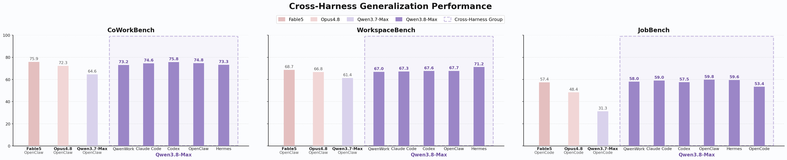
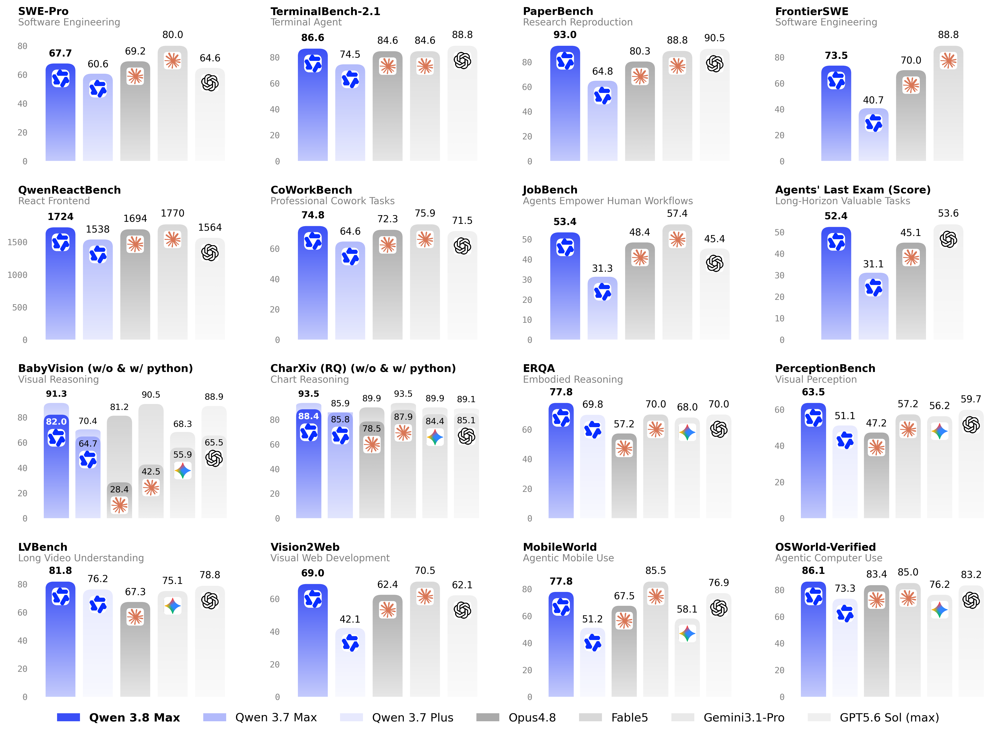

# Qwen3.8-Max：超大规模模型、真实工作强化学习与视觉反馈 Agent

## 1. 论文信息与模型定位

| 项目 | 信息 |
|---|---|
| 原文 | Qwen3.8-Max: A New Bar for Coding and Cowork |
| 发布方与日期 | Qwen Team，2026 年 8 月 3 日 |
| 来源 | [官方发布博客](https://qwen.ai/blog?id=qwen3.8)，2026-10-08 快照 |
| 参数口径 | 2.4T 总参数、95B 激活参数 |
| 定位 | 基于 Qwen3.5 架构基础扩展的 Max 档位，强化编码、专业工作、研究、长任务和多模态 Agent |
| 发布状态 | 当时在 QwenCloud 提供 API，并宣布下一周开放权重；本文不将预告当作已核验的当前下载状态 |

该材料提供了真实工作 RL 的系统思路和大量评测配置，但没有完整披露主干层数、专家路由、视觉编码器、预训练 token 或训练超参数。95B 激活与 2.4T 总参数需要分开：它们体现容量与计算参与范围的差别，不能把模型当作只需存储 95B 参数的稠密网络。

## 2. 快速概览

Qwen3.8-Max 的能力组织围绕“完成任务并检查结果”：写代码、运行测试、观察 GUI 或渲染输出、修改方案，再继续执行。多模态不是只在初始输入阶段使用，而是贯穿反馈循环。长视频理解另配 Qwen-MM-Plugins 的记忆系统；超过 100 小时视频的展示不等于全部原始视频帧一次进入主干窗口。

训练方面，博客重点是联合扩大 RL 环境和计算：任务从单个步骤扩展到多任务和多日，工作区从多文件扩展到复杂层级，harness 则覆盖多种种类、版本和技能。统一奖励体系结合执行检查、按 rubric 的文字与渲染视觉判断，以及 Agent 检查；在线数据平衡器调整任务、难度、工作区和 harness 的 batch 分布。

主要能力数字包括 PaperBench **93.0**、OSWorld-Verified **86.1**、ERQA **77.8**、OmniDocBench 1.5 **92.1**。但模型并未全面领先：SWE-bench Pro 67.7 低于 Fable5 80.0，Terminal Bench 2.1 86.6 低于 GPT-5.6 Sol 88.8；MMMU-Pro 82.3 也低于 GPT-5.6 Sol 83.0。表中的旧模型在语言部分多为 Qwen3.7-Max，视觉部分为 Qwen3.7-Plus，两类基线不能混写成一个版本。

## 3. 整体架构

内部网络只披露“基于 Qwen3.5 架构基础”与规模扩展，不能由这句话推导新版的全部层数、注意力比例、专家数量和投影器。系统层则比较清楚：语言与视觉模型接收任务历史，harness 提供代码、GUI 与其他工具，工具执行产生文本、截图和结果文件，再反馈给模型。

**Hybrid Agent** 把代码与 GUI 操作结合：代码负责实现或大规模处理，GUI 负责与真实运行应用交互并验证结果。RecreationBench 对此进行黑盒应用重建评测，覆盖 Ubuntu、macOS、Windows、Android 和 web；模型只能交互观察，没有源代码或互联网。这是带环境约束的 Agent 任务，不能当作仅凭一张图片重建所有应用的纯视觉基准。

Qwen-MM-Plugins 是给现有 Agent harness 使用的扩展库，提供图像视频处理、动态分辨率、多模态记忆、视觉工具，以及剪辑、Blender、CAD 等功能。它属于系统工具层，而不是已披露的模型内部神经模块。视频记忆图可组织人物、事件、时间戳和场景，让长时间信息可检索；原文未说明其精确图数据库、帧率或向量索引配置。

推理 API 支持 xhigh、medium、low 三档 reasoning_effort，发布默认 xhigh；**preserve_thinking 默认开启**，这与 Qwen3.6-Plus 的默认行为不同。保留任务思考和外部记忆不等于推理时更新权重，博客的“持续学习”业务案例主要描述从交易反馈调整决策，不应自动称为在线梯度训练。

## 4. 核心创新与数学原理

官方没有编号公式。下面的表达用于说明其公开系统思路，并不代替实际奖励实现。

把训练环境表示为 \(e=(\text{task},\text{workspace},\text{harness})\)，可理解在多个独立轴上扩展得到环境组合，而非每次完全重新集成一个单任务环境。在线平衡器控制采样分布 \(q_t(e)\)，训练目标可概括成 \(\mathbb E_{e\sim q_t,\tau\sim\pi_\theta}[R(e,\tau)]\)。原文未公布奖励函数、优势估计、KL 系数或优化算法，本文不将它写成 PPO/GRPO 的确定配方。

Universal Reward System 将不同任务的验证纳入统一框架：可执行任务用运行结果，开放产物用 rubric 约束文字与渲染判断，复杂工作可用 Agent 检查。统一框架旨在减少多个独立 verifier 的不一致，但博客没有给出奖励标定、偏差测试或可证明的等价性。模型评审与视觉评审本身也可能出错，不能由统一名称推断奖励恒正确。

95B/2400B 约为 **3.96%**，只是激活与总参数之比，不能当作 FLOPs、显存或费用下降到 3.96% 的结论。路由、共享计算和通信没有详细公开，无法进一步从参数比计算吞吐。

图的横轴是 **RL Training Envs**，不是明确标注的训练步数；纵轴是 10 多项基准的 Score Index，而非单个准确率。SFT 基线为 0.474，最佳点在 4000 环境处为 **0.725**，后续 4500 和 5000 点为 0.719、0.689；中间也有小幅下降。它支持总体扩展有收益，但与正文“持续稳定增长”的概述相比，原图并非逐点单调上升。博客未公布该 index 的聚合权重或每点计算量，不能把 0.725 直接写成 72.5% 所有任务成功率。

代码与视觉反馈可以形成“生成—执行—观察—修改”循环。它的价值在于把错误显式转为下一步条件，而不是只依赖一次性生成。是否发生权重学习、每类反馈的可靠性及回合预算，需要分别验证，不能把每次修改都叫模型训练。

## 5. 数据构建与处理

原文未提供预训练总 token、图文比例、独立视觉训练集合或后训练样本数。较具体的是 RL 环境设计和在线 batch 平衡：任务、难度、工作区、harness 四类分布被共同控制，以降低 batch 间梯度变化、维持扩大 RL 计算的稳定性。这是官方设计目标；缺少采样权重和对照消融，不能单独量化每个轴的贡献。

某些基准经过处理：SWE-bench Pro 修正有问题的题目后重评基线；MathVision 和 CharXiv 少量错误真值经过人工核验修正。MathVision 的本模型用固定提示，对比模型取有无 boxed 格式的较高结果。不同来源表格若没有同样修正和提示，不能直接拼接。

内部评测包括 CoWorkBench、QwenSWEBench、QwenQoderBench、QwenReactBench、QwenSVGBench、QwenBlenderBench 和 QwenVisualOffice，覆盖代码、专业工作、渲染产物等。其完整样本与污染审计未在博客披露。电商模拟使用淘宝天猫脱敏交易数据，含 12 类店铺、60 类商品、近 600 供应商、7000 商品及 152 个欺诈商家；这是**评测模拟环境**的信息，不能直接写成全部模型训练语料。

## 6. 训练流程与目标

博客把主要机制写为环境与 RL 计算联合扩展、统一奖励、在线平衡。原图含 SFT baseline，说明比较起点是监督微调模型，但没有公开完整 SFT 或预训练阶段安排、冻结策略、优化器和硬件时长。模型规模扩展与 RL 改进同时存在，缺少受控消融时不能将全部收益归给其中一个。

图中 Qwen3.8-Max 在 CoWorkBench 的五种 harness 得分约为 73.2–75.8，WorkspaceBench 为 67.0–71.2；JobBench 更分散，从 OpenCode 53.4 到 OpenClaw 59.8。它体现多种 harness 下都能工作，但不是“任何框架得分完全一样”。某些外部模型列使用 OpenClaw 或 OpenCode，条件也要保留，不能只挑每个模型的最高点进行不加说明的比较。

实验资源属于推理设置：PaperBench 在 BasicAgent Code-Dev 下由 Opus 4.6 评审，三次运行平均、每次最多 12 小时；Terminal Bench 2.1 的本模型采用 Claude Code、avg@10、5 小时超时与 max_tokens=131072，其他模型采用跨 harness 的最佳公开成绩。SkillsBench 87 个任务每题三次平均，不同模型分别使用 Claude Code、Codex、OpenCode；这些配置不是统一 harness 的严格受控比较。

## 7. 实验设置与主要结果

原图保留全部标题、数值和底部模型图例。BabyVision、CharXiv 柱图同时画出无 Python 与有 Python 条件；全文表中次序是 **without CI / with CI**，CI 在该文明确为 Code Interpreter，不能当作置信区间，也不能沿用 Qwen3.6 的反向排列。

| 指标 | Qwen3.8-Max | 前代（原表指定） | 主要边界 |
|---|---:|---:|---|
| SWE-bench Pro | 67.7 | 3.7-Max 60.6 | 低于 Fable5 80.0 与 Opus4.8 69.2；修正题集 |
| Terminal Bench 2.1 | 86.6 | 3.7-Max 74.5 | avg@10 与跨harness公开最佳结果比较 |
| PaperBench | 93.0 | 3.7-Max 64.8 | 三次平均、模型评审；非所有研究论文复现率 |
| CoWorkBench / JobBench | 74.8 / 53.4 | 3.7-Max 64.6 / 31.3 | 都低于 Fable5 对应 75.9 / 57.4 |
| Agents’ Last Exam，Pass / Score | 27.0 / 52.4 | 3.7-Max 11.8 / 31.1 | 两指标不是同一口径 |
| MMMU-Pro | 82.3 | 3.7-Plus 79.0 | 略低于 GPT5.6-Sol 83.0 |
| MathVision，无CI / 有CI | 95.2 / 97.7 | 3.7-Plus 90.3 / 未报告 | 同一任务两套工具条件 |
| BabyVision，无CI / 有CI | 82.0 / 91.3 | 3.7-Plus 64.7 / 70.4 | 明显提升，但要保留工具条件 |
| ZeroBench pass@5，无CI / 有CI | 24.0 / 49.0 | 3.7-Plus 19.0 / 19.0 | 不当作单次准确率 |
| OSWorld-Verified | 86.1 | 3.7-Plus 73.3 | GUI执行任务，而非静态定位 |
| OSWorld 2.0，binary / partial | 19.4 / 46.7 | 3.7-Plus 2.8 / 21.5 | 部分奖励 46.7 不等于完全完成 46.7% |
| ScreenSpot Pro | 84.5 | 3.7-Plus 79.0 | 低于 Fable5 87.3 |
| ClawEval-MM，pass@3 / 平均 | 77.2 / 74.8 | 3.7-Plus 57.4 / 60.1 | 原文定义至少一次通过与三次均值；评分规则不同不能硬按大小推断错误 |
| CharXiv RQ，无CI / 有CI | 88.4 / 93.5 | 3.7-Plus 85.8 / 85.9 | 有CI与 Fable5 93.5相同 |
| OmniDocBench 1.5 | 92.1 | 3.7-Plus 91.4 | 当前表为高分方向口径，非其他论文的编辑距离 |
| ERQA / PerceptionBench | 77.8 / 63.5 | 3.7-Plus 69.8 / 51.1 | 具身推理与感知专项结果 |
| VideoMME / VideoMME v2，有字幕 | 90.4 / 68.3 | 3.7-Plus 88.0 / 59.7 | v2低于 GPT5.6-Sol 71.1 |
| LVBench，不加记忆 / 加记忆 | 81.8 / 85.6 | 3.7-Plus 76.2 / 74.5 | 记忆系统是额外配置，不与原始输入成绩混用 |

长视频的其他结果也体现系统边界：EgoLife 加记忆为 80.3，低于 Fable5 的 82.3；VideoDR 加搜索为 73.2，低于 Fable5 的 77.1。视频记忆和搜索对结果有贡献，但没有完整消融能分离插件与模型贡献。RecreationBench 为 51.7，低于 Fable5 56.1；“混合 Agent”仍存在未完成任务。

博客的长任务案例提供过程证据：约 16 天自主维护项目累计 265 commits、127 PR、151 issues；五日论文复现实验开展 33 轮 GPU 训练，AIME24 从复现基线 49.58% 改到 52.29%，提高 **2.71 个百分点**。这些是特定运行记录，不是跨项目平均成功率。

硬件设计案例把综合门数从 8298 降至 678，版图从 106×106 降到 46×46 平方微米，面积约降低 81%；采用 Iverilog、Yosys、cocotb 与 OpenROAD/Nangate45 验证。它是仿真、综合和布局布线结果，不能表述为已流片的实物芯片验证。电商模拟最终余额 416252 元、初始 100000 元，约为本金的 4.16 倍，余额不能被当作净利润。量化示例的 6000 次回测与选出因子同样属于研究展示，不证明真实交易收益。

本文保留官方丰富的数值与配置，也明确环境、工具、平均分、通过率及前代型号的区别。发布页缺少完整训练配方、统计区间与全部任务运行记录，不能据展示证明跨行业结果恒可靠；本介绍没有运行模型。
