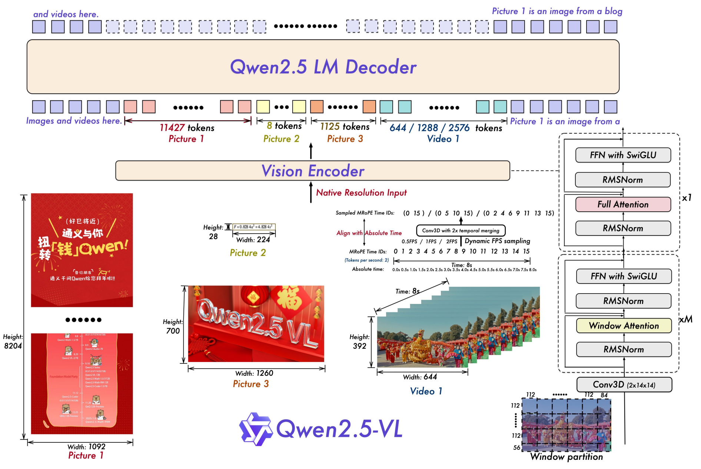
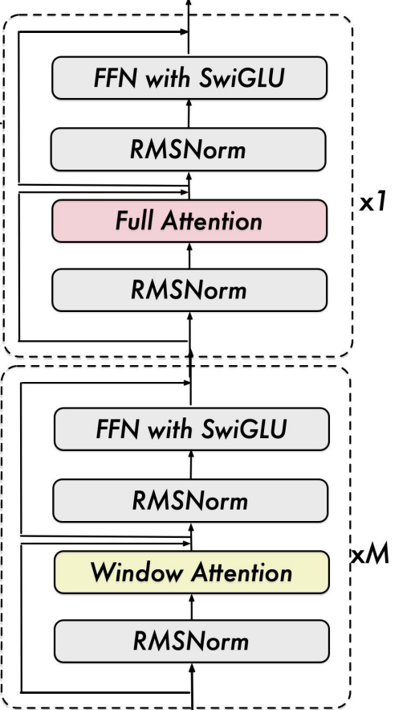
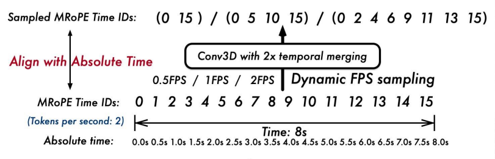
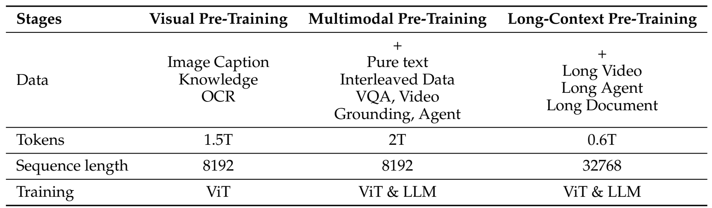
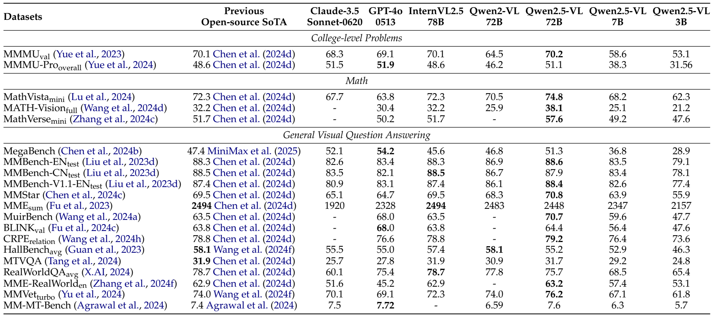
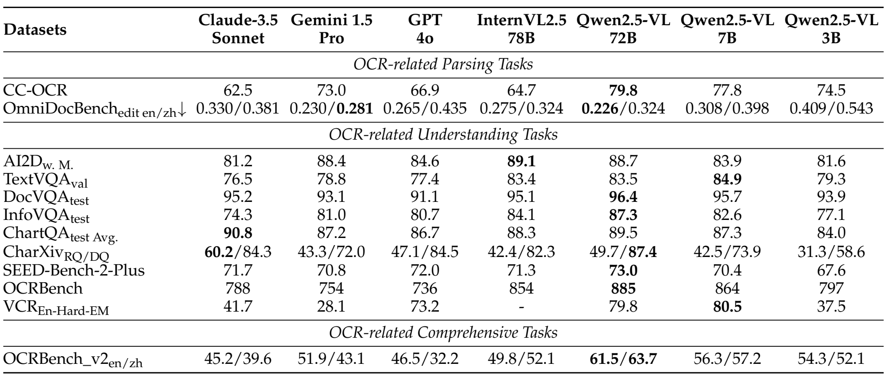
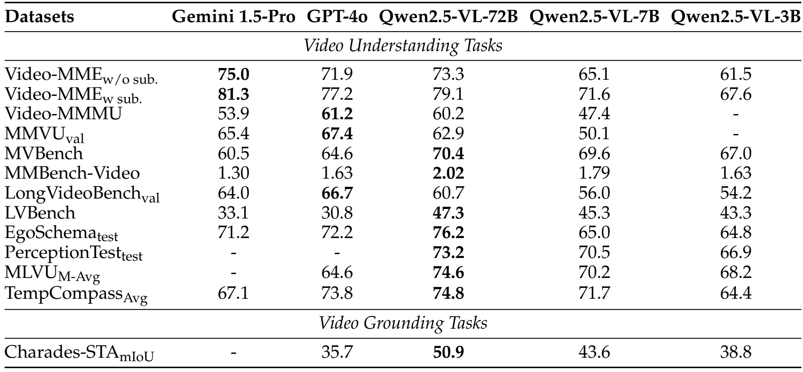

[返回 Qwen 家族](../README.md) · [返回仓库](../../../README.md)

# Qwen2.5-VL：动态分辨率、窗口注意力与绝对时间编码

> 本文按七部分模板解读 **Qwen2.5-VL Technical Report**，固定采用 [arXiv:2502.13923v1](https://arxiv.org/abs/2502.13923v1)。图表均从该版本 PDF 提取；数学表达中标明为“解读公式”的部分用于说明原理，原报告没有给出对应的编号公式。

## 1. 论文信息与模型定位

| 项目 | 内容 |
|---|---|
| 论文题名 | Qwen2.5-VL Technical Report |
| 发布机构 | Qwen Team，Alibaba Group（以 PDF 署名为准） |
| 发表与采用版本 | arXiv 首次提交：2025-02-19；本文采用 v1。该版本 PDF 页首另标注 March 5, 2025，两个日期分别记录 |
| 所属家族与分支 | Qwen 家族的 VL 分支，面向视觉理解与视觉交互 |
| 模型档位 | 3B、7B、72B；这些是模型档位名称，报告没有在 Table 1 给出包含视觉编码器和连接器的精确总参数量 |
| 输入与输出 | 接收文本、图像及视频帧；生成文本，以及可由文本表达的坐标、结构化结果或操作指令 |
| 主要任务 | 视觉问答、文档与图表理解、OCR、物体定位、视频理解与时间定位、GUI 交互 |
| 原文 | [固定版本 PDF](https://arxiv.org/pdf/2502.13923v1) · [对应 HTML](https://arxiv.org/html/2502.13923v1) |
| 官方资源 | [原报告中的代码地址](https://github.com/QwenLM/Qwen2.5-VL) · [官方权重组织](https://huggingface.co/Qwen)；旧代码地址目前会重定向，本文技术描述仍以 v1 报告为依据 |
| 开放情况 | 作者公开模型权重与使用代码；报告提供数据构建和训练阶段说明，但没有完整披露全部训练数据、混合比例和优化配置 |

Qwen2.5-VL 的定位是让语言模型获得更可靠的视觉输入：既读懂图片内容，也读取文档细节、输出目标位置，并理解视频中的事件及其时间。其视频入口依靠视觉帧和时间编码，原报告没有把语音输入、音频生成或图像生成作为这个模型的输出路径。[原文摘要及 §2.1，PDF 第 1、3–5 页](https://arxiv.org/pdf/2502.13923v1#page=3)

## 2. 快速概览

Qwen2.5-VL 仍由视觉编码器、视觉与语言之间的连接模块，以及 Qwen2.5 语言模型组成。升级重点在于输入处理与训练：图片保留可变长宽比和相应的视觉 Token 数，视觉编码器主要使用窗口注意力降低高分辨率计算开销；视频支持不同采样帧率，时间位置编码与实际时间对齐，从而让模型有机会区分事件的先后、速度与发生位置。

数据侧，作者将多模态预训练规模扩展到 4.1T Token，并增加文档结构、绝对坐标定位、长视频和界面操作等任务。训练由三个预训练阶段加 SFT、DPO 后训练组成。结果表明，72B 模型在视觉数学、文档和部分视频任务上表现突出，3B、7B 提供较小规模的选择；不同基准仍存在明显强弱差异，结果需要逐项阅读。

这篇报告值得抓住三个连接关系：**高分辨率如何变成可负担的视觉 Token，采样帧序号如何对应真实时间，数据与训练如何将这些表示转化为实际能力。**[原文 §1–3](https://arxiv.org/pdf/2502.13923v1#page=2)

## 3. 整体架构

### 3.1 沿原图理解输入到输出

> 来源：原文 **Figure 1**，arXiv v1，PDF 第 **3** 页；[原图所在页](https://arxiv.org/pdf/2502.13923v1#page=3)。原图区域完整导出，移除外围正文，图内内容保留。

从图的下方向上读：不同尺寸的图片和采样视频首先进入视觉编码器，再形成长度不同的视觉序列；这些序列与文本序列一起交给顶部的 Qwen2.5 LM Decoder。图的左侧强调图片尺寸与 Token 数对应，中央强调视频的采样率与时间编码，右侧展示视觉 Transformer 的窗口与全局注意力模块。

实现这一过程的三个主要组件是：

| 组件 | 输入与输出 | 作用与原文配置 |
|---|---|---|
| 视觉编码器 ViT | 图片或视频块 → 视觉特征序列 | 三个档位共用报告所列的视觉配置：32 层、隐藏维度 1280、16 个注意力头、空间 Patch 为 14×14 |
| Vision-Language Merger | 相邻四个视觉特征 → 一个语言侧视觉 Token | 将空间相邻的 2×2 特征拼接，经两层 MLP 映射到语言模型的嵌入维度 |
| Qwen2.5 语言模型 | 文本与视觉 Token → 文本序列 | 使用预训练 Qwen2.5 权重初始化；3B、7B、72B 对应隐藏维度分别为 2048、3584、8192 |

ViT 的空间位置由 2D-RoPE 编码，语言模型侧的图文视频序列由 MRoPE 编码，二者对应不同计算阶段。

这些数值来自 [原文 Table 1，PDF 第 4 页](https://arxiv.org/pdf/2502.13923v1#page=4)。连接器做的是特征压缩与通道映射：每四个视觉特征合成一个 Token，图像的内容随后通过语言模型的序列计算参与回答。

### 3.2 动态分辨率为什么会改变 Token 数

输入图像在处理后，高度和宽度均为 28 的倍数；视觉编码器以 14×14 空间 Patch 提取特征，连接器再合并相邻 2×2 个 Patch。因此，在报告所描述的空间划分下，一张处理后大小为 $H'\times W'$ 的图像对应：

$$
N_{\mathrm{patch}}=\frac{H'W'}{14^2},\qquad
N_{\mathrm{visual}}=\frac{N_{\mathrm{patch}}}{4}=\frac{H'W'}{28^2}.
$$

这是根据架构整理的**解读公式**。图中三个例子能直接验证它：8204×1092 的长图对应 11,427 个 Token；28×224 的公式图对应 8 个；700×1260 的图片对应 1,125 个。于是，视觉序列长度随输入尺寸变化，细节丰富的长图可以得到更多表示位置。[原文 Figure 1 与 §2.1](https://arxiv.org/pdf/2502.13923v1#page=3)

“原生动态分辨率”仍包含尺寸调整与计算预算约束；报告明确要求长宽对齐到 28 的倍数。它的关键是保留可变尺寸的处理方式，而高分辨率输入带来的视觉序列增长，需要由后面的注意力设计和训练策略共同承担。

视频首先经 Conv3D 形成两帧一组的视觉块，再进行空间合并；时间合并与 2×2 空间合并是两个维度上的处理。Figure 1 中视频帧为 392×644，每组对应 $14\times23=322$ 个语言侧视觉 Token；示意的 8 秒视频在 0.5、1、2 FPS 下分别产生 644、1288、2576 个视觉 Token。这揭示了视频预算同时受帧数与每帧空间分辨率影响。[原文 Figure 1、§2.1.1](https://arxiv.org/pdf/2502.13923v1#page=3)

## 4. 核心创新与数学原理

### 4.1 窗口注意力：降低多数视觉层的空间计算开销

> 来源：原文 **Figure 1 右侧注意力模块局部**，v1，PDF 第 **3** 页；[来源](https://arxiv.org/pdf/2502.13923v1#page=3)。全图见第 3 节。

原图黄色模块表示 Window Attention，粉色模块表示 Full Attention。报告的 ViT 共 32 层，只有零起始索引 7、15、23、31（第 8、16、24、32 层）的四层使用全局注意力，其余使用窗口注意力；窗口上限为 112×112 像素，即 8×8 个空间 Patch。较小区域直接处理，不通过补齐到最大窗口增加无效 Patch。[原文 §2.1.1、Table 1，PDF 第 4 页](https://arxiv.org/pdf/2502.13923v1#page=4)

用 [Transformer 的标准缩放点积注意力](https://arxiv.org/abs/1706.03762) 解释其计算差异：

$$
\operatorname{Attention}(Q,K,V)=
\operatorname{softmax}\!\left(\frac{QK^\top}{\sqrt{d_k}}\right)V.
$$

若有 $N$ 个视觉特征、每头特征维度为 $d_k$，全局注意力的两两交互需要处理 $N\times N$ 个关系。将特征划成每个最多 $M$ 个 Token 的窗口后，窗口内交互约为：

$$
C_{\mathrm{global}}=O(N^2d_k),\qquad
C_{\mathrm{window}}=O\!\left(\frac{N}{M}M^2d_k\right)=O(NMd_k).
$$

这里比较的是**注意力交互项**，未包含投影与前馈网络的全部成本。空间窗口上限对应 $M=64$，窗口大小固定时，单个窗口层的该项随 $N$ 近似线性增长。但四个全局层依然存在二次交互，不能将整个视觉编码器的注意力复杂度写成严格线性。这个组合让多数层局部提取信息，并通过少数全局层交换跨窗口信息；后一作用是对架构的解释，报告没有单独消融量化其贡献。

报告同时将视觉网络的归一化和前馈组件改为 RMSNorm 与 SwiGLU，并采用 2D-RoPE 表达空间关系。这些是已有组件在本架构中的采用方式，不宜分别当作该论文首次提出的算法。[原文 §2.1.1](https://arxiv.org/pdf/2502.13923v1#page=4)

### 4.2 绝对时间 MRoPE：给视频序列保留真实时间信息

> 来源：原文 **Figure 1 中央时间编码局部**，v1，PDF 第 **3** 页；[来源](https://arxiv.org/pdf/2502.13923v1#page=3)。展示了 0.5、1、2 FPS 与对应时间 ID 的示意。

仅用“这是第几帧”做位置编码，会把采样密度与事件时间混在一起：相同数量的帧，可能覆盖很短或很长的时间。Qwen2.5-VL 将时间分量与实际时间戳对齐，并在训练中动态采样 FPS，让模型接触不同时间密度的视频序列。[原文 §2.1.2–2.1.3，PDF 第 5 页](https://arxiv.org/pdf/2502.13923v1#page=5)

MRoPE 将位置表达分成时间、高度、宽度三部分，可用以下**解释性写法**概括：

$$
p=(p_t,p_h,p_w),\qquad
\widetilde q=\operatorname{Concat}\!\left(
R(p_t)q_t,\ R(p_h)q_h,\ R(p_w)q_w\right).
$$

$q_t,q_h,q_w$ 表示分配给不同位置分量的特征，$R$ 表示相应的旋转位置变换；键向量同样接受对应变换。标准 RoPE 在一个二维子空间中的旋转形式为：

$$
R_\omega(p)=
\begin{bmatrix}
\cos(p\omega)&-\sin(p\omega)\\
\sin(p\omega)&\cos(p\omega)
\end{bmatrix}.
$$

它满足 $R_\omega(p)^\top R_\omega(s)=R_\omega(s-p)$，所以变换后的查询与键的点积可以携带相对位置差。这里用于解释 [RoPE 的标准性质](https://arxiv.org/abs/2104.09864)，报告没有列出这些编号公式，也没有完整公开各维度划分和时间映射参数。

具体到不同输入，文本的三个分量使用相同位置 ID；图片时间分量固定，高度和宽度随空间位置变化；视频则让时间分量对应绝对时间。可将时间映射抽象写为 $p_t=g(\tau)$，其中 $\tau$ 是时间戳。Figure 1 用每秒 2 个时间 ID 示意，时间 ID 不应笼统等同于秒数。实际尺度、分组后的取点和量化应以对应实现为准。

这项设计给模型提供了学习事件速度与时间位置的表示条件，但能否输出准确时间，还取决于训练中的时间标注任务与数据，第 5、6 节会说明相关训练来源。

### 4.3 将空间压缩与结构化输出结合起来

Merger 的作用可写为四个相邻视觉特征的拼接与投影：

$$
z=\operatorname{MLP}\!\left(
[x_{1,1};x_{1,2};x_{2,1};x_{2,2}]\right).
$$

每个 $x$ 在报告配置下是 1280 维，拼接表示为 5120 维；$z$ 映射到相应语言模型的嵌入维度。该表达省略了实现内部的归一化与非线性细节，用来说明 2×2 空间合并，而不替代完整实现。[原文 §2.1、Table 1](https://arxiv.org/pdf/2502.13923v1#page=4)

在输出端，报告强调利用输入图像实际尺寸表达框与点，并通过 XML、JSON、文档 HTML 等任务训练结构化输出。于是，模型学习的不只是对象名称，还包括位置和文档元素之间的结构。其具体能力来自表示、数据与训练的组合：原文没有将性能增益逐项拆解成上述三个组件的独立贡献。[原文 §2.2.1，PDF 第 6–8 页](https://arxiv.org/pdf/2502.13923v1#page=6)

## 5. 数据构建与处理

Qwen2.5-VL 把数据建设重点放在细粒度感知、结构化输出和长序列任务上。预训练规模从 Qwen2-VL 的 1.2 万亿 token 扩大到 4.1 万亿 token；这里是训练 token 口径，不能理解为 4.1 万亿条独立样本。数据包括图像描述、交错图文、OCR、视觉知识、学术问答、定位、文档、视频与交互轨迹。作者称不同阶段会调整数据组成和比例，但未公布完整配比。[原文 §2.2.1，PDF 第 5–8 页；Table 2，第 8 页](https://arxiv.org/pdf/2502.13923v1#page=5)

| 数据方向 | 原文披露的构建方法 | 对能力的作用 |
|---|---|---|
| 交错图文 | 先做常规清洗，再以内部模型评估文本质量、图文相关性、信息互补性和信息密度平衡 | 降低装饰性图片、无关文字等噪声，让图与文字共同提供信息 |
| 目标定位与计数 | 结合公开和自有数据，用 Grounding DINO、SAM 与复制粘贴增强生成框、点和指代表达；输出格式覆盖 XML、JSON 等 | 学习将对象描述映射到位置，并按要求组织结果 |
| 文档解析 | 合成包含段落、表格、图表、公式、插图、乐谱和化学式的文档，以 HTML 统一表达内容、阅读顺序和区域坐标 | 同时学习“识别了什么”和“位于哪里”，支持结构恢复 |
| OCR、图表和表格 | 混合合成、开源和自采 OCR 数据，覆盖多种语言；合成 100 万张图表样本；对 600 万条真实表格样本进行离线识别并过滤 | 扩展文字外观、语言与图表类型，减少低质量结构标注 |
| 视频 | 训练时动态抽样 FPS；对超过半小时的视频合成长描述；时间标注包含秒制与时分秒帧格式 | 适应不同采样密度，并学习长内容与事件时间位置 |
| GUI Agent | 收集手机、网页和桌面截图，合成界面描述与元素定位；把多步操作轨迹统一为函数调用 | 将界面感知、动作选择与多步执行放进一致的数据表示 |

定位数据采用输入图像实际尺寸对应的绝对坐标。为增强开放词汇检测，训练数据覆盖 **超过 10,000 个对象类别**，并构建不存在目标的查询和多实例图像；前者让模型接触“没有这个对象”的情形，后者支持计数和定位。文档 HTML 的区域坐标则将文字、图表和版面关联起来，而不只是保存 OCR 文本。[原文 §2.2.1，PDF 第 6–7 页](https://arxiv.org/pdf/2502.13923v1#page=6)

图表数据使用 matplotlib、seaborn 和 plotly 合成，涵盖柱状图、关系图、热力图等。表格数据会过滤低置信度、重叠和单元格密度不足的样本。**600 万是送入离线处理的样本量，论文没有给出过滤后保留量。** Agent 轨迹还为每一步补充推理说明：标注者看到总体任务、操作前后截图和已知正确动作，解释操作意图，再由模型过滤低质量解释。这类说明属于根据正确动作构建的监督数据，不宜据此认定为模型真实执行时产生的内部推理。[原文 §2.2.1，PDF 第 7–8 页](https://arxiv.org/pdf/2502.13923v1#page=7)

SFT 数据约 **200 万条**，纯文本与多模态各占 **50% 的条目数**，主要语言是中文和英文，并补充其他语言。多模态样本包含图像与视频，视觉 token 会使其平均成本更高，因此这个比例不是 token 比例，也不是算力比例。[原文 §2.3.1，PDF 第 9 页](https://arxiv.org/pdf/2502.13923v1#page=9)

SFT 清洗先用从 Qwen2-VL-72B 派生的 Qwen2-VL-Instag，将问答分为 **8 个主领域、30 个子类别**；再针对领域应用规则与模型过滤。规则去除重复、截断、格式错误及不相关等样本；奖励模型评估问题相关性、答案正确性、完整性与视觉信息使用情况。数学、代码和复杂 VQA 还使用拒绝采样：中间版本模型生成答案，保留与标准答案匹配的样本，并过滤语言混杂、过长、重复和视觉推理错误。正确终答仍不等于每一步推理正确，论文也承认中间步骤的模态对齐仍有挑战。[原文 §2.3.2–2.3.3，PDF 第 9–10 页](https://arxiv.org/pdf/2502.13923v1#page=9)

## 6. 训练流程与目标

训练先准备视觉和语言初始化，再经过三阶段预训练，最后进行 SFT 与 DPO。视觉编码器使用 DataComp 和内部数据从头训练，语言端使用预训练 Qwen2.5 权重。原文还在 §2.1.1 提到 CLIP 预训练、视觉语言对齐及端到端微调，但没有逐一给出这部分初始化与 Table 2 token 统计的对应关系，不应额外为它们分配训练量。[原文 §2.1.1，第 4 页](https://arxiv.org/pdf/2502.13923v1#page=4)；[§2.2.2，第 8 页](https://arxiv.org/pdf/2502.13923v1#page=8)

*来源：[原文 Table 2，v1 PDF 第 8 页](https://arxiv.org/pdf/2502.13923v1#page=8)；这是论文表格截图。读表时注意“+”表示逐阶段扩展数据类型，而不是给出了各类型占比。*

| 阶段 | token 量 | 序列长度 | 更新配置与学习重点 |
|---|---:|---:|---|
| 视觉预训练 | 1.5T | 8,192 | 原文写仅训练 ViT，侧重图像描述、视觉知识、OCR，让视觉表示与语言模型对齐 |
| 多模态预训练 | 2T | 8,192 | 解冻全部模型参数，加入纯文本、交错图文、VQA、视频、定位、Agent 等任务 |
| 长上下文预训练 | 0.6T | 32,768 | 训练 ViT 与 LLM，增加长视频、长 Agent 轨迹、长文档，学习跨较长序列的信息关联 |

三阶段合计 **1.5 + 2 + 0.6 = 4.1T token**。前两阶段把样本动态打包到 8,192 token，第三阶段增至 32,768 token。打包依据是进入 LLM 的序列长度，目的是平衡不同 GPU 的语言端计算负担；它并不表示每个独立图像或文档都具有相同长度。Table 2 未单列 Merger 的冻结与更新配置，因此不能把首阶段擅自改写为“只训练连接层”或“视觉端和连接层同时训练”。[原文 §2.2.2，PDF 第 8 页](https://arxiv.org/pdf/2502.13923v1#page=8)

后训练包含两个步骤，**均冻结 ViT**。SFT 使用 ChatML 组织纯文本、图文、视频指令及回答，把预训练能力转为对话和任务响应；DPO 只使用图文与纯文本偏好数据，每个样本处理一次。论文没有披露 SFT/DPO 的上下文长度与 Merger 独立更新设置，也没有给出 GPU 型号、数量、学习率、batch size、训练步数和完整训练成本。32,768 是长上下文预训练的序列长度，不能据此断言全部后训练或实际部署都固定使用该长度。[原文 §2.3、§2.3.4，PDF 第 8–10 页](https://arxiv.org/pdf/2502.13923v1#page=8)

为说明这些目标，可以采用以下**标准数学表达作为阅读辅助；它们不是该报告给出的公式或完整实现配方**。对视觉输入与指令构成的上下文 $x$、目标回答 $y$，常见监督生成目标为：

$$
\mathcal L_{\mathrm{SFT}}=-\mathbb E_{(x,y)}\sum_{t=1}^{|y|}\log p_\theta(y_t\mid x,y_{<t}).
$$

它让模型在看到图像、视频和指令后，提高参考回答逐 token 的概率。这里强调回答区间；论文未给出具体标签掩码规则，不能由此反推官方对各 token 的损失处理。

[标准 DPO](https://arxiv.org/abs/2305.18290) 则比较同一输入下的偏好回答 $y^+$ 与较差回答 $y^-$：

$$
\mathcal L_{\mathrm{DPO}}=-\mathbb E\log\sigma\!\left[\beta\left(\log\frac{p_\theta(y^+\mid x)}{p_{\mathrm{ref}}(y^+\mid x)}-\log\frac{p_\theta(y^-\mid x)}{p_{\mathrm{ref}}(y^-\mid x)}\right)\right].
$$

$p_\theta$ 是正在更新的模型，$p_{\mathrm{ref}}$ 是参考模型，$\sigma$ 是 sigmoid，$\beta$ 控制偏好调整强度。SFT 提供“参考回答怎样写”的监督，DPO 利用成对比较调整回答倾向。报告只明确采用 DPO，没有公布 $\beta$、参考模型选取和偏好数据规模；上式用于解释方法，不构成 Qwen2.5-VL 的可复现训练配置。

## 7. 实验设置与主要结果

本文结果均取自报告 v1 的作者评测表，比较对象是当时选用的模型版本。表 3 明确使用 GPT-4o-0513 与 Claude-3.5-Sonnet-0620；表 5、8、9 只写 GPT-4o，未在表头进一步标明快照，不能默认视为同一版本，更不能当作当前模型排名。不同基准的分数、切分和输入条件也不同，以下保留原表标注，不将它们混合成一个总分。

### 7.1 通用视觉问答与多模态推理

表 3 将大学水平问题、视觉数学和一般视觉问答放在同一张总表中。MMMU 使用验证集，MathVista 使用 mini 集，MMBench 英文和中文均使用 test 集。下面摘出最能说明版本变化的结果：

| 基准 | Qwen2-VL-72B | GPT-4o-0513 | Qwen2.5-VL-72B | Qwen2.5-VL-7B | Qwen2.5-VL-3B |
|---|---:|---:|---:|---:|---:|
| MMMU_val | 64.5 | 69.1 | **70.2** | 58.6 | 53.1 |
| MathVista_mini | 70.5 | 63.8 | **74.8** | 68.2 | 62.3 |
| MMBench-EN_test | 86.9 | 83.4 | **88.6** | 83.5 | 79.1 |
| MMBench-CN_test | 86.7 | 82.1 | **87.9** | 83.4 | 78.1 |

*图表来源：原文 Table 3，v1 PDF 第 11 页；上方中文表为部分结果摘录。[查看原表](https://arxiv.org/pdf/2502.13923v1#page=11)。*

读这张表时应先找模型列，再比较同一行。72B 相对前代在 MMMU、MathVista、英文 MMBench 上分别增加 5.7、4.3、1.7 个分数点，说明提升涉及知识推理、视觉数学与一般问答。3B、7B 保留了较强的问答能力，但在 MMMU 等复杂任务上与 72B 仍有明显差距。提升也并非覆盖每项指标：MMMU-Pro 为 51.1，低于 GPT-4o-0513 的 51.9；MME_sum 从前代的 2483 降至 2448；HallBench_avg 从 58.1 降至 55.2。因此，表 3 支持“多项能力提升”，不支持“所有指标全面超过前代或闭源模型”。

### 7.2 文档、图表与 OCR

表 5 更直接地检验高分辨率输入和精细文字处理能力。以下 DocVQA、ChartQA 都保留 test 切分，ChartQA 为原表 Avg. 指标；OCRBench 是基准分数，不能将 885 写成 885%。

| 基准 | GPT-4o（表 5） | InternVL2.5-78B | Qwen2.5-VL-72B | Qwen2.5-VL-7B | Qwen2.5-VL-3B |
|---|---:|---:|---:|---:|---:|
| DocVQA_test | 91.1 | 95.1 | **96.4** | 95.7 | 93.9 |
| ChartQA_test Avg. | 86.7 | 88.3 | **89.5** | 87.3 | 84.0 |
| OCRBench | 736 | 854 | **885** | 864 | 797 |

*图表来源：原文 Table 5，v1 PDF 第 13 页。[查看原表](https://arxiv.org/pdf/2502.13923v1#page=13)。*

72B 在 DocVQA 和 OCRBench 上领先表内全部对照模型，7B 的 OCRBench 864 也高于 InternVL2.5-78B 的 854。不过，ChartQA 的 89.5 仍低于 Claude-3.5 Sonnet 的 90.8；OmniDocBench 中文编辑距离为 0.324（越低越好），高于 Gemini 1.5 Pro 的 0.281。文档能力需要分成文字识别、问答、图表推理和结构解析来判断，不能仅凭某一高分断言全部任务最优。TextVQA 上 7B 的 84.9 还高于 72B 的 83.5，也说明规模与单项分数不一定严格单调。

### 7.3 视频理解与时间定位

作者对所评视频基准统一限制每段视频最多 768 帧，视频 Token 总数不超过 24,576。Video-MME 必须区分无字幕和有字幕：72B 分别为 73.3 和 79.1，7B 为 65.1 和 71.6，3B 为 61.5 和 67.6。字幕带来的额外信息使分数增加，不能拿 79.1 与其他模型的无字幕分数比较。[原文 §3.3.4、Table 8](https://arxiv.org/pdf/2502.13923v1#page=14)。

*图表来源：[原文 Table 8，v1 PDF 第 14 页](https://arxiv.org/pdf/2502.13923v1#page=14)。w/o sub. 表示无字幕，w sub. 表示有字幕；“—”表示原表未报告。*

72B 的无字幕 Video-MME 73.3 高于 GPT-4o 的 71.9，低于 Gemini 1.5 Pro 的 75.0；有字幕 79.1 同样位于二者之间。长视频指标也呈现差异：LVBench 为 47.3，高于 GPT-4o 的 30.8，但 LongVideoBench_val 为 60.7，低于 GPT-4o 的 66.7。时间定位 Charades-STA 的 mIoU 为 50.9，高于 GPT-4o 的 35.7，说明在该基准上定位区间重叠度更好；这不等于所有视频任务都具有同样增益。

### 7.4 GUI 定位与任务执行

GUI 评测进一步表明，精准定位并不直接等于完整任务成功。Table 9 中 72B 的 ScreenSpot Pro 为 43.6，明显高于前代的 1.6；OSWorld 为 8.83，虽高于前代的 2.42，仍低于 Claude 的 14.90。部分在线基线还使用了 Set-of-Mark 辅助标记，比较时须保留该条件。[原文 Table 9，第 15 页](https://arxiv.org/pdf/2502.13923v1#page=15)。

### 7.5 实验能够说明什么

报告 v1 未提供分别移除窗口注意力、绝对时间 MRoPE 或动态 FPS 的专门组件消融，也未报告各项设计独立贡献的数值。上述实验验证的是最终系统表现；它们与所提出设计的目标一致，但不足以把全部提升归因于某一个模块。本文也不能据此给出部署延迟、显存占用或每次请求成本，因为这些没有在上述实验表中量化。

读完这些结果，模型定位会更清楚：Qwen2.5-VL 在文档读取、视觉数学与部分视频理解任务上取得了可观提升，较小档位在部分 OCR 任务上也有竞争力；复杂知识推理、长视频任务和完整 GUI 执行仍需按具体基准和使用条件评估。
