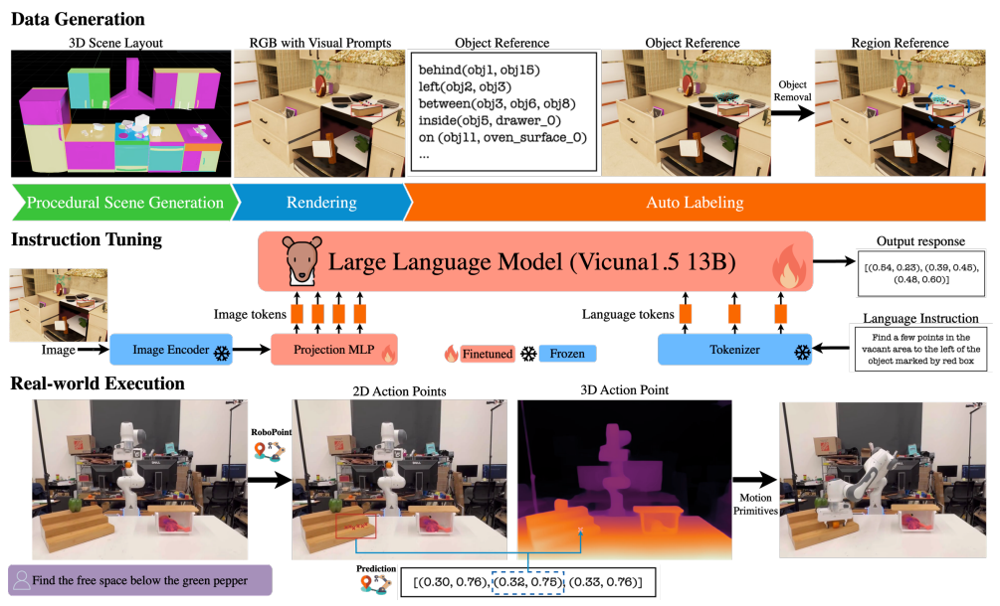
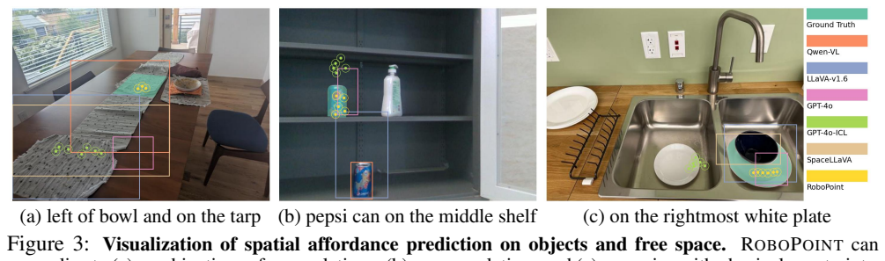
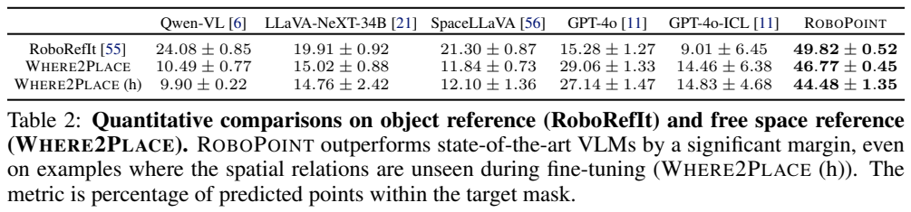
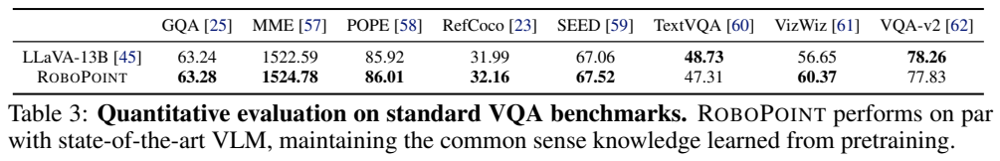
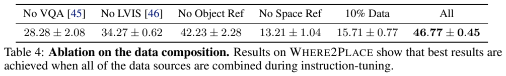
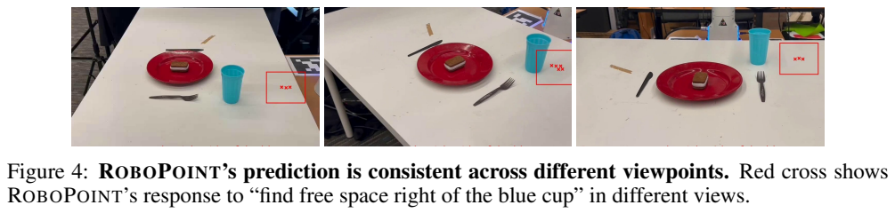
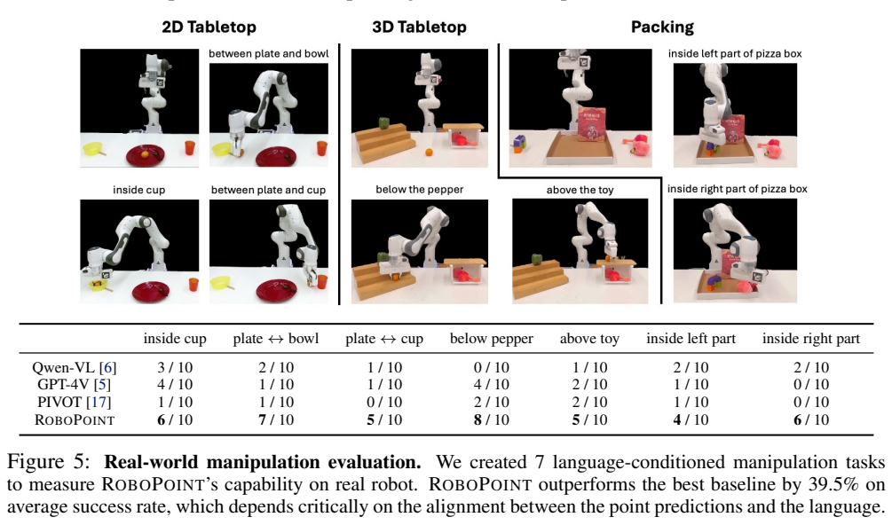
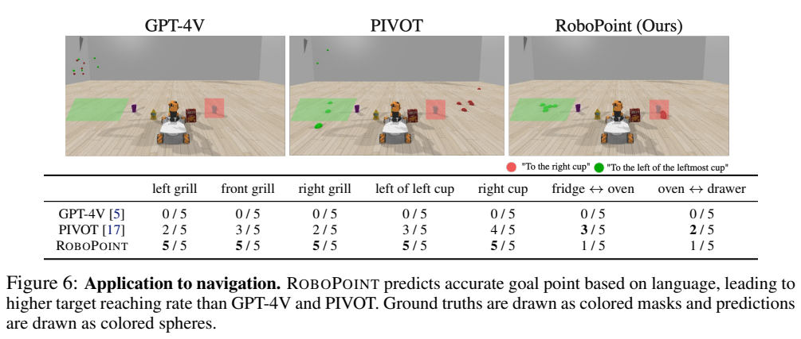
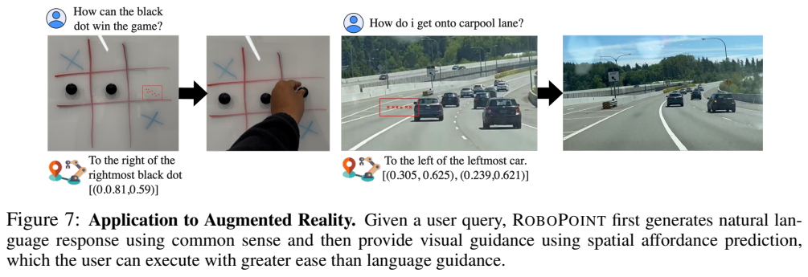

# RoboPoint：以合成空间数据训练视觉语言模型预测行动点

## 1. 论文信息与模型定位

《RoboPoint: A Vision-Language Model for Spatial Affordance Prediction for Robotics》由 Wentao Yuan、Jiafei Duan、Valts Blukis 等作者提出，机构包括华盛顿大学、NVIDIA、艾伦人工智能研究所和 Universidad Católica San Pablo。本文依据 [arXiv 2406.10721v1](https://arxiv.org/pdf/2406.10721v1)（2024 年 6 月 15 日）；项目入口为 [RoboPoint](https://robo-point.github.io/)。

模型根据 RGB 图像和空间指令输出若干二维行动点，既可以指向物体，也可以指向“碗左侧的空位”等没有独立对象的区域。语言骨干是 Vicuna-v1.5-13B，视觉骨干是 CLIP ViT-L/14 336px。机器人执行还需深度图、位姿转换和运动规划，RoboPoint 不是直接生成电机控制序列的端到端策略。

## 2. 快速概览

| 难题 | 论文处理 |
| --- | --- |
| 自然语言行动描述位置不够精确 | 输出图像归一化坐标点 |
| 框包含背景或障碍物 | 在目标物体或空闲区域内采样行动点 |
| 空间指令数据难以人工规模化收集 | 程序生成三维场景、视角与相对关系 |
| 空闲位置缺少明确可见对象 | 移除目标物体，在其支撑交集处生成空位标签 |
| 专项微调可能削弱通用能力 | 合成空间数据与真实图像问答、LVIS 定位共同训练 |

额外机器人相关标签可以由模拟自动产生，但整个模型训练并非完全没有真实图像数据或人工标注来源。合成空间样本之外，VQA 与 LVIS 仍包含真实世界数据；WHERE2PLACE 评测也由人工构造。

## 3. 整体架构

Figure 2 按上、中、下三层阅读。上层生成三维布局，渲染 RGB 并计算空间关系；移除物体后可生成空位参考。中层用图像、文字和坐标答案训练 Vicuna，视觉编码器和 tokenizer 冻结，MLP 与语言模型更新。下层将预测二维点通过深度映射到三维，再交给运动规划器执行。最终任务成功同时依赖感知、深度与控制链路。

视觉编码器产生特征，经两层 MLP 投影到语言嵌入空间。文字请求与视觉嵌入串联，语言模型自回归输出如 `[(0.56,0.69), ...]` 的坐标列表。二维点是任务位置建议：在导航中可作目标点，在抓取中可作接触或区域建议，在放置中可作空位候选。对于不同任务，将点转成完整末端位姿的方法仍由外部执行流程决定。

它不需要在测试时先用外部检测器给图像中的全部对象画框，但训练合成样本常用彩色框标出参考对象，帮助学习关系。真实部署时能够用自然语言对象名称，是由多类训练数据共同支撑，不能把这一能力归为只有红框提示的合成数据效果。[PDF 第 3–4、13 页](https://arxiv.org/pdf/2406.10721v1#page=13)

## 4. 核心创新与数学原理

预测目标是点集合 $\{(x_i,y_i)\}$，每个坐标归一化到 [0,1]。它不直接要求框覆盖完整物体，而要求输出点落在满足语言关系的区域。点表示能降低框内背景和杂物带来的歧义，尤其适用于不存在独立对象边界的空闲位置。

空位标签由三维几何产生：先选择位于某种相对关系下的目标物体，移除该物体后重新渲染，再在原物体与支撑表面的交集内采样点。可以用 $A=\text{target mesh}\cap\text{support surface}$ 概括候选区域的来源；这是对流程的解释，不是原文编号的新数学损失。标签通过相机投影变成图像坐标，因此来源能覆盖不同视点下的空间关系。

二维到三维的关系可用标准反投影 $p_{cam}=d(u,v)K^{-1}[u,v,1]^T$ 理解，其中 K 是相机内参，d 是深度。此式是解释 Figure 2 执行步骤，原文没有完整列出标定、坐标转换和末端位姿策略。操作实验使用三维点加偏移计算末端位姿，再规划轨迹，不能凭一个像素点保证抓取姿态或无碰撞路径正确。[PDF 第 5、7 页](https://arxiv.org/pdf/2406.10721v1#page=7)

学习采用回答 token 预测。坐标列表被当作语言序列，不是报告中新增的连续坐标回归头或显式几何一致性损失。可用负对数似然解释自回归训练，但论文未给新编号损失及额外坐标权重，因此本文不补造。一项实际限制是模型不提供点预测置信度，输出点数也不可控制，不能把列表视为带校准成功概率的规划分布。

## 5. 数据构建与处理

| 训练来源 | Table 1 数量 | 目标 |
| --- | ---: | --- |
| 合成物体参考 | 347K | 满足关系的物体表面点 |
| 合成空位参考 | 320K | 满足关系的无物体区域点 |
| 图像问答 | 665K | 保留语言推理与通用问答 |
| LVIS | 100K | 给定类别的实例框中心及宽高 |

合成数据来自约 10K 场景，正文概括为约 660K 图像—关系对，表中两个空间来源合计 667K，是近似规模口径。对象库有超过 8K 实例和 262 类，场景布局包含厨房家具、可旋转门与可平移抽屉等结构。物体在支撑面随机放置，采用稳定姿态，碰撞姿态被拒绝。[PDF 第 4–5、13 页](https://arxiv.org/pdf/2406.10721v1#page=4)

相机位置随机生成，保留至少三个可见物体且至少一个有效关系的视角；“可见”的判据是分割掩码中点数超过 100。空间关系依据三维框和相机视角计算，涵盖左右、前后、上下、相邻、内部及支撑面不同部分。每图采样约 1–50 个真实点，答案用归一化坐标列表表示。

合成对象往往只有类别名，没有丰富自然语言描述，于是在参考对象周围加入彩色框。输入只展示参考提示，不把真实采样点画入模型输入。LVIS 让模型学习类别到区域的识别，VQA 保留文字回答能力；训练时共用输入输出格式。报告没有给出逐来源采样权重、完整最终 epoch 和语义去重率。

WHERE2PLACE 收集 100 张真实家居及办公图像，一组人写空闲区域指令，另一组人标注目标掩码；其中 30 个较难样本含训练未见关系类型。物体参考评价使用 RoboRefIt 的 750 图像子集。这样的评测减少同一人同时写指令和画区域的偏差，但样本规模有限，仍不能替代各种环境的系统测试。[PDF 第 5 页](https://arxiv.org/pdf/2406.10721v1#page=5)

## 6. 训练流程与目标

模型从 Vicuna-v1.5-13B、预训练 CLIP 图像编码器及已对齐投影器初始化。两层 MLP 先前使用 558K LAION-CC-SBU 子集的 BLIP caption 预训练，这是初始化资源，不能混成新生成的机器人指令数量。

指令微调更新 MLP 和语言 Transformer，冻结图像编码器与 tokenizer。原文目标包含回答 token 以及划分指令与回答边界的特殊 token，所有来源共同训练。附录给出学习率 **4e−5**、**16 张 A100**、**每 GPU batch=16**，训练约 **40 小时**；在没有进一步累积说明时，每设备 batch 与完整有效 batch 口径不能自行混用。

报告未给出精确优化步骤、epoch、优化器和调度的完整设置、精度、序列长度、冻结视觉模块之外的额外层级策略，因此不从 LLaVA 的相似管线自动复制这些参数。没有报告奖励模型、强化学习或真实机器人专家轨迹微调阶段。[PDF 第 3、13 页](https://arxiv.org/pdf/2406.10721v1#page=13)

## 7. 实验设置与主要结果

空间准确率是预测点落入真实目标掩码的比例，报告三次运行的平均与标准差。它不是“每张图成功一次”的二值任务率，也不是框 IoU。比较基线采用图像坐标轴提示，先输出框再在框中均匀取点，因而与直接点训练模型有输出形式和训练差异。

| 基准 | RoboPoint | GPT-4o | LLaVA-NeXT-34B | Qwen-VL |
| --- | ---: | ---: | ---: | ---: |
| RoboRefIt | 49.82±0.52 | 15.28±1.27 | 19.91±0.92 | 24.08±0.85 |
| WHERE2PLACE | 46.77±0.45 | 29.06±1.33 | 15.02±0.88 | 10.49±0.77 |
| WHERE2PLACE 较难子集 | 44.48±1.35 | 27.14±1.47 | 14.76±2.42 | 9.90±0.22 |

增加 14 个合成示例的 GPT-4o ICL 在两项上反而为 9.01 与 14.46，不意味着任意其他提示策略都会无效。通用评测整体接近 LLaVA-13B，但 TextVQA 为 47.31，低于 48.73，VQA-v2 为 77.83，低于 78.26；“没有遗忘”只能理解为多数指标保持接近。

空位数据消融最突出：移除 free-space 来源后 WHERE2PLACE 为 13.21，完整数据为 46.77；去掉 VQA 为 28.28，去掉 LVIS 为 34.27，只有 10% 数据为 15.71。多个来源和规模都重要，但这些消融不自动证明所有真实场景都能组合泛化。

七个操作任务每项十次，成功要求无碰撞执行并把物体放在指令位置。Figure 5 的 RoboPoint 成功次数依次 6、7、5、8、5、4、6，合计 **41/70**；GPT-4V 为 4、1、1、4、2、1、0，合计 **13/70**。按图表直接计算相差 **40 个百分点**。正文与图注写 39.5%，摘要写不同下游提升值，报告未解释差异；本文以可复查逐项次数为准，不把百分比概括强行统一。该组机器人基线是 GPT-4V，与前面的静态空间预测 GPT-4o 不同。

导航在 CoppeliaSim 的三个房间场景和 YouBot 平台进行，不是全部真实移动机器人试验。七项各五次，RoboPoint 前五项均 5/5，最后两项仅 1/5，而 PIVOT 对应为 3/5、2/5。AR 例子展示棋盘和车道提示，是定性演示，不能据此推导正式自动驾驶能力或完整成功率。

附录还展示 GPT-4o 更好的失败案例。模型对输出点数和置信度缺少控制，坐标建议需要外部深度与运动规划，不具备完整行动可行性保证。本文整理并核验了原图原表，没有执行机器人或重新测试模型。
