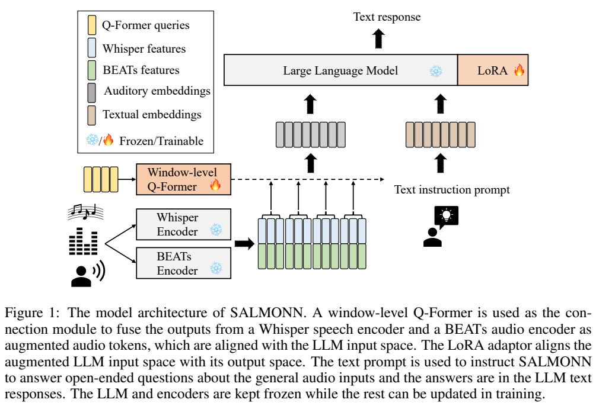
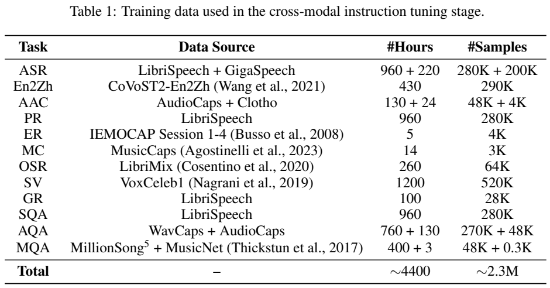
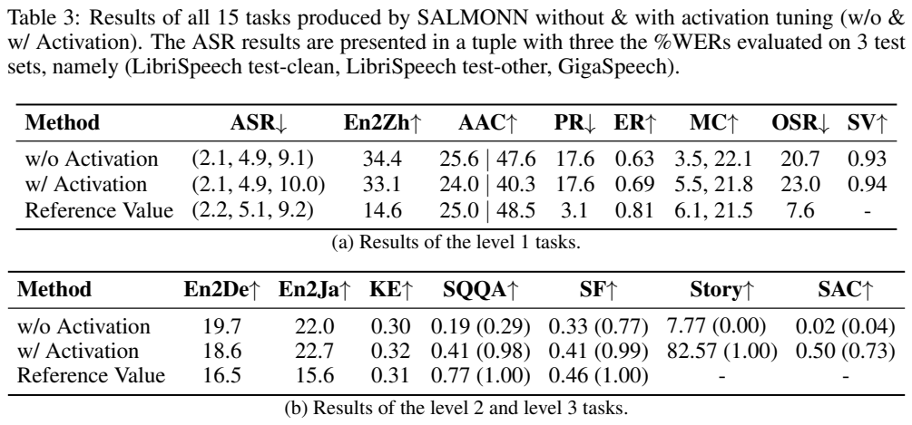
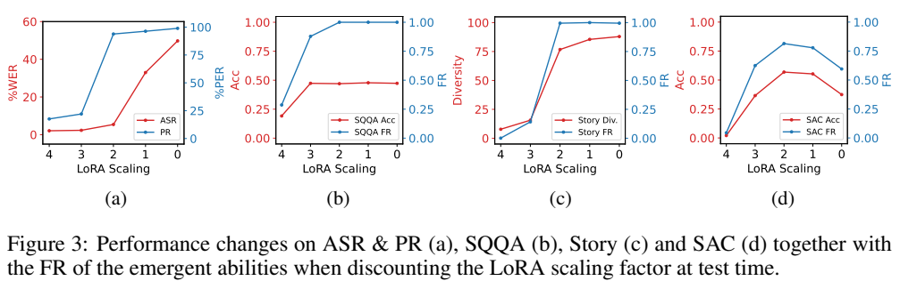
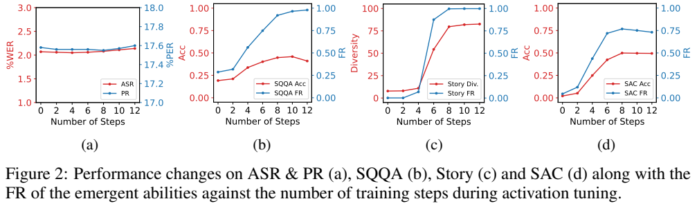
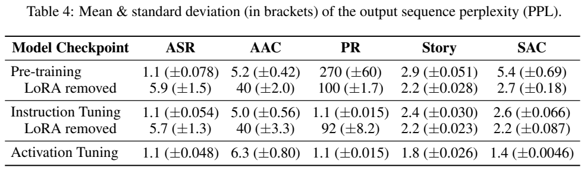
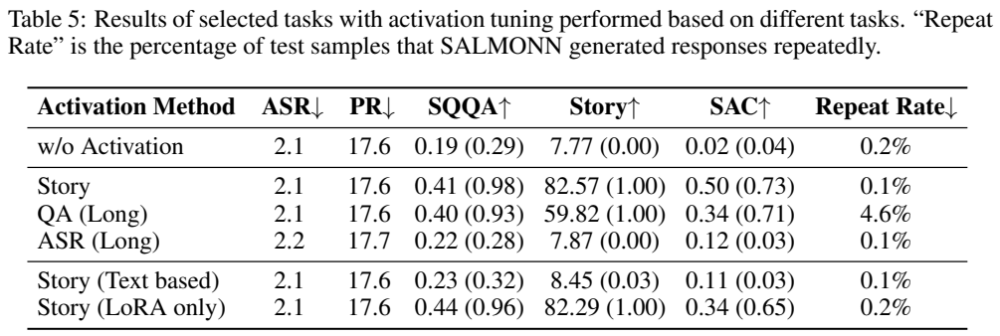

# SALMONN：双音频编码器与少样本激活微调

## 1. 论文信息与模型定位

| 项目 | 内容 |
|---|---|
| 原论文 | **SALMONN: Towards Generic Hearing Abilities for Large Language Models** |
| 作者与机构 | Changli Tang、Wenyi Yu、Guangzhi Sun、Xianzhao Chen、Tian Tan、Wei Li、Lu Lu、Zejun Ma、Chao Zhang；清华大学电子工程系、ByteDance |
| 版本 | 2023-10-20，arXiv:2310.13289v1，21 页 |
| 来源 | [固定版本原文](https://arxiv.org/pdf/2310.13289v1)；[项目仓库](https://github.com/bytedance/SALMONN) |
| 定位 | 语音、声音事件、音乐输入，文字回答；Vicuna-13B-v1.1 语言骨干 |

SALMONN 是 Speech Audio Language Music Open Neural Network。它希望在一个模型中处理转录、翻译、音频问答和混合声音推理，不依赖每个任务单独调用外部工具。本文固定原始 v1，不把后续音视频或语音生成扩展并入：本模型的输出是文字，不能合成语音、音乐或图像。

## 2. 快速概览

系统将 Whisper-Large-v2 的语音编码器与 BEATs 的非语音编码器并行使用，再通过窗口级 Q-Former 压缩为语言模型能接收的音频表示。训练仅更新 Q-Former 与 Vicuna 的 LoRA，约 33M 参数，约占整个系统 0.24%。

作者发现，常规预训练和指令微调后的模型倾向于不论问题是什么都做转录或声音描述，称为 **task over-fitting**。降低 LoRA 缩放系数能恢复部分开放问答和故事生成，但会损害转录。作者因此将低缩放状态生成的少量长故事作为新训练目标，进行“激活微调”。

这里“涌现”主要指恢复未被音频指令训练直接覆盖的任务能力。它不能证明模型凭十二条故事创造了全新知识，也不能把提高指令遵循率等同于答案正确率。

## 3. 整体架构

**读图：**两个冻结编码器读同一音频，特征沿通道拼接；窗口级 Q-Former 是可训练连接器。音频嵌入与文字提示共同送入冻结 Vicuna，LoRA 更新其自注意力 Q、V 投影。火焰和雪花分别表示可训练和冻结部分。

Whisper 编码器提供语音内容及一定背景噪声信息，BEATs 提供声音事件语义。后者采用 fine-tuned BEATs iter3+（AS2M，cpt2）。两者输出均为 50Hz，从而可逐帧同步；这里 50Hz 是特征帧率，不是原始波形采样率。

Q-Former 不把整段音频强行压成固定几个 token，而将特征切成短窗口，在每个窗口用共享查询和注意力提取表示，再按时间顺序串联。实际窗口 L=17 帧、每窗 N=1 查询，约 0.33 秒；报告称 30 秒音频产生 88 个输出 token，精确边界由编码与窗口实现决定。语言端 LoRA rank 8，正常缩放系数 4.0。

## 4. 核心创新与数学原理

原文式 (1) 是双编码器特征拼接：

$$
Z=\operatorname{Concat}(\operatorname{Encoder}_{\rm Whisper}(X),\operatorname{Encoder}_{\rm BEATs}(X)).
$$

$X$ 是音频，$Z$ 含 T 个时间帧。原文式 (2) 将其分成 L 帧窗口，最后一个不足窗口零填充：

$$
H=[\operatorname{QFormer}(Q,Z_l)]_{l=1}^{\lceil T/L\rceil},\qquad |H|=N\lceil T/L\rceil.
$$

这个数量随输入时长变化；窗口顺序保证输出与音频保持单调时间对应。Q-Former 查询内部无因果掩码，但窗口结果仍按先后排列。它能压缩长音频而保留较细粒度的时间结构，不能称为逐词精确声文对齐标注。

作者用原文式 (5) 分析过拟合：

$$
P(Y\mid X,I)=\frac{P(I\mid Y,X)P(Y\mid X)}{P(I\mid X)}.
$$

$I$ 为指令，$Y$ 为回答。大量短且确定的转录/描述监督可能使条件回答分布偏向简单输出，对新指令下的长回答给出低概率。这是解释性分析，并非严格证明所有错误由单一概率项造成。

缩小 LoRA 影响相当于改变冻结语言骨干和音频适配增量的相对贡献；无需删除音频输入。但纯推理时降缩放会破坏已训练任务的适配。激活微调改为用长、多样且音频相关的目标进行 teacher-forcing 交叉熵训练，同时更新 Q-Former 与 LoRA。论文不使用新的奖励模型或 RL 目标。

## 5. 数据构建与处理

预训练语音识别使用 960 小时 LibriSpeech、1,000 小时 GigaSpeech M-set；描述使用约 2,800 小时 WavCaps，并移除超过 180 秒的片段，另有 AudioCaps、Clotho。不同任务的数据不是全都无监督：识别、描述和标签提供明确目标。

**读表：**同一音频源可被用于转录、音素识别、性别和问答，不能逐行把重复小时数相加后宣称独立音频总量。作者汇总约 4,400 小时、2.3M 指令样本。

指令阶段覆盖 ASR、英译中、声音描述、音素/情绪/性别识别、音乐描述、重叠语音、说话人验证及语音/声音/音乐问答。示例包括 430 小时 CoVoST2-En2Zh、IEMOCAP Session 1–4、14 小时 MusicCaps、260 小时 LibriMix、1,200 小时 VoxCeleb1。GPT-3.5 根据转录或描述标签生成问题与答案，因此问答标签可能继承文本和生成器偏差。

激活阶段的十二个故事由降低 LoRA 缩放的 SALMONN 基于音频自行生成，并非十二个人工黄金标签。零样本 SQQA 和关键词提取测试的语音由商业 TTS 生成；SAC 为内部混合声音数据，不能与真实自由对话的全部噪声条件等同。

## 6. 训练流程与目标

第一阶段用 ASR 和音频描述训练 Q-Former 与 LoRA，使冻结音频编码表示和 Vicuna 输入空间对齐。第二阶段使用 Table 1 的任务指令继续训练，增强音频任务响应。

第三阶段将低缩放状态生成的十二条故事作 teacher-forcing 目标，训练十二步，每步一条。编码器与语言模型基础权重保持冻结。十二步指的是激活阶段，不能说整个模型只训练十二步；报告也未给出足以复现前两阶段的全部学习率、批大小、步数与训练成本。

对照实验比较长 ASR、纯文本故事、长问答，以及只更新 LoRA 的音频故事。这一设计试图区分“仅仅变长”与“在音频条件下学习丰富响应”。主要证据来自这套模型和有限数据规模，尚不能把激活方法推广为所有模态过拟合的通用解法。

## 7. 实验设置与主要结果

**读表：**Table 3(a) 是训练覆盖任务；(b) 是未覆盖或开放任务。括号为 following rate（FR），前面的数是准确率或多样性，不能把括号数当正确率。ASR 三元组依次为 LibriSpeech clean、other、GigaSpeech。

| 指标 | 激活前 | 激活后 | 解释 |
|---|---:|---:|---|
| ASR WER%，三套测试 | 2.1/4.9/9.1 | 2.1/4.9/10.0 | 前两套稳定，GigaSpeech 退化 |
| 英译中 BLEU4 | 34.4 | 33.1 | 有回退，仍高于指定流水线参考 14.6 |
| AudioCaps METEOR / SPIDEr | 25.6/47.6 | 24.0/40.3 | 并非激活后所有任务保持 |
| SQQA 准确率 / FR | 0.19/0.29 | 0.41/0.98 | 更愿意答题，但正确率仍低于流水线参考 0.77 |
| 槽填充准确率 / FR | 0.33/0.77 | 0.41/0.99 | 与是否遵循指令分开 |
| 故事多样性 / FR | 7.77/0.00 | 82.57/1.00 | 多样性为不同词数，非质量分 |
| SAC 准确率 / FR | 0.02/0.04 | 0.50/0.73 | 内部测试、GPT-3.5 评判 |

训练只包含英译中，但英译德/日 BLEU4 激活后为 18.6/22.7，体现跨模态迁移；对应流水线为 16.5/15.6。音素识别 PER 17.6、重叠语音 WER 23.0 明显弱于专门参考的 3.1/7.6，所以不宜描述为“通用听觉已全面胜过专门模型”。

Figure 3 中缩放从 4 降至约 2，可提高开放任务 FR，同时使转录和音素错误率增大。正文将相关变化写成“PER drops”，与实际曲线方向冲突；本文依据原图记录为错误率恶化。

长故事激活的 SAC 准确率为 0.50，长 QA 为 0.34、纯文本故事为 0.11、长 ASR 为 0.12。长 QA 还使重复回答比例达到 4.6%，故事方案为 0.1%。只更新 LoRA 可获得 SQQA 0.44，但 SAC 0.34 低于同时更新连接器与 LoRA 的 0.50，说明不同任务对适配范围敏感。

FR 的定义带有启发式：SQQA/槽填充输出与语音问题的 WER<30% 被判为只做转录；故事最多 200 输出 token，少于 50 个词判为未遵循；SAC 由 GPT-3.5 分别判尝试答题与正确性。更丰富的文字仍可能包含虚构，不能用故事长度或低困惑度代替事实可靠性。本文未运行模型或独立复现实验。
