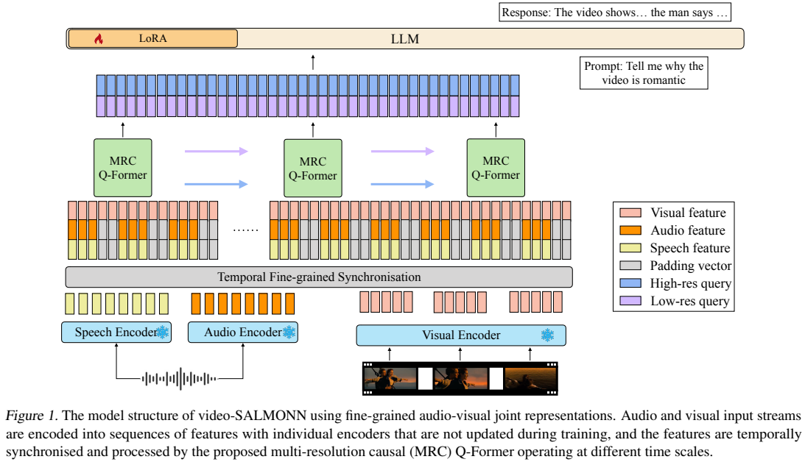
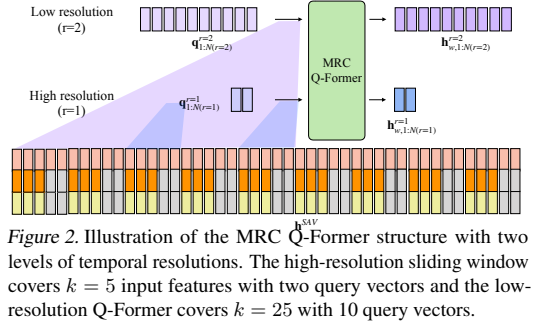
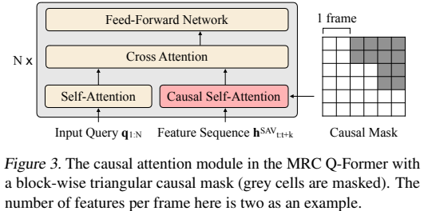
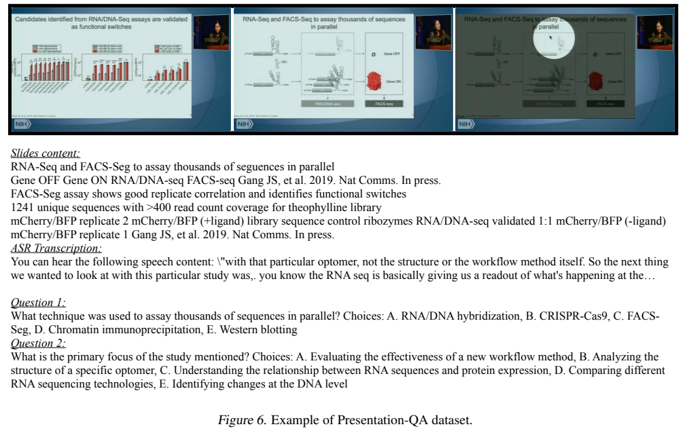
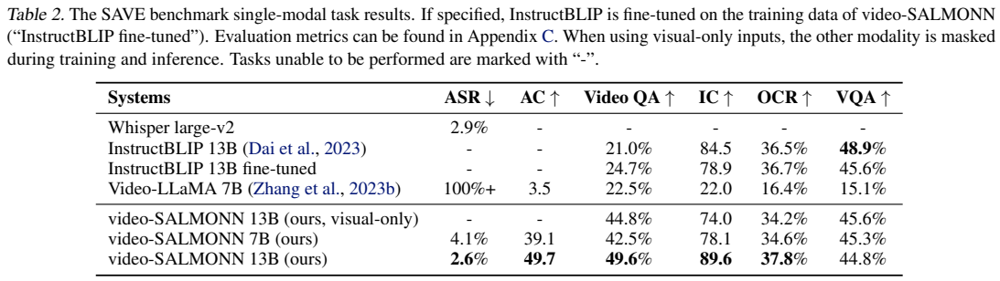
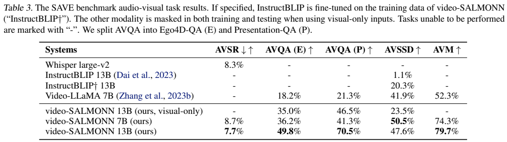
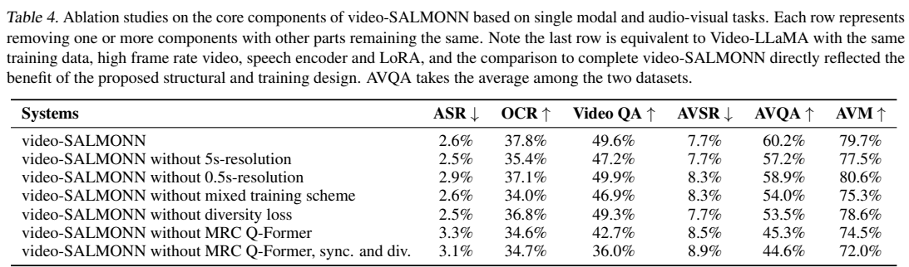

<!-- article-header:start -->
[项目首页](../../../README.md) › [模型系列](../../../reports/model-family-index.md) › [SALMONN](../README.md)
<!-- article-header:end -->

# video-SALMONN：用多时间分辨率连接视觉、语音和声音

<!-- article-toc:start -->

**本篇目录** · [论文定位](#paper-info) · [快速概览](#overview) · [整体架构](#architecture) · [核心原理](#principles) · [数据构建](#data) · [训练流程](#training) · [实验结果](#experiments)
<!-- article-toc:end -->

## 1. 论文信息与模型定位

| 项目 | 内容 |
|---|---|
| 论文 | *video-SALMONN: Speech-Enhanced Audio-Visual Large Language Models* |
| 作者 | Guangzhi Sun、Wenyi Yu、Changli Tang 等；通讯作者 Chao Zhang |
| 机构 | 清华大学电子工程系、字节跳动 |
| 发表与版本 | ICML 2024；本文依据 [arXiv 2406.15704v1，2024-06-22](https://arxiv.org/abs/2406.15704v1)，共 20 页 |
| 系列定位 | SALMONN 的视频扩展，核心 LLM 为 Vicuna-v1.5，含 7B/13B，默认实验为 13B |
| 官方资源 | [代码与权重](https://github.com/bytedance/SALMONN/) |

模型把画面、语音内容、非语音声响和音乐一起用于理解短视频，输出文本回答。它没有在本报告中训练语音或视频生成能力。重要问题是时间尺度：语音需要较密的时序信息，视频语义又需要较大范围的事件聚合，直接粗池化会牺牲语音与跨模态线索。

## 2. 快速概览

| 设计 | 作用 |
|---|---|
| 三路冻结前端 | InstructBLIP 看画面，Whisper 编码语音，BEATs 编码音频事件 |
| 时间同步 | 按视频帧对齐高频音频与低频视觉特征，缺失模态补零 |
| MRC Q-Former | 不同时间窗口提取信息，融合成同长度的 LLM 输入 |
| 因果自注意力 | 当前帧特征可读取前帧，限制读取后帧 |
| 多样性损失与非配对混合 | 减少只关注少数帧或一个模态的倾向 |

收益主要体现在视频因果问答和含语音的视听问答。图像 VQA 没有全面超过视觉专用对照，7B 版本也不一定比 Whisper 更好，因此应按具体任务和模型规模阅读结果。

## 3. 整体架构

*原论文 Figure 1，PDF 第 3 页。冻结前端输出联合特征，Q-Former 与 LoRA 负责适配。*

视觉前端是 InstructBLIP 的 ViT 与 Q-Former，每 0.5 秒抽一帧，每帧 32 个特征向量。Whisper large-v2 与 BEATs 对同一音轨分别提取语音和声音信息，输出以 50Hz 时间粒度组织。时间同步模块通过补齐将视觉与音频序列对齐，并沿特征维拼接。单独图像可以作为单帧；图像配音时会复制图像以匹配音频时长。

MRC Q-Former 有两层 Transformer、隐藏维度 768。默认使用 0.5 秒与 5 秒两级窗口，分别输出 3 与 30 个查询向量；不同分辨率共享主体参数，查询向量各自独立。经投影映射到默认 13B LLM 的 5120 维输入，与用户提示共同生成回答。正文前面的“三种尺度”是一般结构描述，实际默认实验采用两级。

*原论文 Figure 2，PDF 第 4 页。图中 5/25 个输入特征、2/10 个查询是结构示意，不能替代默认实验配置。*

*原论文 Figure 3，PDF 第 4 页。灰色部分禁止访问；同帧块内部保留交互，前后帧采用因果结构。*

因果限制作用在额外的帧特征注意力模块，不代表整套系统已经实现在线无未来信息的流式交互。固定窗口跨注意力和 LLM 可以读取已提供的完整片段，报告主要评估离线短视频理解。

## 4. 核心创新与数学原理

第 r 级有窗口长度 $k_r$、查询数 $N_r$，输入长度 T 时：

$$
W_r=\left\lceil\frac{T}{k_r}\right\rceil,\qquad W_rN_r=C.
$$

作者约束各级总输出长度为 C，便于融合。将查询矩阵按“token×维度”排列，可写为：

$$
H=\sum_r H^{(r)}P_r,\qquad H^{(r)}\in\mathbb R^{C\times768},\quad P_r\in\mathbb R^{768\times E}.
$$

这是按维度一致性整理的行向量写法；原文 Eq.(4) 将投影写在左侧，同时把其形状记为 D×E，符号方向并不完全一致。多级结果是投影后相加，不是把 token 数量按分辨率倍增。固定 C 需要对齐和边界处理，报告对任意长度的补齐细节未给出完整规则。

低分辨率窗口的多个查询可能重复读同一关键帧。作者最小化同窗口不同查询的余弦相似度：

$$
\mathcal L_{\mathrm{diverse}}=\sum_{r=2}^{R}\sum_{w=1}^{W_r}\sum_{i=1}^{N_r}\sum_{j\ne i}^{N_r}\frac{h^{(r)}_{w,i}\cdot h^{(r)}_{w,j}}{\|h^{(r)}_{w,i}\|\|h^{(r)}_{w,j}\|},\qquad
\mathcal L=\mathcal L_{\mathrm{CE}}+\lambda\mathcal L_{\mathrm{diverse}}.
$$

它鼓励查询差异，却不保证每个查询对应独立事件或严格正交。求和包含 i→j 和 j→i，不能擅自改成均值还沿用同一个 λ。实验显示过大 λ 会损害生成和提高语音插入错误，多样性并非越大越好。

另一个关键设计是将本不配对的音频和视觉样本混合，并组合原任务提示，使模型必须分别读取两路。它增加多模态信息利用，不能据此假定训练音画天然描述同一真实事件。后续的音画匹配任务才直接检验是否能够识别不一致。

## 5. 数据构建与处理

总训练集合约 1M 样本，其中视频少于 300K。音频部分含 LibriSpeech 的 100h+360h、AudioCaps；视觉部分含 LLaVA-150K、OCRVQA、TextCaps、NExT-QA、COCO 配音图像和 VideoChat。报告还使用随机抽取的约 600h Ego4D 描述、How2 300h 及 AVSD。TextCaps 抽取约 80K，COCO 配音样本约 5K，VideoChat 约 11K；附录另列 MSVD-QA，但主文清单未逐项提到，整体配比不能仅凭列表恢复。

*原论文 Figure 6，PDF 第 13 页。结合幻灯片文字和语音转录生成选择题。*

SAVE 包含六种单模态、四种视听任务。Ego4D-QA 与 Presentation-QA 各约 1000 个视频样本，用视频描述/幻灯片内容和 ASR 转录提示 GPT-4 或 ChatGPT 生成问题。实际模型输入包含音视频，不是只读这些文本；合成参考题仍可能受转录错误或文本代理信息影响。报告没有完整披露人工审题和污染检查。

NExT-QA 有训练数据，但测试视频和推理时的选择题指令形式未见，被论文定义为 zero-shot；这不是“从未训练过该数据集或任务”。部分大型评测只抽取 1000 或 850 样本，不能将其结果当作全量测试集成绩。

## 6. 训练流程与目标

采用多任务指令微调，更新 MRC Q-Former、投影和 LLM LoRA，冻结三路感知前端及 LLM 主体权重。LoRA rank=32，覆盖注意力 Q/K/V 和前馈层，约占 LLM 参数的 0.4%。目标是答案交叉熵加低分辨率多样性损失，同时混合单模态、配对视听及非配对输入。

本文没有另编“预训练—SFT—RL”三阶段流程；原报告未充分披露 optimizer、learning rate、batch、完整混合概率、GPU-hours 或默认 λ。窗口尺度和多样性系数分析只用随机抽取的 10% 数据，不能作为全量配置对应的最终成绩。

视觉基线 InstructBLIP 额外在相同图像与视频数据上微调，每视频 5 个均匀帧、160 个查询；video-SALMONN 是 2Hz 采样。正文说它与 25 秒视频的输出 token 数相同，但按默认 0.5 秒窗口×3 查询简单推算是 150，边界口径未交代，不能断言所有样本严格等 token 比较。结构消融加入相同训练数据和帧率，更适合判断模块收益。

## 7. 实验设置与主要结果

*原论文 Table 2，PDF 第 6 页。WER 越低越好，其他列包含 accuracy、SPIDEr 或 CIDEr，尺度不同。*

| 指标 | video-SALMONN-13B | 对照 |
|---|---:|---|
| LibriSpeech WER | 2.6% | Whisper 2.9% |
| NExT-QA accuracy | 49.6% | 微调 InstructBLIP 24.7% |
| 图像 caption CIDEr | 89.6 | InstructBLIP 84.5 |
| TextVQA | 37.8% | InstructBLIP 36.5% |
| GQA | 44.8% | InstructBLIP 48.9% |

NExT-QA 对微调基线实际增加 24.9 个百分点，对未微调基线增加 28.6 点；原文笼统的“超过 25%”需要区分对照。7B 的语音 WER=4.1%，反而弱于 Whisper。视觉专用 13B 版本的视频 QA 为 44.8%，表明联合训练收益与结构因素共同存在。

*原论文 Table 3，PDF 第 7 页。AVQA 分成 Ego4D 与 Presentation 两个子集。*

13B 的 AVSR WER=7.7%，对 Whisper 8.3% 约相对降低 7.2%。Ego4D-QA 为 49.8% 对 Video-LLaMA 18.2%，增加 31.6 个百分点；Presentation-QA 为 70.5% 对 21.3%，增加 49.2 点。AVM 达 79.7%，但 AVSSD 47.6% 低于本模型 7B 的 50.5%，参数增大并非所有任务都提高。

*原论文 Table 4，PDF 第 7 页。AVQA 是两子集的平均。*

去混合训练使 AVQA 从 60.2% 降至 54.0%，去多样性损失降至 53.5%；去 MRC Q-Former 降至 45.3%。但仅去高分辨率分支时，VideoQA 49.9%、AVM 80.6% 又略高于完整系统，支持的是综合平衡而非所有任务严格最优。对一个已训练模型把分支输出置零的 Table 5，与重新训练去分支的 Table 4 是不同实验。

附录的 image spotlight 把大图切成子图序列，OCR 从 37.8% 到 56.1%，同时视频 QA 从 49.6% 降到 49.1%。它是另一个训练变体，不能并入基础配置成绩。LRS2 音画输入 WER=4.9% 对 Whisper 5.3%；这体现音画帮助，不是单独无音频唇读成绩。

VQA 主要按参考答案是否出现在生成文本中判分，VideoQA 推理提供选项并要求匹配答案；AVSSD 用 GPT-3.5-turbo 判断语义等价。不同任务协议和评估器影响成绩。报告没有给出统一运行成本、完整统计置信区间或与更大规模最新系统的公平复测；案例中的故事生成也不等于视觉事实忠实性已经得到证明。

<!-- article-footer:start -->
---

[← 上一篇：VideoLLM-online](../../videollm-online/arxiv-2406.11816/README.md) · [按发表时间浏览](../../../reports/paper-reading-guide.md#year-2024) · [下一篇：Cambrian-1 →](../../cambrian-1/arxiv-2406.16860/README.md)

[返回本篇目录](#article-toc) · [返回模型系列](../README.md)
<!-- article-footer:end -->
