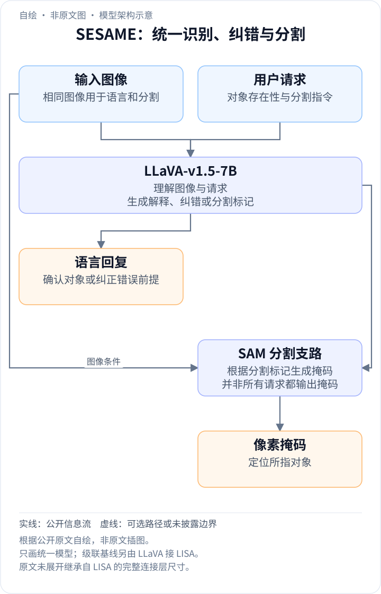
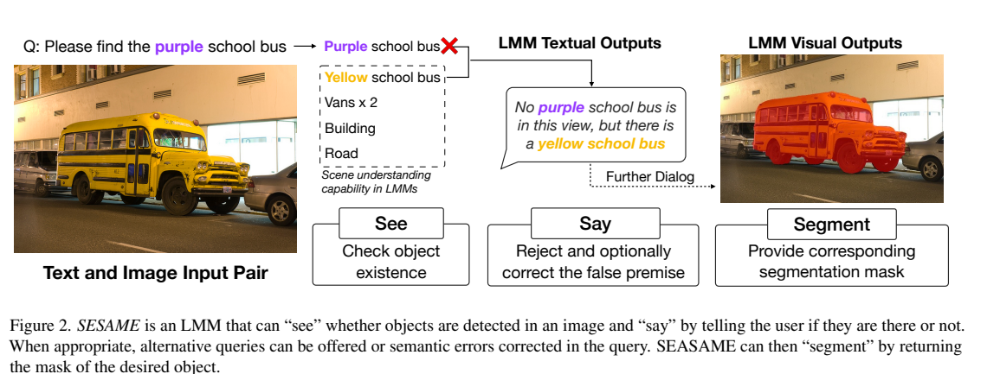
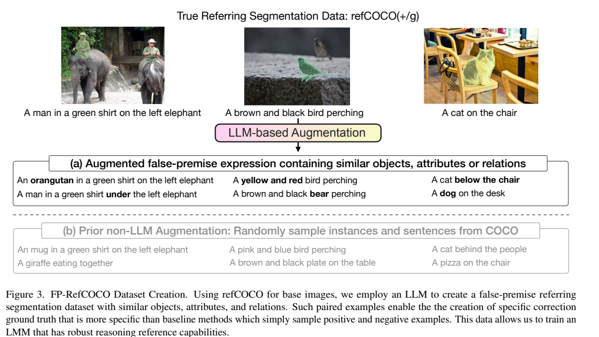
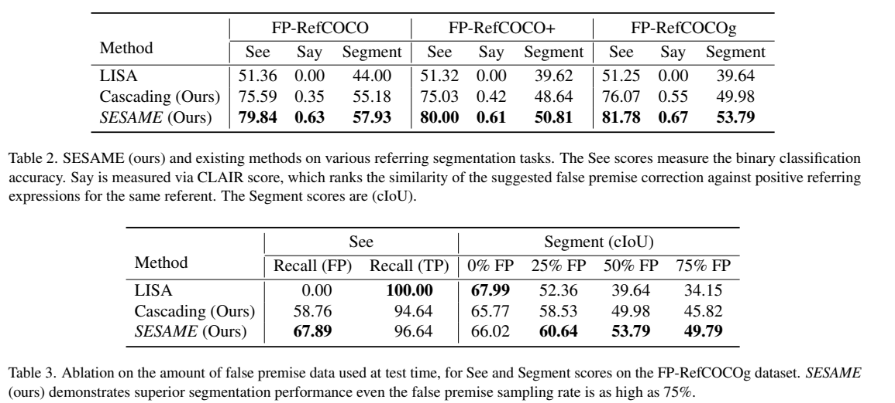
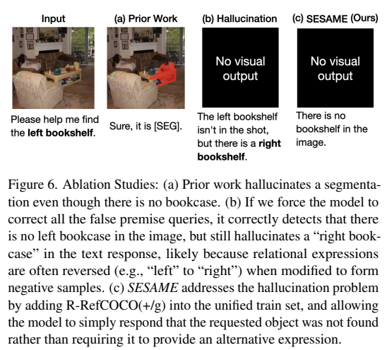
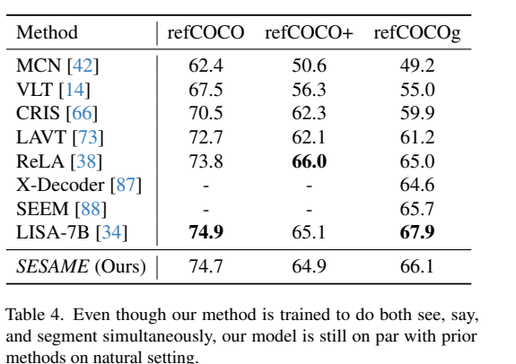

<!-- article-header:start -->
[项目首页](../../../README.md) › [模型系列](../../../reports/model-family-index.md) › [See, Say, and Segment: Teaching LMMs to Overcome False Premises](../README.md)
<!-- article-header:end -->

# SESAME：看见、解释与分割，纠正用户的错误视觉前提

<!-- article-toc:start -->
<a id="article-toc"></a>

**本篇目录** · [论文定位](#paper-info) · [快速概览](#overview) · [整体架构](#architecture) · [核心原理](#principles) · [数据构建](#data) · [训练流程](#training) · [实验结果](#experiments)
<!-- article-toc:end -->

<a id="paper-info"></a>

## 1. 论文信息与模型定位

| 项目 | 内容 |
|---|---|
| 论文 | See, Say, and Segment: Teaching LMMs to Overcome False Premises |
| 作者 | Tsung-Han Wu、Giscard Biamby 等；University of California, Berkeley |
| 本文依据 | [arXiv v1，2023-12-13](https://arxiv.org/pdf/2312.08366v1)，18 页 |
| 官方项目 | [See-Say-Segment](https://see-say-segment.github.io/) |
| 模型与定位 | SESAME；以 LLaVA-v1.5-7B 和 SAM 实现错误前提感知的语言指代分割 |
| 输入与输出 | 图像加自然语言请求；输出确认、拒绝或纠正说明，以及需要时的像素掩码 |

“请分割紫色校车”隐含图中存在紫色校车。如果图里只有黄色校车，直接生成掩码就会把错误前提变成错误结果。论文指出，专门学习分割的 LISA 可能丢失原有的物体存在性判断与自然对话能力；SESAME 通过带负例与纠正答案的联合训练改善这一问题。它研究的是交互式理解与分割，并非通用图像生成模型。（§1、4）

<a id="overview"></a>

## 2. 快速概览

| 能力 | 对应问题 | 评测方式 |
|---|---|---|
| See | 请求的物体或关系是否存在？ | 存在性二分类准确率及正负例召回 |
| Say | 错在哪里，可否给出合理替代？ | GPT-4 驱动的修改版 CLAIR 相似度评分 |
| Segment | 在请求有效、需要掩码时定位对象 | 累计交并比 cIoU |

两条实现路线分别是“先让 LLaVA 判断，再调用 LISA 分割”和“把 LLaVA、SAM 放入统一训练框架”。后者在 FP-RefCOCOg 上 See 为 81.78、Say 为 0.67、Segment 为 53.79。但负例召回仅 67.89%，说明仍会接受一部分错误前提，不能视为已经消除幻觉。（Tables 2–3）

<a id="architecture"></a>

## 3. 整体架构

<!-- derived-architecture:start -->


*自绘模型架构示意（非原文图）。依据下述公开资料归纳；方框表示功能组件，不代表逐层实现。*

依据：[§4–5；PDF 第5–6页、Figure4](https://arxiv.org/pdf/2312.08366v1)。
<!-- derived-architecture:end -->



*来源：v1 Figure 2，PDF 第 2 页。此图展示能力流程，不是三个完全独立的新神经网络模块。*

**级联方案**使用现成 LLaVA-v1.5-7B 作为前级，按包含存在性判断和可选替代建议的提示生成回答；确认存在后，把指代请求交给 LISA-7B。附录 C 说明，前级以特定否定句开头的回答被解析为不存在。由于依赖文本解析和两次模型处理，不能把它等同于一个专门训练的二分类头。（第 5、14、17 页）

**SESAME 方案**沿用 LLaVA-v1.5 的视觉语言理解骨干，以 SAM 为分割骨干，训练模型何时给出文字反馈、何时生成分割输出。原文使用 `[SEG]` 表示分割触发的输出；具体接口沿用 LISA 路线，本文不把它扩写为论文未详细列出的新连接器设计。数据让同一系统同时学习拒绝、纠正和正例分割，避免所有请求都被机械地答成“已经分割”。（§4）

统一模型的一次交互先由 LLaVA-v1.5-7B 联合读取图像与请求，回答对象是否存在，并在错误前提下给出解释或可用替代；只有需要分割的回复才进一步输出对应掩码。原文 Figure 4 同时展示带 `[SEG]` 的回复与只列举物品、没有视觉输出的回复，说明分割支路是按任务调用的出口。SAM 提供分割骨干，模型并未另加一个专门判真假的二分类头；第4节也未展开继承自 LISA 的全部连接层宽度，不能据其名称补成确定的网络参数表。（§4–5，PDF 第5–6页）

| 模块 | 输入与输出 | 公开机制 |
|---|---|---|
| 级联前级LLaVA-v1.5-7B | 图像、请求 → 存在性及文字建议 | 现成模型提示链处理；按否定句解析结果，不是新增二分类头 |
| 级联后级LISA-7B | 确认存在的指代请求 → 掩码 | 仅确认对象后调用分割专用模型，两次模型处理带来接口依赖 |
| SESAME视觉语言主干 | 图像、请求 → 拒绝/纠正/回答/[SEG] | 以LLaVA-v1.5联合训练见、说、分割；用文字输出控制出口 |
| SAM分割骨干 | 分割输出接口 → 掩码 | 继承LISA式连接；原文未完整列新连接器宽度，不补内部细节 |
| 联合训练数据与目标 | 正例/相关负例/随机负例/VQA → 联合更新 | 文字CE加掩码BCE/Dice，分别学习纠正、停止与有效分割 |


<a id="principles"></a>

## 4. 核心创新与数学原理

### 4.1 分割请求首先需要检验前提

传统指代分割常默认目标存在，训练也鼓励收到请求后立即输出掩码。本文让有效请求、可纠正错误和无合理替代的错误分别产生不同回复，使“没有分割输出”也成为正确行为。判断以语言响应实现，统一模型没有为真假请求单独增加分类分支。[原文 §4、Figure 4，PDF 第 5–6 页](https://arxiv.org/pdf/2312.08366v1#page=6)

**把“对象不存在”纳入任务定义。** 设图像为 $`I`$、请求为 $`q`$、存在性为 $`e`$。系统需先判断 $`e`$，再生成语言回复 $`r`$ 与可选掩码 $`m`$。可用 $`p(e,r,m\mid I,q)`$ 表达这种条件输出关系；这是本文的解释符号，不是原文新增的概率建模公式。有效请求可以生成掩码，错误请求可以拒绝，也可以提出经图像证据支持的替代请求。

### 4.2 保留语言判断并学习像素出口

LISA式分割适配可能削弱原有解释和纠正能力，SESAME因此把VQA与分割数据共同训练。文字损失约束回答内容与是否触发，掩码损失约束被触发时的像素结果；掩码重叠正确不意味着拒绝也正确，评测分别报告See、Say与Segment才有意义。[原文 §4–5、Table 2，PDF 第 5–6 页](https://arxiv.org/pdf/2312.08366v1#page=5)

**联合目标兼顾文字与像素。** 原文报告使用句子交叉熵、掩码二元交叉熵与 Dice 损失。其组合可概括为：

```math
\mathcal L=\lambda_t\mathcal L_{\mathrm{CE,text}}+
\lambda_b\mathcal L_{\mathrm{BCE,mask}}+
\lambda_d\mathcal L_{\mathrm{Dice,mask}}.
```

例如 Dice 衡量预测概率与真值掩码的重叠，常见解释形式为 $`1-(2\sum_i p_i g_i+\epsilon)/(\sum_i p_i+\sum_i g_i+\epsilon)`$。本文用该式说明作用；原文没有给出损失系数、平滑常数和具体归一化实现，不能将示意式当作精确复现配方。（§5）

### 4.3 相关负例与随机负例提供不同停止信号

FP数据里的错误描述仍与原目标相关，适合学习给出可用修正；随机不存在的COCO对象则教模型没有依据时直接拒绝。两种负例混合避免形成“每个错误都要换个属性”的捷径，VQA再补充无需分割的交互。原文7:2:1数据混合与FP内9:1正负比例是具体训练配置，不等于一般场景最优比例。[原文 §4、§5.2，PDF 第 5–7 页](https://arxiv.org/pdf/2312.08366v1#page=5)

**纠正与拒绝都必须学。** 如果每个负例都强制给出替代，模型可能只把“左”改成“右”，即便左右都没有该物体。混入只需拒绝的随机负例，让模型知道没有合理替代时可以停止。Figure 6 直观展示这种语义纠正仍然幻觉的失败方式。（§5.2）

<a id="data"></a>

## 5. 数据构建与处理



*来源：v1 Figure 3，PDF 第 3 页。原正例可作为对应负例的纠正参考，而非只提供二分类标签。*

FP-RefCOCO、FP-RefCOCO+、FP-RefCOCOg 在原有指代数据上追加语境相关的负例。生成提示要求修改对象、属性或关系，并避免改写后又指向图中其他真实对象；清理保证输出可解析。正文说使用 GPT-3.5-turbo，附录 Table 7 图注却写 GPT4，存在版本表述不一致，本文不强行选定未核实的生成器。（第 4、18 页）

三个训练划分分别有 234,445、234,892、157,866 条句子；它们来自 16,992、16,994、21,899 张图像。全数据正负例大致 1:1，沿用 RefCOCO/RefCOCO+ 的 UNC 和 RefCOCOg 的 UMD 划分。句子数量不是独立图像数量，各数据集图像也有重叠，不能简单相加成独立图片规模。（Table 1）

联合训练同时使用 FP 数据、LLaVA VQA 指令数据和 R-RefCOCO 随机负例。作者在合并三套不同划分时排除与验证、测试重叠的训练图像。附录推理分割扩展另外加入 ADE20K、COCO-stuff、LVIS-PACO，以及 LLaVA 生成的错误前提推理问答；这属于扩展实验的训练配置。（第 6、13–14 页）

<a id="training"></a>

## 6. 训练流程与目标

| 项目 | 主实验原文设置 |
|---|---|
| 初始化 | LLaVA-v1.5-7B 及 SAM 分割解码器 |
| 数据采样 | FP-RefCOCO(+/g)、LLaVA VQA、R-RefCOCO(+/g) 为 7:2:1 |
| FP 数据内部采样 | 真前提与假前提为 9:1；与数据集本身接近 1:1 的组成不同 |
| 优化 | LoRA 微调 10 epochs；AdamW，学习率 $`3\times10^{-4}`$ |
| 批处理 | batch 10，梯度累积 5 |
| 资源 | 原文报告约 24 小时，并写 single DGX A100 80GB GPU |

DGX 是系统名称，原句无法清晰确定设备数量，本文保留该资源表述，不推导成单卡可复现耗时。论文未披露完整 LoRA rank、所有模块的冻结清单和损失权重；训练轮数与学习率不能弥补这些信息缺口。（§5）

VQA 数据的作用是保留一般文字交互能力；FP 数据提供纠正监督；R 数据避免系统把“任何错误前提都能修正”当成规则。附录扩展实验改用语义分割、主联合集、推理分割数据 10:3:1，且正例采样率仍为负例的 9 倍，应与主实验分开理解。（附录 A）

<a id="experiments"></a>

## 7. 实验设置与主要结果



*来源：v1 Tables 2–3，PDF 第 5 页。CLAIR 在 0–1 范围内比较纠正表达与同一对象的真实表达；不是人工满意度比例。*

| FP 测试集 | LISA See / cIoU | 级联 See / cIoU | SESAME See / cIoU | SESAME CLAIR |
|---|---|---|---|---|
| RefCOCO | 51.36 / 44.00 | 75.59 / 55.18 | 79.84 / 57.93 | 0.63 |
| RefCOCO+ | 51.32 / 39.62 | 75.03 / 48.64 | 80.00 / 50.81 | 0.61 |
| RefCOCOg | 51.25 / 39.64 | 76.07 / 49.98 | 81.78 / 53.79 | 0.67 |

FP-RefCOCO 的 See 51.36→79.84 是增加 28.48 个百分点，约 55.45% 的相对提升；cIoU 44.00→57.93 是约 31.66% 的相对提升。论文摘要的“55%”“31%”属于相对变化，不能写成增加相同百分点。摘要关于“67% 有帮助”的表达，在实际方法中对应 CLAIR 0.67，本文按实际指标解释。（Tables 2、§5.1）

FP-RefCOCOg 增加负例比例到 75% 时，SESAME cIoU 为 49.79，LISA 为 34.15。但纯正例时 SESAME 66.02 低于 LISA 67.99；负例召回 67.89、正例召回 96.64，也显示部分错误请求仍被接受。





*来源：v1 Figure 6、Table 4，PDF 第 8 页。案例说明可以拒绝而不必总提供替代；表格说明正例分割仍有轻微下降。*

Table 4 的传统 RefCOCO/+/g 成绩为 74.7/64.9/66.1，低于 LISA 的 74.9/65.1/67.9。附录额外训练的推理分割版本在 Table 5 达到负例召回 86.5、正例召回 90.0、cIoU 51.43；这不能直接代替主模型数字。条件查询、多轮互动潜力主要通过案例说明，论文仍展示纠正答案本身错误的例子。（第 8、13–15 页）

**来源说明：** 文字、数值与图表固定依据 v1，未进行模型训练复现；原图裁切与来源哈希见 [图片清单](figures-manifest.json)。

<!-- article-footer:start -->
---

[← 上一篇：Vary](../../vary/arxiv-2312.06109/README.md) · [按发表时间浏览](../../../reports/paper-reading-guide.md#year-2023) · [下一篇：VILA →](../../vila/arxiv-2312.07533/README.md)

[返回本篇目录](#article-toc) · [返回模型系列](../README.md)
<!-- article-footer:end -->
